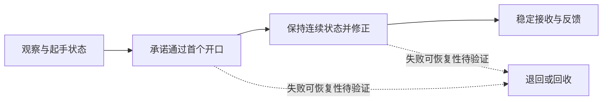

# 从用户参考图到本作的生成规则

本轮用户补充了一张《空洞骑士》风格机关挑战截图，并询问如何设计、如何映射本作，以及离线模块库和运行时生成的取舍。这里只借鉴空间与行为关系，不复制素材，不把静图猜测写成原作事实。

## 图中能看见什么

左侧角色邻近竖直墙面；下方和多个实体轮廓覆有危险刺面；中部实体形成不同高度的狭窄开口；圆形锯轮分布在通道附近；右侧有一处平整水平落脚面。实体、空腔和危险轮廓共同限定通路，视觉风格统一，危险附着在可辨认的宿主上。

单帧不能证明：锯轮是否移动、运动轨道/周期/相位、墙面是否安全可停、玩家前一动作/速度/资源、是否允许下劈弹跳、实际推荐路线、隐藏通路、失败回退点与无伤解。画面也不能证明作者先画美术还是先搭白盒。以下是可迁移的设计推导，不是对原作者流程的史实断言。

## 应借鉴的设计过程

1. **先选体验问题。** 例如“在可观察的起点读出窗口，承诺穿越后连续修正，最后抵达明确接收岸”。先说明判断和反馈，再选择形状。
2. **写状态图。** 起手可用动作/速度/资源→穿过首口后的状态→下一目标与修正资格→稳定落地。没有中间恢复面的两段，不能靠各自从满资源起步通过来证明连续成立。
3. **用实体和空腔共同组织动作。** 形状必须改变起手、可见信息、可用轨迹、纠错或目的地；不能先画一串矩形，再用“精妙”标签赋予意义。荆棘明确占据哪块支承的哪段表面。
4. **加入最少的耦合。** 若锯轮真会运动，问题可能是进入时机、移动中预测和落点修正；并非锯轮越多越好。安全观察点、危险窗口和接收空间要互相影响。
5. **提出强替代解。** 完整持跳、短释放、合法反冲、提前起步、回退、绕过目标、目标消失等，逐一挑战“某动作必需”的主张。多解可以保留；只有与设计目标或回报关系冲突时才返工。
6. **真实采样而非只验最优轨迹。** 身体扫掠、入口速度/资源、机关相位、少量起手/释放扰动、失败恢复和连续回放分别记录。一次bot成功不是人类容错率。
7. **最后校准感受。** 正常镜头下能否读懂、失败是否可解释、是否愿意再试，仍需独立看片与真人操作。技术绿灯不能代签。

## 对应四层：动作边界不等于画面大小

| 层 | 这张图可如何解释 | 本作映射 |
| --- | --- | --- |
| Cell | 支承墙面、带刺宿主、锯轮、通口、接收岸 | 现有平台/单向面/刺面/锯轮/移动支承/机关Definition；Cell可同时表达形状与交互规则，不仅是地砖 |
| Module | 从一个真实起手状态到一个明确稳定出口的完整动作挑战 | 多入口/出口、动作依赖、观察/承诺/修正/恢复、替代解与资源合同；由既有Module或森林消费者运行 |
| Macro Module（可选） | 若前后另有教学、组合、恢复段，并共享资源或机关状态 | 具有独立跨边界完成条件的体验编排sidecar，仍扁平交既有消费者；一屏很大不自动升Macro |
| Map | 挑战位于哪里、是否必经、能力何时可用、失败去哪、绕路值不值 | 现有区域拓扑/能力锁/奖励/回程和Seed Manifest；可直接引用Module/Cell |

这是行为假设图，不是截图的已证通关路线。连续状态把B/C绑定为一个Module，未必需要Macro。若B和C各有完整安全岸、可以各自组合复用，也可以拆为两个Module，再由可选Macro验证连续资源和节奏。边界取决于设计职责，不取决于像素尺寸或子块数量。

## 翻译到《失序之钟》

平原可以围绕“瞄准机关的射击方向，同时决定自身反冲落点”设计一次选择；森林可以围绕“固定果/活目标位置、身体空腔、回程支承”设计连续路线。它们只是候选方向：机关触发与反冲若彼此不影响后继状态，不能称双重作用；活目标没有真实运行证据，也不能只凭标签称新机制。

不照搬原作的冲刺、下劈弹跳、无限滞空或资源规则。使用实际授予点和当时单武器规则。当前main与最新开发分支的空中射击/能量规则不同，输入轨迹不能混签。森林的未来能力声明也不能当正式已授予能力。

本轮四个新技术pilot只测试分路、回望、回返与便宜替代，没有动态锯轮/H机制、正式领奖或最终美术，因此不能声称已达到参考图的连续时机挑战品质。其价值是暴露：声明路线会被上方支承截住、完整身体净空不成立、以及某些编舞可以被更便宜行为替代。这些失败应回流到生成规则，不能拿“有分叉”替代价值判断。

## 随机肉鸽采用混合生成

推荐 **离线创造和验证玩法家族，在线生成受约束的结构、参数和探索情境**。

大成品库可控，却有制作成本和组合接缝成本；完全自由的runtime算法能产生无限布局，却没有自动保证趣味、公平或新判断。“无限Seed”不等于无限体验，也很难一劳永逸。应积累可解释的关系规则、已验证实例、失败边界和少量优秀成品，不以库数量为目标。

| 阶段 | 允许自由度 | 验证职责 |
| --- | --- | --- |
| 离线AI实验 | 新Cell关系、动作判断、多解与风险回报；可淘汰整个家族 | 规则→真实Motor→AI反证/实录→精选真人；保留失败及版本 |
| 家族准入 | 明确消费规则、参数域、入口/资源/相位前提与保底 | 区分“若干样本通过”和“完整域已证明”；未知域不外推 |
| runtime | 从已准入规则采样，组合地图拓扑/能力锁/支路/回程，执行便宜守卫与有界重试 | Seed/Manifest复现；不在游戏内调用昂贵AI或临场发明未验证机制 |
| 迭代 | 收集真实失败/退化打法/玩家反馈，离线重开受影响规则 | 新版本使旧相关证据失效，稳定无关证据可缓存；不覆盖原失败 |

本轮实现的是离线的有限可执行关系基因搜索与已有运行消费者的验证，没有把新实验规则接入正式随机池。在线受限生成未来应接现有生成器，而非另写一个平行消费者。扩展顺序是实例可靠→关系可解释→验证域明确→真实邻接/多Seed→玩家校准→扩大自由度；每步的可用性与趣味性分开。
