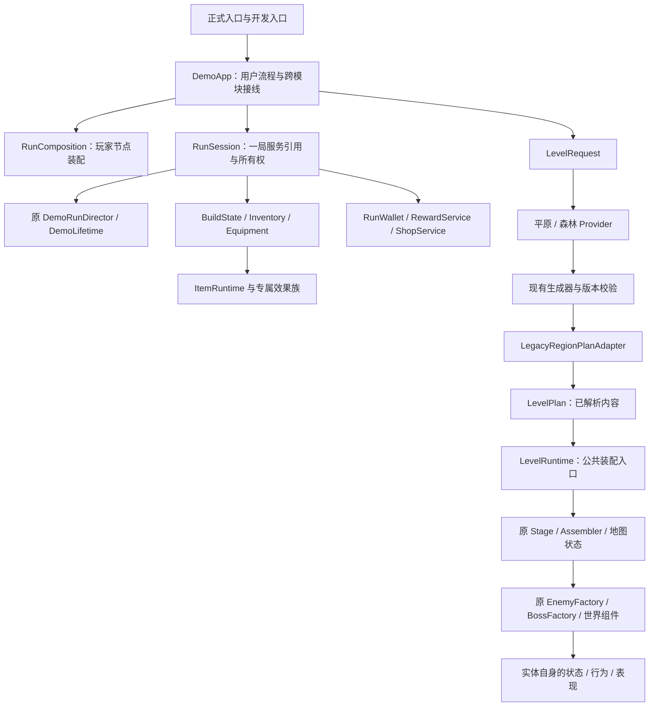

# 当前运行架构

游戏采用按功能组织的模块化单体，继续使用 Godot Node、Scene、Resource。应用层装配服务，功能模块拥有规则和状态；实验复用这些模块，并保留自己明确的输入、重生和版本政策。当前重构的验证状态见[执行记录](worklines/game_architecture_01/execution.md)，目标和批次见[目标架构](worklines/game_architecture_01/target_architecture.md)。目录归属见[模块导航](module_map.md)。本文描述已接入的调用，不把规划中的类当成实现。

## 正式运行路径

RunSession 复用原流程和 epoch 权威，不新增第二个 RunDirector。它持有本局构筑、钱包、奖励、商店及道具服务；出发仍按原顺序创建，跨图保留同一局状态，终局按原政策清空并返回家园。节点父子关系与物理生命周期仍由实际场景管理。

地图的 Request/Plan 是暂态内容协议，不是新存档格式。Provider 包含旧生成器选择、Manifest 校验和有界回退；公共装配只消费已经解析的内容，不抽随机数。LevelRuntime 当前是装配入口，运行中的节点和恢复状态仍归 Stage、Assembler 与既有地图状态对象，不能把它误写成另一个持有全部服务的世界管理器。

后续新模块库和新地图算法通过新 Provider 生成同一个 Plan。怪物、Boss、宝箱等用既有工厂/组件创建多个实例，但每个实例必须有稳定身份、独立状态与原领取收据；共享定义不等于共享生命值或 claimed 状态。旧地图实现留在旧 Provider 后面，直到真实新消费者完成迁移再删除。

## 状态与操作的唯一权威

| 功能 | 所有者与真实调用边界 |
| --- | --- |
| 输入和移动 | 输入适配器 → Router → PlayerController/能力 → PlayerMotor；Motor 唯一执行运动与碰撞 |
| 生命、资源、伤害 | 原资源状态与 DamagePolicy/FrameDamagePolicy；地图只装配、提交请求 |
| 本局金币 | RunWallet；Shop 与道具收益提交钱包命令，不从外部改余额 |
| 库存与配装 | RunInventory 持有实例/效果进度并负责受限事务恢复；BuildState 负责生效，EquipmentService 负责装备选择和容量 |
| 道具效果 | 原目录/authoring 是定义权威；ItemRuntime 编排效果族。Active/Companion 共用 ItemActiveCast，Time 只获得 ItemTimeContext 的窄能力 |
| 购买与重放 | ShopService 负责报价、付款与购买收据；四种操作共用已有 transaction replay 实现 |
| 奖励与永久成长 | RewardService、既有来源账本、SupplyHealEffect、MetaProgression；拾取和宝箱共用底层提交，但保留不同领取/反馈协议 |
| 普通怪和 Boss | 原 Registry/Factory 与 Definition；Actor/Behavior 负责快照和恢复，地图不再逐字段写普通怪内部状态 |
| 地图状态 | 既有 PlainsRegionState/区域状态及原 Manifest；不创建第二份存档或随机流 |
| 音频与入口释放 | 局部 GameAudio 宿主和既有选定音效服务；WorldAudioLifecycle 是生产与测试共用的释放实现 |

不要把 RunSession 传给所有模块任意取用。装配层只注入实际需要的服务；UI、音效和视觉不能拥有第二份伤害、余额、冷却或奖励规则。

## 需要保留的差异

同类功能不一定具有相同合同。商店分层抽样与物品池归一加权抽样使用不同随机调用序列；拾取和宝箱的收据、满血处理、音效条件不同；Boss 招式、织蛛/跨枝怪恢复、灰盒全场重置各有明确政策。这些差异不能为了减少代码行数合成带大量开关的万能函数。

旧版本回放使用显式版本边界。v11 历史 charger 定义漂移是单独修复：原 SHA/28×32 和当前 28×28 同时由原 Registry 明确选择，未知版本拒绝。正式图声保持用户已采用版本；历史预览的素材不自动升级或删除。

## 维护与验证

现有权威仍是 `config/player_tuning.json`、`config/input_profile.json`、实际 Definition、原目录及注册表。设计文档和检查契约不是第二份运行配置。不要再建立平行注册机制或复制默认数值。

新增功能先找到所属模块及真实消费者：规则放在拥有该状态的模块，跨模块用例由应用或既有服务编排，表现消费已接受结果。出现第二个语义相同消费者时，迁移到同一实现并删除重复代码；不要只新增一个无人调用的 helper。

验证沿现有 Harness：静态边界检查、原行为回归、版本/随机/恢复、所有入口、真实导出及 PCK 隔离加载分别给证据。静态扫描公开列出动态加载，不能代替引擎；原生通过不能代签 Web、实体设备或用户手感。原断言、预算、失败日志必须保留。
