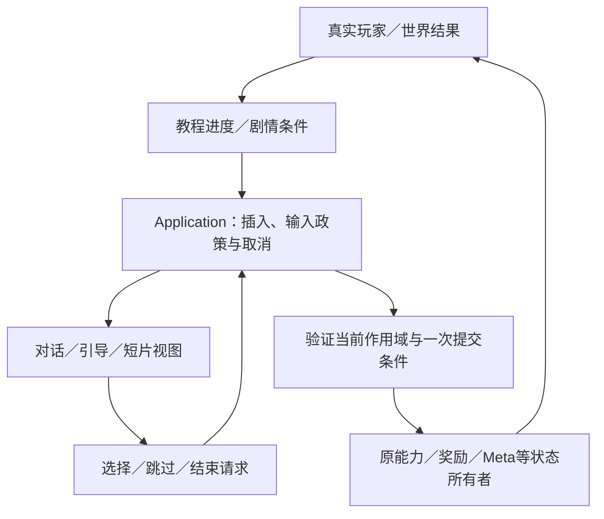

# 后续功能怎样接入

2026-11-02：新增[map-gen v2第一轮宿主接入](worklines/mapgen_host_v2_01/integration.md)与[上游约束/R2清单](worklines/mapgen_host_v2_01/upstream_requirements.md)。真实三模块受控入口已复用本架构；完整地图、正式App源记录/恢复、运行时算法和Web仍未接通。下文正式运行路径保持。

当前基础可以继续扩展，但尚未达到“四类功能都只加配置即可完成”。永久升级的事务与保存最接近可直接复用；map-gen正式接入的缺口最大。下表及[逐项源码审计](worklines/future_feature_architecture_01/assessment.md)以游戏 `8dfaf7f3`、map-gen `c2ac2c36` 为来源。它们描述可行性，不代表新功能已经实现。

| 需求 | 已有实际基础 | 仍需完成 |
| --- | --- | --- |
| 新手教程、剧情短片 | 正式Player／能力、输入取消、中立恢复、暂停、run/stage/actor生命周期 | 教程步骤与真实行为观察；演出开始／跳过／取消／结束的成对政策；当前场景恢复 |
| map-gen、模块包、多区域、能力与选区 | LevelRequest→Provider→LevelPlan→LevelRuntime，原实体工厂、RunCampaignProgression与TraversalAbility | 正式模块包合同及导入；新来源完整App／Stage适配；异步生成取消；去两区域／两图硬编码 |
| 剧情、对话、NPC、家园 | 家园真实交互／服务、森林阅读／确认／领奖、原输入及账本 | 通用对话内容／条件、故事事实与触发、作用域、重复触发政策；需要持久化的内容另作保存迁移 |
| 永久升级 | MetaProgression、MetaSaveService、幂等购买与保存失败回退、下局应用 | 当前只有vitality样例；购买／展示／效果仍单项绑定，需迁移现有消费者后才能低成本扩展 |

## 模块与文件归属

下面的新路径是接入时的建议，**本轮没有创建运行空壳**。先实现一个真实消费者，再提取已重复的规则；不用通用事件总线或可任意修改全部系统的剧情脚本。

| 归属 | 内容及调用边界 |
| --- | --- |
| `game/onboarding/`（待建） | 教程定义、步骤及本次进度；观察真实移动／开火／领奖结果，提出引导请求。动作仍由正式输入与能力执行，不复制教学版物理或武器。 |
| `game/narrative/`（待建） | 对话／剧情内容、条件、故事事实和一次触发政策。区分局内临时状态与跨局事实；不直接扣钱、授予属性或自行写存档。 |
| `game/application/` | 协调场景、模态界面、演出和加载。先从现有App菜单／森林阅读的两个真实消费者收敛开始／结束／取消政策；不让教程、NPC各自暂停／恢复全局。 |
| `game/presentation/` | 对话文字与选项、教程提示、动画／短片播放视图。发出选择、播放结束／跳过请求，不裁决剧情或奖励结果。 |
| `game/world/components/` | 空间触发器和NPC交互实例。持有稳定instance ID、位置与本地图状态，不成为第二套玩家、奖励或故事存档系统。 |
| `game/world/levels/providers/` | map-gen内容适配；解析来源、版本与模块包，产出当前LevelPlan。沿用原Catalog／Definition／工厂；不伪造旧Manifest来绕过正式来源迁移。 |
| `game/application/run_campaign_progression.gd` | 本局区域完成、能力奖励与合法区域选择；UI消费它的合法选项。不要新增平行Campaign或在按钮里另写准入。 |
| `game/progression/`＋`game/platform/persistence/` | 复用MetaProgression的报价／购买／提交，MetaSaveService的唯一持久化边界。永久升级与本局能力是不同政策；新增剧情／教程字段明确schema迁移，不能随手改保存格式。 |

## 输入与演出的调用关系

当前已经存在 `DemoApp._pause_for_menu/_resume_from_menu`、`InputRouter.clear`、`PlayerController._cancel`、各输入适配器的按住保护、`HomeScene.set_input_blocked`、`AirFocusAbility.stop` 与 `DemoLifetime` token。新功能应复用这些真实消费者，不能另写平行InputLock管理器。

`clear` 只取消当前意图，不等于持续阻断后续输入。当前App的各关闭分支也还不支持任意嵌套暂停：先明确谁打开、谁可以结束、关闭后应恢复到什么模式。世界继续运行但玩家不能操作，与全树暂停是两种明确政策。演出不得自行重置time_scale；慢时仍由原AirFocus所有者结束。死亡、离图、新局后，旧演出与远程请求必须经原token判无效。

先用一个家园NPC或一个正式教程步骤走通这条链：打开、合法推进、取消、重复打开、死亡／切图取消和恢复输入。短片采用相同插入／取消边界，但播放时间轴不承担游戏伤害与奖励结算。

## map-gen的准确接入边界

已核的map-gen是Python原型，输出 `map-port-prototype/2`，使用128px block和占位模块，明确 `certified_for_game=false`；浏览器HTML是检查器。正式map-edit模块导入、Godot物理认证，以及在浏览器本地运行算法或远程服务的协议均尚未完成。不能把现有截图／静态连通结果当成游戏可玩性证明。

共同边界保持为：**当前能力与区域请求 → 指定算法＋模块包 → 校验后的LevelPlan → 原Runtime → 原实体工厂**。模块包共享Definition，怪物／宝箱／NPC各有独立实例状态和稳定ID；instantiate本身不等于正确接入保存、领奖、死亡或恢复。

接入先冻结坐标单位、模块／端口／镜像／封口、能力条件、实体Definition ID、算法和模块包版本/hash、seed及拒绝原因。资源仍采用当前游戏注册版本；不能因模块包缺字段意外回退旧美术或加载另一套怪物默认值。

- 本地运行：选择可交付到Godot Web的实现；生成在加载阶段有界运行或分帧，不能每个战斗帧重新生成。
- 远程运行：平台适配承接传输／超时／取消；应用只接受当前run/request的结果。失败给明确重试／拒绝政策，不静默换旧地图。远端返回内容数据，不返回可执行游戏脚本。
- 第一张真实新地图：完成实际碰撞、实体装配、出发／离图、Boss场地、领奖和地图状态恢复；然后才能切正式默认入口。不强迫新Plan携带旧Manifest私有字段。
- 多区域：将现Campaign／Director／菜单中的合法入口与能力准入收敛到一个真实政策，再增加区域。能力认领继续提交原TraversalAbility，不能只在campaign数组增加ID。

这仍需实现工作；当前统一Runtime不能被描述为“任意新Provider已无痛接完正式App”。旧地图内部历史矩阵继续按既有延期范围处理；验证新模块真实玩法属于新来源接入验收。

## 建议批次

1. **P0 战斗性能**：继续当前独立性能线；不混入剧情或新生成器。
2. **P1 流程边界**：迁移现有菜单和森林阅读的打开／结束／取消消费者，再用一个教程或NPC对话验证；不先建设大型剧情引擎。
3. **P1 地图合同与适配**：与map-gen/map-edit冻结真实模块格式，先一个小模块包和一个实际新Provider；完成来源记录／恢复后再扩选区。
4. **P2 永久升级维护**：现家园升级UI读取现有definition/quote并传upgrade_id，效果在正式构建边界只应用一次；先保vitality行为，再另批增加升级种类和数值。
5. **P2 剧情与教程内容**：沿已验证插入边界增加对话／NPC／短片和故事事实；必要保存迁移单独评审，不改旧账本语义。

每批迁移真实消费者，并验证关闭后按住输入、重复确认、过期回调、保存失败及重新进入。不存在“重构后加任何功能都不会出错”的保证；目标是让改动有固定归属、有限影响和可验证的失败边界。
