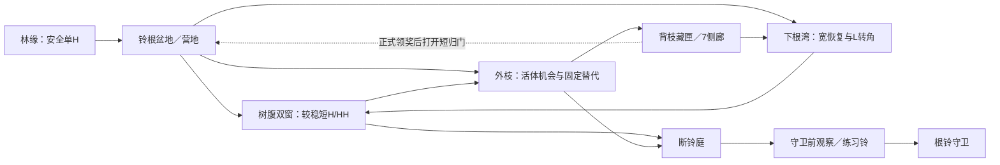
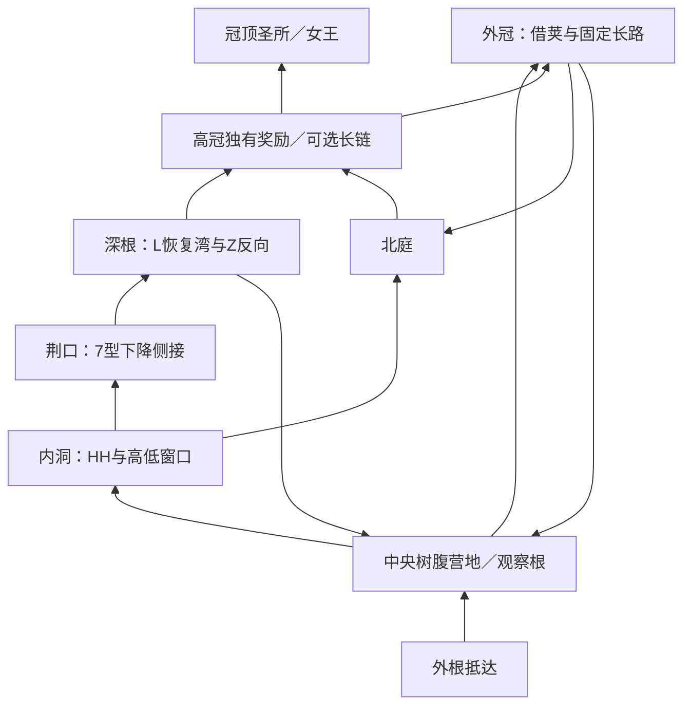

# 荆棘森林 v16：趣味模块与整体拓扑续案

任务 `FOREST-EXPLORATION-02`。这是完整区域圣经内的实现细化，状态为 **G0 proposed / 两处有限黄金待实际验证**，不是新地区方向选择、几何通行、趣味、艺术或设备验收。作者 `/root/forest_playful_topology` 仅只读生产代码，未运行引擎、未修改 runtime 或 Git。

## 输入与不可移用的边界

- 原森林圣经完整 SHA256：`a7bad8323af64a7be0577132e5d988a6e1b781d9e1ac1639d37f9d65935194e3`。重点对应 §1、§3、§4、§5、§6、§7、§10、§13；全文已读，本文不替代原文。
- 用户最新原话（本轮对话转录，非 API 导出）：“花更多时间和关注度在更多不同的关卡模块上，增加趣味性”“低顶短跳模块太无聊了吧，而且也不好看”“还可以加一些z型或者7型L型类的荆棘通道”“开发更多的脑洞，开发有趣的关卡模块和整体地图拓扑”。
- 低顶短跳 `sheltered_short_hops` 已按用户否定淘汰，不换名重启；当前 `low_root_tunnel` 也已从新 v16 推荐 easy 池退休，历史 build 留存。
- 沿正式平原 Underworld 像素家族，以真实根盘、树腹和枝体组织空间。荆棘覆盖真实宿主与正确危险面；不以漂浮刺砖、装饰树背后的浮板梯或英文名称代替地形特色。
- S2 实际 H、Pulse Lv1 的合法 R；不额外授予 D/W，不改 PlayerMotor、物理、资源、RNG 或旧版本保存。固定挂点按跳的新二段高度只适用于固定 `hook_hang`，摆荚、活萤仍是原生自动接触踢离。
- BGM 延后由用户引入；本方案不生成新 BGM。

## 当前实现事实与主要失配

只读 `forest_exploration_world.gd` 的现有构建仍按四次相同语法生成：两块普通主片，上方一块 normal，再上方一块 hard。图二另加冠层回桥，但这不足以单独表达围绕同一棵巨树穿行。此前实际 manifest 的 normal 入口可先上十余级通用阶梯，hard 继续上十余级；这只是暂时避碰的工程候选，不能升级为完整森林体验。

`_module` 当前主要消费 `raw.steps`；局部 `raw.routes`、`choice_contract` 或 `interaction_contract` 需要明确转成实际世界边和奖励端口。仅物理存在一个上枝不等于其选择已进入世界路线；将所有 normal 的局部收益统一成 2 金币也会抹平上枝价值。

当前 v16 的 `forest_shortcuts=[]`；不过 `ThornForestRegionAssembler.resolve_reward_shortcuts()` 已存在真实消费者：正式奖励/发现物 claimed → opened_key → 关闭捷径阻挡碰撞，旧 v15 F05 已使用。因此“领奖打开短归路”可复用现有系统；“背侧按交互无条件开新门”仍需最小新 runtime，不能混称现成。

## 六种有明确因果的体验

以下是待检专家假设，不能以名字、动作数量或 AI 评价签趣味。

### 1. 背枝邮袋：先看见，走过后才意识到该回头

**看到什么：** 入洞前能看见高枝上的邮袋/宝匣；它与入口之间有真实树根断面，前方侧果与观察枝交代可抵达的另一面。奖励一开始可预读，不用假称只有到观察枝才看得见。

**一次判断：** 先去右侧观察枝，再朝来路左上回跳取奖，还是直接沿下根前进。

**不同解：** 普通两段受支撑跳跃形成回头路径；H 可改变接近速度；合法 R 可成为耗弹捷径。禁止把其中一个动作当密码。

**回报/恢复：** 实际金币绑定 cache_perch，不在公共 exit 同额发放。取奖后短下降回入口根面，继而走未走的下根 onward；这是“入口奖励回环”，不能伪称在下一 hub 异口重汇。

**最便宜解反证：** 旧 cache 顶 -128wu 可被普通原地长持跳直接拿到，已 REWORK；新候选顶 -192wu 超过普通首跳实测约 150wu，但侧观察枝到 cache 仍可分两跳。还须真实测试走到边沿直跳、合法 R、反向从出口/恢复盆地接近，不能仅比较一个点高差。

**当前可复用：** `backlook_fruit_cache`、真实 ordinary steps、现有果实、奖励/claimed。需最小世界 choice-route/奖励端口接入；没有新动作系统。

### 2. 借荚还是摘荚：好时机立刻借，坏时机另找路

**看到什么：** 两条真实根枝之间，一枚有宿主的活摆荚沿弧线运动；右侧宽根可观察高奖岸与较远固定果实。

**一次判断：** 高且向有用方向转回的阶段立即 H 借踢离；相位不利则走右端固定果实，或先击杀取真实掉落，再走仍存在的根路。

**不同解：** 活体接触、固定挂点、合法 R、跳过奖励。摆荚不提供搭乘/挂着等待，不声称固定 127wu 挂点起跳可用于活体。

**回报/恢复：** 独立高奖 5 金币/1 音符绑定 reward_receiver，失败落真实根湾。H 真实伤害 1、摆荚 HP2；重复借力可能击杀，故必须在敌死后仍可从固定果实/根路到达同一奖励。

**最便宜解反证：** 固定方案只多走少量路，可能比等待 4.8s 摆周期更快；不能宣传活体总更快。比较有利相位立刻借、坏相位等待、改走固定路、先击杀四种真实结果；还要测试目标近最大射程时真实 ShapeCast 能否接触及短 kick 是否确实接岸。

**当前可复用：** `borrow_pod_crossing`、`ForestSwingPodBehavior`、现 EnemyActor H 目标、现 DropService、固定果实。需要 authored ecology slot 与真实交互驾驶消费，不新增敌人行为。

### 3. 双窗换班：选高度也在选择下一个目的地

**看到什么：** 同一实体树腹的高低两个洞口、真实交替丝线、能看到另一出口的光窗。一个洞口通北庭，另一个通根湾，不把两个洞口都包装成同一 exit 的同一种走法。

**一次判断：** 此刻等当前窗收线、抢另一窗，还是从旁枝射杀织棘蛛；同时决定继续上冠还是回营补给。

**不同解：** 等待/换窗/射杀/外根绕行。主路保不依赖敌存活的通道。

**回报/恢复：** 上窗有更快向前的路线，下窗更快回到熟悉营地；奖励枝在侧窗背面。失误落在眼前根盘，避免无预告将唯一接收岸封死。

**最便宜解反证：** 两孔若最终同目的地且等待时间总短于换层，换窗只是额外操作；若 protected_points 让织网始终自取消，则并无真实时序。必须有真实线 active/收拢与身体通过证据。

**当前可复用：** `double_window`、`ForestBibleWeaverBehavior` 的两条真实、有限、不同高度丝线。需新增实际窗口端口与世界分流；不需新网逻辑。

### 4. 同一根体的 L/7/Z：把路径形状变成方向判断

**看到什么：** 实体根枝形成带刺边界，转角处能先看见下一接收枝和更远奖励。苍白刺尖只长在真实 up/down 危险面。

**一次判断：** L 线先降到宽肘部再横向借力；7 线先横跨，再决定下落的时机和侧面接入；Z 线需要在有预读的侧窗连续反向，选择停中继稳住还是用 H/R 走流畅技巧线。

**不同解：** 同树下根 L 路承接普通前进，7 路换层到另一庭，Z 路接高奖/捷径。不是把同一狭缝旋转三次，亦不将微缝/低顶当趣味核心。

**回报/恢复：** 普通线宽接收岸与根湾恢复；Z 更丰富奖励放在真实独立末岸。退出方向改变整体地图的去向，而非每次挑战后回原架子。

**最便宜解反证：** 斜向一发 R 直越全部转角、从恢复盆地普通上跳白拿末奖、最后 H 直接略过前锚，都应实际比较。若强替代更流畅且无判断损失，可保留多解或删冗余，不为形状强锁动作数。

**当前可复用：** 新 L/7/Z helper 候选、现 rooted fruit、thorn-host renderer、H/R。需真实模块/身体/路线/奖励返回验证；不新增侧刺 renderer 或假刺砖。

### 5. 诱籽离岸：让敌人替玩家强调换线时机

**看到什么：** 棘籽哨对当前实际站稳的根枝形成可见预告；旁边真实果实与另一条根路都在镜头内。

**一次判断：** 先诱导锁定左岸，待方向确定后 H 换到右侧，从另一角度进洞/射击；或者先在掩体岸射杀，再走普通路。

**不同解：** 击杀、诱导后换岸、退回掩体、走低根。不会要求在空中同时学习新瞄准、新目标与看不见的落点。

**回报/恢复：** 哨位原方向成为玩家可利用的短时间路线信息；奖励仍在静态可达支撑上。未击杀也能通过，敌提前死不产生软锁。

**最便宜解反证：** 若旧岸根本不受实际弹体威胁、另一岸照样被相同弹体贯穿，H 与敌人只是并排摆放；必须保存真实 attack_goal、弹体、移动和命中因果。射击反冲不能把玩家推出唯一安全枝。

**当前可复用：** `ForestSeedSentryBehavior` 确实锁定脚下射线命中的支撑点，再发真实抛物线 seed。仅需空间遭遇布置与策略，不新增锁岸系统；该组合尚未实现。

### 6. 门的背面终于连起来：探索改变返程长度

**看到什么：** 初过营地看见一扇真实根门后方的熟悉色光/支撑；此时走普通路线从树另一侧找到藏匣。

**一次判断：** 带着当前状态继续 Boss，还是先取支奖、让短归路打开，回营补给再从别的入口继续。

**不同解：** 开门不是过 Boss 的收集配额。原长归路始终合法，取奖后短路是真缩短/少重复，不是增加一个图边标签。

**回报/恢复：** 正式 cache transaction 成功才打开 gate，真实 collision_shape 被禁用；opened/claimed 存在现 run-state。重复领奖、暂停/返回、地图恢复不得多发奖励或关回已开门。

**最便宜解反证：** 从门另一侧可直接逆爬高奖、门不开也能穿碰撞、claimed metadata 改了但 shape 未改、短路比原路更长，都不能称闭环收益。新桥若提前给出普通两跳上高奖的捷径也需拒绝。

**当前可复用：** assembler `forest_shortcuts` + `unlock_reward_id` / `unlock_discovery_id`、`resolve_reward_shortcuts()`。需布真实门和两条路线；无需新系统。另“只从背面按交互开门”未实现，不在首批承诺。

## 两张地图的不同骨架

这是下一阶段的整体目标图谱，不声称当前四 district 实现已经具备。

### 图一：双叉盘根三瓣环

空间记忆围绕一个低处可识别的铃根盆地、其右上双叉树和右侧断铃庭建立；以横向、同层洞口和短侧拉为主。第一次从盆地就能认出树腹、外枝与根湾三种去向，中途可以换线。

- 主路实际经过展示单 H、稳定观察、一次可读换向、短遭遇和战前铺垫，不把复杂奖励链强塞给首图。
- 低路可以在树腹侧窗转外枝，外枝拿奖后从另一个方向回下根；路线在空间中交叉，不是从每个 hub 各自爬一座复制奖架。
- 同一 cache 已取后，玩家更容易改走另一入口回营，再决定前进；原路折返不是唯一选项。
- 随机应改变一个有意义的关系：哪扇窗通外枝、背枝奖从哪侧初见、哪条回归门接盆地。不能只换楼层高度/模板顺序。

### 图二：中央巨木双 8 字

营地成为巨树内一个真实观察根面；上方能看见圣所，下方能看见深根。玩家从不同高度反复见到同一实体树腹。内洞/外冠构成上环，荆口/深根构成下环，奖励回程交回熟悉的营地。

- 上环比较内洞稳定换窗与外冠动态借力；下环是主动下入后反向回升，先在侧窗看到高奖，再从根背接近。
- 深根 Z 是可选高奖；主路可由北庭的短连续钩索进入冠顶，保留首次前进的能力/资源容错。
- 营地不再位于一条水平链上的第 N 个任意宽台，而由真实巨树洞口、观察根与能看懂的回程联系确定。
- 高冠回程不复制上行连续操作：可控下降串联既见窗口，返回营地后可再选择内/外入口。
- 随机改变内外入口先后、窗口向哪个院落打开、深根出口接高冠哪一侧；保持一个核心树体与营地基准，避免失去可记忆性。

## 先落地的两处黄金

### 黄金 A：图一同体回望取奖

落点为 map1 district1 的第二个主片。用真实 `backlook_fruit_cache` 同时承载下根 onward 与入口回奖环；删掉该处额外架高的 normal 实例及十余级入场梯，不额外复制一块“探索房”。

世界必须消费 `choice_contract.route_ports`，把 entry→cache、cache→entry 变成真实边，cache_perch 获得局部设定的实际收益。区块 macro 标 `reward_return_to_entry`；原有 elsewhere 真 fork/rejoin 可保留，但不得将这里回同 entry 的行为签成异 hub 重汇。

通过条件：完整普通 lower 前进、实际跳到观察枝后回头拿奖并短返、从出口/恢复盆地反向最便宜解、真实 modal/claimed 幂等与相邻模块身体冲突。先看实屏是否能同时读出 cache、观察枝、下路，不先扩到全部 seed。

### 黄金 B：图二营地就是借荚观察根

优先把 map2 district1 的 `borrow_pod_crossing` 真实 `observation_root` 作为 hub2/camp 支撑本身。局部 camp port `[848,-18]`、reward `[928,-210]`、reward return 先落 `[944,-18]` 再短 walk 到 camp。于是高枝取奖后真正从另一高度回到原来认识的营地，无需再造几千 wu 横桥。

世界实现者已接受此有限方向，具体接口建议：

1. camp alias 实际 mapped `observation_root`，不再叠一个独立 hub slab 吞身体；map2 对应层高以真实观察根为准，不追逐旧的 844 数值。
2. 到 camp 的主路线消费 `raw.routes.pod_approach` 并停在真实 848 观察点，不走到 raw exit 再折回。
3. 高奖回程消费 `reward_return` 的真实下降，再有短走到 camp 的边；onward 从观察根东端接后继。
4. placement cursor 必须越过整个模块 footprint（1280 及真实侧恢复边界），不能用 camp.x+240 将下一模块插进尚存枝体。
5. 有利 phase 的活体 H、坏 phase 的固定替代、击杀后无活体路线、拿奖回营四条真实轨迹分别验证。固定 fallback 是 hang anchor；pod 是 auto-contact target，二者不能混证。

此处先不造门；后续另挑一处只有正式领奖后才有实际缩短收益的归路再使用已有 reward-gate，避免机制全堆在第一个样板里。

## 推广顺序与停止条件

1. 先保证当前真实主路基础通行；旧静态百万断言不能代签 Motor。
2. 黄金 A/B 各验证目的打法、最便宜强替代、关键对象死亡/移走以及一次失败恢复，查看正常比例合屏。
3. 接 L/7/Z 三种不同端口和返回到实际世界池；至少一处 L/7 通向不同目的地，Z 的高奖不能在普通共享出口领取。
4. 在一段真实内洞做双窗目的地分流；在一个实际遭遇做诱籽离岸。没有新增判断就删候选，不为库数保留。
5. 再分批替换现四 district 复制骨架：图一先一段三瓣环，图二先围营地的一个实际 8 字环。只有图/动作/奖励变化且真实路径成立才扩到其余种子。

若黄金连续两轮只增加平台/移动数而没有可观察选择、回报或空间记忆改善，停止该方向并保留失败，回到具体因果重做。结构、技术、玩家 FUN、视觉和设备分别记录；本文件无任何已通过内容或用户认可声明。
