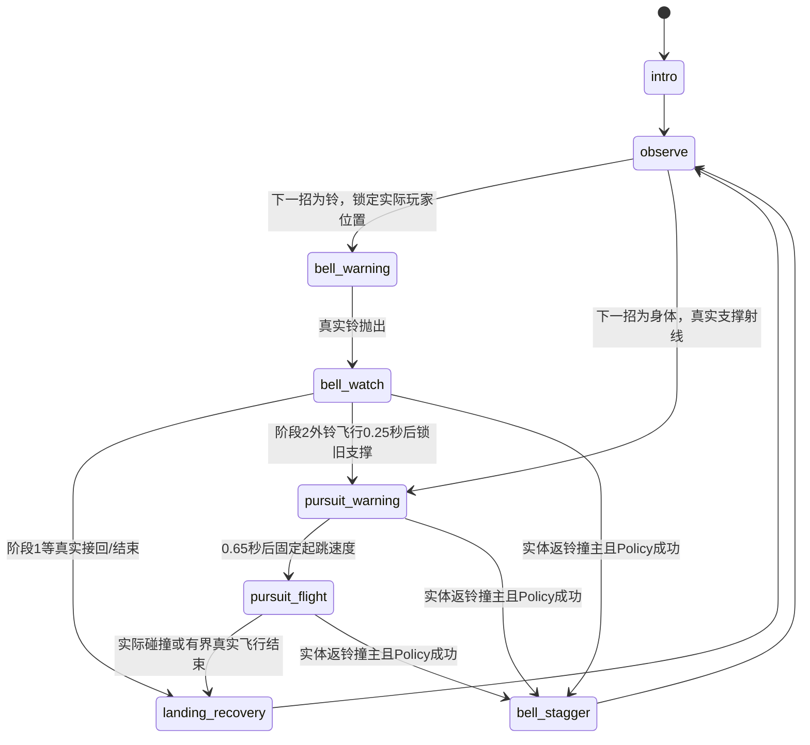

# 根铃守卫 V2：借铃返击与移动接收者

任务 `FOREST-DEPTH-02`。当前是荆棘森林第一图的**双招、两阶段灰盒候选**：局部机制已获独立限定ACCEPT，26版预警/返击表现另获限定ACCEPT；正式App全流程、低资源、真人学习与设备验收尚未全部成立。旧V1冻结，不能用本页代表默认版本已推广。

设计遵循 [boss-creator](../../.agents/skills/boss-creator/SKILL.md) 与 [game-quality-gate](../../.agents/skills/game-quality-gate/SKILL.md)。参数以实际Definition Resource为唯一来源，本页数值是当前配置说明；总G0–G5记录由主协调者维护。

## 玩家要读什么、能主动改变什么

守卫带着不可射坏的实体金属铃。铃既挡普通弹，也是移动钩索目标；玩家可以走位换射线、普通跳躲、直接持续射击，或真正到铃后踢返。**树心除入场演出外常态可伤**，没有H开甲密码或统一亮心窗口。

第一招让同一实体从威胁/射线障碍变成反击媒介。只有玩家Motor真实到达移动铃、完成原Traversal kick，铃才带着反击动量沿固定弹道回去；只有铃之后真正撞到同一主人，才经现有FrameDamagePolicy结算4伤和短失衡。按H、头弹接触、预计将命中都不能产生伤害。它可能撞地形、打空或被主人移动错开。

第二招向玩家当时下方的**真实支撑旧点**扑击。警告后不追踪新输入，玩家离开承诺落点仍能继续射击。第一阶段先独立观察这次身体追击；第二阶段外铃飞行时身体也开始追扑，接铃者的位置因此变化。玩家要同时决定离开身体扫掠方向、保持射线，或借实际来铃返击；阶段变化不是只加速/加血。

普通射击反冲、H231范围、来侧24kick、到达恢复及所有Player物理/资源合同不变。普通Pulse实际消费者是 `PlayerTuning` 速度1200、寿命2秒、冷却0.25秒、半径3；不能拿WeaponDefinition的850/420/0.11代替这条消费者。

## 状态、承诺与阶段演化

阶段2要求血量不高于40%，并且至少一次真实Body flight已经完成（`cycles > 0`）。cycles只由身体真实sweep碰撞进入收招，或真实逐步飞行到有界时限后进入收招累加；取消、H事件、钟表观察都不充数。低血量且正在watch外铃时可直接承接身体预警，保留真实外铃。核心不锁血，合法高效击杀可以跳过完整教学周期；`learning_cycle_covered`只是该场实际覆盖事实。

身体弹道锁定旧支撑，撞普通地形会提前结束；不传送到预定点。`ForestBossMotor`每有效步只有一次 `move_and_collide`。实际KinematicCollision通过共享 `DemoContactEmitter` 的真实contact信号进入原FrameDamagePolicy，保原H仅保护目标、伤害间隔、iFrame与epoch；不扩大Player或伤害盒补漏。

## 唯一配置与真实场地

配置为 [rootbell_guardian_v2.tres](../../resources/bosses/rootbell_guardian_v2.tres) 和 [BossDuelDefinition](../../scripts/bosses/boss_duel_definition.gd)。当前关键值：

| 项目 | 当前值与用途 |
| --- | --- |
| 生命/身体 | 32HP；72×96真实身体 |
| 观察/Body预警 | 0.45秒/0.65秒 |
| Body弹道/落地恢复 | 设计飞行0.72秒、重力1400、有界时限1.5秒；恢复0.7秒 |
| 铃预警/抛出 | 0.8秒；抛出设计0.9秒、重力700 |
| 铃实体/回收 | 圆半径24；普通回收速度320；寿命4秒 |
| 真实返击 | 速度460、固定弹道最多1.1秒；实际撞主Policy4伤、失衡0.8秒 |
| 阶段2 | 40%血量且已真实完成Body；外铃0.25秒后开始Body预警 |
| 铃独有solver余量 | 1.0；其他ForestBossMotor仍0.08，实际Circle/Player尺寸不变 |

32HP用于让正常高效打法经历独立Body和后续移动接收者，而不是凭血量创造机制。18HP原型中第1铃前普通弹加4点返击已能直接跨过半血，只有单招速杀；32配合真实cycle顺序，在当前H完整战中容纳两阶段。不是用户不可调常数，也不为强教动作禁射/锁伤。

[ForestBossArenaFactory](../../scripts/generation/forest_boss_arena_factory.gd) 是唯一几何出口，版本 `forest-guardian-duel-arena-v4`。`from_prep(prep,map_index,definition)`只接受守卫map1；Queen另有独立Factory接口，未由本候选开放map2。场地1000×520，永久地板、真实冠顶、中央单向承台、两侧同位置单向枝、四固定环，以及真实入口连接；所有坐标由Definition读取/平移，Stage不复制第二套数值。

旧可破承重根、根Health/Policy目标、折根Refund/失衡已淘汰，`root_supports=[]`。侧枝只是普通真实支持；改one_way让身体可向上穿过后真实落脚，解决原实心枝把连续扑击截在起跳处的问题。冠顶是真实可见碰撞，封场用正式BossArenaSeal；玩家不会飞过墙顶后被测试假称低效打法。

铃保留普通弹实体遮挡、原移动目标H、真实Circle碰撞。catch只接受真正owner sweep或同实时CircleShape与owner Collider重叠，不用距离/timer。有限Player接触返弹由真实相对速度/法线/切线决定；重碰同Player不延长承诺，避免旧173帧推碰循环。当前24原生17条bell-player碰撞，最长同铃连续4tick；19的“最长1”只属于19，不能外推。

## 正式接口与保存边界

`RootbellGuardianV2 extends ThornForestEncounter`保留health/active/core_open/objective/combat_snapshot/cancel/reward公共接口；`bind_duel(geometry,controller,policy,lifetime)`绑定正式服务，同完整绑定幂等，冲突拒绝，不重复注册Boss Health。

移动铃返击必须通过真实到达→原kick→同铃/同主人实际接触→当前epoch/session/token→稳定event ID→原Policy结算一次。真实Policy成功才发`bell_counter_committed`并失衡；死亡后不追加攻击，取消/换段拒旧实体迟到事件。普通弹仍经过正式App的eligible-shot与core消费路径；本地fixture不代签该接入。

存档版本 `guardian-two-action-cycle-v6`。保留真实phase、cycles、weak_side、intro时长、next_bell、serial/attack_epoch、身体位置/垂速及有界clock；拒绝旧版本、旧`duel_roots`、非法数值/类型和stage2/cycles0。恢复前先完整验证，实际恢复取消旧铃/弹体并提升epoch；已赚取bell_stagger保有限余时，其他攻击回到恢复而非重播旧碰撞。暂停冻结实际physics与可暂停表现。

正式App V6首采真实走到earned phase2/counter后的非法数据反例，发现bool类型比较顺序导致SCRIPT ERROR；原失败保留在`restore_v6_01`。Root现已最小修为先核类型再比较，acceptance准备fresh V6_02；**24/26本地证据不倒签这一修复或正式恢复已经通过**。唯一奖励、同帧死亡优先、自然入场与保存回家由正式消费者独立验证。

## 合法策略、学习长度与输入容错

同32HP/玩家5HP/精力100、正式Seal与相同六处真实可见Body瞄点，24完整对照如下；26仅表现变化，七项结果逐项相同。

| 策略 | 战斗tick | 结束HP | 结束精力 |
| --- | ---: | ---: | ---: |
| H到移动铃返击A | 606 | 5 | 26 |
| 同H驾驶，仅counter=false B | 1033 | 5 | 27.5 |
| 地面走射 | 824 | 3 | 23 |
| 普通跳射 | 1462 | 1 | 26 |
| peek跳射 | 591 | 4 | 70 |
| 驻射 | 506 | 2 | 100 |
| 只躲首铃后驻射 | 487 | 4 | 100 |

A真实一次移动铃H、返击4伤，阶段1/2身体各一次，外铃与身体并行18帧；第二扑从x67.742追到733.556，真实水平665.814像素。A/B差也包含失衡、后续身体位置和射线，不能把427tick全算4伤DPS。便宜解更快省精力但损血；H提供此样本中的无伤主动反击，不宣称最快/必需或已穷尽最优解。廉价片损1来自tick458真实Body接触，非铃伤。普通冷却时仍有移动/弹体，不能把全部冷却帧当空等，也不把所有时长签有效决策。

25在同24选定生产SHA上只改测试输入时机，六条完整实战均真实到铃返击、正常唯一击杀且HP5：

| 反应延迟tick | 起跳hold tick | 击杀tick | 结束精力 | counter次数 |
| ---: | ---: | ---: | ---: | ---: |
| 0 | 9 | 559 | 31.5 | 1 |
| 0 | 12 | 606 | 26 | 1 |
| 0 | 15 | 732 | 29.5 | 1 |
| 3 | 12 | 725 | 16 | 2 |
| 6 | 12 | 664 | 35 | 1 |
| 9 | 12 | 666 | 35 | 1 |

延迟中正常移动/射击，实际发H前重新核活铃、输入状态、231范围、LoS与真实回收接近速度。84/0通过是六个确定样本的有限容错，不是连续时机穷尽、低资源或真人学习证明。未注HP/资源/phase/位置，不删普通便宜解或必须完整击杀的守门。

## 灰盒表现与接受范围

26只读已有状态：Body预警画真实72×96身体沿意图弹道的完整范围及落脚框；真实地形可提前截停。阶段2青色双框与`II BELL + BODY`提示并行；仅真实`bell_counter_committed`启动0.55秒橙色放射圈与`BELL COUNTER -4`。没有新玩法/保存状态，没有资产扩产。

24机制独审完整覆盖H717帧与廉价598帧，限定ACCEPT局部双招/两阶段，允许进入正式消费者验证。26表现另由未写呈现者实际看原尺寸271/375/585、读真实弹道/呈现源，限定ACCEPT可读信息改善。左seal仍部分遮文字；两者均**未正常速完整播放/听音/手动操控**，Dummy音频不签音质，不签最终艺术、真人、设备或完整G5。技术通过与这些范围不能合并冒完整交付。

## 可重建证据与淘汰索引

| 证据 | 原件/精选入口与范围 |
| --- | --- |
| 当前局部机制/策略与容错 | [24/25精选](../evidence/forest_guardian24_25/README.md)，原raw/log、完整sourceinventory、selected源、两MP4、独立机制审查及SHA |
| 新表现 | [26精选delta](../evidence/forest_guardian26_delta/README.md)，唯一呈现源、native179/0、两新MP4/raw/receipt、原尺寸keys及限定表现复核 |
| 24冻结源 | `build/forest_depth/snapshots/boss24_oneway_branches`；actual bee850基线+当时dirty overlay |
| 25/26冻结源 | `boss25_input_tolerance` / `boss26_readable_cues`；actual40edd668+各自overlay，不重签旧源 |
| 真实命令 | 主repo锁`build/verification/engine.lock`；fresh snapshot复制双SHA；24–26实际先独立editorimport原90秒，再snapshot内`python3 tools/run_forest_boss_depth.py --output-dir <fresh>`原native180秒；容错显式`--scenario tolerance`。Root后续将同一次90秒clean import纳入CLI并记录import.log，不倒签旧capture |
| 两版完整影片 | `build/forest_depth/boss/movie24_H`、`movie24_evade_stationary`、`movie26_H`、`movie26_evade_stationary`；固定60fps/717及598帧，原45秒cap，版本和producer/source前后guard在receipt |
| 独立结论 | `build/forest_depth/independent/guardian24-review`与`guardian26-presentation-review`；原报告也收入对应精选 |
| 全历史索引 | [原逐轮设计记录](../evidence/forest_guardian26_delta/prior_design_chronology.md.txt)保留重写前全部257行及每个证据引用；历史参数不是当前配置 |

淘汰摘要：固定身体削根统一亮心被同源地面698tick对H3371tick反证，拒绝靠堵射角修；单扑真实接触曾因solver停距漏伤，09实际反例→11共享Emitter修正，旧无伤数据不追认；14铃卡根底161帧、17返铃推PC173帧分别保REVISE，19真实solver参数后消除旧长连碰；combined19根在/削一枪未产生承诺的路线价值，删除该层；20–23暴露实际出界/持铃自撞/阶段无独立Body/实心枝阻扑，24以真实冠顶、持铃位置、cycle顺序与one_way支持得到当前内容。

上述原件在`build/forest_depth/snapshots/boss01`至各命名`boss26_readable_cues`，旧08/14/17独审、combined19、未执行10说明均保持原范围。完整旧路径与失败解释见保全的历史索引；不得把后续通过倒签到原失败。当前不再新增机制或重复拍旧片，后续重点是正式App与保存/奖励、不同入场资源、正常速体验与玩家/设备证据。
