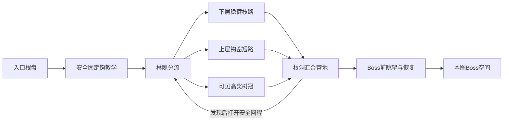

# 荆棘森林：短钩索随机区域设计 V0.1

任务 `FOREST-DESIGN-01`；内容版本 `forest-design-v0.1`；基线 `e8ee34446aa82b4e64f5cdc414a22f5b6e2a6ca7`。本轮交付 **G0 候选设计**，供下一轮灰盒制作，不是已实现地区、物理通过报告或最终创意认可。用户本轮授权重新开始森林关卡与怪物设计，覆盖此前“仅平原、不启动森林”的范围限制。区域开放、能力奖励接入与正式发布另行实施；本轮不改平原、美术、Motor、武器、资源或存档。

## 体验目标与取舍

**在被荆棘分割的巨木之间，找准钩点拉近，借小踢跳选择下一枝落脚；熟练后用反冲改变出钩位置、避开威胁，并穿过活锚点走短路。** 森林强调短距连续换位和空间阅读，不做大跨度摆荡，也不以到处铺刺增加难度。

与风铃平原的区别：平原以开阔地面、起跳与反冲落点为主；森林以树干遮断、错层枝台、可见但不能直线抵达的目标和林隙回环组织空间。主路仍有完整安全落点，林下不是整片死亡坑。地区保留两张非线性连通大地图，分别承担“学会读枝路”和“在熟悉语法中选择路径”。

比较过的方向：①长绳摆荡／无限空中攀升需要另造核心动作，拒绝；②复用平原矩形房间、换绿色和加刺，缺少空间判断，拒绝；③**固定锚点保障通行、活锚点提供捷径、枝台保障观察恢复**，采用。具体怪物、地块、骨架均为 proposed；S2-H 和现行动作合同为必须继承。

## 能力与事实边界

| 来源 | 本设计使用的规则 | 运行与授予范围 |
| --- | --- | --- |
| [地区 V0.3](player_actions/regions_v0.3.md) §0–3 | S2 森林只要求 H＋基础跳跃／Lv.1 武器反冲；隐藏也不准要求 W/D/U1/U2 | 阶段方向已确认；正式流程目前仍只开放平原 |
| [动作入口最新覆盖](player_actions/README.md) | H 可 360°瞄准；同一时刻一把当前武器，H 独立于武器 | 练习运行能力不等于正式授予 |
| [钩索修复](../quality/grapple_fix.md)、`resources/player/traversal.tres` | 当前射程 231px；小跳向量／持续时间对应每轴约24px；从目标来路一侧弹离 | 参数只是当前资源快照，不是生成器新默认值；不是必然向前越过目标 |
| `scripts/player/traversal_ability.gd` | 从实际发射源测距；碰撞挡钩；接触完成才恢复 H；目标死亡／失活可失败 | H 不提供全程无敌；只保护被钩目标身体接触，其他伤害正常 |
| [空中恢复](../quality/air_action_refill.md) | 成功 H、有效空中子弹伤害等可恢复已授予 H；不凭空授予 D，不自动补射击次数 | 不依赖随机敌人命中作为主路续航来源 |
| [武器 V0.8](player_actions/weapons_v0.8.md)及入口覆盖 | 枪／手里剑／炸弹三种 Lv.1 分别验证；一次只装备一种 | 正式平原默认 Pulse；其余练习可玩不等于已接入战役选型 |

旧 `thorn_forest_h_slice.gd` 使用历史长H资源验证旧路线；旧 `thorn_forest_design.json` 是借平原反冲升台的合同样例（H仍optional）。两者均保留，不作为本版231px路线证据，不修改旧断言来追认本版。

支持构筑目标：分别 `H+枪Lv.1`、`H+手里剑Lv.1`、`H+炸弹Lv.1`，无随机道具／永久增强。第一黄金先用当前Pulse跑通，再逐种Lv.1复验后才可称三构筑支持。每次读取真实Definition和能力snapshot，不复制武器预算。主路冷启动、空枪／低精力时必须能等待地面按现行规则恢复或安全撤回；不能赠送资源。

## 地块先于贴图：七个功能家族

这些是可伸缩的空间家族，**不是七种固定尺寸房间或七张整图贴片**。实体支持、单向支持、伤害面、可钩面、装饰面分开；灰盒就要有稳定轮廓／符号。

| 家族 | 空间与碰撞语法 | 玩家判断／连接职责 | 灰盒识别与后续资产接口 |
| --- | --- | --- | --- |
| F01 根盘林隙 | 有根宽地面，连接两至三个枝路；无藏刺 | 观察下个钩点、落稳恢复、看地图分流；入口／汇合／撤离 | 暖色平顶实线；根脚连到土层，不把安全地面做得像危险藤 |
| F02 错层枝台 | 粗枝承托真实站位，长短与高低按已验端口组合；枝尖外侧留身体净空 | 起跳把锚点带进射程；钩后向来侧落枝，再选下一方向 | 宽枝顶明确亮边，树干为实心暗块；细叶不是落脚面 |
| F03 钩窗树干 | 树干为实体挡视线／挡钩；实体边缘留明确开口与观察台 | 先换站位得到视线，再出钩；不许对背景树皮任意抓取 | 圆环标真实 GrappleAnchor；装饰藤无同类圆环；目标／通道同时可见 |
| F04 荆棘夹道 | 危险只在枝腹／侧墙／可读局部地面；始终留身体扫掠与小踢跳净空 | 判断走枝顶还是经过钩窗；用反冲避开侧刺 | 锯齿危险轮廓＋独立碰撞，不用纯配色；禁把树叶全画尖而混淆 |
| F05 悬藤渡口 | v0.1固定悬挂锚点，下面有接收枝或安全退落层；动态摆藤另候选 | 选择钩点／落点，不把悬藤当可站地面 | 细藤从真实上方树枝挂下，钩环突出；运动只在未来验证后引入 |
| F06 空心树／根洞 | 洞口有实体基座；安全连接下层，短通道打开回程 | 从高奖枝绕回林隙、失误下降后重新进入；有新视角／发现 | 大洞剪影与暖口；灰盒明确可走洞口，背景洞不复用同一标记 |
| F07 冠层眺望台 | 安全停台面对下一巨木／Boss树冠；上层留白、下层见回路 | 从跨层视角预读目的地；高潮前释放压力 | 只预留巨木主焦点和远层剪影；前景不得盖钩环、落点、敌人预警 |

首批只做 F01–F04＋固定F05，F06/F07可用同套几何。后续资产按“树干实体与分叉／枝顶和枝腹／钩环挂件／荆棘危险／根洞开口／远冠剪影”拆家族，声明锚点与接缝；不要先画一张美图再逼碰撞迁就它。背景枝条降低对比、无支持亮边和钩环，避免虚假通行承诺。

### 连接端口与安全合同

每条连接记录：真实起站面与可用宽度、入口速度范围、发射站位区、锚点接触几何与遮挡、拉近身体扫掠、踢跳来向、候选落点／恢复下层、出口稳定站位、后继可见性、往返方向、能力／资源与相位。`PlatformingModuleDefinition.anchors` 是站位路径点，**不等于** `GrappleAnchor`，不可混用字段。当前 `PlatformingModulePort` 尚未保存或自动检查发射区／可钩目标／视线／小踢相位；这些是候选连接验收要求，下一实现先使用稳定落地端口组合，不能宣称现有assembler已检查。

231px从真实发射源到合法接触点测量，不能拿房间中心或树干间距代替。原型可从小于上限的保守站位开始；最终间距由实际Motor、目标碰撞尺寸、相机与输入容错验证冻结，不设另一套硬编码“可达半径”。斜钩、左右镜像、来侧弹回、头顶低枝、斜向树干切角分别测。主路接收枝优先在目标来侧／下方；越目标落远侧不是默认保证。

静止安全入口→观察目标→承诺钩拉→来侧小踢跳→方向修正／必要的一次已验反冲→落枝恢复，是首轮标准语法。连续空钩链只在恢复事件成立后追加；普通主路不默认要求多次无落地精准接钩。落空消耗H时，每个必经承诺与可选支线都必须保留可达安全退落层／撤回路线，不让玩家悬在无路可走的半层。既有伤害回退只验证事故后的状态保留，不作为合法通行或恢复证据。

## 随机拓扑：固定学习承诺，变化探索决策

选择“语义骨架变体→分配多尺度空间→装配已验连接→联合遭遇”。不复制平原网格，不做完全自由散点再找路。先锁定学习、汇合、Boss接近与返程，后抽取可变支路；不能随机剪掉已承诺的教学／回程边。

两图共有角色节点如下。箭头是**设计连接**，尚无运行Manifest／Motor证明：

- 图1：T分成展示与练习，固定钩→枝台落稳→首次钩窗；之后才出现活锚／射落点敌人。L少量短链、路程较长；U更多站位观察、路线更短。X只深化已学H/R，不能先上X却被考未教的新怪。
- 图2：不再重复安全首钩课，用入口短复习接地图决策；错层枝路跨林隙重汇合，活锚只提供可选加速；高奖线深化“先射击反冲换起点再钩”的关系。保持安静眺望与Boss前稳定岸。
- 两图Boss机制不照搬平原；本轮只留空间合同。图1小Boss考“读预警后换枝”；图2Boss考“由同侧／异侧枝台选择进攻角度”。固定环境钩点和地面恢复路在Boss死亡／部位失效后仍有效。Boss攻击与数值需独立Boss设计卡，不算本轮已设计完成。

每图候选骨架从以下三类择一，均保留入口学习前缀、汇合和Boss接近：

| 骨架 | 实际选择差异 | 回程与防重复 |
| --- | --- | --- |
| 双干环抱 | 中央林隙为共同地标；两侧巨木一侧缓升、一侧短钩窗，跨冠重汇合 | 高奖从冠层根洞下行回林隙；不是两条同样台阶 |
| 斜冠串庭 | 多个大小不同林隙沿斜向串接，枝路在其中一个林隙分流再汇合 | 奖励后下降到后一个林隙，打开短回连，不重复整串上爬 |
| 空心巨木 | 大树实体把内外路线分开，内侧稳健平台、外侧钩窗；在真实洞口连通 | 不做高竖井墙跳；高度由多段可站枝台H连接承担，外环下降回内洞 |

v0.1生成流程（候选算法，不是已接入的服务）：

1. 输入region/map索引、版本、root seed、真实能力和当前单武器快照；先验证H前置，无H不得生成可进入的森林。
2. 在已有分流RNG和RunManifest语义中固定选择骨架／路线角色，保存实际选择与版本；不另建随机流体系或用地图抽样改变奖励／商店结果。
3. 为学习前缀、L/U/X、汇合、回程、Boss前岸分配不同尺度空间；允许X分支在合格候选中省略，但不能拿不可达空洞当隐藏内容。
4. 按端口选**已用当前短H验证**的微模块，先静态地形／固定锚点，再敌人和装饰。模块旋转／镜像只有对应方向验证过才合法。
5. 校验逐边方向、能力、真实视线、支持面与退路。拓扑可达仅为预筛；模块需真实动作验证，拼装整段还需连续资源／相位验证。
6. 按学习依赖和压力预算放遭遇，保留最坏敌态下静态通行；再放奖励／发现和回程。装饰随机不得改变碰撞。
7. 失败有界回退：退回失败局部重选已验连接；达实现中声明的预算后使用同武器／同短H已验保底骨架；连保底证据也缺时明确失败，不能偷切旧460px资源或无限重抽。重试次数待实际生产者中配置，设计不另设运行默认。

三条必测策略：`A→T→J→U→C→P→B`（快找Boss）；`A→T→J→L→C→J→U→C→P→B`（先稳健再探索）；`A→T→J→X→C→J`（高奖异路返回）。图2将T替换为复习节点。X存在的seed必测高奖策略；X省略时该策略标not_applicable，种子矩阵必须另有X存在实例，不能拿省略例代签高奖覆盖。C→J须由C侧正常输入开启并按现有持久状态保存，或采用已验证静态下行；不得依赖活锚存活或第二能力。每条实际边都要存在、方向成立；重复访问不reset敌人、奖励、相位。另测首次先去X、不击杀、先击杀活锚、落空、低资源和退回重试。

变体必须改变站位／观察顺序、稳健与捷径取舍、敌人相互作用或回程，不能只换贴图／坐标／ID。记录结构、动作、机制、探索、视觉五种签名，并分辨静态意图与真实输入轨迹；不以hash数量报告丰富度。

## 挑战配方与节奏

所有尺寸、窗口、连续深度均待实际操作校准；下表是下一轮制作合同。

| ID / 定位 | 可观察判断与动作 | 入口／出口、恢复与资源 | 反例与验收重点 |
| --- | --- | --- | --- |
| H01 林缘借枝／教学 | 地面先看见环与来侧接收枝；基础跳起→钩固定环→小踢跳落枝 | 无敌／无刺；起终均稳定岸；失败回宽地面；H只按真实成功／落地恢复 | 超距、挡钩、向左镜像；不靠旧大弹跳升高台 |
| H02 树干开窗／主路 | 近岸看见目标但被树干挡；走到／跳到窗口再钩，读“看见≠可钩” | 站位移动创造视线；落来侧枝；下层林隙接住落空 | 站原地盲钩不得穿树成功；镜头要显示遮挡与落点 |
| H03 射后换枝／普通深化 | 朝阻挡方向射击，借反冲把自己带到开窗站位，再钩到接收枝 | 先在稳定岸看全信息；无命中也可过；低精力先等／撤回；分别验证三Lv.1 | 不能射击与钩索只是两段无关系表演；零命中不得断续航 |
| H04 借萤走短／可选捷径 | 看活锚停留位，等它进入可钩窗后拉近；也能走固定环长路 | 活锚存活可缩路；死亡／离开／未激活时静态路线和退落层仍在 | 射死、钩拉中死亡、逃离方向、暂停／回退后都不死锁 |
| H05 棘下收势／高奖 | 钩后向来侧离开侧刺，再用一次可读反冲改变落点，抵达树洞奖台 | 只用已学H/R；先看见奖台与回程；失败落较低恢复枝，奖励不靠刷怪 | 用同入口／资源测无反冲错误解和两向输入余量；不是简单缩台加刺 |
| H06 冠层回环／隐藏大师 | 连续固定环之间选择下一目标，利用真实H恢复衔接，再借R进奖台 | 无额外能力；每个承诺前可看见目标；退出可落下层；非主路／非必要成长 | 一次落空后的恢复；不能依赖射死活锚给资源；未跑完整链前不准进随机池 |

图1节奏候选：观察→H01练习→H02→林隙分流→单怪展示／稳健路→安静根洞→可选H04／奖励→眺望恢复→小Boss。图2：短复习→H03／新路线决策→恢复→已学机制联合遭遇→可选H05/H06→回路奖励／眺望→Boss。

主路一次只引入一个新的判断；首轮联合遭遇在同一承诺窗口最多一种主动敌人攻击，静态荆棘只界定路线。教学、出生／段回退岸、商店／领取界面、Boss前岸不承受远程火力。数量预算随正式镜头和路线测量校准，不按总怪数认定节奏。安静空间必须能观察目标／读路／恢复或看独有地标；没有用途的长走廊直接压缩。

## 怪物设计：先两种可测行为，再补一只

命名、造型和下列时间为候选；不复制平原HP／移速。复用 `EnemyDefinition → EnemyActor/AI/Motor → Damageable/Health → DamagePolicy`；正式入池前按[敌人规范](../enemies_and_bosses.md)完成真实攻击、状态退出和独立验证。初版不制作精美动画，但预警、有效、恢复和死态必须在灰盒清楚可辨。

### E01 铃囊萤：活锚与移动捷径（第一优先）

森林巨木间的慢速载铃昆虫。与普通巡逻怪的区别是“可利用的停留位与失去后的静态替代”，玩家决定等它、钩它、打掉它还是放弃捷径。

状态：枝间巡游→明确停留（铃囊张开）→转向预告→移到下一停留点；受钩按现有接触／踢伤害结算，受击走既有Health，死亡取消活锚。首版无主动发射攻击，仅有现有身体接触语义；它的移动／钩后是否短暂停留需要独立AI实现与检验，不预设现有敌人已支持。提前收紧其活动范围，使最坏移动期间仍不会将玩家拉进实体／荆棘；只靠调慢速度不能算安全证明。

钩索恢复来自成功接触，不因为锁定目标就恢复。目标失活或被弹体杀死时正常hook_miss，不补发成功或自动传送；从每个可能失败位置都能落回安全层／撤回。身体保护只来自被钩目标，不能借此穿过别的敌弹。击杀沿既有掉落账本，无必掉回血或通关道具；死后不刷第二只作为隐形保底，固定锚点负责保底。

关键表现：普通身体小实心块，铃囊是与固定钩环一致的靶标符号；停留／出发姿态不同。不能用颜色独自区分可钩状态。首版不做“闭囊不可钩”相位切换，以免学习同时叠加移动与资格变化。

### E02 棘籽哨：预告落点，迫使选枝（第一优先）

扎根在侧枝的定点植物。“旧落点”限定为锁定当刻玩家所在、具有真实支持面的枝面位置；玩家在空中且没有可验证支持目标时不启动此攻击，不预测未来落点、不读取输入、不在无支持的空中生出地刺。与平原远程兵的区别必须来自**对已看到的旧落点作承诺攻击，而非持续追踪玩家**。若最终只做普通水平弹，取消新增类，直接复用旧敌人。

状态：休眠／感知→朝可见玩家当前落点锁定并显示种子落区→发射单枚有边界的弧线种子→种子落地短暂危险→消退／恢复。候选首轮预告0.8秒、落区有效0.4秒、恢复1.2秒，只是试调起点，必须落在实际Definition而非文档运行默认；飞行时长取实际距离／速度，不缩预告抢难度。预告后不重定向，弹体有碰撞和寿命，不穿树干；关闭／离场／暂停／epoch取消遵守正式规则。新增弧线／落区攻击当前未实现，不得拿旧弹替代后宣称已完成该设计。

玩家可等种子落旧枝后钩换枝、在可用射击方向压制本体并借反冲后撤，或走树干遮挡的下层绕路。无枪时仍可等待／诱导／换枝。落区不得同时覆盖出钩岸、唯一接收岸、下层恢复岸；不从屏外发出本轮未见预告。攻击不追到安全林隙，也不为了保证命中预判玩家输入。钩目标资格沿实际EnemyActor规则核查；若它可被钩，完整测试钩近本体和旁侧种子仍危险，不能把本体保护误作全场免伤。

### E03 根背獾：地面压迫与换高度（第二批）

宽枝／根盘上的短距离冲撞怪。玩家看到它压低身体后选择起跳钩上层、退后诱撞空处或在安全起点开火反冲拉距。状态为巡逻→停步辨向／身体收缩→直线冲撞→撞停／恢复，不中途跟踪拐弯、不冲进唯一接收岸；候选预警0.7秒、恢复0.9秒，速度／距离待地块扫掠验证。

差异门槛：必须让“主动换高度／诱到一侧再回落”优于只站着打HP，且和现有冲撞敌人相比有新的森林空间决策；否则复用旧冲撞行为，不新增同质类。只在宽根盘／双出口枝台生成，禁窄树尖、落地第一帧接触、唯一钩点下蹲守。首版不增加背甲免疫／角度伤害等额外系统。

### 联合遭遇矩阵与禁配

| 地块 | 首轮可放 | 必留反制／安全面 | 禁止组合 |
| --- | --- | --- | --- |
| F01入口／恢复林隙 | 无主动攻击 | 宽站位、下段可见、资源自然恢复 | 屏外弹、刷怪、领奖时冲撞 |
| F02/F05固定锚过渡 | 单E01，固定路线并存 | 活锚只是捷径；目标消失有退落层 | 活锚唯一连边；逃离目标把人带进刺 |
| F03已学钩窗 | 单E02，先在无刺版本展示 | 两个不会同时受攻击的站位／树干遮挡绕路 | E02＋低顶刺＋唯一窄落点 |
| F01宽根盘分流 | 单E03（第二批） | 可钩上层和地面后撤都有效 | E03堵住段回退点或把人赶进强制伤害 |
| 高奖枝路 | 已学单E02或E01，分别制作 | 奖台和退出路可见，回程不过同一高压 | 首轮E01移动＋E02落区同时压唯一落点 |

每个怪测活体不击杀／正常击杀／离开范围／失活／钩拉中死亡，至少左右两来向；组合还要测无命中续航、第一次失败后返回、伤害回退后相位、同帧死亡不重复掉落。敌人消失不能让唯一必经钩点、回能或撤离路消失。正式随机池接入前记录实际生成标签、物理class与内容版本，不能靠seed白名单绕过坏几何。

## 第一黄金与后续制作顺序

**第一黄金只做一段“根盘→钩窗→来侧枝台→林隙回路”**，使用当前短H与Pulse，不引入动态藤、Boss、长链或新美术。先空场打通出返，再加E01的可选短路，最后用同几何的独立变体验证E02；不在第一轮把三怪全放入。

1. H01/H02空场：真实InputRouter、当前Definition、Motor一次运动；出程落稳／返程落稳，左右镜像与钩落空／超距／遮挡反例。记录真正支持面、accepted事件、hook_used、射击次数／精力与恢复因果。不能只记录reached。
2. 原样例加入E01：活体借力／不击杀走固定路／先击杀／拉近中死亡／目标离开，全部有完整退路。30/60/120Hz覆盖移动迎面与逃离；不覆盖历史长H报告。
3. E02独立展示后接H03：预告→旧落点生效→等待／钩换枝／压制三种策略，真实弹体与伤害；正常速度相机＋HUD核对，低资源仍有合法策略。
4. 三种Lv.1分别复验全段再入森林开发模块库。若某反冲不适配，改对应连接的等价几何并记录，不能切枪或提高玩家跳跃／射程。
5. 一张单骨架森林开发地图，三种探索策略、先支后主、奖励异路返程；再加入另外两骨架和第二图深化。固定至少10个不同root seed、两图／路线矩阵，保留最差种子；先静态清单，实际Motor次数另列。
6. 通过技术片和独审才推广；再处理正式S1授H→S2进入／两图RunManifest／奖励保存与死亡回退。该接入不是本轮设计文档已完成项。最后才批量美术、Boss完整制作、正式发布。

适用未来验证入口已有 `tools/run_forest_h_slice_tests.py`（仅旧fixture）、动作专项、原harness与V2；**当前没有本版可运行森林关卡入口**。下一实现任务须扩展／新接现有开发消费者和真实runner，不能把运行旧命令称为本版通过。Foundry的H profile尚未开放，不能假装其build已经验证H。

## 本轮交付与未验

本轮文件是设计产物；配套[来源账本](thorn_forest_authority.json)、[质量记录](../quality/records/FOREST-DESIGN-01.json)与设计审查保存具体来源、修订和未验项。采用 game-quality-gate／region-generator／enemy-creator，并使用 challenge-choreographer／encounter-director／scene-composer 的G0规则；生态和空间分别只读审查，未制作新资产。

可证伪的下一轮拒绝条件：短H拉不到目标；小踢跳落点在来侧却设计只接远侧；路径暗需D/W／第二武器；空枪／怪死则卡关；钩窗碰撞阻挡身体；两图或奖励返回只有图可达；相机／HUD遮预警；随机只改坐标与ID；主路靠损血或重置资源通过。发现即退回相应端口／编舞／遭遇，不调核心物理救设计。

真实通关、物理容错、完整随机消费者、动画／声音／画面、趣味、性能与实体设备均未验。本轮没有新可玩构建，因此不把旧线上版本标为森林试玩，也不因设计文档提交部署无变化的游戏。
