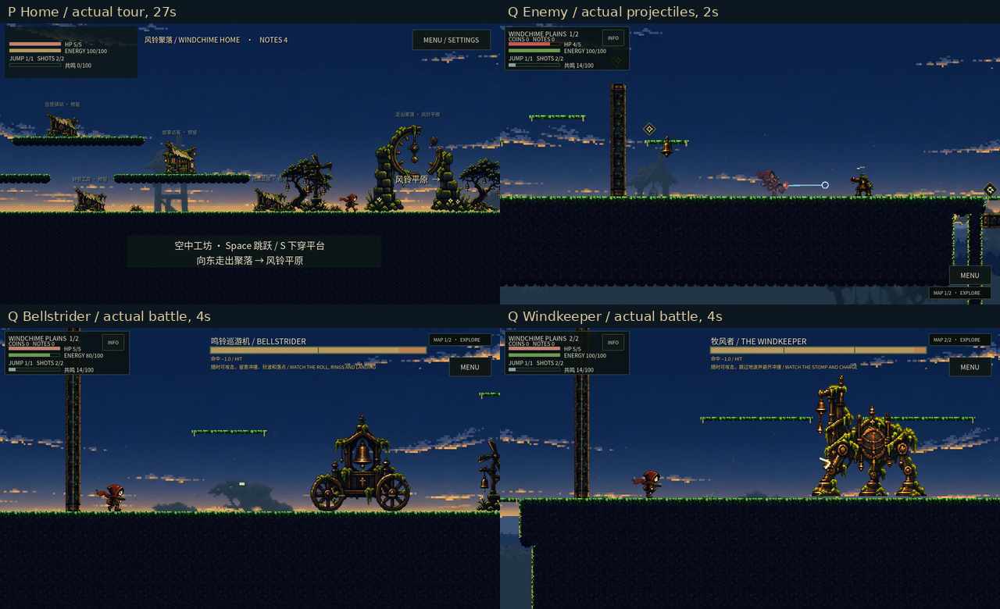

# 十一项试玩反馈返工结果

任务 `UNDERWORLD-FEEDBACK-03`，状态 **review**，未合并 main。[直接试玩](https://zhipijun1996.github.io/gunman-rush/?v=74431d31fbfd)：标题进入平原或家园。Web build **74431d31fbfd**，准确游戏源 **9402bf92fa9be16b10d401db5e02b5c63124ff3c（P）**。后续 Q `3e5b19408829dc915912e964d5df511893491918` 只改录像驾驶器；[1885项运行树等价证明](verification/runtime_equivalence_P_Q.json)保留 P/Q 标签，不冒称重新导出。



## 可以直接比较的结果

| 用户反馈 | 实际修改 | 主要实际证据 |
| --- | --- | --- |
| 1 主角、敌人没有受伤反馈 | 真实扣血后统一发受击音效、身体 hurt、闪烁及唯一 Motor 击退；被拒、无敌、重复和旧请求不重播。地面怪不被普通击退推成悬空，钩索/技能保持原运动所有者 | [双方交战录像](native/Q_enemy/movie.mp4)、[317专项日志](verification/final_P_17/underworld-damage-feedback.log) |
| 2 下方有地面却算坠崖 | 区分附着表面的危险和独立坠落面；后者检查真实下层可站实体。全局越界在角色整体越过真实地图底部后处理 | [原误伤/合法下落/移除地面反例](damage/portable_selection.json)；实际同一 ferry 几何旧 HP4、新 HP5，无下层仍 HP4 |
| 3 荆棘、齿轮受伤进入/退出 | 原命中点有限残影、安全点淡入、hurt 和闪烁自然退出，不延迟原扣血与回退事务 | [荆棘录像](native/Q_surface/movie.mp4)、[齿轮录像](native/Q_gear/movie.mp4)，各225条检查、210行实际连续观察 |
| 4 双方远程缺美术 | 奶金/铜色主角弹，锈色敌种弹，真实发射点、尾迹、命中火花；Boss 铃弹沿用同族铃体。到期/取消不伪造爆炸 | [真实交战](native/Q_enemy/movie.mp4)、[15种实际装备消费者2450条](verification/final_P_17/underworld-projectile-vfx.log) |
| 5 风铃数字难看 | 同族黄铜小牌、I/II 刻痕，替代漂浮数字 | [物件实机独审](independent_review/objects_native_remaining_review.json) |
| 6 上侧门需攻击触发，门风格统一 | 移除 W 旁路；真正上侧主角弹命中机关开门，保留遮挡/敌弹/错误侧/旧请求/重载反例。捷径与 Boss 门共用地形帽沿和苔铜材质 | [83条实际对象检查](verification/final_P_17/underworld-world-objects.log)、[物件证据目录](objects/portable_selection.json) |
| 7 宝箱打开不能变灰 | 原领取成功事务切真开盖姿态，保持尺寸/脚底，重载仍开着 | [关闭](objects/current/map1_cache_closed.png) → [打开](objects/current/map1_cache_open.png) → [重载](objects/current/map1_cache_reloaded.png)，两图各一组 |
| 8 增加装饰 | 小型有根草花预算2→6，保留独立装饰 seed、间距、整物 keepout 和地标预算 | 当前交战与环境影片中的真实正式场景；没有改玩法随机流 |
| 9 家园入口要像出村 | 东侧道路、开口钟拱和明确“风铃平原→”，近身再显示交互说明 | [家园完整往返录像](native/P_home/movie.mp4) |
| 10 家园功能多层分布 | 12站分地面、96wu/192wu平台，基本单跳可达；四原业务、八预留分别验证，二维近邻且落地交互 | [52.8秒家园影片](native/P_home/movie.mp4)、[180条/3051物理行/102实际输入](native/P_home/trace.json) |
| 11 Boss 可持续贪刀、行动规律与碰撞 | 活动且存活战斗持续可伤；可学前摇/行动/收招替代弱点轮换，过渡有界。可打躯干与真实接触底盘分别定义，提示同步更新 | [巡游机完整战斗](native/Q_boss1/movie.mp4)、[牧风者完整战斗](native/Q_boss2/movie.mp4)、[100+16+44条及两完整正式战斗](verification/final_P_17/underworld-continuous-bosses.log) |

## 回归与来源

公开Chromium按原同字节42谓词执行的9项操作检查通过，实际家园露台、升级面板和独立D/A输入均有原件。捕获HTTP失败列表为空、列定Godot/脚本/页面/着色器错误0，但原console有一条未记录URL的通用404，**保留未归因**；不能称所有资源控制台错误为0，亦不猜是favicon。完整PCK与12许可在GUI后再次逐字节核对通过。

最终游戏源 P 的[17项无缓存报告](verification/final_P_17/report.json) **17/17通过**，串行554.538秒，工作树干净。包括 core5680、地形239900、正式20地图40374、空间身份21127、危险281、正式92、角色607、机关1425、家园180、UI243、伤害317、远程43及2450、对象83、Boss100+16+44与两场完整战斗，以及 pipeline116、Home守门36。日志保留原输出，不把合计断言当覆盖率。

[准确交付身份与最终公开核对](delivery/final_delivery_P.json)、[原浏览器报告](delivery/browser_public_P_r3_9.json)、[407项交付证据索引](delivery/evidence_index.json)。

最终交付文档另跑[六项无缓存检查](verification/final_document_checks/report.json)，docs/structure/world/quality/quality-tests/consumer-coverage-tests全部通过；质量记录一致不等于内容全门槛通过。

六段影片均为真实 Godot MovieMaker 输出，旁边有原始 trace、完整前后源 SHA、命令、退出/编码与声音测量日志。环境另保留关键原尺寸 post-draw PNG；其他影片保留若干1秒原尺寸解码帧及完整解码索引。完整原影片可下载，其余全量逐帧 PNG 和 raw AVI 只保留在 build，未全部提交。总览为这些真实截图缩放拼版，不能代替连续影片。

家园是真实 Input → 原生适配器 → Router → Motor，12站走跳无传送；原购买测试显式提供9音符经济 fixture，不是自然赚取演示。交战/荆棘/齿轮各一次初始安全位置 fixture 后用真实键盘；Boss 初始房间定位后用真实 Router/Motor/AI/弹体，不中途改 HP、资源或 AI。Boss 结算后的奖励定位另明确记录；这些不是从地区入口自然通关的整图录像。牧风者击杀时 HP5，胜后等待出现一次原破桥坠落扣血，不能称整段无伤。巡游机短战未覆盖其全部攻击组合。

新增开箱图是本轮唯一实际生成资产，[原图/请求/裁切与原 builder](objects/provenance/)保留；裁切真实条件是 **alpha>8**。其余复用同族素材或明确的程序 VFX，不冒充重新生成。所有对象历史组件截图保持原绑定，不能重标成 P/Q 新采。

[最终独立只读复审](independent_review/final_independent_review.md)对十一项具体消费者及已观看窗口给出 SCOPED ACCEPT；逐帧范围见原报告，不代签完整 CI、用户或实体设备。

## 仍然失败和未验证的范围

- 公开GUI保留上述URL未知的通用404；九项操作通过不掩盖该原始控制台事实。
- 完整适用回归没有全绿。历史 L 请求85项、实际执行37项，36通过后原 action-budget7305/13失败；12个钩索运动冲突修复后原7305另次实际通过，另一次独立输入 TTL 丢失仍保留。最终 P 的17专项不冒充完整85项。
- P 完整 CI `39296218971`：core先9项通过，generated-consumers 子项23180断言/0断言失败，但退出仍有4对象/2资源，**严格失败**；web先13项通过后 level-design-contracts **超时**，子检查断言数未知。后续未运行/部署跳过不算通过。Windows/prepare成功另记。原 HomeUI27条业务断言通过但退出335对象/204资源也仍为严格失败。
- N 空间身份21127/0曾退出4对象/2资源，原命令 verbose 单次隔离复试干净，P最终新鲜专项也干净；根因未证，不能抹去原失败。
- K 独立正式场景加载循环、旧暂停 fixture 受新 hurt 状态影响、旧截图遮箱、N Boss 旧护甲提示等实际失败均保留在[历史报告](verification/history/)、[独审](independent_review/)与各专项证据。修复后证据不追签旧版。
- 连续像素独审只签实际检查的窗口。未完整听音、未做实体设备/性能、全武器观感、Boss全招式、任意种子自然路线或最终玩家审美和贪刀手感验收。软件录制耗时不等于设备帧率。状态保持 **review**。

## 复验与下一轮

```sh
python3 tools/harness.py --check underworld-damage-feedback --check underworld-projectile-vfx --check underworld-world-objects --check underworld-continuous-bosses --check underworld-home --release --jobs 1
python3 tools/quality.py check docs/quality/records/UNDERWORLD-FEEDBACK-03.json
```

Harness新增真实消费者守门、旧适用断言逐条迁移、实际完整战斗及录制源绑定；八份 Skills 已回流到[本轮方法总结](../../underworld_feedback_r3.md)。下一轮先依据实际试玩调整受击与贪刀节奏，再单独定位严格退出泄漏/完整合同超时。16区共享画法、交互与伤害接口，各自产材料、色系和生态；本轮没有开放森林/工城或证明16区量产完成。
