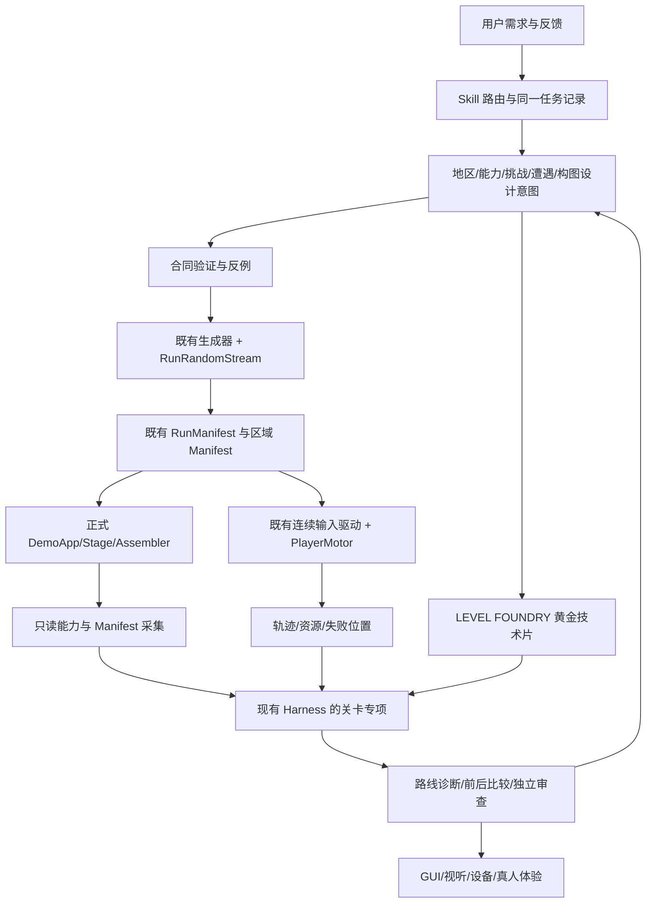

> 当前生产入口已升级为[区域总谱三阶段流程](creative_direction/README.md)：默认route先预制作，绑定总谱后推进；本页保留V2技术合同和历史示例，不覆盖当前CLI语义。

# 《失序之钟》Level Design Harness V2

本体系把关卡设计意图、真实生成结果和体验证据连接到现有 Skills、LEVEL FOUNDRY 与 [Harness](harness.md)。目标是同时支持优化已有地区与制作新地区。本轮生产体系不授权重做正式平原、开放森林、改变 PlayerMotor/武器/资源/随机流或保存规则。

运行事实以 [current_state](current_state.md)、[handoff](handoff.md)、实际消费者及最新用户决策为准；[generation_current](generation_current.md) 提供生成导航，历史八小关不是现行正式设计。技术验证结果须查本任务证据和质量记录，本说明中的命令不是执行通过证据。

## 从需求到成品的责任

| 用户目标/设计层 | 主 Skill | 协作与程序消费者 | 证据门槛 |
| --- | --- | --- | --- |
| 旧地区优化、新地区完整生产 | [region-generator](../.agents/skills/region-generator/SKILL.md) | 现有地区生成/装配、RunManifest；V2 route/capture/analyze/compare | G0 意图，G3 正式消费者，G4 回归 |
| 宏观拓扑、能力锁、区域身份 | region-generator | 正式 PlainsExplorationTopology；旧 PlainsRoomGrammar 仅历史/共享开发消费者 | 图与能力声明检查；实际操作另验 G1 |
| 连续动作编舞 | [challenge-choreographer](../.agents/skills/challenge-choreographer/SKILL.md) | 动作语法、真实能力、Foundry 输入回放 | G0 设计，G1 连续输入/资源 |
| 物理模块与邻接 | [level-module-creator](../.agents/skills/level-module-creator/SKILL.md) | PlatformingModuleDefinition、真实 PlayerMotor、Foundry | 单片、连续短语、邻接/相位与正式池分验 |
| 战斗/平台/机关/奖励与路线节奏 | [encounter-director](../.agents/skills/encounter-director/SKILL.md) | 现有敌人/机关/奖励消费者；逐路线诊断 | G1 联合操作，G4 反例，G5 玩家 |
| 空间构图与视觉引导 | [scene-composer](../.agents/skills/scene-composer/SKILL.md) | 正式 PlainsRegionScenery；PlainsSetDressing 属于另一开发消费者 | G2 正式比例合屏/连续音画 |
| 美术风格、AI 系列和来源总责 | [art-director](../.agents/skills/art-director/SKILL.md) | 现有资产 manifest、地形/GPU 检查 | 黄金合屏认可后扩产 |
| 独立体验反证 | [gameplay-reviewer](../.agents/skills/gameplay-reviewer/SKILL.md) | 原 Harness + V2 专项，实际 GUI/设备/玩家来源 | G4 独立审查；G5 不由 AI 代签 |
| 分类、任务与完成声明 | [game-quality-gate](../.agents/skills/game-quality-gate/SKILL.md) | 现有 quality.py/policy/任务记录 | 原 G0–G5 与十一维不变 |

enemy-creator、boss-creator、weapon-creator、ability-creator、animation-vfx 仍负责其对象的真实实现。新增三技能分别补动作编舞、联合遭遇节奏和空间构图，不接管已有专业职责。

## 六层与旧系统的兼容关系



| 层 | 共享设计语义 | 保留的运行实现 | 渐进接入方式 |
| --- | --- | --- | --- |
| 1 世界拓扑 | 节点/边、主支线、环路、锁/授予、返回、选择价值 | PlainsRegionGenerator、PlainsExplorationTopology | 用设计侧语义图表达非规则坐标与多尺度意图，不重写现行平原布局 |
| 2 身份/空间语法 | RoomIntent、玩家目标、空间/机制/视觉身份 | 现有区域装配；PlainsRoomGrammar 仅旧共享开发链 | 以真实 room/route/module ID 关联，未来地区可换语法 |
| 3 动作编舞 | AtomicAction → ActionPhrase → ChallengeSequence → Encounter/Room → Route | PlainsRouteRecipes、PlatformingModuleDefinition、Foundry | 动作依赖/资源/相位附加合同，不把模块 ID 串当动作证据 |
| 4 遭遇节奏 | EncounterPlan、学习/压力/恢复、风险收益、回程 | 既有敌人、机关、奖励、生命周期 | 先离线设计和路线诊断，未经实现不声称运行导演已经存在 |
| 5 场景构图 | SceneComposition、焦点/轮廓/层深/接缝/可读性 | 正式 PlainsRegionScenery、资产 manifest；开发 SetDressing 单列 | 先黄金合屏，后实际消费者集成；不改变已验碰撞 |
| 6 体验验证 | LevelExperienceReport、来源/范围/反例/未验 | 原 Harness、质量记录、Motor/GUI 工具 | 注册专项，保留旧回归和 G0–G5 |

宏观替代方案的选择需比较语义约束图、非规则嵌入、多尺度空间分配、手工骨架变体与能力约束布局。当前合同可以表达非规则节点；这不代表运行平原生成器已经改为非网格。未来接入应从一个小样和一条真实消费者路径开始，保留 RNG 分流、版本化 Manifest、有界失败与既有保底。

## 数据合同、真实消费者与迁移

设计合同版本 `schema_version: 1`、`artifact_kind: level_design_intent`。机器定义由 [level_design_contracts.py](../tools/level_design_contracts.py) 校验；可复制 [平原边界 fixture](../tests/fixtures/level_design_v2/plains_design.json)、[未来森林 fixture](../tests/fixtures/level_design_v2/thorn_forest_design.json)、[黄金设计卡](../tests/fixtures/level_design_v2/golden_challenges.json)。它们分别为技术切片或 design_only，不是正式地图 Manifest。

| 合同概念 | 实际设计字段/产物 | 消费者与用途 |
| --- | --- | --- |
| BiomeDesignProfile / BiomeChallengeProfile | biome、experience_categories、challenge_axes、learning_order | validate 检查身份、八标签、十项难度轴与学习顺序声明；region-generator 实施 |
| RegionTopology | topology.nodes/edges、entry/goal、requires/grants、weapon_ids、choice_value/return_policy | validate 检查图和能力声明；不判定实际碰撞 |
| CapabilityRequirements | capabilities.catalog/guaranteed/optional/future/supported_builds；挑战入口出口与资源引用 | validate 拒绝非法或未授予能力声明；真实数值由运行采集 |
| RoomIntent / EncounterPlan | rooms、encounters、pacing.strategies | 关联空间、挑战、敌人/机关关系、策略和恢复；设计诊断与后续实施输入 |
| ChallengeSequence | atomic_actions、phrases、challenges | 动作衔接、主要/替代短语、状态、时序、资源、设备和失败恢复 |
| SceneComposition | scene_compositions | 场景层次、焦点、轮廓、接缝、遮挡、资产来源；元数据不替代画面 |
| CapabilitySnapshot | [level_capability_snapshot.gd](../tools/level_capability_snapshot.gd) 运行侧只读采样 | 当前装备/等级、已授予动作、Motor 参数、能量、次数、冷却、构筑和配置哈希 |
| 生成与运行采集 | [level_design_capture.gd](../tools/level_design_capture.gd) 输出 | 保留正式 RunManifest/区域 Manifest，关联实际能力、路径和轨迹 |
| LevelExperienceReport | analyze / Foundry experience 输出 | 结构化诊断、证据引用、观察范围和未验；compare 消费前后报告 |

能力快照不推断未观察到的解锁：当前采样的可装备范围明确是已装备武器；独立 H/W/D 的已实现和已授予分开，未实现 inventory capacity 明示未实现，未传构筑消费者明示 no_build_consumer。同一时刻一个当前武器，不能拼接多个武器的全部能力。正式平原能力与 ActionStudio/Foundry 开发配置分别处理。

这是一组离线 sidecar 合同，不改变存档、RunManifest、随机流和生产模块 Definition。版本变化时更新验证器与 fixture，记录字段迁移及所有实际消费者；源/能力/配置/内容变化使相关旧证据失效。禁止把未来地区合同写入正式生成池或游戏开放白名单。运行时不调用大模型。

## 工作流 A：优化已有地区

1. 读取最新正式入口、生成器、配置、消费者与 Git 基线。
2. 收集玩家原话、Seed、实际路线、能力、设备和失败位置。
3. capture 正式 Manifest 与可用轨迹，analyze 建立基线，静态候选与实际观察分开。
4. 按严重度定位路线/边/模块上的重复、空白、失衡、探索或构图问题。
5. 使用 [优化任务卡](templates/level_optimization.md) 提出具体玩家体验变化和最小改动。
6. 制作少量黄金改进，动作使用 [挑战卡](templates/challenge_sequence.md)，美术使用 [构图卡](templates/scene_composition.md)。
7. 验真实连续动作、资源、探索选择、镜头、美术与体验；修复失败并保留反例。
8. 仅推广相关门槛通过的样板，保持正式准入与开发试验边界。
9. 原两图/共享消费者、随机复现、资源、保存/生命周期和三端输入回归。
10. compare 同依据前后报告，独立审查并交付 [验收卡](templates/level_experience_acceptance.md)，缺设备/玩家认可分别保留待验。

“这里无聊”要形成具体发现，例如某 route 的哪些 edge 重复相同动作依赖、哪段只有长距离移动、奖励是否值得回程；不能泛泛建议加机关，也不能把距离估计直接当真实无互动时间。

## 工作流 B：制作新地区

1. 明确世界观、区域身份和难度定位；不擅定未来地区数量或顺序。
2. 读取进入地区时实际授予的合法能力、单武器构筑和资源规则。
3. 设计区别于平原的核心机制与玩家行为，规划机制明确标未来。
4. 设计空间语法与视觉身份，填写 [地区卡](templates/biome_design_profile.md)。
5. 设计专属机关、敌人、挑战及相互关系，分派已有专业 Skills。
6. 制作最小黄金技术样板，标出创意/视觉/机制缺项。
7. 用真实输入/Motor 验新机制和连续动作，保留低资源、不利相位与失败恢复。
8. 建立经过验证的可复用模块库，验证邻接衔接及设备操作合同。
9. 生成多种非线性拓扑，以路线价值、空间身份和返回证明选择有意义。
10. 联合编排内容、奖励、授予/能力锁、回程；全支持基础构筑有路，随机道具不作强制门槛。
11. 依黄金合屏生产 AI 素材系列并组装，校验层深/接缝/遮挡/来源。
12. 接正式消费者并检验完整地区的真实探索/战斗/平台/视听体验。
13. 修复最差 Seed、独立发现和玩家反馈，按同依据比较前后。
14. 完成正式流程、保存/生命周期与原内容回归，按 G0–G5/十一维作有限结论。

森林 fixture 只证明合同未把平原网格、风铃、Boss 或默认能力锁死；它不证明已制作森林关卡。新区域仍使用相同任务、合同、Skills、Foundry 与 Harness。

## 实际调用入口

从仓库根目录执行；Godot/依赖安装按原工具链，命令失败或缺完成标记不得算通过。以下是可复现调用示例，实际退出码和结果保存在任务证据。

```sh
# 设计意图合同，多个文件逐一验证
python3 tools/level_design.py validate tests/fixtures/level_design_v2/plains_design.json tests/fixtures/level_design_v2/thorn_forest_design.json tests/fixtures/level_design_v2/golden_challenges.json

# 从真实正式消费者取得 Manifest，并复用原连续输入驱动采集三种策略
python3 tools/level_design.py capture --seed level-design-v2-baseline --strategies fast growth deep --output build/level_design_v2/baseline/capture.json
python3 tools/level_design.py analyze --capture build/level_design_v2/baseline/capture.json --output build/level_design_v2/baseline/report.json

# 修改后使用同 Seed、能力和策略重采，不复用旧轨迹伪称新源已测
python3 tools/level_design.py capture --seed level-design-v2-baseline --strategies fast growth deep --output build/level_design_v2/after/capture.json
python3 tools/level_design.py analyze --capture build/level_design_v2/after/capture.json --output build/level_design_v2/after/report.json
python3 tools/level_design.py compare --before build/level_design_v2/baseline/report.json --after build/level_design_v2/after/report.json --output build/level_design_v2/comparison.json

# 可选 policy 必须带来源与版本；不得为了 PASS 放宽阈值
python3 tools/level_design.py analyze --capture build/level_design_v2/baseline/capture.json --output build/level_design_v2/calibrated-report.json --policy build/level_design_v2/calibrated-policy.json

# 生成既有生产流程可消费的任务路由计划；生成计划不等于执行 Skill
python3 tools/level_design.py route --request '优化风铃平原' --output build/level_design_v2/optimize-mission.json --mode optimize
python3 tools/level_design.py route --request '制作荆棘森林' --output build/level_design_v2/forest-mission.json --mode new_region

# LEVEL FOUNDRY 扩展：原真实 Motor 验证与输入回放，输出在 build，禁止正式晋级
python3 tools/foundry.py experience --output build/level_design_v2/golden

# 原回归仍需执行；本轮至少 docs，具体选择按任务影响范围
python3 tools/harness.py --profile docs
python3 tools/harness.py --profile gameplay --profile art
```

`--mode` 可省略，由 request 路由；有歧义时以明确任务范围为准。`capture --strategies` 选择实际驱动支持的 fast/growth/deep，不能据此称覆盖所有玩家行为。`--policy` 输入应先使用当前实现接受的字段，完整语法查 `python3 tools/level_design.py --help` 及各子命令帮助。上例 calibrated-policy.json 是需实际创建并审查的校准文件，不能复制不存在文件当已执行。

## 自动诊断与证据边界

V2 分别处理 Topology、Traversal、Challenge、Pacing & Encounter、Visual Composition、Experience Review 的数据和证据。具体已实现检测、正反例和执行结果以工具测试/报告为准，不能将六类设计目标全部称为已实现自动审美。

当前 capture 首先从正式 DemoApp 取得真实 Manifest 和能力；路线轨迹随后来自现有区域 assembler/射击锁连续输入测试。其范围是实际 Motor、真实碰撞/输入/资源的已测试路线，**不包含敌人遭遇与 Boss 战完成**，设备为 synthetic_router。actions 是 router 输入请求而非全部已接受动作事件；不得直接把每个请求计为真实攻击或有效互动。能力/配置不匹配、空轨迹、失败/错误源必须显式失败。执行凭据校验只证明本地命令、完成标记、内容和当前源码一致，不能认证作者身份；独立重放仍必要。未受理输入请求不会中断低互动候选。

| 证据 | 允许的结论 | 禁止的外推 |
| --- | --- | --- |
| 设计 validate | 字段/引用/图与能力声明符合合同 | 真正可达、已实现机制或好玩 |
| 正式 Manifest | 该源/Seed 的真实生成结果 | 路线可通关、体验优秀 |
| 连续 Motor 轨迹 | 该输入/能力/相位与测试消费者路径表现 | 所有构筑/策略/设备、敌人/Boss 完成 |
| 静态空白/重复候选 | 指定路线/模块的潜在冗余或体验缺口 | 玩家确实无聊、真实无互动秒数 |
| 输入/资源逐帧分析 | 已记录请求、位置/速度/次数/能量变化 | 未记录的观察、命中、奖励或玩家决策 |
| 构图声明 | 有明确焦点/层深/接缝/遮挡要求 | 真实画面美观、动态落点可读 |
| Foundry 黄金技术报告 | 原验证器的短语/连续 itinerary 与回放证据 | 大师难度完成、正式池准入、用户认可 |
| GUI/设备/真人原始反馈 | 对应场景、设备、参与者和版本 | 自动覆盖其他设备或全体玩家 |

保存完整 Seed/Manifest、源/配置哈希、能力、动作轨迹、失败帧、日志和诊断；截图/录像需要真实来源与相同消费者/版本关联，不能从别的 Seed 借图。缺画面/设备/趣味证据保留 unverified / awaiting-device / review。结构签名、动作签名、机制组合、探索决策和视觉身份分开；不同 Hash 不直接算多样性。

## 基线、阈值与反例

阈值先做版本化 baseline observation，按地区×挑战类别×目标设备解释，不设“趣味95分”。长空白、高压连续、奖励间隔、重复地标/遭遇、回程疲劳等指标必须说明测量单位、实际路线、输入依赖和候选性质。黄金样板与真实玩家反馈提供校准依据；阈值变化写明为什么及哪些旧报告不可比，不能为通过当前样本临时改标。

每项新检测必须有通过例和故意失败例：例如字段缺失/未来能力、不可达或循环锁、同动作换 ID、长无决策路段、连续资源不足、空报告、错误 Manifest/能力/版本引用。反例应定位真实 route/edge/module/帧；静态 fixture 只能检验判定器，正式路线与真实 Godot 仍需独立执行。保留最差 Seed 与失败→修复→复审链。

## 三类黄金与工坊晋级

[黄金卡](../tests/fixtures/level_design_v2/golden_challenges.json) 给普通、进阶、大师的设计/能力/空间/相位/资源/恢复与设备要求；[挑战模板](templates/challenge_sequence.md) 用于后续复制。现有 Foundry 的 height_then_precision、resource_then_rhythm、precision_to_transfer 和连续 itinerary 可作为技术底座，不单凭模板名或动作数判断实际难度。

| 类别 | 体验合同 | 技术片之后仍需完成 |
| --- | --- | --- |
| 普通 | 主路短组合、容错、观察与恢复、熟练后流畅 | 入口出口容错/低资源、实际镜头、真人学习反馈 |
| 进阶 | 自愿高收益、资源决策、机制耦合与连续操作 | 风险收益、替代解法、不利相位、完整返程 |
| 大师 | 隐藏可选、长链精密控制、明确安全区、可学失败 | 原创专属挑战、精度与节奏校准、完整美术/音画/实体设备与玩家验收 |

`foundry.py experience` 复用原验证和回放并保存新证据，不安装正式资源；原 `build --promote` 也仅晋级开发工坊。技术片中的静止入口/出口值是设计意图，不能称已测包络。新机制/新资产缺项明确标注，不把技术底座包装成精美大师关卡。

## 后续任务 Prompt

```text
请按 AGENTS 与 Level Design Harness V2 优化风铃平原的一条最差路线。
先 fetch 并冻结正式消费者与当前能力，复现本次报告中最严重的 route/edge/module 问题。
读取原始玩家反馈；用同 Seed 的 fast/growth/deep 基线区分重复动作、空白与回程问题。
只做一个黄金改进切片，优先改变真实判断/连续动作/恢复或构图，不改 PlayerMotor、武器、资源、随机流和保存。
通过真实 Motor、相邻连续组合、正常尺寸合屏与原 Harness 后再决定推广。
保留原失败和最差 Seed，输出同依据前后对照；独立只读审查，缺设备/真人认可如实未验。
提交独立分支并创建 PR，不默认合并。
```

新地区任务把首句替换为“按工作流 B 制作荆棘森林最小黄金样板”，先确定与平原不同的机制/空间身份及合法进入构筑。以森林 design_only fixture 开始，未实现机制不得作主路证明；先样板、后模块库、再拓扑/遭遇/美术/正式集成，沿同一体系继续。
