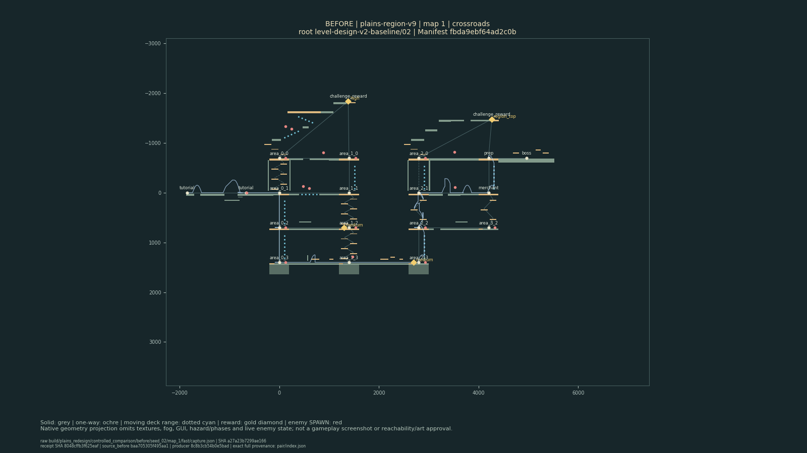
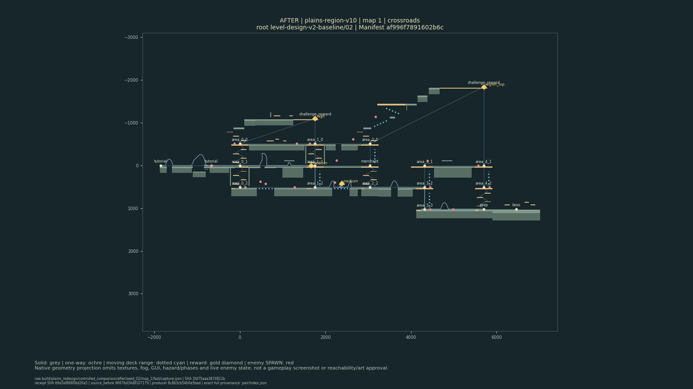
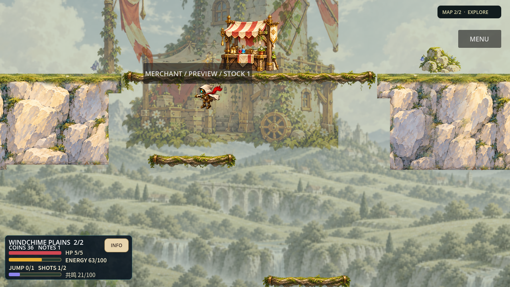

# 风铃平原整区重设计：可玩候选已改善，整体品质目标未完成

本轮保留了布局、动作、奖励、敌位和功能读图的改善。**Q6的四种强空间身份仍然失败，原live-PNG外环录像实际失败，一次无实时PNG对照成功未修复默认观察器；整区趣味、审美和全部方向公平性没有通过，整体未完成。** 体系能完成真实设计、验证、独立拒绝和有界返工，但没有自动保证优秀关卡；历史52项工程检查不能抵消新失败。

分支 `feature/plains-designed-exploration`，基线 `30f6a825712fbb30e607791c996de142c6757a79`；C3运行检查点 `ee821ce18746253c01ad9e27270df96488870264`，C4测试定位检查点 `a39ea373105c24b09c59b9d51b7c440440bc0a17`。C4已push并建立[stacked draft PR67](https://github.com/zhipijun1996/gunman-rush/pull/67)，base为`feature/level-design-harness-v2`，关联PR66；未合并、未发布。最终文档/证据提交由PR67的实际commit记录确定；本报告保留原C3/C4运行来源，不把文档提交冒充重跑。

## 原体系怎样承担这次制作

正式链仍是 `DemoApp.start_plains → PlainsRegionStage → PlainsRegionGenerator/Assembler`，复用RunManifest、RunRandomStream、Definition与唯一PlayerMotor。Scenery/Composition负责表现，GroundSupports提供实体基础；核心物理、单武器、资源、能力、RNG和保存合同保留。正式基础仍为Pulse1、一跳、两发空射，Studio的H/W/D实现不等于授予。

原 `level_design → Harness/production_loop` 加载地区/武器/能力/覆盖后路由Skill：region-generator做探索骨架，challenge-choreographer/level-module-creator做动作，encounter-director做敌地关系，scene-composer/art-director做空间素材，不同作者gameplay-reviewer只读反证。Q1–Q8映射既有十一维/G0–G5。

| 自动路由职责 | 实际程序/证据入口 | G层职责，非通过声明 |
| --- | --- | --- |
| region-generator：区域/路线 | PlainsRegionGenerator、PlainsRouteRecipes；controlled_comparison | G0布局、G1物理、G3正式、G4多样性 |
| challenge-choreographer：动作编舞 | 原Foundry；PLAINS-REDESIGN-GOLDEN-01记录 | G0挑战、G1轨迹、G2连续读图 |
| level-module-creator：模块/接缝 | plains_low_arch.tres、原Module Lab与18格校准 | G1身体/资源、G3真实邻接 |
| encounter-director：敌地/风险收益 | 原正式capture/level_experience；ENCOUNTER-01记录 | G0目的、G1–G3联合、G4对照 |
| scene-composer：空间/镜头 | PlainsRegionComposition/Scenery、原SceneRunner/Wrapper；SCENE-01 | G0构图、G1–G4真实合屏 |
| art-director：素材/风格 | 原资产manifest、Q6-CLIFF-ASSET-01及alpha原件 | G1–G3导入/合屏、G4来源；本轮failed |
| gameplay-reviewer：不同作者反证 | final_regression/design/visual_review | G0–G4独审、G5保留真人/设备缺口 |
| game-quality-gate：总记录/完成声明 | tools/quality.py、PLAINS-REDESIGN-01及同任务子记录 | G0–G5/十一维；不把局部接受升级为总通过 |

记录完整前缀为`docs/quality/records/PLAINS-REDESIGN-`，程序和原始观察位于仓库与`build/plains_redesign/`；G5真人/设备认可仍缺。

黄金、空间、体验、敌情、HIGH、Scene均有真实host响应、source、退出码、独立REJECT与复审。断语义路线、动作因果/入口身份漏检、Scene删岸坏例和归档阻塞保留；阶段接受仅针对对应合同。

生产预算已关闭：原29次，加旧装饰Q6失败1次、唯一新素材失败1次，共**31次实际调用；cap33不增加，剩余2封存不用**。宿主须真实活跃，以nonce/source_hash/expires_at、request_hash和agent_id绑定租约；裸shell不是无人模型daemon，认证或外部工具失败不能由模板PASS代替。最终采样、归档和只读审查不重开创意预算。

## 已保留的具体改善

| 改善 | 实际结果与限制 |
| --- | --- |
| 探索骨架与回程 | 三骨架、变列距/层高、短路回营、上庭与溪谷进入正式生成；仍共享列轴/正交连接，不同Hash不等于玩法丰富。 |
| 主路动作与容错 | 图1井铃同弹开门/反冲接低顶短释放；图2上台再射第二铃。低拱18格由12次危险接触→18/18通过：release5/7/9×offset−8/0/+8×双向，轮心282→308、半径18，顶棚/Motor不改。走路仍碰轮、长按仍可能碰顶，不是普通玩家/手机认可。 |
| 溪谷发现 | 原预算中箱移到受控渡船侧岛：登船→停车→上岛正式modal领奖→返同船重启→攀回营地。首次单diver分开教学，后续联合压力保留。 |
| HIGH与敌位 | 接收台/遮枪线守卫移到宽岸，保留AI、预算和活敌绕过，真实回程反例驱动修复。高奖rolled0为recoil_step→windchime_rush，中间落地恢复，是两段组合，非稀缺资源长空大师链。 |
| 外环与功能画面 | 下层外臂真实消费carrier并攀回；厚实体岩基、紧凑HUD/地图chip、短提示改善读图。维修区是开放小屋前庭，有回营价值，非压缩廊道。 |

历史外环同岔口→同汇合，下路约24.58秒、上路24.25秒，不能称下路更快或独占渡船。历史逆时针闭环回段HP3→3、完整前缀HP5→3；它不能替本次新录像闭环签字。顺时针首次抵达未清fan+sentry岸的两种策略失败仍在。独审反冲探针落到319层后因目标策略停止，未证明后续物理无解或完整安全替代。

## 同条件160路线：确有收益，也有反向指标

完整 `controlled_comparison` 已结束；原严格analysis2/compare退出0，双方各10个root、两图、fast/growth/deep/return四策略，各80条。共享19文件driver、133项核心来源、初始能力与策略基准核对后比较；玩家伤害与打敌/机关伤害分开。

**这些是具有地图和目标信息的合成路线策略。** 不证明玩家依靠雾图/视觉引导自然发现路径，也不覆盖所有探索决策；到目标不是真人成功率，“normal”命名不能充当真人认可。

| 实际观察 | 旧内容 | 当前内容 | 能支持什么 |
| --- | ---: | ---: | --- |
| 各80条到目标 | 51 | 71 | 20条旧策略失败转为到达；0条旧到达转为新失败；仍9条双侧失败。 |
| 双方都到目标的51条：低互动候选总数 | 52 | 33 | 在排除提前失败截短后，候选减少；候选仍需解释观察/恢复用途，不是无聊评分。 |
| 同51条：玩家受伤事件 | 46 | 49 | 受伤增加，不能写全局难度/公平性全面改善。 |
| 同51条：时长中位数 | 79.33秒 | 56.73秒 | 该共同完成集合更短；不外推每个Seed更快或路径更有趣。 |
| map2/fast的10个样本：玩家受伤事件 | 4 | 10 | 两侧10条都到达，但这一组伤害恶化，须保留具体风险；不是“受伤人数4→10”。 |

整80的玩家受伤事件78→63、低互动候选63→57，包含旧侧29条提前策略停止，不能用它覆盖共同完成51条的46→49。map2/growth到达7→10，同时玩家受伤事件8→12，也不能只选到达收益。动作次数、时长与候选变化是体验代理，不是自动乐趣评分。

9条残留全在map2：deep的`/01、/03、/05、/08、/09`，return的`/03、/05、/08、/09`。`unresolved_locations.json`明确记录：

- `/01/deep`在tick2612、deep_region_top，位置约(2697.63,−910.07)，诊断为ferry_air_intercept的“enemy bank unsafe/no damage progress within budget”。
- 其余8条在deep_high，`/03`tick931、`/05`951、`/08`1014、`/09`960；站位x≈−130、y≈−1100或−910，诊断为“unsafe recoil bank before enemy shot”。

终帧均grounded、HP5、能量66–100，表明**带敌渡船岸的反冲站位/有界策略未解决**，不证明物理无解或必伤。终态资源不代表完整资源路径。依据实际raw、root_readout和unresolved；旧受负载干扰80组不充primary。

## Q6失败保留，alpha解释收窄

钟庭仍主要是薄踏板、局部厚岸和重复淡拱；溪谷仍缺可信近中景井口围合。两版放大小石簇的合屏都失败，唯一新侧壁图也未准入；已恢复精确20f表现和匹配的原Scene观察器，原59断言/10实际Node坏例/12收据拒绝保留，被弃版本新增14/14反例与失败影音另存。恢复可玩候选不是美术目标完成。

原PNG冻结合同要求31px全高alpha0沟槽和四边透明padding；实测7px、padding30/0/20/0，**原spec failed，不改阈值**。alpha>0 bounds受1/255尾部影响；alpha≥2诊断沟槽79px、≥128为84px，alpha0隐藏RGB不等于可见色。候选未实际import/GPU合屏，matte/halo/拼缝未证；未来须以真实filter_clip/采样器/缩放校准，7＜31不能单独证明画风差，更不能批准本图。

主路/上层复用remote_sequence仍有复考风险，须结合进入方向、敌压、信息和连续画面判断；不能只按ID判无聊，也不能因高奖重复已修而忽略。

## C3技术通过、C4桥接与工程独审的边界

| 证据 | 结论 |
| --- | --- |
| C3原deliver `20261015T105103Z/report.json` | 12/12 steps passed/exit0；包含原Foundry重认证/stamp、三Lab、Windows、Web、三浏览器路径和动作片。Foundry36短语/18路线属于开发池，不授正式H/二跳或新模块池。 |
| C3两轮release | `20261015T105150.413469Z` gameplay/art49项、`20261015T111159.550455Z` web22项均实际通过、reused=false；交集19、并集52。是完整52种检查的合并覆盖，不是单次full52或71种检查。 |
| C4 test-only桥接 | `c3_to_current_bridge.json`确认runtime_changed_paths=[]，仅GUI像素定位工具及任务/声明变化；C3全局source_digest不能改标C4，也没有宣称新跑C4全52。 |
| GUIv2 | region8项、floating_touch7项均failed0、两命令exit0；真实Home购买/重载、正式departure、雾图focus/zoom/drag/Escape、跳射与独立三触点。build_id=`eeeb0759998d`，包源仍C3。一次9notes是隔离fixture，earned-note reload未验；保留1条资源404，Chromium模拟不等于Android/iPhone/手柄。 |
| C4工程独审closure | `/root/plains_spatial_audit`于`c4/closure_provenance.json`给出ACCEPT，范围仅工程回归/原测试守卫及技术证据归属；实际核对160小收据、九残留与原严格重算。明确不接受Q6、真人趣味/设备、全部方向公平或九条残留路线已解决。 |

上述closure先于本次outer录像失败；不能扩写为当前所有观察都通过。原失败另有`c4/outer_render_failure_review.md`；后续技术记录必须显式容纳这次exit1及独立观察器结果。

`final_delivery_source_freeze.json`已在全部原生/电影观察终态后冻结C4的686项runtime来源。后续仅做文档、Skill经验、质量记录和归档，不能把最后文档提交改标为新跑完整52项；19文件driver、133项核心对照与686项全运行来源属于不同范围。

原GUI失败保留：稀疏OCR漏掉可见地图chip，C4改为有限候选区真实像素定位，缺失/歧义拒绝，原点击/雾图断言保留，无固定坐标成功兜底；这不等于玩家已自然看懂引导。

实际执行入口包括 `python3 tools/deliver.py --jobs 4`、原`foundry.py build --count 24 --promote`、gameplay/art与web两次release Harness、`build.py windows`；160使用原`level_formal.py`的10root×两图×四策略、同kill_from_bank_v1、jobs2、max18000，LP1串行防止争抢录制。正常电影使用原capture API的有界900s，不能虚构CLI参数、改Router TTL或刷新输入时间戳换通过。

本地可玩入口：`bash tools/godot.sh --path .`，从菜单正式出发体验两图。本次map2电影经既有合法独立测试loader进入，不代表已经打穿Boss/完整解锁流程。下一轮自主生产入口为`python3 tools/harness.py --mission <新mission.json> --execute --worker-mode host --evidence-dir build/verification/<新任务>`；须有真实活跃宿主处理租约，裸shell不会自动变成模型daemon，本轮封账不能用此命令续抽。

## 已收集电影、地图与剩余收口

8部匹配片已终态captured，8条生产命令均exit0；这表示媒体采集完整，不表示8条路线全成功。均为1280×720、60fps、48k双声道、软件GPU/LP1。`matched_movies/execution.json`与各`capture.json`、收据、rendered_report保留原SHA。

| 匹配题 | 旧物理tick/结果 | 当前物理tick/结果 |
| --- | --- | --- |
| intro_fast | 2559，到目标 | 4313，到目标 |
| creek_growth | 7575，到目标 | 3950，到目标 |
| advanced_deep | 899，route_policy_failed | 3407，到目标 |
| high_return | 4711，到目标 | 2287，到目标 |

路线选择有变化；intro当前更长，advanced旧片提前失败，不能用时长直接给趣味或效率打分。实际片长/视频帧数与物理tick分别记录，不把post-draw截图请求tick或MP4帧号冒充精确物理同帧。

**原外环录像失败：** `final_outer_movie`为7条断言/1失败、3007tick、`scene_custom_route_failed`、目标false、exit1。上行`area_3_3→area_3_2`未达，末位约(4080.74,709.93)、HP3/energy100；非物理无解证明，历史闭环不能抵销。原收据无source_after，不补写。`failed_media.json`绑定原capture/receipt/log/AVI四件SHA，仅转码完整失败MP4；AVI排除bundle，保留SHA/字节数。

原队列保持`blocked_outer_circuit_movie`，前三passed、outer failed/exit1；旧worst/maps监视者保持`blocked_original_queue`/`blocked_movie_queue`。独立`observation_closure_v2.json`完成失败片转码、worst采集、地图投影三阶段，均exit0且source_before==source_after；状态为`observations_collected_with_failed_outer_route`。worst以v2 execution为准：recorded，但`/03`map2/deep在931tick仍`route_policy_failed`，unsafe recoil bank保留。**10部原观察包含失败，绝非10条成功路线。**

6对地图已从160原件生成12 PNG/12 SVG。取after每family×map字典序首个fast，配同root/map旧例：map1 crossroads `/02`、linked_rings `/03`、woven_layers主root；map2 crossroads主root、linked_rings `/04`、woven_layers `/01`。同轴使用两world_bounds并集，保留RunManifestHash、raw/receipt/log/source/producer SHA与真实轨迹，敌人标SPAWN。省略贴图、雾、HUD、危害相位/几何与敌动态，不是实机、物理或趣味验收；不按成功/好看筛选。

设计与视觉独审已读终态匹配片抽帧、失败外环/worst和6对地图；目前仍拒绝Q6完成声明。视觉原件另定位creek无根部ivy、回营小屋露水平裁底、clock重复拱脚结束在桥下空域；是视觉根植问题，不是要求所有背景都碰撞。有限静帧不等于全片运动/音轨审听、真人趣味或设备验证。两份审查均已 completed_bounded_review，实际 verdict 均为 REJECT 完整品质完成声明。设计报告 SHA256 `9cb15f94efd8f81aa95824945d457bb62b0d20e9b716f5c5d7ff897e62b79534`，视觉报告 `9d1980dbaf8f190842e187768473fb563e632f92f88d8e63453b9cb3c8f048c6`。标记完成指审查完成，不是内容通过。

唯一`outer_no_live_png_movie`对照保留原SceneRunner/路线/cycle/断言，仅不传`--screens-dir`，仍完整write-movie。现为`captured_route_passed`、exit0、8/0、6528物理tick、source相等；MP4为6533帧/108.883秒，SHA256 `c5eb691bfedd8b34b6810d3debb4bd4bd4243d3ff9595f76c5e8f3ec2ca7e981`。18 PNG是事后视频帧，不是native截图/精确物理tick。总数**10原观察+1技术对照=11电影**；原7/1失败独立保留。默认live-PNG观察器可靠性仍未解决，不能据此单独证明TTL因果或内容修复，不再重试。

工程新附录`c4/outer_no_live_png_review.*`独立核对：全6528tick的**12项明确状态字段**与fresh C3 headless相同，前3000状态与原失败片相同；3001对照接受jump，原片请求相同却未接受。单次模式对照支持与live-PNG观察干扰有关联，确切原因unknown，未记录请求墙钟/消费年龄/丢弃原因，不能证明TTL。原默认观察标准及父technical/G1继续failed；工程守卫保留的局部ACCEPT不抵销它。

已完成的归档由正文从`docs/plains_redesign_delivery.md`引用`evidence/plains_redesign/final_current/`。bundle内电影约定为`raw/build/plains_redesign/matched_movies/{before,after}/{case}/gameplay.mp4`，失败外环/worst与可选第11片各在同级实际目录；地图为`raw/build/plains_redesign/controlled_maps/map_{1,2}_{family}/{before,after}/map_{1,2}_{family}.png`及同名SVG。JSON/log实际stored文件带`.gz`，Markdown源为`.md.source`；最终`index.members`才是权威映射，`original_path`仓库相对、`sha256`为原件、`stored_sha256`为实际gzip/媒体。引用gz必须用storedSHA，restore只向隔离新root恢复且拒绝覆盖异字节文件。完整归档已逐文件校验原始/压缩SHA与解码往返：[portable index](evidence/plains_redesign/final_current/index.json)，index SHA256 `fb6dc4d3396138e0f4fe7674dd2863d5c9bfc3fbff51d0c8b737a1c3ffc99995`。这只证明证据字节，不授予技术或品质PASS。PR67保持draft。

## 森林准备与五个问题

森林以`restored_forest_dry_run`为准，旧`final_forest_dry_run`仅历史：14步骤、5任务、plan_only，全库13条中按适用域选择6条经验，**非全13条输入**，含素材尺度/alpha经验。H的Studio实现≠正式授予；formal_region仍no_formal_consumer_observed，grant/catalog未实现。机制/关卡/资产尚未制作。若有fresh `final_forest_closure`，按其实际selected数与SHA补入。

1. **再说“把平原做得更有趣”，能自主完成什么？** 原体系能加载权威、分工设计、真实运行、独立反证和有界返工；本轮20条策略改善和主动发现Q6失败都有事实。它不能承诺每个目标自动成为优秀内容，也不能越过已关闭预算继续重抽。
2. **说“开始制作荆棘森林”，能组织吗？** 能按S2/H、单武器与最新经验组织14步骤/5任务；当前只证明plan-only，实际H授予、机制黄金、自然空间/敌人/素材和正式集成仍须真实制作验证。
3. **怎样主动发现问题？** 从真实输入/资源/敌态/路线/镜头定位，再由责任Skill解释观察留白、无目的往返、复考或敌位冲突，并设实际反例。Hash、道具数、候选数和到达率都不是乐趣判据。
4. **本轮改善了什么？** 有目的的侧岛/回程、不同首题、18格几何余量、高奖配方/敌位、真实外环及功能UI；同策略到达51→71且无新增失败。但共同完成样本受伤46→49、map2/fast4→10、九条ferry-bank残留与Q6失败必须同列。
5. **哪些还需外部或真人？** 真host/认证和图像工具要实际可用；重要画风取舍、完整音画审美/乐趣、实体输入与硬件性能需要对应证据。缺这些不阻止授权内常规修复，也不允许伪造认可。

## 下一次Prompt：本轮收口之后的新有界任务

> 以本次最终提交和失败证据另立有明确上限的新任务，不复用已关闭31次账本。先按角色尺度、可见根部/采样器制作一个可信钟庭或井口岩壁黄金，验证正常HUD/敌预告下的轮廓与观看顺序，不放大小石簇或仅凭alpha百分比签美感。针对ferry unsafe-bank及主路/上层remote复考选少量代表路线，区分策略局限与空间/敌位问题，验证观察、站位或替代关系。保留物理、单武器/资源/能力、RNG、保存；真实黄金与不同作者反证后再推广，无进展停止、不重抽，不用更聪明driver冒充设计修复。真人趣味/审美与设备另验。

完整C4变更清单为 `changed_files.csv`：实际30f…a39ea37共2,971项，M102/A2,869，其中2,825项为原始证据/失败归档，不能当新增玩法数量。最终文档/证据提交后按实际SHA更新清单；原运行版本、审查版本和包装版本继续分别标注。最终完整路径清单见[变更清单](evidence/plains_redesign/acceptance/changed_files.csv)。

## 可直接查看的实际证据

| 内容 | 旧版 | 当前候选 |
| --- | --- | --- |
| 主路推进 | [旧电影](evidence/plains_redesign/final_current/raw/build/plains_redesign/matched_movies/before/intro_fast/gameplay.mp4) | [当前电影](evidence/plains_redesign/final_current/raw/build/plains_redesign/matched_movies/after/intro_fast/gameplay.mp4) |
| 溪谷探索/回营 | [旧电影](evidence/plains_redesign/final_current/raw/build/plains_redesign/matched_movies/before/creek_growth/gameplay.mp4) | [当前电影](evidence/plains_redesign/final_current/raw/build/plains_redesign/matched_movies/after/creek_growth/gameplay.mp4) |
| 高收益路线 | [旧电影](evidence/plains_redesign/final_current/raw/build/plains_redesign/matched_movies/before/advanced_deep/gameplay.mp4) | [当前电影](evidence/plains_redesign/final_current/raw/build/plains_redesign/matched_movies/after/advanced_deep/gameplay.mp4) |
| 高奖回岔口 | [旧电影](evidence/plains_redesign/final_current/raw/build/plains_redesign/matched_movies/before/high_return/gameplay.mp4) | [当前电影](evidence/plains_redesign/final_current/raw/build/plains_redesign/matched_movies/after/high_return/gameplay.mp4) |

[原外环失败电影](evidence/plains_redesign/final_current/raw/build/plains_redesign/final_outer_movie/gameplay.mp4)；[最差策略失败电影](evidence/plains_redesign/final_current/raw/build/plains_redesign/worst_movie/gameplay.mp4)；[完整外环技术对照电影](evidence/plains_redesign/final_current/raw/build/plains_redesign/outer_no_live_png_movie/gameplay.mp4)。均为实际正常速度音画记录；录制的墙钟耗时不是游戏实时性能。没有完整音轨审听签收。

[独立设计审查原文](evidence/plains_redesign/final_current/raw/build/plains_redesign/final_design_review/report.md.source)；[独立视觉审查原文](evidence/plains_redesign/final_current/raw/build/plains_redesign/final_visual_review/report.md.source)；[工程守卫范围接受](evidence/plains_redesign/final_current/raw/build/plains_redesign/final_regression_review/c4/closure.md.source)；[录制失败与唯一对照审查](evidence/plains_redesign/final_current/raw/build/plains_redesign/final_regression_review/c4/outer_no_live_png_review.md.source)。Markdown原文保留为.md.source，避免将历史相对链接误当本轮导航。

### 地图与实际镜头

以下地图由真实Manifest/geometry/轨迹投影，同一对使用共同坐标轴；不是游戏截图或美术验收。

[全部六对地图索引及来源](evidence/plains_redesign/final_current/raw/build/plains_redesign/controlled_maps/index.json.gz)。

### 复现与明确的停止原因

完整恢复命令：`python3 docs/evidence/plains_redesign/final_current/restore.py --root /tmp/plains-observations-new`，目标必须新建，原件中的绝对路径作为历史保留，index映射仓库相对路径；不能直接把旧路径改到当前源后称重演。全部归档已解码校验，但没有在空间受限环境完整写出第二份隔离副本。旧地图应checkout基线30f并安装同19文件观察器，按保存request复演；当前内容v10不能消费旧v9 Manifest。

采用的[game-quality-gate](../.agents/skills/game-quality-gate/SKILL.md)要求：“预算、无进展、越界或外部工具依赖阻塞才保留现场并停止对应依赖。”[本轮冻结预算](quality/plains_redesign_iteration_budget.md)进一步明确：“新旧失败卡/源/原图/全部媒体不动，Q6完整目标仍failed。”两版旧素材构图和一次新资产均失败后，实际31次生产调用封账、剩余2不用。本轮保留候选而不继续重抽或把失败签成完成；下一轮具体方向见上方Prompt。无需用户替团队发现这些已知问题。

## 最后收口实际结果

[最新森林dry run](evidence/plains_redesign/acceptance/final_forest_closure/plan_v2.log)已实际退出0：14步骤、5依赖任务，从13条全库经验选择6条适用经验；包含本轮修订的素材采样因果限度。只规划，不生成森林或授予H。首次误用mission入口不支持的`--plan`实际exit2，原日志和blocked收口receipt保留；更正为该入口默认规划后另存v2，不覆盖旧失败。

[打包修正独立复审](evidence/plains_redesign/acceptance/final_packager_review/report.md)仅接受对真实native/rendered两种产物合同的区分；第一次预检拒绝缺失电影invocation文件保留。没有补造native收据或source_after。

空间受限时，240个原始路径（160capture及冻结旧项目80镜像）已与portable gzip逐项解码比对，再移除重复build副本；原字节/路径/哈希与恢复命令见[可逆归档记录](evidence/plains_redesign/acceptance/portable_primary_storage.json)。任何旧工具需原路径时先实际恢复，不把路径暂缺当成已丢失原始证据。电影、日志、收据、失败现场和来源不删除。

最终检查与运行来源桥接见[收口目录](evidence/plains_redesign/acceptance/README.md)。Windows/Web已在C3实际导出；本地可玩Windows文件在build/windows，Web可用`python3 -m http.server 8000 --directory build/web`。它们的构建来源仍为C3，与C4运行代码相同；PR的后续CI构建状态以实际Actions为准，不预签最终提交或公开部署。

最终适用检查实际fresh19/19通过，任务/记录/Skill索引与累计测试守卫审查通过。此前并行clone/storage中断（0检查）、缺草稿相对链接上下文（docs失败）、质量条目缺reason（结构失败）均留在[原始收口记录](evidence/plains_redesign/acceptance/final_checks.json)，只修实际原因，同标准复验。末次19项检查之后仅补证据包装、路径清单和记录指针；不外推为最终文档提交fresh52原生通过，也不冲销原live-PNG失败。

portable final_current约1.1GiB，以完整媒体和原始轨迹为主；这会增加clone/审查成本，不是新增玩法或框架数量。完整独立审查中，视觉实际查看100张原图；设计仅实际查看12张（历史3、工程图6、对照后抽3）并核对八片终态/raw，未完整播放或听音。此处不把“两者都审查过”写成同等观看覆盖。

原件保真还意味着不清理原始OCR空列、历史CSV行尾或归档脚本的尾空格：全文件`git diff --cached --check`对38个evidence路径实际非零，未改标PASS。源码与正文单独格式检查退出0；[完整限定](evidence/plains_redesign/acceptance/immutable_whitespace_review.json)及压缩原告警留存。此范围区分只针对字节归档，不豁免任何游戏测试或质量门槛。
