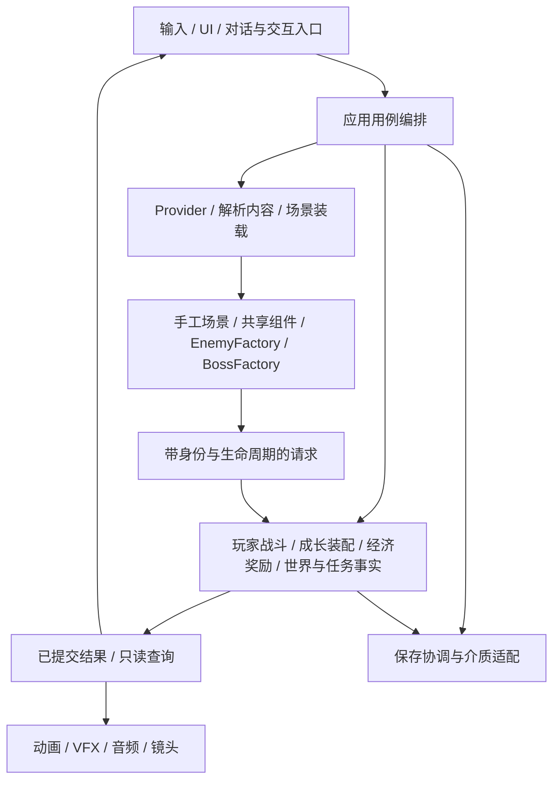

# 全项目架构与实施边界

保持 Godot Node／Scene／Resource 的模块化单体，按功能和内容归属演进。应用编排用例，业务模块拥有规则与状态，表现消费已接受结果；职责划分不要求每项新增类或管理器。本文规定系统边界；真实运行版本见 [当前状态](current_state.md)，文件与检查从 [模块导航](module_map.md) 按任务定位，实施依赖和验收见 [MV-RUNTIME-01工作线](worklines/mv_migration/scope.md)。

**现有复用**表示已有真实消费者；**需要适配**表示机制已存在但寿命、身份或入口不符合固定世界；**需要新增**表示当前仍无对应的新世界消费者；首批已落地部分标为**已接入**。表中目标职责不是已实现声明。

## 逐个打磨内容的目标结构

系统模块提供稳定能力，内容对象拥有自己的差异。以下是新增内容逐步落位的目标示意，不是本轮已建目录，也不要求搬迁仍被使用的旧资源；施工源绑定实际scene_ref，当前平原施工范围为35个独立手工房。一个对象可以由场景、Definition、资源引用和少量专属脚本组成，不要求每个对象都写类或README。

```text
game/
  application/                     # 开始/继续/过房等用例，连接业务模块
  player/ combat/ loadout/          # 现有共享玩家、战斗和装配规则
  economy/ rewards/ progression/   # 现有经济、授予和进度机制，适配世界寿命
  enemies/
    species/<物种>/                # 该物种定义、专属行为和表现；复用Actor/Motor
  bosses/
    <Boss>/                        # 该Boss招式、阶段、场景及资源；复用Encounter
  npcs/                            # WorldNpc共用放置/身份；人物内容按需独立
    <人物ID>/                      # 人物定义、外观、对白内容、服务/剧情引用
  story/                           # 待真实消费者接入
    quests/<任务ID>/               # 跨人物/跨房的阶段、条件、结果和专属演出
  world/
    levels/ state/ components/     # 装载协议、状态适配和可复用门/机关
    regions/<区域>/                # 区域环境/音乐/视觉默认值及专属机制
      rooms/<房间ID>/              # 手工场景、实例放置、局部演出与资源引用
  presentation/ platform/          # 共用UI/音画基础能力、输入、存储和设备适配
config/world/                      # 当前拓扑/施工/收集人工源，非第二份房间脚本
```

已有Boss场景/Definition仍在scenes/resources等路径时，沿工厂和对象规范找到真实资源；日常打磨不强制迁目录。素材保持单份并由内容引用，来源/许可随素材。生成合同、运行数据、临时预览进入build/；如何产出及导出见下文，不把生成文件当内容编辑入口。

| 内容单位 | 自己拥有 | 通过引用或共享能力使用；不得复制 |
| --- | --- | --- |
| NPC人物 | 稳定人物身份、外观、人物口吻/对白、可用服务引用 | 对话展示、有限条件查询、交易入口；当前任务阶段/位置由任务与世界状态解析。同一人物迁居不复制第二份人物定义 |
| 区域 | 主题环境、默认音乐/视觉资源、区域专属机制 | 共用房间装载、镜头和机关；连接与资格只归世界源。区域脚本不汇总所有房间逻辑 |
| 房间 | 手工地形、局部布置、放置ID、必要局部演出 | 按类型ID/资源引用NPC、怪物、Boss和机关；每次放置有独立实例状态。不能拷贝一套敌人/商店规则，不能直接取邻房节点 |
| 普通怪／Boss | 物种或Boss定义、专属决策/招式/阶段、独特表现 | Actor/Motor、战斗裁决、投射物/音画基础组件、Encounter；场地通过锚点绑定。奖励与永久胜利经业务提交，不由动画发放 |
| 剧情任务 | 跨人物/房间的阶段条件、结果与专属演出顺序 | 引用人物、房间、文本和action ID；读取已提交事实、调用业务入口。任务不控制另一个对象的内部节点，不复制库存/奖励账本 |

跨对象协作使用明确的查询、命令和有范围的结果订阅，由应用装配注入所需接口；不增加一个人人可读写的全局服务袋或万能事件总线。房间只认识所放对象的公共能力，人物不认识商店UI和目标房节点，故事不拥有钱包。区域默认值可被明确允许的局部字段覆盖，覆盖有来源且不复制整份配置。

打磨冲锋怪先读 [对象规范](../data/enemies/plains_charger.md)，沿注册/Definition定位行为、场景和专属表现，再跑该物种及受影响共享战斗检查；改一个NPC对白只涉及人物文本/条件与对话检查，移动人物改剧情放置规则并核两个房间；调一个Boss招式不改房间装载；改房间地形只改手工场景，改门连接/资格才改世界源并重生成、核两端。若一次局部内容修改必须进入App增加对象ID分支，应先检查是否缺少注册/数据绑定或窄接口，不能不断扩充中心分派。

共享机制在出现真实重复消费者后提取，至少用两个不同内容对象验证独立参数/实例状态；不把Boss独特招式硬塞进所有敌人的基类。共享接口变更的影响按生产者与直接消费者追踪，局部内容任务只加载对象规范、实际资源及直接依赖；不维护第二份全量对象文件清单。

## 当前调用与允许依赖



业务模块不依赖 UI 或音画节点，Provider 不获得钱包、玩家或 RunSession 服务袋；解析内容不抽取新的随机结果、不提交奖励。装配层注入实际需要的服务。保存协调聚合各所有者的快照，不接管全部游戏规则；跨模块写操作经拥有该状态的业务入口，禁止读写同一事实的第二份账本。

当前正常链为 `project.godot → FixedWorldApp → FixedWorldProvider / FixedWorldState`。Provider只读build/world运行包，按LevelRequest的room/door/content身份解析；FixedWorldRoom消费合同并装配手工地形、既有敌人/Boss。App持有跨房共享玩家、相机与生命周期票据，WorldSaveService复用可靠IO保存同一世界修订。

共鸣回复由WorldFocusHeal管理持有意图、蓄力与取消；HealthState/CombatEnergyState继续拥有实际资源。App在帧伤害裁决后复核并把回复后的HP/共鸣保存为同一修订，再同步应用资源事务；失败不扣费。蓄力进度不进入存档，UI和各房间不复制治疗规则。

旧DemoApp → RunComposition/RunSession → Plains/Forest Provider → Stage/LevelRuntime仍供显式原型与回归。region/map/seed、clear_run_services/reset_maps及旧Run/Meta清空语义不进入新世界链；不将历史WorldContext或回放格式改名作为新核心。

## 系统职责与真实缺口

任务编号均属于 MV-RUNTIME-01，依赖与进度唯一见 [任务表](tasks.md)。所有权描述是目标，复用和缺口分别列出。

| 系统与目标所有者 | 现有复用：真实入口 | 需要适配／需要新增 | 归位任务 |
| --- | --- | --- | --- |
| 应用与全局流程：新游戏、继续、暂停、过房、死亡恢复、结束的编排 | [DemoApp](../../game/application/demo_app.gd)、[RunSession](../../game/application/run_session.gd)、[RunComposition](../../game/application/run_composition.gd) | **已接入**FixedWorldApp开始/继续、共享玩家、暂停/过房/失败/死亡与保存返回标题；**需要新增**结局及完整对话/演出接管 | 01D／01E／01H |
| 玩家、武器与战斗：运动、动作资源、攻击请求和帧伤害各有主人 | [PlayerController](../../game/player/player_controller.gd) → [PlayerMotor](../../game/player/player_motor.gd)；[WeaponActionRuntime](../../game/combat/weapons/weapon_action_runtime.gd)、[FrameDamagePolicy](../../game/combat/damage/frame_damage_policy.gd) | **已接入**跨房取消/资源连续性、WorldRecoilGuard与进入侧恢复；平原不授予Q，正式获取路线待扩展，保持唯一Motor及接受后命中/表现链 | 01D／01E／01F |
| 成长、库存、装配与效果：永久解锁、实例所有权、当前装配、有效属性与触发额度分别拥有 | [MetaProgression](../../game/progression/meta_progression.gd)、[RunInventory](../../game/loadout/inventory/run_inventory.gd)、[EquipmentService](../../game/loadout/equipment/equipment_service.gd)、[BuildState](../../game/loadout/stats/build_state.gd)、[ItemRuntime](../../game/loadout/effects/item_runtime.gd) | **已接入**试制永久所有权/等级/破损、负荷装配/周期锁/使用额度与实际效果查询，统计复用BuildState；**需要适配**最终48件及正式成长配置。所有权不等于已装备 | 01E／01G，依赖 ITEM-V5-01 |
| 怪物与Boss：定义、实例战斗状态、专属决策/招式/阶段及表现 | [EnemyFactory](../../game/enemies/enemy_factory.gd)、EnemyBehaviorRegistry、EnemyActor/Behavior；[BossFactory](../../game/bosses/encounter/boss_factory.gd)、BossEncounter与专属Encounter | **已接入**平原稳定放置ID、敌人周期快照、牧风者场地/封场及永久胜利/H收据；后续对象仍逐个绑定，工厂不拥有永久进度 | 01D／01F／01J；既有物种工作线继续打磨 |
| NPC、对话、任务与剧情：人物身份、任务阶段、条件和演出用例 | [HomeScene](../../game/progression/home/home_scene.gd)及App服务面板；[ForestBibleDiscoveries](../../game/world/components/forest_bible_discoveries.gd)是局部发现/阅读入口 | **已接入**WorldNpc章节动画、WorldTraveler阿栖平原唯一宿主/迁居/已谈话痕迹、WorldServices试制服务/委托；**需要新增**外区人物任务和结局演出。UI不拥有钱包或任务账本 | 01G／01H，叙事依赖 STORY-DESIGN-03 |
| 世界、区域、房间与机关：拓扑、解析、装载、放置、局部空间及机关实例 | [LevelRequest](../../game/world/levels/level_request.gd)、[LevelPlan](../../game/world/levels/level_plan.gd)、[LevelRuntime](../../game/world/levels/level_runtime.gd)、Stage/Assembler、现有世界组件 | **已接入**FixedWorldProvider、room/door/content请求、35房平原场景与卸载、真实分区资格、钩索支路/折梯/井台与风车承载；其余274房待施工，保留有消费者的旧Provider | 01B／01C／01D |
| 探索地图：玩家知识及其只读展示 | [PlainsMapExploration](../../game/presentation/ui/plains_map_exploration.gd)、[PlainsRegionMap](../../game/presentation/ui/plains_region_map.gd)消费地图账本 | **已接入**实际到达知识持久化及同源大小地图、触控拖动/缩放，查看不揭示；**需要新增**入口预览/房内分区深入，世界图坐标不作碰撞坐标 | 01E／01F／01I |
| 经济、收集与奖励：报价、余额/材料、库存及唯一收据 | [RunWallet](../../game/economy/shops/run_wallet.gd)、[ShopService](../../game/economy/shops/shop_service.gd)、[RewardService](../../game/rewards/grants/reward_service.gd)、[MetaProgression._transaction](../../game/progression/meta_progression.gd) | **已接入**世界action授予与唯一收据同修订保存；WorldServices已接入试制报价/余额/永久库存、实际购买/升级/维修和周期效果的原子提交；WorldCoinDrops复用EnemyDropService/PlainsLootMotion/PlainsStageVisual，掉落权益与拾取收据归同一世界账本，运动/显示不直接加钱；**需要适配**正式商品与48件配置及正式经济政策 | 01E／01F／01G |
| 世界进度与保存：各领域拥有事实，保存协调聚合快照与恢复 | [PlainsRegionState](../../game/world/state/plains_region_state.gd)、[RunCampaignProgression](../../game/application/run_campaign_progression.gd)、[MetaSaveService](../../game/platform/persistence/meta_save_service.gd) | **已接入**FixedWorldState与WorldSaveService独立schema/槽/key、版本/校验/备份、能力/Boss/收据、休息周期/敌人、位置/探索及安全恢复；尝试和动作不存为永久事实。**已接入**试制库存/装备/有限委托快照；平原修钟、三条捷径与阿栖宿主使用同一账本，外区与结局按内容消费者扩展 | 01E／01H |
| UI、输入与设置：显示/焦点/取消、设备意图与独立用户偏好 | [InputRouter](../../game/platform/input/input_router.gd)、[InputSetup](../../game/platform/input/input_setup.gd)、DemoMenu、[ModalShell](../../game/presentation/ui/demo_ui_01/modal_shell.gd)、[GameTypography](../../game/presentation/ui/demo_ui_01/game_typography.gd) | **适配**互斥面板与控制权、触屏安全区/手柄焦点/长文本；**已接入**WorldSettings独立槽与WorldText新UI文本目录；完整旧UI文本迁移与设备验收按范围推进。`_session_input`只是会话值，字体工具不是文本本地化系统 | 01D／01I |
| 动画、VFX、音效、音乐与镜头：专属表现、事件时序和切换策略 | 武器/Encounter时序、[GameAudio](../../game/presentation/audio/game_audio.gd)、[GameMusic](../../game/presentation/audio/game_music.gd)、[StageCameraRig](../../game/world/generation/stage_camera_rig.gd) | **适配**房间镜头意图、场地/演出优先级及订阅释放；**新增**修钟状态驱动的区域画面/BGM刷新。保持每个动作唯一时序来源，表现不能重复结算伤害或奖励 | 01D／01H／01I |
| 平台与资源生命周期：设备适配、资源释放、异步失效和观测 | 输入适配器、MetaSaveService、[WorldAudioLifecycle](../../game/presentation/audio/world_audio_lifecycle.gd)；[RuntimeMapGenerationJob](../../experiments/generation/runtime_map_generation_job.gd)已有票据/取消模式 | **已接入**固定房票据、过期请求拒绝、失败保留旧房和卸载；不依赖mapgen。**需要适配**完整平台观测与资源峰值，测量后再决定缓存/预加载 | 01D／01I |
| 内容生产、验证与交付：人工源、派生数据、资源导出、版本身份和试玩 | [世界输入](../data/world/README.md)、room_context、现有工厂/注册表、[Harness](harness.md)、[构建](../../tools/build.py)及prepared部署流程 | **已接入**独立施工/路线输入、config/world权威、build/world编译与PCK显式消费；图QA、真实输入闭环与导出分别验收，后续按同一链扩房 | 01B／01C／01J |

## 状态、身份与内容归属

四种寿命及其重置规则唯一见 [保存与休息](../bible/home_and_save.md)，玩家失败/死亡政策见 [伤害](../bible/damage_and_respawn.md)。实施时，永久解锁、库存、装配/额度、经济收据、任务/Boss/修钟和探索知识由对应业务模块提供快照与校验；房间节点只持有其活动实例，不在退出时销毁这些业务事实。尝试上下文拥有实际进入侧与失败锚点；动作所有者持有动作资格、冷却与取消状态。快照聚合者不另造语义不同的副本。

| 身份 | 所有权与用途 |
| --- | --- |
| 类型/定义ID及定义版本 | 现有Registry、Factory、Definition；共享配置与专属行为选择 |
| room/section/connection/door ID | 权威世界源与派生入口绑定；定位拓扑、落脚和探索语义 |
| 持久放置/实体ID | 房间内容所有者登记并校验唯一；同类型多个实例独立状态，不用路径、数组下标或Godot实例号作持久身份 |
| 遭遇ID与尝试身份 | Boss/遭遇所有者；封场与一次尝试同寿命，永久胜利关联稳定世界事件ID |
| 房内机关稳定ID | 手工场景声明；FixedWorldState.mechanisms保存开闭、运行和相位，ShotLatch负责射击资格，App在接受后提交，表现不写账本 |
| 库存实例ID与来源ID | RunInventory及后续永久库存适配；装配、升级、破损不能只按物品类型归并 |
| action/stock/reward/receipt ID | 世界交互与经济提交边界；同请求重试返回原结果，不把重复访问当新奖励 |
| epoch/装载票据/运行实例号 | 仅用于本次活动实例的资格与过期拒绝，不序列化为永久身份 |

## 控制权、时间与资源寿命

当前正常入口暂停/地图互斥与取消由FixedWorldApp和Router处理，旧DemoApp只供回归，规则引用 [输入合同](../bible/controls_contract.md)。固定世界当前由装载票据与活动epoch接管过房/死亡；后续对话/演出沿同一边界扩展：菜单、对话、演出、过房、死亡用例声明接管原因、活动epoch及恢复条件；只能由当前持有者释放，死亡可使先前持有者失效。关闭旧面板或旧异步回调不能重新启用已死亡/正在装载的角色。接管时取消旧意图与未提交动作；恢复不伪造松手射击，也不靠暂停刷新资格。

| 时钟 | 当前消费者与目标约束 |
| --- | --- |
| 真实时间 | PlayerController将去除Engine倍率的delta交AirFocus处理空中预算/接地恢复；GameMusic淡化也使用真实delta。音频退出超时使用单调墙钟。输入/UI不由区域时间主题改速；世界暂停时玩家动作不推进，UI/音频仅按自身process策略运行 |
| 有效世界时间 | 物理、敌人、机关与实际游戏模拟使用受主动慢时影响的delta，暂停为零。区域时间风格属于环境/表现，不另改全局玩家基础操作。Q冷却按 [Q合同](../data/abilities.md) 使用有效游戏时间，装载/菜单不制造额外推进或清零 |
| 动作时钟 | Jump/Traversal/WeaponActionRuntime等由真实拥有者推进；预警、有效攻击窗、恢复与取消均从同一动作状态派生。明确使用传入的世界或真实delta，不由动画、音频另起一个伤害计时器 |
| 玩家保护时钟 | FrameDamagePolicy已有player_clock与保护期限；沿其真实实现及资源合同适配。不能因为另一时钟使用真实秒就把所有保护/效果都改为同一计时域 |

装载者拥有房间资源、订阅及异步票据；共享玩家与业务服务独立于房间寿命。过房先校验目标和条件，申请控制权，准备资源/入口，成功后切换活动房间并撤销旧实例资格，按实际支撑落脚再交还输入。失败保留可恢复的原房间/最后已提交状态和可重试入口，不先清空玩家和账本再等待加载。取消后的票据、旧房弹体/延迟请求、旧音频与镜头回调均不得作用于新实例。同步装载也遵守此边界，不为满足架构文本预建异步框架。

## 候选、裁决、提交与刷新

对同帧竞争的战斗、交互和转场结果：对象报告带稳定身份/实例资格的候选 → 既有帧伤害与生命周期规则裁决 → 业务所有者提交 → 地图、UI和音画消费提交结果。`FrameDamagePolicy.resolve_batch`先使死亡实例失效，App批次回调核epoch；新世界沿用这条权威链，补齐交互/永久提交入口。零血优先级、已提交永久结果与回退按 [伤害合同](../bible/damage_and_respawn.md)，事务一致性按 [保存合同](../bible/home_and_save.md)。普通设置、存档读取不送进战斗帧队列。

新世界业务提交需要候选快照、唯一请求/来源、修订校验及失败结果。沿MetaProgression候选→持久保存→发布成功的模式，协调扣费/扣料、授予、库存、售出与收据；任一步失败保留已提交版本。商店和奖励现有会话内回滚/防重可复用，但不能据此宣称跨模块磁盘原子提交已实现。

公开边界只约定必要输入、结果、状态主人和取消/失败含义，不冻结内部类结构：

| 用例 | 必要输入 | 结果与失效语义 |
| --- | --- | --- |
| 房间切换 | 当前room/section/door、目标入口、玩家活动资格与内容版本 | 成功给出活动房间及真实落脚；缺失场景、非法入口或过期请求拒绝并恢复可操作状态 |
| 领取/购买/任务提交 | action/reward/stock ID、请求ID、当前修订、真实交互/胜利资格 | 业务所有者给出已提交/重复/拒绝结果及修订；拒绝不产生扣费或成功表现 |
| 存读档 | 槽位、schema/content身份、各领域同修订快照 | 成功后发布恢复/保存结果；错误包含来源身份，未知版本和坏数据不覆盖原件 |
| 表现刷新 | 已提交变化与相关对象/区域ID | 当前实例重查派生视图；过期订阅忽略；无业务写权限 |

## 世界事实与条件查询

永久能力、装备所有权、已装备效果、任务阶段、Boss胜利、修钟与探索知识语义分开。UI、对话、机关和结局读取同一所有者的有限命名查询；先实现首批消费者需要的能力/剧情标记、收据和数量条件，不预建万能条件语言。世界源中条件的OR/AND语义保持不变，物理门与房内能力环境不能互换。

以灯/滤芯为例：库存回答拥有，EquipmentService和有效属性回答是否生效，门/环境效果与UI使用同一查询，不能用“拥有”替代“已装备”。生效/叠加/互斥与重算由BuildState/ItemRuntime适配；UI不重算一份属性。

提交后的已加载机关/NPC/地图/区域表现刷新；未加载房间进入时从同一事实重建。NPC迁居属于任务/世界状态，装载时解析当前放置，不改静态世界源。演出状态与业务结果分离，跳过、打断和重入不会重复修钟、发奖或完成任务。探索只由实际到达对应入口/分区提交，预览与主体深入不混为一谈。

## 数据权威、保存与导出

当前权威和生成关系唯一见 [世界输入](../data/world/README.md)：config/world拥有人工源，当前编译309房合同；生成物只进入build/world并纳入实际导出。手工场景不能被生成脚本覆盖。

| 内容 | 单一人工所有者 | 其他消费者的职责 |
| --- | --- | --- |
| 身份、连接、资格与交互所在room/section | config/world/world.json | 合同、UI、模拟和运行导出按ID引用，不另维护拓扑表 |
| 奖励侧本地返程身份与独立开启要求 | config/world/collection_design.json | 编译为同一动作账本中的local_return；真实闩位置与开闭碰撞归场景，不增加跨房边、不改原IR资格、不以领奖推定开启 |
| 尺寸、门台、镜头意图、场景绑定 | config/world/construction.json | 合同生成；场景验实际包络和成对接口，不能将地图坐标当碰撞坐标 |
| 地形、房内节点与专属表现 | 手工Godot场景及所引用Definition | 场景装配/校验消费稳定放置ID；重复的ID、门位、交互位置明确由源生成或校验，不双向随意改 |
| 收集/库存映射与数值 | collections及实际目录、配置/Definition | 文档描述玩家行为并链接参数来源；不复制可编辑数值表 |
| 路线回归输入 | 从当前路线提取的独立测试输入 | 模拟结果/报告重新生成，不能将上次生成结果当人工权威 |

新世界使用独立原生槽位及Web key；旧Run／Meta兼容不在目标内，也不覆盖旧文件。WorldSaveService覆盖独立schema/content与Web key，复用MetaSaveService介质可靠性；默认Meta消费者保持原有格式。schema解释结构，content版本解释稳定身份/内容引用；未来新世界升级分别处理身份映射、失效位置与缺失引用，保留有效永久结果，安全落点来自合法已登记位置。当前版本保存/读取、事务、备份及损坏恢复检查保留。会话重入和独立进程退出重启分别验收，只有后者通过才声明磁盘持久化。

## 内容交付与维护

文本由内容定义持有稳定文本ID、统一可提取入口提供实际字符串；UI只展示和布局。新世界已接入WorldText/WorldSettings，既有共享组件沿原接口复用，具体语言、辅助选项和目标设备按发布范围确定。

共享接口/schema变更的生产者、消费者、版本和单写者见 [协作规则](cloud_production.md)。验证沿 [开发与审查](development.md) 与实际Harness：对象练习、正式场景、跨系统闭环、PCK/Web和目标设备分别证明自己的范围。错误定位至少包含对象/房间/连接ID、关键状态/修订/epoch、输入与时钟域、源码和构建身份。

历史清理不重做。退役前核当前消费者、动态路径、UID、导出和实际支持的新世界版本；不恢复旧原型存档回放。来源/许可随最小数据和素材，回归输入随夹具；临时报告、音画和日志只写ignored build/或构建产物。新世界架构的运行验收取决于工作线的真实闭环，首批闭环不等于全部内容系统完成。
