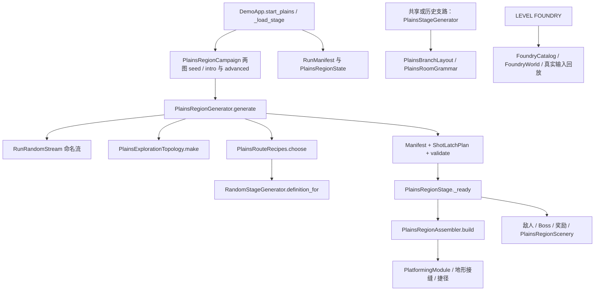
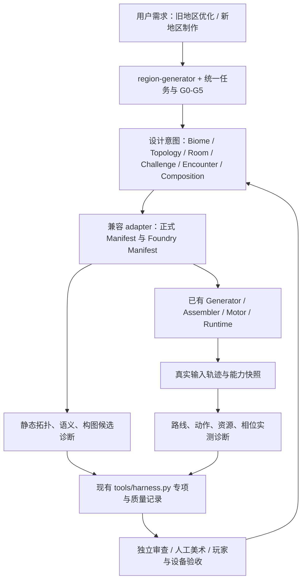

# Level Design Harness V2：现状审计与兼容迁移

任务：LEVEL-HARNESS-V2-01。审计方式：只读源码审计；实际 fetch 基线为 `fa9b9502a3b3c6c28bb361b1512cc44b5e854564`。本报告中的常量、函数与消费者结论来自该基线源码，不是本轮测试通过声明。实际 Godot、Harness、浏览器、截图与新增专项结果由主任务另行补齐；缺少证据保持 unverified。严重性采用 P1（生产体系核心缺口）、P2（可逐步改善），不意味着已发现正式游戏阻断 Bug。

## 权威来源与范围纠正

已读 `AGENTS.md`、`docs/current_state.md`、`docs/handoff.md`、`docs/generation_current.md`，再沿正式消费者审查源码。`current_state` 顶部记录 PR65 合并点 `33b0fe9`；实际 fetch 后的工作基线以上述完整 SHA 为准。用户本轮范围是生产体系，未授权大规模重做正式平原、开放新地区或改变玩家机制。

`generation_current.md` 仍自述 `da76b0a`，称 PR56 工坊不在基线，并沿用旧能力实现状态；这些描述落后于 main 的 LEVEL FOUNDRY 与动作练习实现。旧八小关已经退出正式流程，不能把 `PlainsRoomGrammar` 的 stage-index 方案当作当前两张大地图的正式生成器。当前动作练习中的能力已实现，也不等于正式地区已授予、保存或纳入可达性保证。

## 当前真实链路



| 文件与关键函数 | 当前消费者与可确认事实 | 不能据此推导 |
| --- | --- | --- |
| `scripts/demo/demo_app.gd:199` `_load_stage` | 正式两图使用 `PlainsRegionCampaign.seed_for`，将 controller 的 tuning 交给 Generator | 已覆盖所有未来武器构筑 |
| `scripts/generation/plains_region_generator.gd:12` `generate` | 最多四次候选，失败走 verified fallback | 生成成功就是体验合格 |
| 同文件 `:27` `_candidate` | 生成拓扑、模块、奖励、敌人、相位，记录 tuning hash | 设计标签等于实际玩家动作 |
| 同文件 `:319` `_fill_edge` | 选择横向配方或竖井配方，摆模块并填 join 地形 | 单模块通过就是全路线通过 |
| 同文件 `:496` `validate` | 连通性、环路、模块 supports、复生成比对拒绝伪造 Manifest | 碰撞与资源上的实际可达 |
| `scripts/generation/plains_region_assembler.gd:8` `build` | 正式实例化录制 Manifest，恢复时钟、捷径状态 | 新随机生成或新的奖励抽取 |
| `scripts/demo/plains_region_stage.gd:13` `_ready` | 正式世界安装敌人、Boss、奖励与 `PlainsRegionScenery` | 父类全部视觉路径也被使用 |
| `scripts/generation/plains_room_grammar.gd` | `PlainsStageGenerator.generate` 与 `PlainsBranchLayout` 使用 stage-index 模板 | 正式两图已经采用该动作语法 |
| `scripts/art/plains_set_dressing.gd` `plan` | `GeneratedDemoStage._ready:83` 调用；有交互对象避让 | 正式两图构图已由该避让逻辑覆盖；子类 `_ready` 未调用 super |
| `scripts/run/run_random_stream.gd` | `sha256_counter_52_v1`，命名流与版本派生 | 不同种子/Hash 等于不同体验 |
| `scripts/generation/movement_capability_envelope.gd:9` `snapshot` | 明确为无碰撞单跳筛选 | 障碍、相位、连续动作或实际落地证明 |
| `scripts/generation/platforming_module_definition.gd` `supports` | tuning、端口、跳跃包络与冷却筛选 | 真实装备、主动技能与授予路径完整验证 |

## 八项假设及可证伪结论

### 1. 宏观布局受网格、间距与家族限制

**成立，P1。** Generator 常量 `DX=1400`、`DY=700`，位置为 `[col*DX,(row-1)*DY]`。`PlainsExplorationTopology.make:5` 从 `4×5 / 6×4 / 5×4` 矩形删格，最多 240 次，保连通、环路与 Boss 邻接；固定三种家族。已有删边、单向下降与背面捷径，不能称为简单线性地图。

复现：导出各家族多个 Manifest，验证 `areas.row/col/position` 等式，比较边关系与尺度。统计图变化与空间尺度分别报告；不同坐标签名不能当作探索价值。

### 2. 模块顺序拼装与补地形产生空白风险

**拼装机制成立；实际无聊未证，P1。** `_fill_edge:367–382` 顺序放置 recipe.modules，剩余 `b.x-HALF-x` 成为 `region_connection`。但 `_candidate` 已向部分宽度至少 420 的连接布置 charger/sentry，不能把所有 join 判为无互动。

复现：按实际 fast/growth 路线关联 join 宽度、敌人/机关位置、输入事件和经过时长。静态空白候选与实际无交互时间分开；合理安全探索、观察与叙事段不能仅因无危险而失败。

### 3. 不同模块、种子或签名可能有相似操作

**存在检测缺口；实际相似程度待实测，P1。** `PlainsRouteRecipes` 已有 16 个 action/pressure/decision 配方、least-used bag、避免相邻重复和危险覆盖目标。`tests/plains_exploration_expansion_runner.gd:27–35` 对 100 图检查每图至少六类动作/压力、同 recipe 占比不超过 0.35。它们仍是全图设计字符串统计，不是玩家所走路线的连续实际动作。`gear_timing` 与 `double_gear` 都使用 `plains_twin_gears`，不能直接把字符串区别算成独立物理体验。

复现：对同一能力与策略导出接受动作事件，去掉皮肤、实例 ID 与整体平移后比较动作序列、关键转向、等待和资源决策；与 recipe 意图并列，不互相替代。

### 4. 缺少完整连续动作编排合同

**部分成立，P1。** 已有动作字符串、竖井动作标签、模块端口速度/资源约束、Foundry 连续路线。缺少跨层统一的入口状态、真实单武器、资源、替代动作、动态相位、提前观察及失败恢复合同。`_connection_actions:384` 聚合 jumps/air_shots/burst 最大值，不能表达连续消耗和装备约束。

复现：取一个多模块连接，尝试从现有 Manifest 重建每一步消耗、冷却、入口速度、替代解与镜头窗口；无法由已有字段确定的内容应标 unknown，不能补猜默认值。

### 5. 敌人、机关、平台和奖励联合评估不足

**部分成立，P1。** Generator 已有 ferry_air_intercept、bell_window_intercept、gear_landing_intercept、ferry_fan_crossfire、safe_cell_ambush 及 escape 描述。`tests/plains_exploration_pressure_runner.gd` 实例化真实 fan+diver+ferry，验证无伤、不杀敌、真实平台出口；联合测试并非不存在。

常用 `tests/plains_region_trace.gd fixture` 仅安装地形与 shot latch，**未安装 Manifest 敌人**。其整图成功不能推导含战斗整图成功。复现：对照正式 `PlainsRegionStage._ready` 与 trace fixture 的实例清单，分别运行地区套件中的压力片段与整图旅程；报告每项实际覆盖。

### 6. 地标和场景构图有限

**源码层面成立，P1；审美效果待截图与人工。** Manifest 有 windmill、ruin_arch、windchime、stones、ivy 五类标签；正式 `PlainsRegionScenery._ready:29` 将它们映射为 windmill 或 ruin_arch **两种主地标**，统一主物高 100、ivy 26、stones 20、z=-10。统计五个标签会高估正式画面身份。`PlainsSetDressing` 的避让逻辑不是正式两图的这一消费者。

复现：从正式 `PlainsRegionStage` 枚举 scenery 子节点的纹理、比例、锚点与组合；对同能力和正式分辨率拍多个区域合屏，标明相机位置。代码只能证明组合限制，不能独立证明不好看。

### 7. 自动化偏重工程正确性

**体验诊断不足成立，P1；应保留已有工程与操作覆盖。** 已有 150 forced-family + 50 automatic 拓扑 corpus、100 operation corpus、fast/growth/tour/deep 真实 Motor 路线、无传送与危险扫掠、压力片段与 GUI。缺路线级高压、空白、重复、回程、视觉构图诊断和可对比结果。`max_empty_join` 目前仅记录最大值，不进行路线分解。

复现：读取现有 corpus JSON 与 `REGION JOURNEY` 日志，检查能否定位某条路线上的空白时间、重复段落与失败位置。无法回答之处为工具缺口，不应编造趣味分数。

### 8. 新武器、能力、能量与构筑尚未进入统一生成合同

**成立，P1。** `MovementCapabilityEnvelope` 自述 `collision_free_single_jump_screening_not_reachability`，边界正确；但区域仅以 tuning 筛选。`FoundryCatalog.tuning_for/apply_profile:13–32` 仅允许 max_jumps/max_air_shots override，没有真实 WeaponDefinition 装备与 TraversalAbility 授予。`config/foundry_capabilities.json` 仍称 hook 待真实实现，但 main 已有钩索；应区分“游戏已实现”和“工坊尚未接入验证”。

复现：对照真实武器/能力 Runtime 和 Foundry profile 安装路径，检查装备 ID、等级、授予状态、能量/冷却、空中资格、构筑来源是否可复原。同一时刻只能使用一个合法当前武器；不能合并所有武器优势来验证主路。

## 新旧架构关系与六层迁移



| 层 | 兼容新增语义与实际消费方式 | 本轮迁移边界 |
| --- | --- | --- |
| 1 宏观拓扑 | adapter 从 areas/connections/rewards 提取语义图；专项检查连通、锁与回程、路线差异 | 不替换正式网格算法，不改 RNG/奖励/保存 |
| 2 区域身份 | BiomeDesignProfile/RoomIntent 记录空间、玩法、视觉与学习前置；地区模板与验证器消费 | 未来地区用未开放 fixture，不能假称已实现 |
| 3 动作编舞 | ChallengeSequence 区分意图、实际接受动作、资源与入口出口；Foundry 技术样板消费 | 复用真实 Motor 与当前能力；不改手感迁就挑战 |
| 4 遭遇节奏 | EncounterPlan 关联实际路线、平台/机关/敌人约束、恢复和收益 | 全图计数不能代替路线证据；不默认全杀 |
| 5 场景构图 | SceneComposition 记录深度、焦点、轮廓、锚点、接缝与遮挡；scenery inventory/截图审核消费 | 设计卡不冒充实际画面；技术切片保留视觉待验 |
| 6 体验验证 | LevelExperienceReport 关联 Manifest、快照、轨迹、截图、失败位置与主观评语 | 接入现有 Harness 专项，保留 G0–G5 和十一维，不造第二质量流程 |

设计意图、生成结果、运行状态、物理证据、主观评价应分栏存储。合同有版本、producer/consumer、输入指纹与迁移说明；新增字段初期通过 adapter 旁路消费，避免更改正式 Manifest hash 或重写存档。未知能力/设备/视觉证据必须显式未验证，不能用默认值填成 PASS。

## 拓扑方案权衡

| 方案 | 优点 | 成本与风险 | 建议 |
| --- | --- | --- | --- |
| 当前删格家族 | 真实消费者成熟、成本有界、已验证回程与模块方向 | 固定尺度、邻接和轮廓，重复构图风险 | 保留为基线和兼容回归 |
| 手工宏观骨架 + 程序变体 | 学习次序、地标、主支路价值易审查 | 骨架库有限，可能只换内容 | 可作为黄金样板与新地区第一切片 |
| 约束语义图 + 非规则空间嵌入 | 先决定能力/奖励/回程意义，再分配不同尺度与方向 | 需处理通道碰撞、镜头、跨度、反向可达与失败保底 | 推荐后续增量方向；本轮只表达与诊断，不换正式算法 |
| 地形/能力约束联合图布局 | 减少布局后无法满足动作空间的问题 | 搜索成本与约束复杂，易退化成重抽 | 先用已有真实验证模块和有界候选，不上全局无限求解 |
| 完全自由连续布局 | 空间轮廓自由度高 | 端口、可读性、遮挡、回程验证成本最高 | 不作为首轮生产改造 |

推荐先把正式 Manifest 转为语义图，标明不同路线提供的能力、风险收益、恢复与地标信息；以后为新地区增加有界非规则 embedding adapter。该 adapter 仍输出既有可实例化、可重放的模块和连接合同，正式接入前必须通过连续 Motor、镜头与设备验证。

## 审计时提出的最小诊断闭环与当前实现边界

1. 读取已有 `tests/plains_region_runner.gd corpus()` 输出的 `build/verification/generated/plains_cohesion/geometry_{woven_layers,linked_rings,crossroads}.json`、`geometry_corpus.json`，以及 expansion runner 的 `operation_corpus.json`。
2. 在派生 trace 的 tick 旁路观测真实 Motor，不改变输入、碰撞与旧断言；原 `tests/random_stage_tests.gd:306 tick` 已执行实际 controller physics、全身危险扫掠和连续性检查。
3. 当前 `walk_edge` 保存 connection ID、方向、tick 区间；每帧采位置/速度、落地、射击次数与精力，以及明确标为请求的 router 输入。完整能力状态在入口/出口快照捕获。逐帧跳数、机关相位与实际接受动作事件是后续增量，不冒充本轮已实现。
4. 当前新采集器分析 fast/growth/deep 三种策略，输出 join、动作状态重复、恢复/回程与图结构候选，定位 edge/node/tick；明确未装配敌人。原测试的 tour 仍保留，但本轮未新增其结构化采集。
5. 报告关联 seed、Manifest hash、源码 basis、能力、策略、设备、截图与失败日志；缺证据不能以空报告通过。前后比较核对这些范围，差异必须明示。
6. 在现有 Harness 注册专项。每项检查须有通过例与故意失败例：错 seed/hash、空轨迹、虚构路径、等价皮肤动作、无恢复高压、长空白、孤立奖励、循环能力锁、不可返回等。安全叙事/观察区应有合理正例。

自动可证明已测试策略，不能证明所有玩家行为。阈值先记录地区、类别、设备基线，再依据黄金样板与玩家反馈校准；不要通过添加无意义机关追指标。

## 复现命令与本轮证据状态

```bash
python3 tools/run_plains_region_tests.py
python3 tools/harness.py --profile docs
python3 tools/harness.py --profile gameplay --profile art
python3 tools/verify_plains_region_browser.py <实际构建URL>
```

现有地区 runner 要求 `PLAINS REGION SUITES: 15 suites passed`，每个子套件需自己的非零断言、零失败完成标记；退出码、超时和缺标记仍按既有规则失败。本报告未执行上述命令，最终日志和计数由主任务补齐。浏览器 CDP 触屏模拟不等于实体手机；未知手柄、手机手感、审美与真人趣味保持 unverified/awaiting-device/review。

## 后续最有价值的平原优化候选

优先量化 `_fill_edge` 的 `region_connection` 与竖井进出段，在 fast/growth 路线定位最长无有效互动区，并关联敌人实际约束；同时核对 `PlainsRegionScenery` 两类固定主地标组的正式合屏。前者给出可定位的体验密度候选，后者有可证实的 Manifest 标签到实际画面信息损失。先制作少量黄金改进样板并做前后对照，再申请或在明确任务授权下批量推广。
