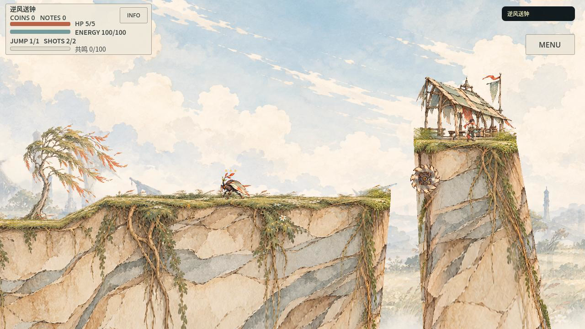
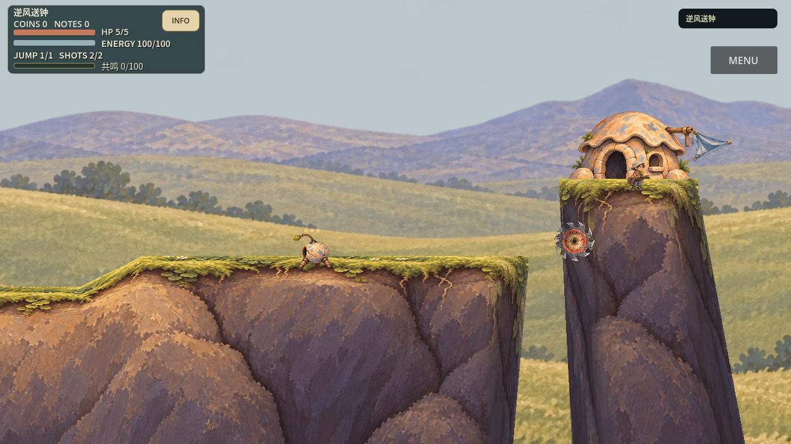

# P1平原：实际作品与准确结论

[18.683秒正常速度实机录像](../evidence/p1_native/second_01/gameplay.mp4) · [反冲穿越画面](../evidence/p1_native/second_01/video_frames/video_frame_000240.png) · [回程画面](../evidence/p1_native/second_01/video_frames/video_frame_001080.png) · [原P1概念提案](../visual_development/directions_20261017/p1-scene.png) · [独立审查](../evidence/p1_native/independent-second-01.md)

**这次确实把P1的主要画面关系做进了可玩游戏，明显摆脱旧B的深圆土体与封闭小屋；尚不能宣称达到概念图同等精美或稳定生成商业级随机关卡。** 独审接受的是单首空间的静态/运动抽帧视觉候选，建议保留并让用户看实际结果，不是最终画风认可。首轮作品没有被工程通过掩盖，实际REWORK与[原片](../evidence/p1_native/first_01/gameplay.mp4)保留。

## 真正改变的制作方法

11张功能源实际由图像工具绘制/编辑，不把整屏概念烘焙进场景。浅色连续截面沿真实岸顶有限弧长映射，独立左右转面形成体积；树、空棚、机关、两景层、人物、敌人与锯分别被真实消费者使用。沿用PR77地形技术，未重造TileSet框架，也没有改变真实碰撞、原正常镜头和路线。三岸共用同一截面/左右转面，最长源段60..1193.22位于实际1254px源内，没有repeat或把整张壁面压扁适配。

首轮已有漂亮土体和景物，实机仍把主体变成碎细线，近草/花层抢焦点。独审先判断整屏，返工只做两件事：**实际重画**主角/敌/锯的大明暗、腿间负形、粗暗盘和少量大齿；重新校准中景的尺度/锚点/视差与独立opacity。其他树/棚/地形未扩产。第二实机在空中、遭遇和回程中都更容易找到主体与危险，这种改善不能由PNG数量或测试数字替代。

原始与派生PNG、提示词、参考SHA和真实工具来源在[资产目录](../../assets/visual_development/p1_native/)。原模型名、token/价格和商用许可未暴露，保持unknown。4次清底编辑源于查看器棕底误判，后来实际RGBA多数背景A0；未证明必要收益，调用与原源照实保留，不能用隐藏RGB签GPU污染。原候选与被替换源在`.gdignore`隔离目录，评审包只加入11张当前功能源的真实依赖闭包。

## 与概念仍有的差距

人物约40world/50screen，部分动作仍细碎；树尚未承担概念中的大轮廓份量，窄竖端/根线偏密。HUD保住真实数值、按钮和资源反馈，完成纸色皮肤，尚非概念叶片/羽片的整套UI。主角9/27状态有源，18缺态明确回退未完成；3处region保留69/51/111个邻姿态像素风险，已看帧未见明显大片残影不等于逐帧全态无污染。亲听、完整连续播放审查、真人操作、手机/手柄/目标设备性能均未完成。

因此没有制作第二空间、随机Seed或森林。三岸同用一套原画只能证明本空间内复用，不能当不同空间结构或随机泛化；跨区共用画法仍是待验证方向。没有默认正式资源池晋级，没有用户审美定稿或商业市场结论。

## 工程与版本

基于PR78最新开发`d549ad9daa17b0397b893f923760d379b75167de`，继承PR77有效技术，独立分支`feature/p1-native-pilot`。首运行`7472637c754c213b7c0ef0e7fa02925b0a5331d3`；最终实际运行/包`2be5e1f6f9a87cfa644b0c52b6ce8ff311c9a51b`，catalog SHA`9b1c52058fdc8bcf6e2e4e913e1b83688233cb8bf727446f6771df8ed05c9e7d`。后续文档提交不改变这份运行产物。

| 验证 | 实际结果与范围 |
| --- | --- |
| 同源旧B/P1完整正常路线 | 各1116ticks、18.683333秒/60fps、HP5、四枪、零回退，原strict/sourceguard通过 |
| 原比较器与逐tick数据 | comparable_for_review；133核心源与路线/物理/资源/镜头/动作语义相同，保留22处输入绝对墙钟差异，不说raw字节全等 |
| 原无枪/删恢复岸负例 | 均真实失败于spatial_primary_gap_failed，原严格退出通过；不把capture exit0称通关 |
| 针对性Harness | docs、art-art、capture-tests、visual-director-tests四项fresh通过；含原20视觉工具用例，不降断言 |
| 包内实际消费者 | PCK含原catalogJSON、11texture的真实.import映射/后端字节；空cwd headless与正常GUI实际P1 READY/严格清退通过 |
| 完整CI/正式Web/实体设备 | 未执行或未通过，不宣称发布门槛通过 |

原始回执及逐Git blob恢复索引在[证据目录](../evidence/p1_native/recovery_index.json)。首两套1254项、最终两套1265项源全部与各自实际commit匹配，无源字节缺口。原短检查曾因任务依赖格式错误失败，修复；一次边修改边验证被sourceguard拒绝，保留为失败，稳定源再fresh通过。

## 试玩与生产入口

[Linux x86_64本地评审ZIP](/workspace/art-direction-exploration/build/p1_native/local_review_01/gunman-rush-p1-native-review-linux-x86_64.zip)，189,253,150bytes；build_id **05810634c318**；ZIP SHA`166dced912f1ef43d9fe2ce1a13ab8f65da333e652f6d18531ff45010ebb2645`。解压运行`./play.sh`，A/D或方向键移动、空格跳跃、鼠标瞄准/左键射击。包内官方Godot4.7.2，仅首空间，无第二入口，不依赖工作区。该包是本地候选评审，不是正式Web/商店发布或设备准入。

实际生产范例在[现有入口](../evidence/p1_native/recipe.md)。`python3 tools/level_design.py route --request "改善平原美术" --output build/p1_next.json`仍走原Harness，现绑定当前P1候选和实际质量卡，不再硬加载旧B母版/旧艺术准入。三个现有美术Skills补的是已经做过的绘画、尺寸和景层操作；未增加同义导演。route本身只是计划，本轮真实图像/集成/采集由宿主执行；尚未证明下一条短Prompt即可独立重复产出同等质量。

## 投入与停止点

18次实际图像调用＝11张初始源＋4次清底编辑＋3张主体可读性重画。没有按Seed重抽图、没有扩产素材种类。原始工具未给完整调用级起止/价格，不能补造纯compute或美元成本；四段正常路线采集墙钟分别90.188、81.441、90.988、81.061秒，固定60fps电影不是设备60fps性能证明。从12:12:48 UTC开始，到13:00:03本地包就绪为47分15秒；此后证据/文档/检查/Git交付另计。见[原始时间记录](../evidence/p1_native/timings.json)，不把并行阶段叠加称纯compute。

本轮有效的答案是‘完整体积绘画＋正确连接语义＋实际小尺寸明暗设计＋真实景层校准’；单靠漂亮独立素材和缺陷检查仍不够。第二轮有实质改善且已到本次有限目标，停止第三轮重抽，不把剩余完成度转述成商业艺术目标已完成。
