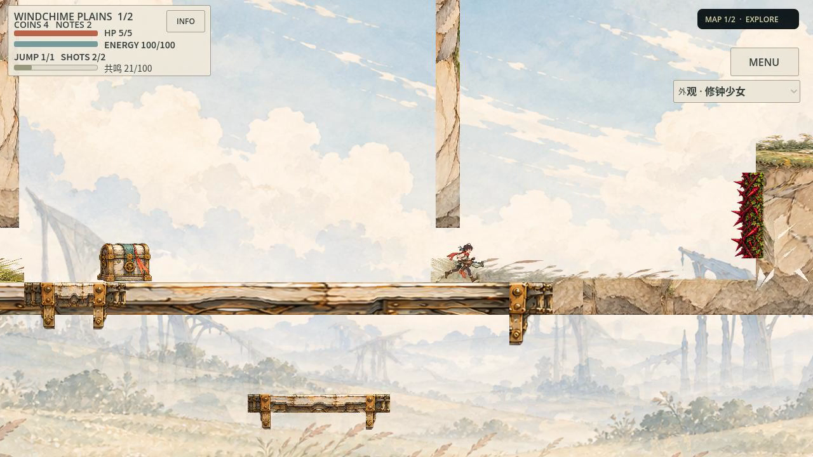

# 随机平原与可选人物：整区美术未通过

[草稿PR81](https://github.com/zhipijun1996/gunman-rush/pull/81)保留本轮实现与失败，不合main。

[改造前同帧](../evidence/p1_random/unity/before.png) · [整屏设计绘改，仅提案](../evidence/p1_random/unity/paintover.png) · [最后实际38.8秒正常速度录像](../evidence/p1_random/records/unity_01/gameplay.mp4) · [最差结构另一画面](../evidence/p1_random/unity/actual_001800.png)

**用户两次指出整体割裂，判断成立。本轮没有完成统一、精美的完整随机地区；停止当前组件补丁方法，不打包、不晋级正式资产。** 可保留的是正常随机地图的实际消费者、可选人物实现、原始作品及失败证据，不能将工程通过写成艺术成功。

[最终独立审查](../evidence/p1_random/independent-final-01.md)明确给出整区REWORK，未以覆盖数反驳用户反馈。

## 失败发生在哪里

第一阶段把P1浅切面接到正常生成器，主岸覆盖由17/23修到23/23，但10个浮体、62个单向平台、8个移动体及功能物仍沿旧画面。用户指出越换越割裂，第三Seed和原定打包立即中止。

随后实际绘制整屏提案，再画有限结构/器物图集，接入80个结构、4箱、2个音符风螺、7个射击铃消费者。实机依旧失败：长桥挤拉源图，附着大岸的细柱没有转成结构，快捷门另有旧木枝绘制，铃还有独立子Sprite消费者；商店、飞行敌、金币和治疗物仍是其他世界的造型。原画中共同受力、围合、空间节奏和焦点关系没有成为生成器的依据。漂亮部件换齐也不能自动形成这些关系。

根因是仍把旧随机几何作为先验，再按物件类别适配绘画。一次整屏绘改也未改变这个执行顺序。下一条有效路线必须先联合创作一整段多屏可玩环境，让地势、建筑、植被、遭遇、路径与镜头共同成立，再从它提炼保持关系的中尺度空间模块及随机组合范围。本轮**尚未实现**这个新的区域生产能力，不新增一个同义导演或验收条件冒充已解决。

最后一批比例/漏消费者微调尚未运行，按用户再次纠正停止；[完整diff和恢复说明](../evidence/p1_random/unity/unvalidated_last_patch.json)保留，工作树仅将本任务三文件恢复到最后实际验证的`c0975dbafb720156b46b8ee98a9ad52f08725bde`。这些微调没有实机证据，不能算下一轮成功。

## 仍然有效的交付

正常`DemoApp.start_plains`及原相机已接入开发候选开关；不是固定黄金三岸。两张实际不同布局分别为`courtyard_weave`、`hub_satellites`，cells、连接和真实碰撞集合确有变化，见[结构比较](../evidence/p1_random/records/structural_comparison.json)。只证明两条已走主线，未验证所有支路、第二张战役图或Boss；第三Seed被用户纠正中止，不计完成。

原信使、围巾旅人、修钟少女通过单一外观所有者选择，共享原操作/能力/枪口/碰撞/资源。少女实际9姿态、18缺态回退，仍是候选；没有完整动画或用户定稿。实际鼠标25项功能断言通过，未知ID和越界姿态拒绝；回家/重开在同一app会话保留选择。复杂辅助脚本严格退出仍有34资源残留，范围未查清；正常两外观最小启动及三条完整路线退出干净不能代签这个失败。见[原始诊断](../evidence/p1_random/diagnostics/index.json)。尚未保存到磁盘，也不是不同能力的角色职业系统。

| 验证 | 实际结果与边界 |
| --- | --- |
| 正常Seed01/02 | 2323/2707ticks，原严格退出与源码guard通过；艺术REWORK |
| `unity_01`同Seed01 | 2323ticks/38.8秒/60fps；原比较器通过，逐tick位置/速度/HP/能量/射击/跳跃/恢复0差异；艺术REWORK |
| 针对性检查 | 原12地形断言、22视觉工具测试、44资源合同测试、原19家园断言；各自源版本见原件，不当全CI |
| 发布/真人/设备/亲听 | 未通过或未进行；没有新PCK、ZIP、build_id或上线结论 |

实际作品、消费者与恢复索引在[records](../evidence/p1_random/records/README.md)。六次图像调用含四张初始功能源、一次绘改、一次有限组件源；底裁旗帜/荆棘拒用，源与参考SHA原样保留，模型/价格/商用许可未知。13:18:26 UTC建立分支，最后验证片14:17:11完成；后续整理、停止与Git交付另计。两轮完整route原生墙钟分别155.084/156.432秒，约+0.9%，不能据此称生产更快或设备60fps。

源码复现与人物入口见[短入口](../evidence/p1_random/recipe.md)，仅用于查看已知失败候选。`route`仍是计划，不代表短Prompt自主整区艺术生产已经建立。森林、核心PlayerMotor/能力/武器/资源/RNG/存档及真实碰撞未改，没有合main或默认正式资产池晋级。
