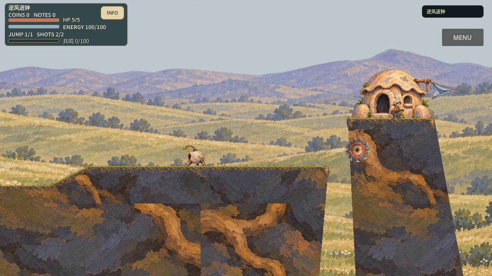
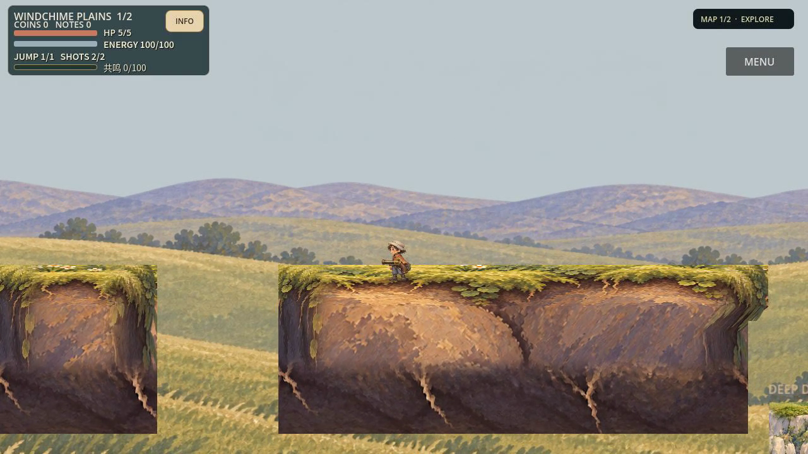

# 连续绘画地形：实际作品与限定结论


[18.68秒/60fps正常速度实机](../evidence/painted_terrain/first04/gameplay.mp4) · [04原始回执](../evidence/painted_terrain/first04/visual_capture.json) · [独立首空间审查](../evidence/painted_terrain/independent-05-first-space-art-sample.md)。图是视频第600帧，不是概念图，也不是物理tick600。下列旧图为最终冻结源码显式选择PR75 B旧消费者的同Seed/同相机/同视频600帧，实际几何与输入完全相同。



**值得保留的是首代表空间的连续土体、草毯厚度和安静草海；尚未证明商业级完整黄金空间与可泛化的随机地图艺术。** 独审ACCEPT_SCOPED只覆盖实际静态与运动抽帧整体艺术，允许一次不同结构试验。用户只选择B“雨釉与偏心”，没有代签本轮作品。第二段仅两薄岸局部复用成立，仍缺强记忆构图与精修，不称第二商业黄金。完整G2、动画、实际听音、真人/设备/市场认可未完成。

## 实际改变了什么

根因不是“碰撞矩形必然廉价”。PR75消费者`visual_language_sample.gd:_terrain`把所有轮廓点直接乘比例作UV，`TEXTURE_REPEAT_ENABLED`重复高对比岩壁；另加很窄顶条/小端件。独立图像中的完整体积被降成无用途语义的纹理：土肩没有厚度，端头不转面，深部与浅部同等繁忙，凹扩轮廓也不受尊重。[PR75最终失败](../evidence/visual_language/final-b1-live-independent-review.md)已实际记录巨大接缝，继续加装饰无法修复。

既有Skills说先整体再拆分，但旧recipe仍绑定那张岩壁和冻结的候选消费者；简短“改善…美术”甚至不能进入视觉工作流。冻结实际碰撞是合理边界，错误在把“旧绘画表示”也当已定标准。这轮没有修改Motor、真实碰撞、武器、能力、资源、RNG、存档或森林生产文件；转而重做视觉表示，并保留未支持表面的旧消费者。

先实际绘制**顶面→根肩→低频深土**的功能截面，从同母版编辑左右转面；真实Godot整屏绘改推动更深的v2土体与三宽风带。`painted_terrain_grammar.gd`沿真实顶边弧长有限取源，横截面随完整实际侧轮廓覆盖，左右源在轮廓内侧连接。顶/肩保笔触尺度，深部让大明暗建体积，不用全片纵拉或重复岩壁遮接缝。[实际源及接口清单](../evidence/painted_terrain/asset-consumer-inventory.json)、[短制作范例](../evidence/painted_terrain/recipe.md)和所有源图旁`.record.json`可追溯。绘改是设计工具，未烘焙成运行背景。

第二用途暴露了新接口：薄岸下方真的可进入，深岸截面不能随意裁成漂浮平台。实际绘制了一个下转面源，第一版透明收边却藏住最多20world天花板；保留失败后，将每列原图alpha128底界对齐真实物理底边，RGBA原图不改。RG8只记录采样坐标，不是程序绘画。两处原Motor真实顶头接触与普通去返分别验证，不能把初始spawn fixture写成普通路线抵达。[独审08](../evidence/painted_terrain/independent-08-second-structure-scoped-review.md)限定接受该用途，平直外底仍是未解决的艺术边界。

## 复用与自动执行的真实范围

首04消费section_v2、左右转面、维护小片、meadow_v2；第二对真实正式生成薄岸复用其中四个主要新源，只增加缺失的下转面；人物、普通物、敌身体、锯和HUD来自PR75 B候选。不是给每Seed画新场景。第二段保留13个原敌，不等于13个敌改画或这段合屏有敌；RootBell在正式生成地图匹配零个，回执不伪签。

第二段来自现有正式`level-design-v2-baseline/08`，不是第一样板换名称。首段三座深岸/斜坡与第二段165/485world宽、152world厚、有20world悬唇的两薄岸结构明显不同。只处理最近两座受支持rooted unions，其他长并集、floating/oneway/移动表面原样保留；不支持源跨度时显式拒绝。没有宣称整个生成地图已替换。Seed预登记在[原始登记](../evidence/painted_terrain/seed-registration.json)，实际三次消费两岸的几何完全相同，最差已看落稳窗并列；这里只证明跨Seed重复性，没有新增随机结构覆盖。实际结果和最差样本单独保留。

另一执行上下文只收到“改善另一段风铃平原的美术”和读写边界，按正常入口实施了正式消费者及实际局部路线。最初工具报Ambiguous，强制optimize仍无visual_recipe；已修正现有`level_design.py`的“改善”识别及纯美术任务路由。它现在直接绑定真实母版、profile、当前源SHA、原生消费者和制作范例，复用原visual_golden租约/独审，未新增导演或平行质量框架。含玩法改动的请求继续原区域预制作，未偷渡G2。宿主仍协调路由修复、下转面生成和独审，**不是无人干预的完整地区生产**。

短启动：

```sh
python3 tools/level_design.py route --request "改善另一段风铃平原的美术" --output build/painted_terrain/next.json
python3 tools/run_visual_director_space_tests.py --painted-terrain
```

第一条是任务计划，Codex须继续按现有Skills执行真实图生/编辑、集成与采证。第二条在原runner中检查实际连续地形与正式适配器的mesh/拒绝/基线保护，不能代替GPU艺术审查。原waterworks等回归仍保留；局部纯美术任务不再先运行无关昂贵waterworks录像。三美术Skills用实证范例替换旧B制作段落；没有要求worker重读全部PR历史。

## 有效迭代与真实失败

- 01首实机660tick预算耗尽，只有局部体积进步，没有完整路线。
- 02完整路线，但扩大实体出现背景漏楔、端面压扁；修了横截面覆盖与真正内接转面。
- 03实际typed-array脚本错误，严格失败，即使路线到了终点也不算通过；03b修类型后严格通过，但仅家族静态限定接受。
- 04重新绘制足够深的源与安静草海，首空间整体静态/抽帧艺术限定接受。没有用更多测试冒充画面进步。
- 第二01沿用旧冷背景和人物、缺可见下转面，REWORK；第二02共同语言改善但藏真实天花板，REWORK；第二03修正源边界与物理映射后局部接受。原始错误、失败head fixture和未覆盖用途保留，不用后次通过改写前次红灯。

实机首完整去返1116物理tick、4次接受射击、HP5、同session零回退；第二局部351tick、HP5、真实两岸去返与两次落稳观察，不是全growth地图通关。后者不强行射击，因为这段现有120world间距无需反冲。第二局部旧/新画面已逐tick比较位置/速度/资源/输入/真实镜头/碰撞；最终冻结源首空间A/E与PCK加载以随后交付回执为准；仅InputRequest绝对墙钟排除，相对序号和内容不排除，原始差异也保留。独审实际看正常尺寸截图和时序联系表，未连续播放整片或亲听音轨。

## 时间、版本与交付边界

本轮01:40:41 UTC开始；8次实际图生/编辑：7张功能/环境源、1张整屏设计绘改。观测调用窗口合计336.2秒，含两组并行调用，不是8次单件耗时或总开发耗时。模型、token、价格和商用许可工具未公开，均未知。PR75为19次调用；两轮范围不同，不能宣称按调用数量推导效率提升。

同1116tick正常速度采集：PR75 A109.98秒/E96.47秒，本轮04约84.73秒；都是原始墙钟观测，硬件负载/缓存未控制，不声明因果提速。总投入包括被保留的失败、集成、独审和交付等待，不能只报最终成功采集耗时。分支`feature/painted-terrain-grammar`，母PR75 `0905516`；首04实际dirty快照绑定，不能以母commit冒称完整新版本。第一源码检查点`df197eb`，最终运行/交付以追加receipt为准。

默认正式资源池及export排除不变。没有main合并、强推或森林改动。完整CI/正式Web发布、真实听音、移动端/手柄/真人试玩、完整动画及商业认可未通过；本地评审包通过实际加载与严格退出后才提供，不以旧包冒新版本。

原始历史闭包缺口也保留：第二01有5份原源码字节未及时保全（逐SHA见恢复索引），无法完整恢复其失败运行树；不拿03代码补签01。head05有实际日志/图/接触回执，但没有当时完整sourceguard，不补造历史闭包。最终同源采证不能倒签这些历史结果。

针对验证实际结果：[5项Harness原报告](../evidence/painted_terrain/verification/targeted-harness-report.json)，20视觉+20路由及独立2适配器Python用例通过。并行3lane存储预检需16.59GB但可用6.51GB而拒绝，未启动检查；随后一次root文档改动被源冻结拒绝，最终冻结文档用原jobs1重跑五个短检查全过。成功Harness墙钟63.903秒，子检查合计6.437秒；依赖指纹与记账仍有明显成本，未借机扩修历史Harness。[真实耗时](../evidence/painted_terrain/timings.json)区分采集、图生窗口与未测量成本。

最终冻结`3ebb0d3`已再次完成旧B／新地形同条件A/E，均1116ticks/18.683秒/HP5/四枪/零回退、strict/sourceguard真；原比较器允许直接评审。逐帧模拟数值/镜头/输入类型方向序号相同，原始22项差异全部是绝对输入墙钟时间戳，原件保留，不称raw字节全等。独审再次实际打开双方60/240/600/1080共8全屏，确认最终E维持首04限定艺术结论，无新像素问题；未完整连续播放/听音。[实际最终独审记录](../evidence/painted_terrain/verification/final-art-review-confirmation.json)。



[第二局部5.9秒正常录像](../evidence/painted_terrain/media/second-candidate-normal.mp4) · [第二同条件旧画面](../evidence/painted_terrain/media/second-before-outbound.png) · [三登记结果和实际拒绝清单](../evidence/painted_terrain/records/reuse_registered_results.json)。首次不同深浅结构证明了四个主要绘画源可跨用途复用，三个Seed则没有带来第三种局部结构；最差并列不是所有地图都优秀。

本地Linux x86_64评审包：`build/painted_terrain/local_review_01/gunman-rush-painted-terrain-review-linux-x86_64.zip`，192,437,291 bytes（约183.52 MiB），SHA256 `330c3bd06a8d273661b3f30ae564869965339067c69b031a659d95c2fccb3aa4`；同一PCK build_id `e5e7d535b742`，运行源码`3ebb0d3`。解压后`./play.sh`进入首空间，`./play-second.sh`进入现有正式/08两薄岸局部，均手动操作、禁Meta写入。Linux包包含Godot4.7.2及其许可证，不是Windows/macOS或Web版本。

[实际包回执](../evidence/painted_terrain/delivery/build_receipt.json)、[两个导出GUI和严格退出摘要](../evidence/painted_terrain/delivery/summary.json)、[原native快速检查](../evidence/painted_terrain/delivery/final_mesh_targeted_01.log)、[原物理负例](../evidence/painted_terrain/records/physics_negative_index.json)均保留。评审包从隔离空cwd加载导出PCK，实际catalog/角色/锯/两岸及静态碰撞验证通过；虚拟GPU启动图不算真人试玩或真实设备认证。正式presets没有修改，未发布线上版本。

03:32:39 UTC已实看双入口包并确认可交付，距01:40:41起点111分58秒；不包括随后证据整理/推送。8次图像调用预算用完，未继续沿薄岸平直底部增加特例或重抽图。总目标判定为**部分完成**：实机比PR75体积与草海主次明显改善，有限源可迁移到一种不同深浅结构；第二精修空间、不同随机组合的艺术泛化与商业级完整体验尚未证明。这不是把流程通过写成艺术完成。
