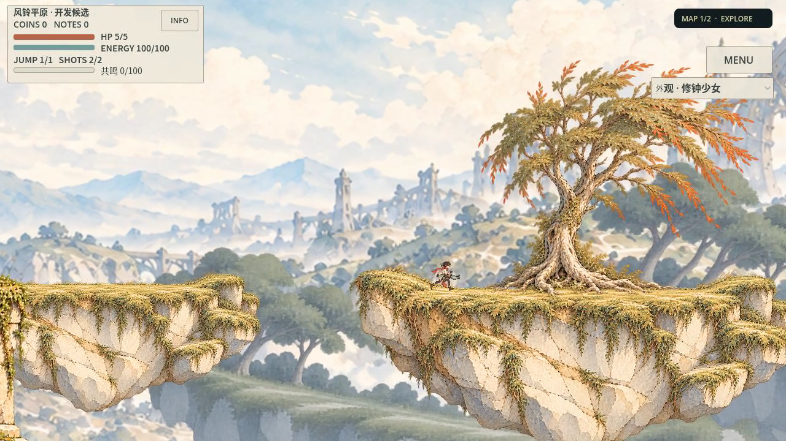

# 同一场所计划联合生成：实际实施与有限收益

先看[真实画面与完整正常速度电影](../evidence/plains_joint/gallery.html)、[独立像素判断](../evidence/plains_joint/independent-native-02.md)、[独立工具审查](../evidence/plains_joint/independent-tooling.md)。母PR84 `f8dead08`，独立分支`feature/plains-joint-place-synthesis`；实际运行冻结`f959e4a9`。P1仍是用户偏好候选，未代签最终风格。

## 已经改变的生产方法

原PR84已经共享一个plan，问题不在“缺一个JSON”，而在measurement中碰撞轮廓、图体锚点、安全站点、路线、焦点和景层分别写好世界坐标，编译仅整体平移，构图不反向约束物件。新生成不再默认加载这套重复坐标：共享source_families保存绘画轮廓和站面；场所声明源体块依附、有限比例变体、支持面语义、具体落点保护、建筑源脚和景层绑定。`_joint_measurement`推导所有下游结果。

| 输入关系 | 同时产生的实际输出 |
| --- | --- |
| 实测原轮廓、源锚、等轴尺度 | solid多边形、完整PNG变换、站面 |
| 体块源点依附 | 东岸、固定500桥、根脚与连续接收面 |
| 支持面分数与高度偏移 | 安全站位、入口/出口、真实路线、敌人与机关 |
| 树候选位置与声明路点距离 | 合法树根、对应焦点；无合法候选拒绝 |
| 实际源脚与共同站面 | 棚的四脚支撑预检；不合拒绝 |
| 支持面、设计观看点与景层绑定 | 中景锚、统一全局视差映射、设计留白 |

物理仍由原assembler实例化，美术仍由原composer消费；renderer不写碰撞、不自己抽随机数。新增实际Sprite2D全局源站面与CollisionPolygon2D全局节点比较，四个体块实测最大误差约0.0000305世界单位，原1源像素容差不改。

默认场所JSON从63,859降到41,358字节，减少22,501字节（35.2%）；共享源家族不再重复三个bank轮廓，旧JSON按需[原件归档](../evidence/plains_joint/baseline_places_v1.json)，非失败回退。这是运行描述体积减少，不代表全部Agent上下文/总成本同比下降。代码增加了必要推导逻辑；没有新增导演或并行质量体系。

## 真实验证与失败

首源`e09f87f7`完整35点路线和电影录制完成，但桥源被原精确500跨度守门拒绝：过早Vector2 float32计算使端点396.000030517578→896相距499.999969，实机出现灰条/裸柱。根代理直接核原capture发现；原生代理误报omitted为空的消息已撤回。旧回执原status=captured不改，另存consumer_audit及新的拒绝，独审01 REWORK，未扩Seed。

修正是源坐标先标量float64计算，最后构造Vector2，未放宽500跨度或修改原bridge消费者。既有visual_director的实际准入补查初末art.omitted及所有实际地形、桥、附件、景层和joint绑定；6项Python测试含缺桥/缺层/伪绑定/NaN等反例，旧输入、source、ERROR、泄漏断言保留。原175原生断言通过，包括旧118的功能范围和57个新联合约束检查；12预登记Seed有12种世界数值排列、7种去平移/排列/ID后的局部数值组合（即有限比例组合），不据此签美感。所有正例首次成功，拒绝负例4次耗尽，没有自然失败后成功重选实证。

修正源`f959e4a9`首可见链`places-contract-01`：邮谷→紧凑草坡→宽阶庭，1961物理tick、35真实落稳案例、HP5、6次接受射击、零恢复。1966电影帧/60=32.766667秒，含后处理墙钟163.226秒；source闭包一致、初末omitted=[]、真实桥/4体块/3层及原ERROR/音频释放/严格退出通过。第二结构仅在首链有限接受后执行，结果见下方最终回执。

同Seed旧新因v2随机流版本改变排列、局部几何和Manifest，不是严格同轨迹纯美术A/B；gallery按实际场所用途比较并标各自frame/time。片末抽帧不是精确物理tick；正常60fps编码不代表实体设备60fps性能。

## 艺术结论与扩产边界

实际改善是草坡入口从树根密纹中移开，桥/坡/阶庭随同源关系合法生成，不再手动同步多份坐标；第二轮桥真实落地，阶庭体积保留。独立审查仅看原尺寸离散帧，未完整播放/亲听/真人操作/设备测试。

**没有证明显著整屏艺术跃升或商业黄金。** 同源浮岛、金黄高频边缘、重复远景仍然存在，人物行经树根/棚内仍可能低对比。当前变体是0.3/0.4/0.6等轴缩放与现有三种场所关系，不是自动创造新轮廓、分岔拓扑或原创场所。`clear_regions`末尾产出设计矩形，不是通用背景/所有装饰避让求解器；实际只求解声明的树路点保护与棚脚。设计camera用于景层映射，真实镜头保持原玩家跟随，未冒充新镜头导演。

因此仅保留联合推导与可读性复现能力，不扩大正式池、整区量产或将等比缩放当成熟艺术方法。下一艺术问题应归源家族/中尺度空间设计，而非继续给这三座同形岛加装饰。需要真正不同、可表达连续地势的绘画家族与场所关系实验；本轮没有用新增纹理或更多技术绿替代该成果。

## 系统固化与恢复

只替换现有region-generator/scene-composer/visual-director中适用段落：输入共享源和关系→共同推导→实际消费者核对→像素独审→限定范围复现。没有新增Skill/导演/质量编号。工具守门修复和局部可读性是已有实证；艺术黄金没有被自动升级。短任务入口沿原route，仅生成计划；[实际制作范例](../evidence/plains_joint/recipe.md)提供现有文件、真实命令和失败，而非只交Prompt。

手动源码试玩：`bash tools/godot.sh --path . --script res://tools/plains_places_preview.gd -- --seed=places-contract-01`。保留原Motor、武器能力、资源、RNG实现、存档、默认生成器和正式池；森林写集为空。无新图像调用/新资产/新商用许可断言，沿原来源未知项。当前正式全CI、Web发布、玩家/设备、完整动画/听音未验，历史阻塞不豁免也不扩大修理。

## 最终复现与可取得产物

第二预登记Seed`places-contract-02`为邮谷→紧凑阶庭→宽草坡：2035物理tick、35案例、HP5、6枪、零恢复；2040电影帧/60=34秒，采集含后处理171.466秒；初末omitted=[]。只读[第二结构审查](../evidence/plains_joint/independent-seeds.md)接受有限机制/可读性复现，最弱已看frame840落地人物融进草缘，820/860/880反证为短时而非全段遮挡。停止更多Seed艺术扩产。

12个预登记Seed实际原生headless启动消费者均通过，48.868秒，每Seed仅一次startup；严格源和实际体块/桥/物件/层接入一致，不能代签12条完整路线或艺术。原回执在records/consumer_startups_01。两个正常片源码完全一致、环境源集合相同，无逐Seed图片。

[最新Linux本地试玩回执](../evidence/plains_joint/delivery/download.json)：build`4a966ef57d75`，ZIP236923754字节，SHA256 `befb6386dea4dca495edc1168dccbc9bf40157f3151e2e5530ba1c215942cc61`，源`f959e4a9`。1485条源PCK逐SHA、空cwd headless/GUI、原退出守门、11成员CRC通过。默认Seed01，可用`--seed=places-contract-02`；包未重新驾驶完整两路线。原package CLI曾因expected-commit拼写错误预检拒绝，保留原log，不重标成功。

图生/编辑调用0；沿原手绘源，不靠新素材数量改善。原生合同175断言复验约14秒，两次实际有效录像采集各约163/171秒，首缺桥失败电影约161秒；阶段可能与代理工作重叠，不相加伪称总成本。Agent模型/token/价格及完整实施墙钟未统一仪表记录，未知不补造。
