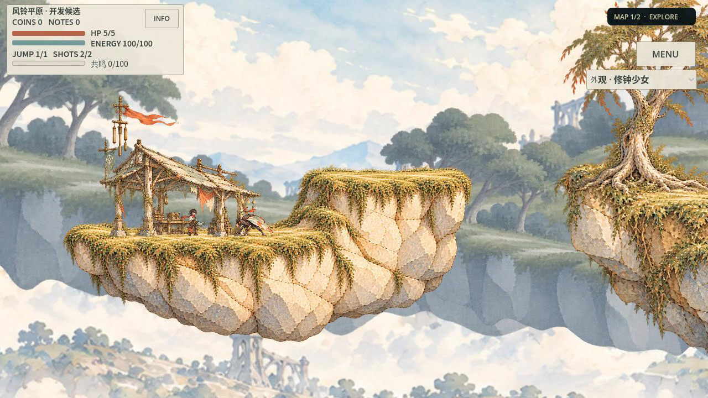

# 随机场所艺术生产：有限实证，尚非商业黄金

先看[真实原帧与完整录像](../evidence/plains_places/gallery.html)、[跨Seed独审](../evidence/plains_places/independent-seeds.md)、[本地试玩](../evidence/plains_places/delivery/delivery.json)。运行冻结 `ef6a8b4f1d06406b6b5f0a3db658902c15c1084e`，母PR82 `4a4b3fd7`，独立分支 `feature/plains-place-grammar`。P1是用户偏好候选，未代签最终艺术认可。

本轮实际做成三个可玩场所、同资产三种Seed排列及两种连接间隙。独立AI限定接受已看窗口：比PR82更可靠地保留连续岸体和场所差异；没有证明任意随机地图、商业黄金、全自动新区域创作或用户认可。不进入正式池、不合main、不修改森林。

## 作品及有界返工

草坡是整岸、风树和低后坡的开阔恢复空间；桥谷是双岸、真实桥踏面及空谷；背风院是低棚/活RootBell/一次反冲攀升/高台回望。三者保留原人物、敌人、锯、HUD、正常镜头和真实输入。环境主库是6张实际消费PNG，角色/敌人/机关/UI另沿现有源；[源SHA、实际实例及三Seed复用](../evidence/plains_places/asset_reuse.json)证明三条链使用相同环境源集合，没有逐Seed出图或整屏绘改烘焙。

首轮完整岸体修复了旧方肩，但院内缩小整岸叠大岸形成“浮饼”。[独审01](../evidence/plains_places/independent-native-01.md)整体REWORK，草坡/桥谷仅限定保留。随后只画新的上下共同院岸，重新量测一体碰撞、两站面、路点及根脚；没有给失败叠法增加装饰或alpha。新完整去返与[独审02](../evidence/plains_places/independent-native-02.md)通过后，才执行额外两Seed。

| 实际同源Seed | 排列 | 两连接间隙 | 物理ticks / 落稳案例 | 正常电影 |
| --- | --- | --- | --- | --- |
| plains-places-first-01 | 背风院→草坡→桥谷 | 由原Manifest记录 | 2174 / 35 | 36.316667秒 |
| places-contract-01 | 草坡→桥谷→背风院 | 200 / 200 | 2231 / 35 | 37.266667秒 |
| places-contract-02 | 桥谷→草坡→背风院 | 160 / 160 | 2199 / 35 | 36.733333秒 |

三条完整出返均HP5、6次实际接受射击、零恢复回退、原sourceguard/ERROR/音频释放/严格退出通过，`omitted=[]`。Seed改变实际场所排列、世界坐标和端口连接；不是机关相位、命名或Hash变化。只有链式重排，没有证明分岔拓扑；连接rise实际均0，没有测试40高度连接。12个离线Seed的正例均首次成功；5类实际负例验证4轮拒绝耗尽，没有实证一次自然失败后成功重选或安全保底。

最弱**已看**窗口为[Seed01 frame120](../evidence/plains_places/frames/seed_01_entry.png)：人物与树根同密度，离树后的240帧恢复清楚。重复同侧梯台/斜纹、同一远环仍限制资产形体变化。独审实际看32个原尺寸帧并核三份完整源清单，未完整播放、亲听或本人操作影片；正常速度由媒体帧数/60fps证据确认。未把最弱静态窗夸成全程遮挡，也不将有限通过外推所有地图。

## 根因与实际修改

| PR82实际阻碍 | 本轮实际消费者变化 |
| --- | --- |
| `PlainsEnvironmentPlan.generate`只duplicate固定JSON、仅A、Seed只动锯相位；校验硬限五场所 | 新`PlainsPlacePlan`读取3局部原型，独立RNG选择6排列与两gap配方；统一编译到原Manifest/assembler/stage，保留4次拒绝，无未验保底 |
| 地形根肩/侧带/深土分别投影，第三轮端alpha仍是方帽 | `PlainsPlaceComposer`整张功能体块等比显示；同源顶/肩/侧/底，不拆薄带、不裁肩、不透明渐隐。上下复合体不再靠缩小整岛堆叠 |
| 场所只是路线区间加孤立大物 | 原型同时包含局部实测solid/surface、端口、观察/起跳/接收/返回、敌与机关、棚脚、层锚及构图目标。三个不同实际结构，而非矩形房间换名 |
| 缺共同中景与连接后的景场 | 一个共享世界远景/地标，两种用途的冷中景实例；全图共享camera reference，编译时反补偿场所观看目标，运行连续视差、不逐房重置 |
| 旧路由和Skills仍推荐thin shoulder/arc-length端转面，并把合屏排在多布局之后 | 替换四现有Skills的9处冲突段落及真实路由绑定，指向当前源/计划/composer/capture/失败。没有新增导演、分数框架或平行质量门 |

源码：`scripts/generation/plains_place_plan.gd`、`resources/generation/environment_grammar/places_v1.json`、`scripts/art/plains_place_composer.gd`；沿原`PlainsEnvironmentAssembler/Stage`与正式DemoApp活体消费。局部原型只平移到世界，不旋转/任意拉伸。原PR82实现和全部旧失败仍可恢复。

**硬约束**：真实源SHA、有限等比尺度、源站面与碰撞profile（容差最多1源像素）、有效多边形、真实端口间距/高度、跨场所碰撞不重叠；缺件/非法形体拒绝并保留原因。实际Motor/安全出生/完整路线仍另验，结构编译不代签物理。

**构图软约束**：围合、焦点、空谷、留白、近中远职责。当前由真实创作与有限配方落实，源码并没有能够优化任意地图美感的万能求解器。**创作自由**是新增/重画合理功能家族、场所目的/连接和景层关系，然后冻结接口重新准入；不是让运行随机任意缩放/撒物件。模块库约束生成几何，不能表达时拒绝，不强拉素材。

## 真实失败及门槛保持

- 首contract解析因局部`next`推断失败，补显式int，原记录保留。
- 首可见启动被原`SegmentRespawn.is_safe`拒绝：出生锚在坡转平面处，24宽身体左脚侵入约0.275像素。只把safe锚放到真实平面内部；原安全检查不改。完整路线验证随后通过。
- 首整屏院岸叠法艺术REWORK，完整39.4167秒电影保留。新共同院岸先真实无录像开发探针，再冻结正常影片；开发探针没有冒签最终源或可见输入协议。
- 原严格compare拒绝两轮作为纯美术A/B：初始capability仅position改变，实际Manifest/几何也改变。保留[原拒绝](../evidence/plains_places/records/comparison_01/original_refusal.log)，gallery仅作相同正常视角/场所用途对照。
- 首包缺实际场所计划中的共享far，严格3层/omitted对照拒绝，无ZIP。将**整个场所JSON**加入既有producer递归根后，第二包1485项逐SHA、空目录headless/GUI、根脚/人物实例、退出与ZIP CRC通过。未降低计数或忽略Godot错误。
- 新工具检查缓存初漏辅助工具依赖，已将tools目录纳入；结构统计初含ID，包装器现另要求纯有限数值平移/端口路径/gap/rise差异，并用重命名不变、坐标改变及NaN/bool/string反例验证。[不同作者工具审查](../evidence/plains_places/independent-tooling.md)保留原P2及闭合记录。

原Motor/武器能力/资源/RNG实现/存档源码未改；候选隔离Meta保存。普通美术路由仍无generation写授权，重设几何只在已授权联合实验。森林玩法/敌人/Boss/生成及专属生产文件未写；共享路由只改平原美术分支。默认运行不选择候选；既有两导出preset排除visual_development路径，本轮未运行正式Web导出证明。

## 可取得的试玩与下一次短任务

[Linux本地包回执](../evidence/plains_places/delivery/delivery.json)：build_id `9386ee72ce48`，237132766字节ZIP，源码`ef6a8b4f`，SHA256 `d9cd647a59716d053ab76c19df4d2279842692d7e88a90f0bf0c88bc5a59ae8a`。完整源PCK、官方Godot4.7.2、空cwd真实GUI已验；手动A/D/空格/鼠标，HUD可选角色，仅会话外观。没有在PCK里重新驾驶三条完整路线；三条源运行与包启动/消费者一致性分别陈述。

源码手动：`bash tools/godot.sh --path . --script res://tools/plains_places_preview.gd -- --seed=places-contract-02`。

短任务：`python3 tools/level_design.py route --request '制作风铃平原美术' --output build/next_plains_art.json`；实际绑定当前母版/范例/失败、真实consumer和两个已注册专项，再沿原Harness真实宿主执行。route仍只是计划。本轮真实图生、专业实现、Godot和独审已执行，但没有把它包装成“短Prompt已经自主创造任意新区域”。

**扩产判断**：允许继续使用这三个已看候选做有界组合研究；不准入正式池、大规模Seed生产、新资产用途或全地区量产。商业黄金、风格用户定稿、完整动画/听音、真人操作、PC/手机/手柄设备、正式两图/保存/全CI及Web发布均未验证或未通过本轮门槛。历史encounter/复杂GUI阻塞未修、未豁免，未借本轮扩大维修。森林风格迁移未执行。下一关键实验是以一个简短场所需求自主派生第三种地形家族、完成接口和真实准入，再验证受控形体参数变化；当前只证明有限策展场所重排，不能用这些电影宣称已经学会自主设计任意新场所。

[真实时间账](../evidence/plains_places/timings.json)保留原记录；4次图像调用（含1次中景重绘与1次院岸返工），价格/token/模型未披露；生成资产商用许可unknown。不能把AI限定接受或测试通过当市场事实。

## 最终相关验证

冻结提交`fc9a01db`上，原Harness明确选择的7项全部fresh通过，墙钟108.457秒（含源码指纹开销）：docs、quality、art-art、visual-director-tests、level-design-routing、plains-places-contract、plains-places-capture-tests。原生contract118断言；12预登记Seed纯数值投影9种结构，排除名称/Hash/机关相位；48项Python测试通过。[原回执及日志](../evidence/plains_places/records/final_verification/harness_report.json)保留明确`targeted_checks=true`、`release=false`。这不是整个profile、完整G4、全CI或设备验收。

另外，提交范围检查首次因质量卡将目录误作精确文件覆盖而拒绝14项源/导入/UID；保留失败日志，改为实际变更文件清单，不修改检查器或运行代码。最终范围检查结果单独归档。
