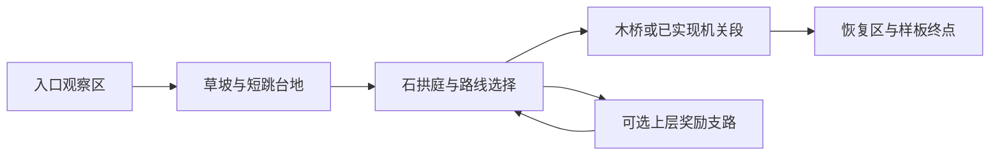

# 后续 Tile Map 制作规划

任务 `TILE-MAP-PLAN-01`，2026-10-19。依据用户提供的[视频](https://www.bilibili.com/video/BV1kbDGYuEF7/)和[关键段落记录](evidence/tile_map_plan_01/observations.md)制定。本文是生产规划，未制作新地图、修改随机池或开放地区。

## 本轮决定

后续地图按 **同族tile素材 → 手工合屏样板 → 可验证模块 → 受约束随机区域** 推进。47-tile blob仍是实体连接地基；美术从少量代表块与真实拼接场景开始验证，然后补齐47态，而不把47张各自漂亮的图直接拼成地图。

视频的像素教程提供制作方法；画风继续按用户最新指定的《洞窟探险2／马里奥制造2》饱满卡通方向收敛，不自动切回像素画。方向B概念尚未获认可，也不是可直接切成tile的母版。V1色块视觉保持被拒绝状态，原技术地基可继续使用。

草土石用饱满草帽、大块石形、倒角亮面与缝隙阴影塑造体积；安静的内部也要有完整形体，细碎纹理从属。人物/敌人视觉沿用同一套设计卡，在真实节点上观察比例和动作，不能用概念角色替代实机合屏。

## 从视频到项目的具体转换

以下均为画面/烧录字幕观察后的概括，右栏为本项目设计选择，不冒称作者制定了我们的地图或47态合同。

| 视频约时段 | 可观察的方法 | 在项目中如何落实 |
| --- | --- | --- |
| 02:30–03:00 | 单块物体大量重复后会显出格纹，细碎纹理也可能形成迷彩 | 内部填充保持安静；把主要识别细节放在外轮廓与表层；连续3屏检查重复，而不只验单块 |
| 03:40–04:20 | 简单内部纹理配合少量变化也能组成完整场景 | 首期只做一个完整草土石家族；先统一材质与轮廓，变体只做允许的有限差异 |
| 08:00–09:30 | 相邻块边界必须对齐；可引用相邻tile作为连接参照 | 冻结接缝带、草帽厚度、石缝/明暗接口；内外角、端头和长条在同一测试场验证 |
| 11:30–12:30 | 网格尺寸明确；示例分层组织高光与深浅阴影 | 保留32世界单位/格、64px源tile合同；材质底色、内部结构、轮廓、高光/阴影分层保存 |
| 15:30–16:30 | 顶面/侧面的材质表达与装饰性物件共同构成场景 | 顶面草帽、侧面土石、底面岩根有不同语义；草花/陶器/遗迹等独立于碰撞层 |
| 17:30–18:30 | tile本身也可做变化或修补，区别于只覆盖场景小物 | 先做少量内部变体；必要的大石块/裂隙另作跨格内部图案，接口固定，不改变碰撞与mask |
| 19:30–21:30 | 光源位置与素材预绘明暗要协调；统一照明较容易保持一致 | 先统一日光方向与素材亮暗；灯光作为局部补充，避免相邻tile像从不同方向受光 |
| 22:00附近 | 示例并非生产就绪资产 | 每件仍须经过源图、尺寸/锚点、接口、真实引擎合屏、移镜与实际操作检查 |

## 第一批素材范围

| 类别 | 首期制作内容 | 明确边界 |
| --- | --- | --- |
| 实体主家族 | 一套草覆土石：顶面、左右侧、底部、内外角、端头、细条、孤立块、内部填充 | 完整晋级前必须覆盖47态；草只作为合适的表层，不能为了同图复用把所有墙底都画成草地 |
| 内部变化 | 安静填充为主体，少量石块/根系/裂纹变体 | 同族轮廓与接缝不变；避免每格一个高对比标记；跨格图案仅用于被实体完全覆盖的内部 |
| 单向平台 | 木板薄平台的左端/中段/右端与连接件 | 从下可穿；与全实体地形和移动固体区分 |
| 移动平台 | 铜木框架、铆钉与运动识别图形 | 独立对象的局部坐标；携带仍由真实碰撞实现 |
| 危险/机关 | 复用已实现机关类型，绘制统一危险轮廓/安装接口 | 危险范围和相位来自Definition，不由图像推断，不为画面添加未授权新机制 |
| 装饰 | 先做8–12件小家族：草簇、花、蕨、蘑菇、碎石、陶器、木牌、灯具等 | 可站边、出生/回退、接缝、机关行程和敌人预告留空；大树/巨岩必须是独立正确尺度资产 |
| 背景 | 天空/远轮廓、中远植被或遗迹、近背景，统一空气透视 | 背景不强制tile化；不能与实体使用相同的落点轮廓和对比 |

首期不同时生产许多实体材质。人工砌石等第二家族在第一家族合屏稳定后再引入；跨材质连接须有明确过渡，47态不自动解决材质转换。

源尺寸继续由 `Blob47Rules` 维护。视频示范的32像素不等同于本项目32世界单位；不据视频修改当前物理或将已验矩形取整。

## 制作顺序与交付物

| 阶段 | 实际要交的东西 | 进入下一步的条件 |
| --- | --- | --- |
| P1 材料与接口 | 8类代表样式（约8–12块），包括顶/侧/底/内角/外角/端头细条/孤立块/内部；一张长条拼接和凹角测试场 | 小图和连续拼接都保持材质、明暗、边缘一致；先解决可见接缝与噪声 |
| P2 完整tileset与MAP-00 | 补齐47态、允许的变体、单向与移动平台，以及真实引擎材料验收场 | 技术映射正确；单行/薄墙/凹凸/孔洞/跨模块接缝和过滤缩放都实际看过 |
| P3 两张手工样板 | MAP-01横向草坡石拱、MAP-02回廊井庭；含真实玩家、既有敌人/机关、UI、背景与装饰灯光 | 合屏体现目标画风；正反路线、危险预告、恢复与动态画面通过；用户视觉反馈单独记录 |
| P4 小型模块库 | 从已验样板拆出6–8个有不同用途的模块，附入口出口、能力/资源、tile家族、keepout和背景身份卡 | 模块独立及邻接组合都能用真实Motor通过；没有靠未授予能力或中途补资源救场 |
| P5 随机验证与正式迁移 | 在现有Manifest/RNG架构中受约束组装，先小区域再逐个迁移正式平原消费者 | 实际多Seed/最差Seed、三种探索路线、保存回退和真实移镜通过；不以hash差异代替内容差异 |

P1的代表样式不是缩减47态要求。先减少美术返工风险，再完成完整拓扑覆盖；不会把未完成的小包准入正式随机池。

## 三张先做的map

### MAP-00：材料验收场

设计尺寸候选40×24格（1280×768世界单位），不是一张正式关卡。内容包括：12/24格长直面、1/2/4格厚实体、1格墙、台阶、L形、T形、凹角、封闭孔洞、孤立格、模块接缝，以及分开的单向/移动平台。

同场放真实人物比例、一个既有敌人、机关和UI；检查素材放在实际游戏画面是否仍成立。提供mask/碰撞/材质层/装饰层/背景层/灯光的检查方式，诊断层不计为最终画面。

### MAP-01：阳光草坡—石拱庭

设计尺寸候选80×28格（2560×896世界单位），以横向为主。尺寸和玩法均需实际制作后验证。

主路用正式起局的真实单武器、基础跳跃/反冲预算设计，不依赖H/W/D；支路有完整返回方案。一次只组织短动作链，下一安全落点和机关预告先可见，再让玩家进入。石拱庭承担一个主地标；其他模块不重复安插同样的塔/拱。

本图重点验证：草土石同族是否能自然构成地面、厚台、支墙和拱下空间；木桥/铜机关是否与实体区分；少量装饰是否有密疏与生活感。

### MAP-02：回廊—井庭

设计尺寸候选48×48格（1536×1536世界单位），继续用同一家族。用折返、上下层和一个可返回的小环路检验另一种空间轮廓；不以换色或再画一套tileset冒充新地图。

重点验证长侧壁、凹角、底面、窄通道和纵向镜头，以及向下看落点/向上看危险的预告。静态站立通道先按至少两格净空筛选；跳跃头顶、身体边界、移动扫掠另验，不能用“两格净空”证明可跳。避免单向平台把玩家接到错误高度，避免台阶与低顶面组成身体夹口。

两张样板均是制作验证空间，不改变正式平原“两图/小Boss与大Boss”的流程，也不代表新增地区开放。

## 模块库与随机化

首轮候选模块：入口观察、低台地、短断桥、石拱通道、时序平台、落点遭遇、奖励支路、恢复汇合。每个必须有不同的空间/操作用途；数量是制作预算候选，不是已经存在或已准入。

当前 `Blob47Layout` 的20×25格串联仅是技术样板。后续模块大小由玩法和构图决定，仍用整数tile边界与明确端口；正式迁移复用 `PlatformingModuleDefinition`、`PlainsRegionGenerator/Assembler`、`RunManifest/RunRandomStream` 等现有消费者，不再创建第二套不兼容的正式生成架构。

随机化依次决定：

1. 选主路、支路、回程与恢复的结构；分配空间身份和机制预算。
2. 选已经验证、tile家族兼容的模块；检查入口出口速度、资源、能力与相位。
3. 先合并实体占用/halo，再统一求47-mask；跨材质不默认合并。
4. 按模块挂点安排真实机关/敌人/奖励；落点、预告、失败恢复和回程必须成立。
5. 用独立装饰流安排背景身份、变体、小物与灯光，受支持面、完整bounds、keepout及预算限制。

第一批候选验证10个Seed并保留最差构图，再按风险扩到更多；抽样数量不是正式完成证明。各Seed分别记录快找Boss/正常探索/奖励绕路返回的真实路径，区分结构、操作、画面与玩家体验。目标是有意义的组合变化，不是任意形状拼接。

## 下一次应交付什么

优先交付 **草土石代表tile小包＋接缝测试＋正常比例合屏**。随后才补齐47态和两张手工样板。独立概念图只用于约束画风；实际地图需要用真正能重复、能转角、能接墙底的素材证明。

验收分开记录：规则/拼接、真实Motor、实际GPU合屏与动态、独立审查、用户画风/体验、目标设备。地图和素材生产尚未执行，不将这份规划标为运行实现。
