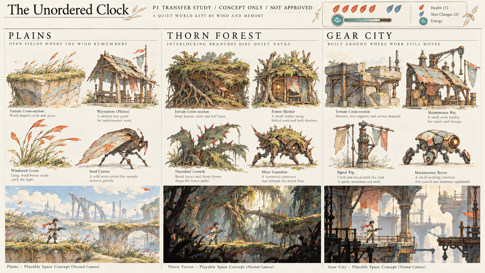
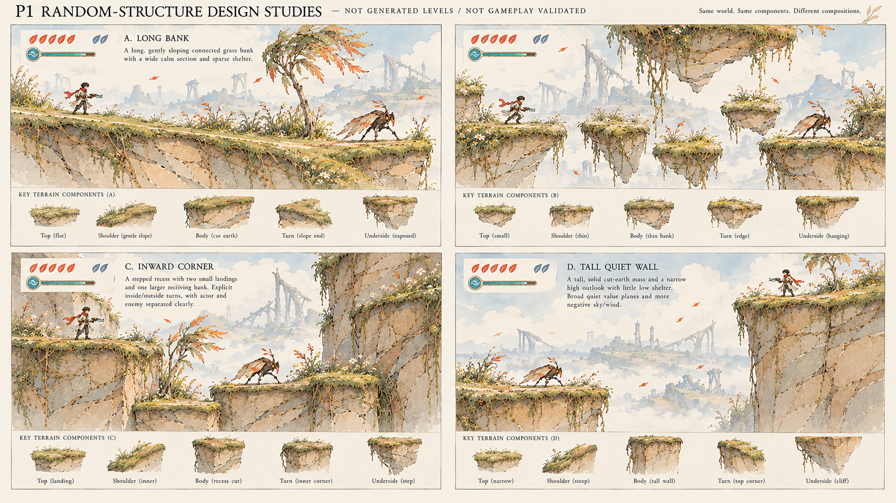

# P1优先候选：共用语言，不固定成一张平原图

用户反馈：“我更倾向于p1。但是，要考虑关卡随机，自己其他区域是否能共用一套基本的美术语言”。这确认候选偏好与验证条件，尚不等于认可P1现有全部对象、比例或最终游戏风格。没有修改生产母版、玩法、森林分支或PR77工具。

两图均为实际图生的设计研究，不是Godot画面、正式资产或随机生成器输出。尤其第二图的不同结构不能算不同Seed运行，图里画了连接关系也不能证明模块真的能拼。

| 层次 | 可共用 | 应随区域改变 |
| --- | --- | --- |
| 绘画 | 有取舍的线、大片淡彩与明暗、统一笔触尺度、边缘软硬、人物与危险的对比层级 | 色彩脚本、湿润/干燥/烟尘的状态、环境明暗与空间密度 |
| 造物 | 可理解的支撑、连接、开口与修补；略偏心、有粗细节奏 | 平原的受风细骨架；森林的分叉/缠结/厚叶；工城的厚重砌筑/铸件/斜撑 |
| 游戏身份 | 同一主角、武器与操作反馈、HUD、交互状态、危险语义 | 区域敌人生态与剪影、机关外形、建筑尺度与用途 |
| 模块接口 | 实际站面→顶/肩/侧体积→端转面/凹角/可见底部的语义与校准方法 | 区域自己的原画家族、源轮廓、材质、接头与必要组合件 |

不能让森林只是平原加树，也不能让工城变成叶顶小屋贴齿轮。共用的是画法与造物关系，不是全世界一张浅色岩壁贴图。P1也不能只靠纤细线稿：40px人物和高速移动时，大明暗与剪影必须独立成立。

随机空间需要保留画面关系：哪条边真能站、端部怎样转面、植物依附哪里、哪里留给落点/预警、焦点如何随进入/跨越/回望改变。独立随机抽每块材质/装饰会重新变成拼贴。先考虑长岸、短薄岸/底面、凹角/阶差、高壁/纵向观看等不同用途；图里新增的地形只是研究，不擅自改真实玩法。

PR77可以继承的是有限截面、完整实体轮廓覆盖、左右转面、底边视觉与物理语义的校准。它只验证有限用途，不能宣称任意随机地形已支持。后续真正准入仍需：选定P1的最小绘画母版→关键连接原画→同家族两个不同真实空间→预登记Seed/最差样本→其他区域的新对象与空间；必要接口缺失时重画，不用拉伸/染色凑齐。不新增平行工具或框架。

当前状态：P1优先，跨区与随机适配仍待实际证明；不冻结成全游戏强制美术权威，不批量生产整区资产。

实看这两图后的具体判断：森林的深腐殖土/厚根与工城的砌筑/金属斜撑，确实能和P1线描淡彩并存；同一主角/HUD也维持身份。工城维修棚仍偏平原屋架，需要更明确的厂房承重与用途。结构图的高壁仍偏密，图下“组件”多是独立完整土块，不能直接称可连接原画或同一库实装复用；这些英文标签只是生成图文字，不是证据。图中跳跃路线/能力需求也未验。
