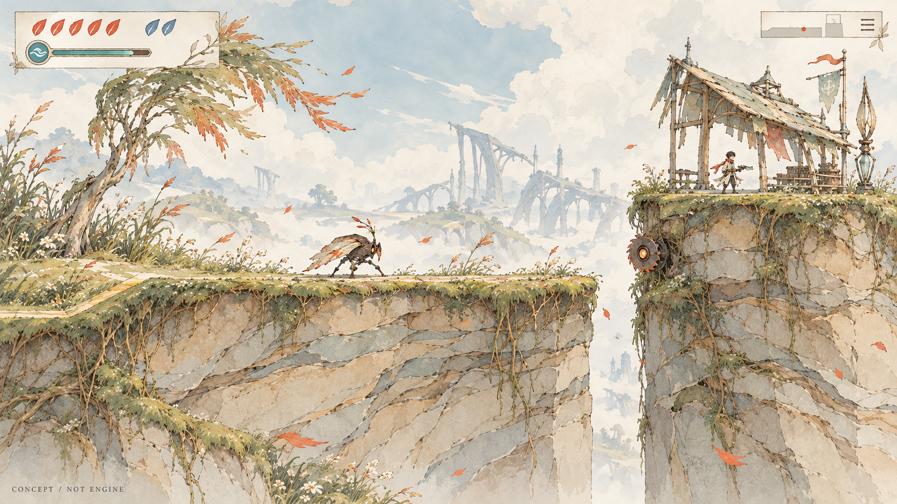
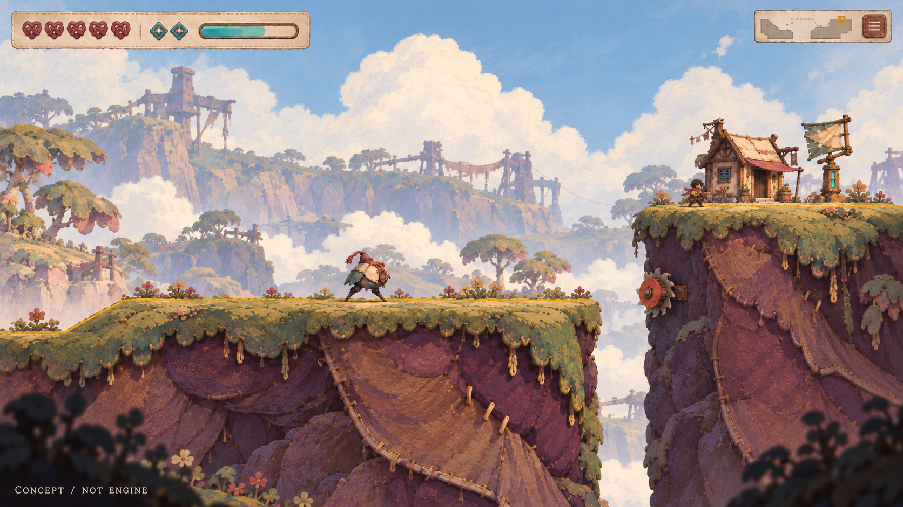
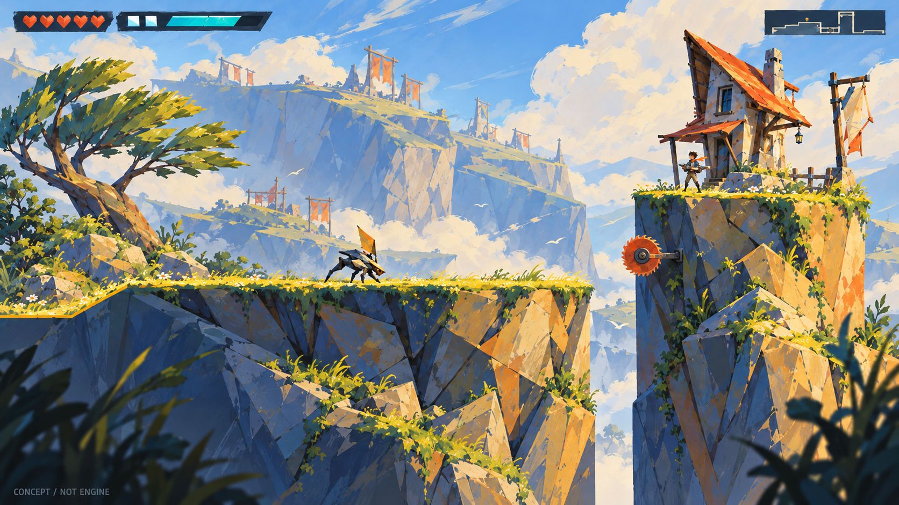
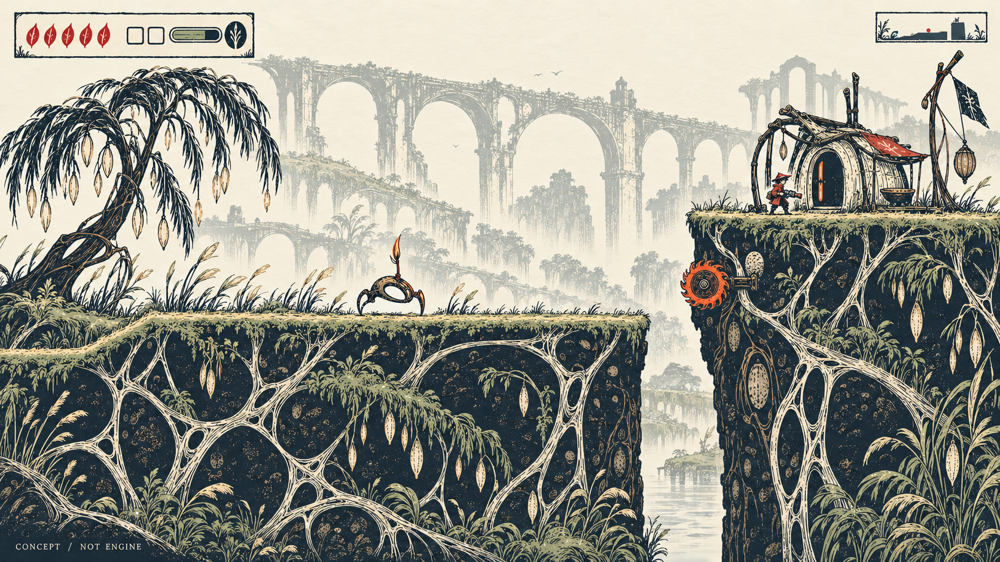

# 《失序之钟》四种艺术方向：供选择的概念作品

**四组均未获用户定稿，均未进入Godot。** 本轮停止继续B「雨釉与偏心」制作。P2的“织构”是另一候选，不是旧B的新名字。先看[同屏切换画廊](gallery.html)，再看普通对象；推荐不升级为视觉权威。

## P1 · 风蚀的歌页

[角色、敌人、地形、树、建筑、装置与HUD原图板](p1-board.png)

温柔与消逝：风把细长种翼、叶片和屋顶的薄片吹向同一方向，部分轮廓像被慢慢擦去。视觉来源是干草种翼、弯木肋架和钢笔淡彩；前者决定收尖与疏密，后者决定支撑和开口，半透明色块决定轻重与深度。修长工作服主角、展开种翼的低伏敌人、开敞屋架与窄叶冠属于同一套“轻骨架承托薄片”的世界，不继承旧圆壳敌人。

**我的判断：** 四图中最轻、最安静，童话温度自然；远处空置骨架比巨大钟楼更适合表达失序。但绘本气质较熟悉，独特性更多依赖持续的造物细节；细线、浅土与浅角色在高速移动时容易相融。当前地形纹理和藤根仍偏多，不应把每根线复制进最终资产。

**模块化风险：** 能继承PR77顶/肩/深部及左右转面的语义；不能把细线源随意拉长，端部根线与屋架挂点必须接得上。后续应验证大明暗成立后的少量线段接口，不靠加密线描补接缝。

## P2 · 缝风的归途

[同方向普通对象与HUD图板](p2-board.png)

被照料与逐渐散开：低重心体块、悬垂叶片、厚草毯和有重量的缝补，让世界像仍被人细心维护。来源是织物受拉形成的悬链、短粗木架和不透明纤维水粉；它们分别控制垂坠、承重、边缘与笔触。短披肩维修者、种袋跳虫、压叠土层、风雨布屋顶及结形HUD共享“覆层与固定点”，不是只把岩壁换成布纹。

**我的判断：** 亲切、触感强，普通物件很容易形成家族；情绪最接近日常维护。但当前地下缝线过于字面化，容易变成玩具布景或过甜的手作世界，削弱神秘与真实生态。不能把“治愈”完全交给圆形和暖色。

**模块化风险：** 草毯覆层与可变长度的安静土腰可共享截面技术；跨模块的缝线应是有受力理由的连接，不能随机贴。深浅岸转换和缝线端点需要接口，不适合全靠同一张纹理缩放。

## P3 · 折光的候风镇

[同方向普通对象与HUD图板](p3-board.png)

明快运动与停止工作的设施：斜撑、楔形、折片和风向叶冠，把射击反冲的方向感引入环境。来源是受风的折片、木构斜撑和不透明大色面水粉；地质、建筑、敌人的腿与感风鳍共享清楚的斜向受力，人物仍以简洁工作服保持识别。HUD用少量分离块面，不让装饰边框抢动作。

**我的判断：** 四图中动作方向与危险最直接，适合高频跳跃；暖亮面和冷暗面让体积容易读懂。但当前若干切面像低多边形渲染，色彩也更接近明快冒险，隐藏悲伤最弱。它有较低的制作歧义，尚不能因此称独特或“最商业”。

**模块化风险：** PR77有限截面能承接大面与转面，拼接容错预计较好，但只是技术推导。当前岸体内部有带草斜面，会被误读为额外落点；选此方向后必须处理这个设计缺陷，不能把它作为真实几何导入。大斜向明暗跨端部时仍需重绘连接件。

## P4 · 苇影的回声

[同方向普通对象与HUD图板](p4-board.png)

仍在维持的微小秩序与逐渐空缺的世界：纸白、深墨、少量朱红，配合芦弓、椭圆开口和受拉曲线。来源是受力芦束、旧木刻的正负形和手刻墨线；它们分别组织连接、空间节奏与表面语言。戴小帽的朱红维修者、镂空弓形敌人、偏心门洞、垂种树冠与地下根网共享负形，和前三套不是同一画面换天气。未采用先前湿墨稿，因为它与P1仍过于接近。

**我的判断：** **我优先推荐P4作为下一次小型绘画—模块实验的候选，P1作为温柔淡彩备选。** P4的对象、HUD与整屏关系最容易被一句清晰的视觉命题统领；小人物在大片纸白与深墨间也有位置。这个判断针对眼前作品，不是用户或市场认可。当前地下纹样偏密、远景拱架偏抢，整体也可能过冷；真正吸引人的应是留白与负形，不能变成满屏装饰根纹。

**模块化风险：** 大墨面能复用PR77体积结构，根线与刻线则比色块更怕连接断裂和缩小闪烁。地下负形不能误导为可进入洞口；需保留安静面、区分图案与真开口。不能用一张统一刻线滤镜把所有材质“变木刻”。

## 同题约束与没有做到的部分

四图从PR77同一个正常镜头、`against-wind-golden-v1`的实际三岸空间出发：主岸水平段、窄隙、右上落点、右侧小屋/主角、中部普通敌人与侧挂锯保持同一功能关系。[原始Godot参考](gameplay-reference.png)来自PR77视频600帧；[数值布局示意](layout-guide.png)不是美术作品或新游戏几何，[SVG](layout-guide.svg)保存坐标。约束逻辑画布1280×720，主角目标40px、普通敌人目标45px、锯直径52px。

**图生没有像素精确服从坐标。** P2上落点与房屋经过一次局部校正；最终锯位置、部分房屋及人物/敌人附属轮廓仍有尺度或坐标偏差。P3的岸内斜面会暗示额外可站面。它们适合比较艺术方向，不能当作相同物理条件的游戏验证，亦不能按图内“40px”文字宣称实测尺寸合格。四图用16:9视窗完整展示，原始PNG尺寸见来源表，未裁切/重绘输出文件。此轮不运行引擎、不导入素材，不拿PR77旧技术通过倒签新风格。

直接用旧实机作图生参考的4张试稿，仍继承过多旧圆壳、油画岩壁；先对象板、后整屏的3张试稿又发生人物放大/挪位。最后改为几何图作主画布、对象板作风格参考，尺度与功能关系有所恢复，残差仍如上。原稿全部保留在`trials/`，没有把失败覆盖掉。P2再做一次局部校正，压回上落点与房屋比例，原稿亦保留。共17次真实图生/编辑，8张选出的场景/对象板、9张试稿；这不是“17张正式资产”。所有图像来自image_gen，程序只绘制技术布局图，不绘制最终手绘成果。

原始字节、实际提示、参考关系和SHA见[来源表](provenance.json)。工具模型、价格、token与商用许可未公开，均标未知。所有候选位于docs，现有export已排除docs；没有加入正式资源池或修改森林、玩法、生成器、Terrain工具及Skills。

**下一步停在用户选择。** 可选择一个方向，也可全部否定或指出希望保留的表达。确认后才冻结新的视觉母版，继承PR77已验证的有限截面、完整体积、端转面、底边语义校准能力，做小型整屏到模块实验；不会将这次推荐自动写入生产catalog，也不重新发明地形框架。
