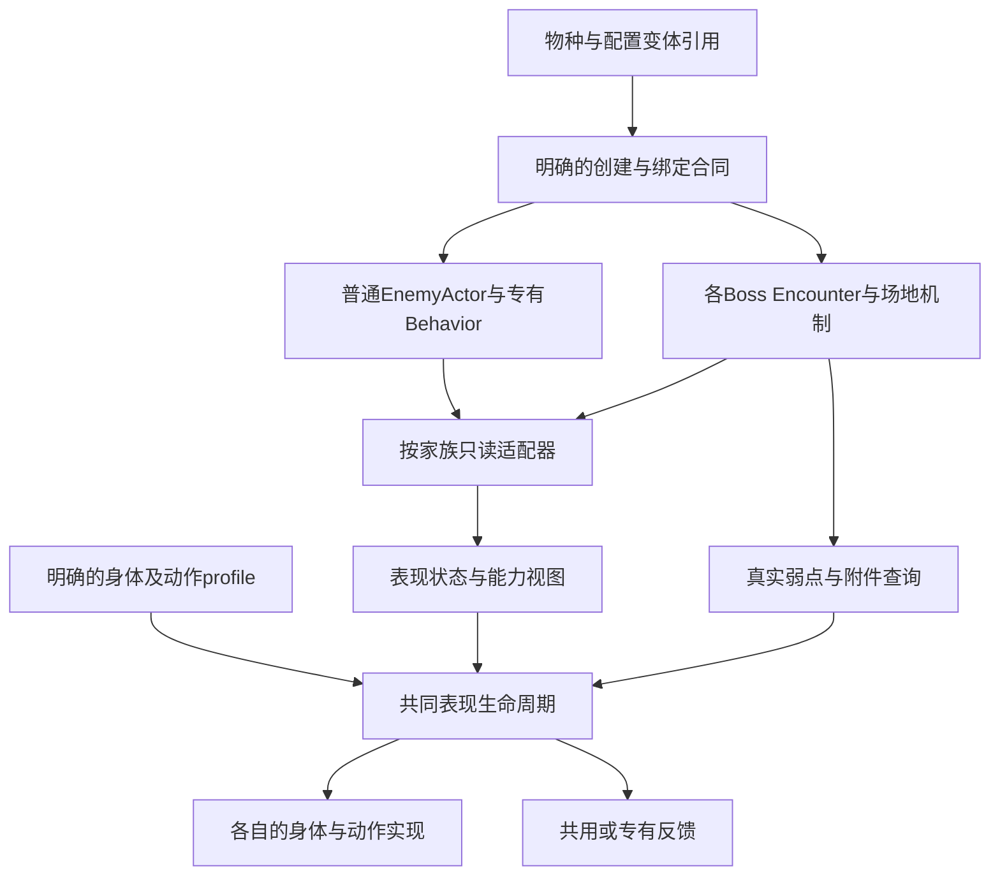

# 全怪物程序结构：现状、问题与统一边界

用户要求：“所有的怪物需要整理并统一程序结构”；同时保留“先不要批量做，先发现问题”。本轮完成逐怪结构盘点和统一方案草案，**尚未实施程序重构**，也没有以结构方案代替成品质量判断。

范围：平原7、森林7、开发候选2、8 Boss场景／9配置。普通怪的22条身体宿主链和候选／Boss变体分别跟踪。结构审计读于本地文档提交9b76f004，生产代码与公开310c0421逐字相同，[来源等价说明](structure-source-equivalence.json)保留此范围，不把元数据变更冒称新实机。

逐怪节点、真实类链、调用与行号见：[平原](structure-plains.md)／[JSON](structure-plains.json)、[森林与候选](structure-forest.md)／[JSON](structure-forest.json)、[Boss](structure-boss.md)／[JSON](structure-boss.json)。[独立结构复核](structure-review.md)另列5项优先问题；本次均为静态核查，恢复等风险未运行复现。

## 已有的共同底座

| 层 | 现在已经共用 | 本轮统一工作应保护什么 |
| --- | --- | --- |
| 生命与伤害 | 普通／Boss的HealthState、Damageable、FrameDamagePolicy与accepted结果 | HP唯一权威、旧epoch／重复攻击拒绝、真实护甲／弱点、奖励幂等 |
| 普通实体 | EnemyActor＋EnemyMotor＋EnemyPatrolAI；Behavior沿EnemyAttackBehavior家族 | 每种移动／攻击算法、真实支撑、取消语义、接触巡逻与固定根部 |
| Boss实体 | 相同Motor根／CollisionShape2D／Damageable／Encounter／Presentation骨架；BossEncounter健康与部分信号 | 活铃／结点／网场／断桥等专有所有者、实际阶段轴、场地与资源规则 |
| 表现基础 | 共享accepted反馈及Plains／Forest／Boss motion helper | 身体与预告／弱点分层，暂停和epoch规则，离屏只省绘制工作 |

Boss实际是7个Encounter脚本（含基类），6个派生类；旧Guardian／Queen共用ThornForestEncounter，默认／Storm共用Windkeeper scene。按场景名数类，会把程序结构记错。

## 逐类现状

| 对象范围 | 行为／控制 | 当前表现与装配差异 |
| --- | --- | --- |
| 平原7种 | patrol无主动Behavior；charger/diver/hopper/sentry/fan在同一EnemyAttackBehavior里分支，root独立Behavior | 同patrol场景＋运行Definition覆盖；root可先换专用表现，之后地区installer再换；scene／Underworld的选择与反馈装配不同 |
| 森林7种 | 共同Actor；多种专有Behavior继承基础Behavior，双入口蛛再继承有限蛛 | 4类Presentation重复生命周期；Bible helper再按祖先meta、ID与碰撞尺寸选身体或备用几何 |
| 开发候选2种 | 一个普通攻击Behavior、一个PrototypeMothBehavior；工厂运行时复制Definition | PrototypePresentation继承EnemyPresentation，又管理自己的motion／epoch／绘制，部分父层工作未消费；两个创建入口参数不完全一致 |
| 发条守卫 | BossEncounter＋phases／pattern＋BossMotor | 按基类phase与pattern采样 |
| Bellstrider／Windkeeper默认及Storm | Bell→Windkeeper→Boss；stage_phase＋mode／clock | 复用继承带入并非每个子类都适用的字段；目标／Stage／controller绑定分散 |
| 旧森林Guardian／Queen | ThornForest→Boss；stage_phase＋mode／clock | 两场景共享Encounter，但材质／表现分支和恢复政策需分列 |
| Rootbell V2 | Rootbell→ThornForest→Boss；身体／独立铃并行 | 专有Bell、弹道、同帧counter、保存恢复，表现读内部铃对象 |
| Weave／Canopy Queen | 各自派生Encounter，网场／移动多条轴；Weave另有route_phase | Knot／Band及迁移路径由机制持有；clock／motion_clock、bind／cancel／restore合同不同 |

这些差异中，有些是必要机制，有些是重复和隐式约定。不能仅按“类名不一样”就统一，也不能因共同父类存在就宣布结构已一致。

## 首先需要处理的结构问题

| 问题 | 已证事实／风险 | 统一方向（尚未实现） |
| --- | --- | --- |
| S01 外观选择与玩法flag耦合 | aerial同时参与运动／击退和选图；fan因此进入另一身体分支。森林皮肤又依赖祖先meta与精确尺寸 | 显式记录最终表现profile及适用能力；aerial仍归运动，造型选择有独立来源 |
| S02 构建入口与运行覆盖分散 | 场景→复制Definition→覆盖参数→临时表现→正式installer替换→App绑定／恢复，难从单一资源得知真实实例 | 明确统一创建合同与顺序，输出最终Definition／变体／renderer绑定事实；复用现有生成与存档权威 |
| S03 状态和时钟没有统一的可读语义 | 普通state_time递增；Boss clock多递减；有stage_phase、phases.phase、route_phase、motion_mode多轴；helper按具体类和字符串翻译 | 家族适配器输出只读表现状态，注明时钟域、raw phase和有效能力；不强制所有行为变同一状态机 |
| S04 表现直接读取机制内部字段 | renderer访问_bell、_weave_bound、_locked_aim、_platform_piers等 | 提供窄只读查询／快照，让真实预告、锚、附件仍由机制拥有；表现不持有可写内部节点 |
| S05 生命周期与反馈所有权重复 | 专有H/D与HitTemplate两套装配；4森林复制接线；Prototype父子双motion／初始化；多套hurt和clock缓存 | 统一bind／初始化／单次推进／解绑的合同，明确每个时钟和反馈owner；可选H/D、尸体与特殊附件保有专有策略 |
| S06 定义验证与行为登记多点维护 | Definition白名单、Actor行为工厂、场景映射、身体映射等分散；基础Behavior又含多个具体算法 | 明确单一有限创建映射；共有校验与专有校验分工；是否再拆策略在最小样板后决定 |
| S07 同ID的创建参数漂移 | 两候选入口中moth速度45／0、半宽120／100有实际代码差异 | 先判断是有意演示变体还是错误；有意差异要显式声明，无意差异再统一来源，不能直接改数值 |
| S08 恢复事务边界模糊 | Stage先health.initialize、后位置，App后方向／行为；表现可能提前采样。Boss和普通ready订阅顺序也不同 | 明确完整恢复完成的通知点，并按fresh death／cold dead／paused restore区分验证；当前仅列静态风险 |
| S09 保存／尸体依赖表现具体类 | Stage按UnderworldEnemy／EnemyPresentation类型取Remains；终态又分宿主淡出、暗体、兄弟尸体、Boss出口 | 通过明确能力与所有权取保存／终态视图，保各政策，不把所有怪强制成同一死亡演出 |

S01–S07中的结构关系／配置差异可由源码核对；不等于每项均已复现玩家Bug。S08等恢复问题需要实际重现后定级。表内“统一方向”是可审查的职责方案，不是已实施成果。

## 建议统一的目标

统一的是引用与创建入口、所有权、状态读取和表现生命周期。造型、动作方法、普通AI、Boss阶段、特殊对象、场地及终态政策继续由各自设计与权威维护。表现profile引用既有素材manifest，不另造一套资产来源登记。

现有`enemies/`、`bosses/`可先保留；如果以后需要整理目录，随职责实际收敛迁移。仅移动文件或把分支搬进一个更大的manager，不能解决这些问题。

## 可实施的迁移次序，当前尚未开工

1. 先把这份问题与逐怪事实表核清；参考怪物编号待用户澄清，不能据“第5个”擅自改造型。
2. 先做一个装配／表现边界样板：显式profile＋只读状态＋统一生命周期；所有原AI／HP／时序／奖励／保存先保持。这一步验证结构可用，不签美术质量。
3. 选第二种必要差异验证合同，例如活体飞行与接地／留尸，或Boss的并行Bell／Knot；未覆盖能力不伪造默认值。
4. 再决定是否收敛行为工厂／验证、父子无效工作与保存能力接口。每次迁移都列影响与等价范围，按所改层验证，不把一批新接口同时铺全体。
5. 后续每只怪再根据设计和品质问题选择补图、动作制作或反馈返工；统一程序不替代该步骤，也不自动恢复批量制作。

后续结构验证应保护原真实轨迹／时序／accepted结果、伤害拒绝、暂停与恢复、卸载和保存；美术／动作仍按正常速度与同屏质量另审。当前旧视频可作“结构回归来源”，不能称用户已采用的品质黄金。
