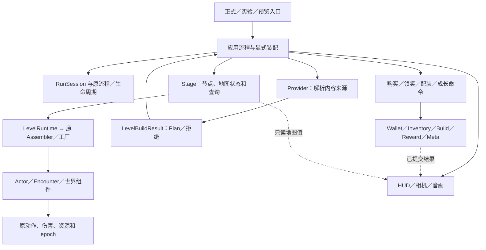

# 架构重构收口

本轮以已合 PR122／124 的 main `2ce4ffa64ef65dd5fba892776eea019c9e2841d4` 为内容底座，PR123 关闭且排除。当前分支为 `refactor/game-architecture-02`；没有自动合 main。本页描述当前实际调用边界，旧阶段记录保留原来源。

## 已落地的职责

| 模块 | 所有者和真实调用 |
| --- | --- |
| 应用／一局 | App 编排用户流程，RunComposition 创建玩家，RunSession 持有本局服务；原 Director／Lifetime 继续拥有流程与 epoch |
| 玩家／战斗 | Router 提交意图，Motor 唯一移动；生命、行动资源、FrameDamagePolicy 和原弹体分别拥有各自状态 |
| 装备／道具 | Inventory 拥有实例与事务恢复，Equipment／BuildState 提交配装与重算；效果族共用已有生命周期和主动施放实现 |
| 经济／奖励／成长 | Wallet 拥有余额，Shop 四操作共用原收据；RewardService／Meta 拥有原账本；Stage 在成功提交后记录地图领取状态 |
| 普通怪／Boss | 原 Registry／Factory／Definition 唯一登记；Actor 拥有地方配置、恢复和取消；各 Encounter 拥有专属阶段与恢复政策 |
| 地图 | Provider 产 Plan；Stage 调 LevelRuntime，Runtime 调原 Assembler／工厂；Stage 拥有伤害装配、Boss 场地／封印及地图查询 |
| 表现／平台 | 视图消费已提交结果；音频宿主共用 WorldAudioLifecycle；输入、存储和 Web 继续使用原适配 |

最近收口包括：Stage／Actor 共用取消攻击；Stage 接回伤害和 Boss 场地／恢复／封印装配；App 与 Stage 共用唯一接触伤害构造；三个 Stage 共用领取状态操作；App 与生成器共用宝箱候选规则。相同规则迁移了真实消费者，不只是新增未使用 helper。不同 Boss、RNG、满血处理和历史预览政策继续明确分离。

最后两处 App 对 assembler 的读取已改为 `route_debug_summary`、`hud_world_regions`。Stage 返回新建的值数组，不暴露模块、Definition 或可变内部容器。App 保留投影、裁切、触控区域和 HUD 评分；原 latch 读取顺序不动。地图相关坐标的解释留在所属旧地图适配器内。

## 地图切换的准确边界

统一 Plan 已有不含 Manifest 的真实 LevelRuntime 消费者。当前正式 App 和旧 Stage 仍使用旧来源记录、表现、机关与恢复适配，**不能把“共享装配已支持裸 Plan”说成“任意新 Provider 已可直接跑完整正式游戏”**。

本轮不实现新算法或新模块库。接入新来源时，使用现有请求／Plan／工厂／状态合同，迁移这些实际来源适配；不再复制玩家、钱包、伤害、装备或奖励系统。上线前至少验证：

1. 新 Provider 的独立 Plan 能通过原 Runtime 创建实际地形、怪物、Boss、宝箱和商人。
2. 每个实例有稳定 ID、独立运行状态与原收据；共享 Definition 不共享生命或 claimed。不能只调用 instantiate 就认定接入完成。
3. 正式 App 的记录、伤害绑定、恢复、Boss 门、领奖与离图走通；明确新来源替代的旧适配，不能伪造旧 Manifest。
4. 先验证一个真实新地图消费者，再切默认入口；新内容、算法／随机或存档迁移分别立项。旧实现待真实消费者与动态／导出依赖迁移后再删。

## CI 与本轮验证

唯一责任配置仍是`config/production_impact.json`，唯一执行注册仍是Harness profiles。开发／PR按十二模块和真实下游选择；普通文档三共同门禁，未知／共享接口／工具链仍full。注册219，默认full171＝92 parallel＋79 serial，手动legacy31。旧地图内部矩阵按授权留手动，不删除入口或旧证据。

| 精确来源 | 实际结果 |
| --- | --- |
| 架构冻结37950e08 | 原fresh171全部通过，Windows／Web／Android／Pages成功；run41280956930 attempt1的core checkout超时保留，attempt2只重跑失败jobs，未抬预算 |
| 独立UI ab263ea6 | 原24项integration干净源fresh通过；UI302／Studio37、Web600与bundle120原预算通过，实际空目录PCK加载1.520秒通过 |
| 维护工具e8c578eb | 原60项纯回归、28项身份守门通过；实际原3浏览器25＋40＋8全true，各151.481／225.579／129.045秒，原300不变；source/tool/Web537/OCR前后稳定 |
| CI映射2d64fbbb | 原46方法保留＋2项正反例，共48通过；两个精确UI测试叶与studio-input真实消费者齐全，未知邻文件和selector自身仍full |

UI源码／测试之后的提交只涉及工具、CI和文档，运行源码与公开包仍ab263。上述结果各有自己的source，不能合称最终文档HEAD fresh171。UI旧缺陷单独修复，不混作行为不变重构；此前导航／遮挡指针失败、第二消费者300秒超时均保留。工具只复用原识别、模板与严格等价四邻域分量，当前导航先完整源绑定控件；桌面点击点在同一Control而非数值同点。

[完整171证据](../../evidence/architecture_technical_closeout_01/full171-compact.json)、[UI24及Web证据](../../evidence/popup_touch_pairing_01/ui-integration24.json)、[原三浏览器绑定](../../evidence/final_maintenance_01/actual-three-browser-binding.json)分别归档。当前公开试玩源码ab263／build2e1274f62210，完整216386008字节PCK的64位SHA与本地实际导出一致；真实Home→门→Plains→移动通过。技术通过不代签设备、玩家或主观图声。

未纳入默认CI的旧directional capture23／4及旧four-line GUI R3主按钮直达Plains预期保持为独立历史问题；当前实际主按钮先进入Home，公开真实流程已经验证。不能用删除旧断言或更改玩法使它们变绿。

## 文件与依赖索引

最终生产源码保存于 `b69ca2933b1739226e9edc37cc5621d47443e322`。三索引按此冻结源生成：34,487个Git路径、1,556个运行文件、35个入口；原静态抽取为843源／511类／3,462边，118个动态表达式未解析，定义的边界错误为0。逐文件职责见[file_inventory.csv](file_inventory.csv)，运行职责／消费者／批次回退见[runtime_inventory.json](runtime_inventory.json)，实际依赖边见[dependency_graph.json](dependency_graph.json)。这些是审计快照，不能作为新运行注册表或动态资源无缺件证明。

## 维护与回退

修改先找状态所有者；跨模块用窄命令／只读值，不能传 App 或整个 Session 让消费者自行寻服务。新增内容继续用原目录和注册表，增加检查时登记真实责任和下游。只有第二个语义相同消费者确实出现才提取共用规则，不合并不同随机或奖励政策。

三份逐文件与依赖索引只代表其 metadata 指定的精确冻结源；人工报告与历史证据不批量替换。动态加载未解析点公开保留，静态图不代替引擎。

最后地图查询批次回退基点为 `2d44aaebbda52977f6ec347379242ec01a9ee62a`，三个生产叶与技术绑定／历史适配一同撤回。前一批六源码回退到 `254b6003`；单次 Bible 读取优化可独立回退到 `c8d39551`。按 Git 父提交逆序 revert，不覆盖用户工作树。

## 本次最后三批的文件与回退

| 批次 | 实际文件／解决的问题 | 保留的行为与验证 | 回退 |
| --- | --- | --- | --- |
| 独立UI缺陷 | `game/presentation/ui/popup_touch_adapter.gd`、`tests/underworld_plains/test_underworld_ui.gd`；本popup未收到press却转发opening release导致误选 | 第二次真实tap才选；cancel／多指／重开／鼠标保持；原11旧新对照、302／37／24和真实Web通过 | ab263父提交37950e08；会同时恢复原已知触屏缺陷 |
| 工具当前消费者 | 18个tools／fixture叶见维护卡affected_paths；当前菜单／武器／世界aim共用定位，重复字形和四连通计算复用；旧OCR不先阻塞当前合同 | 原IDs／断言／15＋15／等待／300保持，60＋28及实际原3全过，源与画面逐次校验 | 对工具合并提交`ecfc53df80fd9a86d265a7a20488273320f1c281`使用`git revert -m 1`；保持独立UI代码 |
| CI责任映射 | `config/production_impact.json`、`tests/test_production_plan.py`；原wrapper已注册但GD叶遗漏、漏选真实Studio消费者 | 仅两精确叶／当前真实消费者，原219／171／预算及未知full保留；原48通过 | `git revert 2d64fbbbbeea120b5c64add5a2af801a81fe7797`，恢复原保守选择 |

后续只改已知UI实现／这两测试叶时，integration选择24项；本次修改selector本身的完整diff仍按既有规则选择full。新增测试应同时登记已有责任规则和真实下游，不按整个混合测试目录粗分，也不另建执行注册表。
