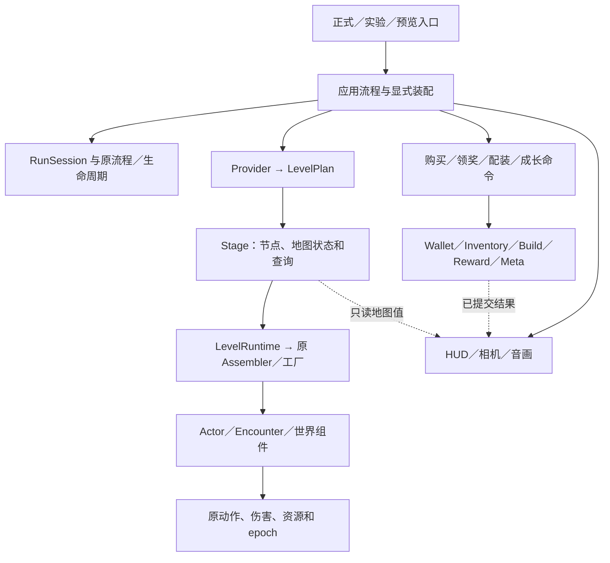

# 架构重构收口

本轮以已合 PR122／124 的 main `2ce4ffa64ef65dd5fba892776eea019c9e2841d4` 为内容底座，PR123 关闭且排除。当前分支为 `refactor/game-architecture-02`；没有自动合 main。本页描述当前实际调用边界，旧阶段记录保留原来源。

## 已落地的职责

| 模块 | 所有者和真实调用 |
| --- | --- |
| 应用／一局 | App 编排用户流程，RunComposition 创建玩家，RunSession 持有本局服务；原 Director／Lifetime 继续拥有流程与 epoch |
| 玩家／战斗 | Router 提交意图，Motor 唯一移动；生命、行动资源、FrameDamagePolicy 和原弹体分别拥有各自状态 |
| 装备／道具 | Inventory 拥有实例与事务恢复，Equipment／BuildState 提交配装与重算；效果族共用已有生命周期和主动施放实现 |
| 经济／奖励／成长 | Wallet 拥有余额，Shop 四操作共用原收据；RewardService／Meta 拥有原账本；Stage 在成功提交后记录地图领取状态 |
| 普通怪／Boss | 原 Registry／Factory／Definition 唯一登记；Actor 拥有地方配置、恢复和取消；各 Encounter 拥有专属阶段与恢复政策 |
| 地图 | Provider 产 Plan；Stage 调 LevelRuntime，Runtime 调原 Assembler／工厂；Stage 拥有伤害装配、Boss 场地／封印及地图查询 |
| 表现／平台 | 视图消费已提交结果；音频宿主共用 WorldAudioLifecycle；输入、存储和 Web 继续使用原适配 |

最近收口包括：Stage／Actor 共用取消攻击；Stage 接回伤害和 Boss 场地／恢复／封印装配；App 与 Stage 共用唯一接触伤害构造；三个 Stage 共用领取状态操作；App 与生成器共用宝箱候选规则。相同规则迁移了真实消费者，不只是新增未使用 helper。不同 Boss、RNG、满血处理和历史预览政策继续明确分离。

最后两处 App 对 assembler 的读取已改为 `route_debug_summary`、`hud_world_regions`。Stage 返回新建的值数组，不暴露模块、Definition 或可变内部容器。App 保留投影、裁切、触控区域和 HUD 评分；原 latch 读取顺序不动。地图相关坐标的解释留在所属旧地图适配器内。

## 地图切换的准确边界

统一 Plan 已有不含 Manifest 的真实 LevelRuntime 消费者。当前正式 App 和旧 Stage 仍使用旧来源记录、表现、机关与恢复适配，**不能把“共享装配已支持裸 Plan”说成“任意新 Provider 已可直接跑完整正式游戏”**。

本轮不实现新算法或新模块库。接入新来源时，使用现有请求／Plan／工厂／状态合同，迁移这些实际来源适配；不再复制玩家、钱包、伤害、装备或奖励系统。上线前至少验证：

1. 新 Provider 的独立 Plan 能通过原 Runtime 创建实际地形、怪物、Boss、宝箱和商人。
2. 每个实例有稳定 ID、独立运行状态与原收据；共享 Definition 不共享生命或 claimed。不能只调用 instantiate 就认定接入完成。
3. 正式 App 的记录、伤害绑定、恢复、Boss 门、领奖与离图走通；明确新来源替代的旧适配，不能伪造旧 Manifest。
4. 先验证一个真实新地图消费者，再切默认入口；新内容、算法／随机或存档迁移分别立项。旧实现待真实消费者与动态／导出依赖迁移后再删。

## CI 与本轮验证

唯一模块责任配置仍为 `config/production_impact.json`，唯一执行注册仍为 Harness profiles。开发／PR 按十二功能模块及真实下游选择；共同门禁三项，未知／共享协议／工具链继续 full。当前注册219，默认 full171＝92 parallel＋79 serial，手动 legacy31；不是把旧地图全部删掉。

P1 原九项相关检查 fresh 通过，包含 core5686、完整两 Boss、森林交互／恢复与宝箱。最后查询迁移前后，原 HUD61／0 和五个相机位置的实际面板诊断完全相同；import 严格退出干净。精确来源与日志见[地图查询证据](../../evidence/map_view_boundary_01/receipt.json)。这些限定结果不代签完整171或平台交付。

`2d44aaeb` 的生产 CI run41279913906 在输入物化阶段主动取消，未执行完整检查，不能记通过。最终冻结后使用现有 `environment.yml` 一次完成 fresh171、Windows／Web 和授权预览，不先额外执行一次相同 full。full 包含原模块选择器测试；实际 diff 计划及原 quality-diff 单独记录。最终状态以本页后续真实收据和交接为准。

## 维护与回退

修改先找状态所有者；跨模块用窄命令／只读值，不能传 App 或整个 Session 让消费者自行寻服务。新增内容继续用原目录和注册表，增加检查时登记真实责任和下游。只有第二个语义相同消费者确实出现才提取共用规则，不合并不同随机或奖励政策。

三份逐文件与依赖索引只代表其 metadata 指定的精确冻结源；人工报告与历史证据不批量替换。动态加载未解析点公开保留，静态图不代替引擎。

最后地图查询批次回退基点为 `2d44aaebbda52977f6ec347379242ec01a9ee62a`，三个生产叶与技术绑定／历史适配一同撤回。前一批六源码回退到 `254b6003`；单次 Bible 读取优化可独立回退到 `c8d39551`。按 Git 父提交逆序 revert，不覆盖用户工作树。
