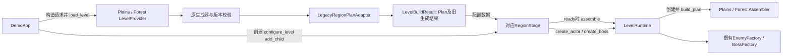
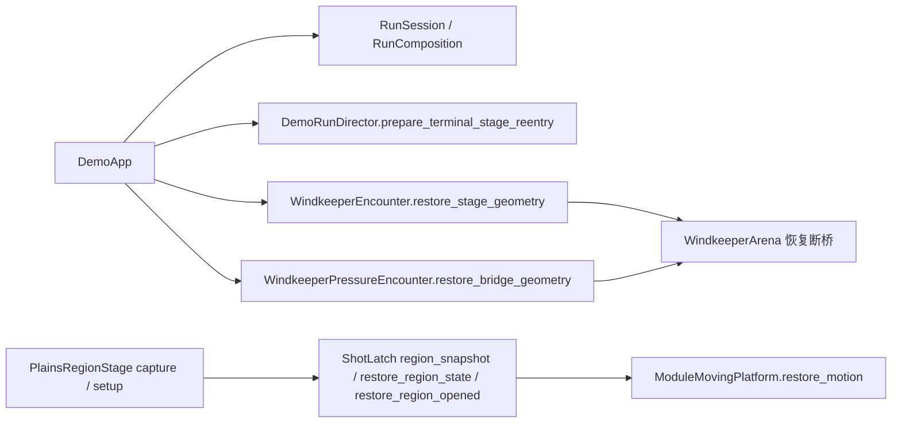

# GAME-ARCH-01：功能目录与依赖交付报告

## 后继有限验收与独立缺陷（未提交）

11254基点后的18个既有消费者和资产manifest3SHA已精确应用独审候选；原157诊断151通过/6失败保留。后继spatial、production-loop115、scheduler27、forest-bible-reader58、Harness91及audio四case通过，motion708/0；原R3完整wrapper仍278/1，不能拼成full185通过。精确2ce原/回调修正targeted均8/1，两组296行与当前仅全局tick差6759；单event起跳probe8/2未采用。正式App现有cautious2经安全观察者记录1608帧/3失败，Boss26/player0及fatal/run_ended，原180/7200与胜利判据保留；这只证明当前策略失败。

RootBell原暂停恢复视觉粒子遗漏独立修1生产leaf(e68c5015)，不属保持行为不变的消费者迁移；hit从原380/4、fixture后393/1到修复后393/0，plains lifecycle112/0与原RootBell/deform两检查通过。图声/物理/伤害/奖励/RNG未改，无style/creative重绑。见[独立记录](../../quality/records/ROOT-BELL-PAUSED-RESTORE-01.json)与[消费者实际收口](ci_consumer_paths_01.md)。新生产leaf尚未提交；下文a671及acb索引仍是此前已提交快照，不能冒称已覆盖本修复，最终索引由root在独立提交后再冻结。

未注册directional仍23/4，与精确2ce同旧capture合同失败；不改原规则/payload，也不计full185。完整185、后继同源导出/PCK/GUI/影片/设备/用户认可仍未验，未发布游戏网页；新地图库/算法尚未实现。后续不得以删除原R3检查或降低物理/胜利门槛收口。


本报告当前验收状态对应提交 `11254a6647dbb4d842feb4d21de9e2d8bd9accd3`；生产实施沿用恢复所有权收口 `4e91a0dd`、真实工具链整合 `59537400` 与独立生命周期修复 `a6714757`。内容底座仍为 `2ce4ffa64ef65dd5fba892776eea019c9e2841d4`；保留 PR122/124/125/107 内容，排除 PR123。八个 Boss/共享消费者测试与两份测试依赖已在 `49a298b40890ccf4d9d2326d051f12a0ffe63c27` 提交；current15 已完整通过（224.151秒），随后技术绑定ad3与Foundry/185收口becd已提交，索引采用下述acb快照；尚非远端main或公开试玩。

功能所有权已接到真实消费者，1,124 文件功能迁移已实施；P9 已在 `4e91a0dd` 将机关、流程及 Boss 场地恢复交回实际所有者。固定上游修复版引擎及同源模板已构建、公开发布、按精确锁实际安装；这不等于游戏各平台导出或完整回归通过。当前完整 Harness 为185项：保留原182前缀，新增三个原Foundry入口回归并移除重复调度。完整185首次远端运行已失败：parallel的11项通过后停在资产元数据绑定，serial的12项通过后停在森林测试旧动态路径；未运行项不能计为通过。Windows导出job成功，serial中的Web构建/包检查通过，但后续交付与发布跳过，最终同源PCK/GUI仍待验收。Foundry36+18验证及三个入口有限检查已通过。统一新地图模块库与替换旧算法尚未实现，当前 Provider 仍运行原算法。

## 可检索文件与实际图

- [file_inventory.csv](file_inventory.csv)：33,768 个文件条目，覆盖技术收口acb7c7c7读取时全部 Git tracked 文件。每行有路径、原路径、职责、具体用途、批次与来源/manifest 候选；未物化稀疏文件大小留空，不为索引下载媒体。
- [runtime_inventory.json](runtime_inventory.json)：1,554 个运行相关文件：1,486 个功能/协议目录文件，另含 assets 中 18 个可执行/定义文件及配对 UID、50 个 shader/include/UID。逐文件列出用途、实际归属、原路径、静态消费者、可能入口与身份持有原因；另列每批精确提交、父提交及完整当前写集。
- [dependency_graph.json](dependency_graph.json)：复用现有 `tools/project_dependencies.py:inspect`，842 个源、510 个类、3,447 条实际静态边、118 个未静态解析的动态加载表达式。没有另造运行注册表或第二套依赖算法。

三份索引已由原提取流程更新至技术收口 `acb7c7c7cc7c195e6773817bb60f7c7f27baabfb`，33,768路径、1,554运行文件、842源/510类/3,447静态边/118动态未解析点。索引是该已提交源的快照，后继索引及说明提交不追改其来源；原6f快照保留在Git历史。

可视调用关系见[当前运行架构](../../architecture.md)，功能导航见[模块导航](../../module_map.md)。这三份数据是审计快照。静态可达入口包含 App 显式打开实验的路径，不能解释成“启动正式游戏会加载全部实验”；提取器覆盖 GDScript、scene、resource 的类/类型及资源边；shader include 内部、元数据驱动选择不冒称已被它解析。动态路径、条件分支、延迟加载和导出 remap 必须由原有专用检查、原生与 PCK 验证。完整外部临时 JSONL 不重复提交；仓库保留一份 CSV、运行时详单和图即可。

```text
game/
  application/  入口、流程编排、RunSession、RunComposition
  player/       输入、动作、移动、玩家资源与专属表现
  combat/       伤害、武器、弹体、命中政策
  loadout/      库存、配装、构筑、道具效果
  economy/      钱包、商店、交易收据
  rewards/      奖励提交、掉落、选项
  progression/  家园与永久成长
  enemies/      怪物定义接入、工厂、行为与状态
  bosses/       Boss 遭遇、招式、专属行为
  world/        levels、generation、components、state
  presentation/ 当前共享视觉、音频与UI
  platform/     平台与输入接入设施
experiments/    专用研究、比较与独立预览入口及其私有辅助
scripts/       必须保原路径/字节的唯一 schema、版本源闭包
scenes/        必须保 Manifest/存档身份的场景
resources/     原业务定义、source-hash 身份与历史证据
assets/        原媒体、当前元数据、原始来源与许可
```

旧目录尚存在不等于旧代码复制了一份。持有协议路径的 schema 仍是唯一实现；已搬迁实现从旧位置移走，没有转发包装层。16 份森林旧集成审计 JSON 是历史证据，保持旧路径和字节，不能按运行配置批量改写其 SHA。

## 当前职责和资源选择

HomeScene 创建家园玩家；DemoApp 经 RunComposition 创建出发玩家，RunSession 持有本局引用、原 Director/Lifetime、构筑、库存、配装、钱包、奖励、商店与道具服务。输入适配器提交意图，PlayerMotor 仍是唯一运动执行者。DamagePolicy/FrameDamagePolicy 管理原伤害政策，Stage 只装配并提交请求。

正式平原/森林的实际顺序是：App构造`LevelRequest`并调用Provider；Provider执行原生成器和版本校验，经`LegacyRegionPlanAdapter`返回`LevelBuildResult`。App创建对应Stage，调用`configure_level(plan, legacy_generated, tuning)`后加入场景树；Stage在`_ready`中调用`LevelRuntime.assemble(self, plan, state, generated.manifest)`，Runtime校验Plan后创建Assembler并调用`build_plan`。Stage还通过Runtime的窄方法创建怪物/Boss及恢复拾取声明。Runtime不会创建Stage，也不拥有App、本局玩家、钱包或伤害服务。



这张图描述当前正式两区，不把所有独立实验说成已改走同一路径。仍调用`configure_generated`的区级消费者在Stage内补做旧结果适配；基础生成关和独立实验保留各自现有入口。Request/Plan是暂态接口，不是新存档；Provider保留原版本选择和失败回退，公共装配不抽随机数。共享实体快照与行为状态恢复已接入实际消费者；Boss的生命、地图快照和决斗恢复由Encounter执行，Stage仍装配实例及普通怪的空间位置，App保持原几何绑定和触发顺序。

公共Plan装配边界已经存在，但当前正式来源仍是旧算法。App和Stage保留`legacy_generated`用于记录及表现，当前Stage还把旧Manifest作为`presentation`传给Assembler；因此不能宣称整条地图路径已经脱离旧Manifest。下一步仍按[目标架构第5.1—5.4节](target_architecture.md)实施：先交付真实的新模块库/算法和同协议输出，再迁移真实消费者、验证身份与恢复、按新开局切换并清理旧正式依赖。模块声明继续引用现有敌人、道具、奖励和资源权威；不另造注册表，也不把空Provider当成新地图实现。新布局/算法改变需独立验收，不能借“等价重构”提前切换。

| 内容 | 当前正式选择与权威 | 必须区分的历史/缺陷 |
| --- | --- | --- |
| 场景美术 | Home 的 home_build；正式平原 Underworld fine_32；森林现有 Bible v2 manifest 与注册选择 | Blob47、Pixel、Style、Windchime 等比较入口保留原专用安装；不自动换成正式美术 |
| 主角 | avatars 中 courier 默认 `motion_v1_weapon_v2_timer_v3`；原 motion_source，现有 MotionFeel/WeaponFeel | courier_classic 显式历史选择；基础 CourierVisual 仍承担隐藏状态/枪口。四个 Lab 的旧外观遗漏装配另列缺陷 |
| 怪物/Boss | EnemyBehaviorRegistry/Factory + 当前 Definition；PR122 Bellstrider 与 WindkeeperPressure 均保留 | v11 charger 用原 Registry revision 显式锁旧 28×32 原定义；default/v15 仍是当前 28×28，不默换 |
| 音效 | 已选 director-v3 事件、hurt feedback_06 A；ambience-v1 quiet-02；Home quiet-01 life；原五首 BGM | v1/v2/v3/Home/Ambience 试听入口保留候选；未选试听资源不等于无消费者 |

现有权威仍是原 Definition、avatars、EnemyBehaviorRegistry、ItemCatalog/authoring、audio selected 配置与现有资源 manifest。索引和技术归档不参与运行选择，不新建平行默认值或注册机制。

P9 已运行的恢复调用方向如下，只有所属对象写自己的状态；不是未来设计图：



ShotLatch 保持原七字段及永久打开账本应用顺序；Director 只复位原 terminal 重入标记。普通 Windkeeper 的 phase3 规则与 Pressure 的实际 bridge release 规则分别保留，后者两个真实恢复调用点都已迁移。地图仍不接收 Session、钱包或全局服务容器。

## 实施批次、行为与回退

表中验证是相应批次已取得的有限证据，不代签本报告当前完整185项。历史批次中的原182等数字保留当时清单含义。6f快照以前批次的精确文件列表见运行时详单的 `batches[].current_changed_files`，全文件 CSV 的 `change_batches` 可检索工具与测试；P9、595和a671新增写集以对应提交及质量卡为准，不能从旧索引推导。下表列主要真实消费者。回退列为实际 Git 基点，操作须按依赖逆序撤回后续批次，不能直接覆盖当前工作树。

| 批次与提交 | 主要文件/消除的问题 | 保留行为 | 验证与剩余边界 | 回退基点 |
| --- | --- | --- | --- | --- |
| P1 `5ff4cb7a` | 原 Harness、quality/web/forest/underworld/source inventory 工具；补 game/experiments 扫描并移除重复 full 规划 | 原检查集合前缀、预算、失败与消费者语义 | Python 原套件与新根缺件/变更负例；原 checks 继续真实注册 | `2ce4ffa6` |
| P2 `41ba5e15` + `170fe37d/86a28815/7a7883a3` | `game/application/{run_session,run_composition,demo_app}.gd`；一局创建/清理只有一个所有者 | 原创建顺序、钱包、Flow/Lifetime、跨图与终局政策 | Session 49/0、原 core/generated/forest 消费者证据；最终整合源待回归 | `5ff4cb7a` |
| P3 `761adec5` + `39ac5cf2/7ed794c6/7b5ad80d` | `game/world/levels/`、两区 Provider/Stage/Assembler；将旧来源分派、Manifest 适配与模块实例化收敛为 Provider/Plan/Runtime，Stage 仍持有装配后状态与实例；Runtime→值辅助单向依赖 | 原 Manifest、版本、模块顺序、恢复与 RNG | Plan 146/0；退出严格检查曾报 57 ObjectDB/25 资源泄漏；解除直接环仍未消除此失败 | `f44f8eec` |
| P4 `9c0414ea` + `7be23e5a` | `game/loadout/inventory/run_inventory.gd`、BuildState、`game/economy/shops/{shop_service,run_wallet}.gd`；状态写入归所有者，四操作复用收据重放 | 验证、扣款/退款、失败回滚、信号顺序与账本 | 原九类道具与经济/装备回归；原 patch 失败后的效果拒绝局限不顺手修 | `170fe37d` |
| P5 `7df9b40b` + `3e0940b9` | `game/loadout/effects/{item_active_cast,item_time_context}.gd` 与两个主动族；共享真实施放流程、收窄 Time 能力 | 支付、冷却、重复回调、随机与效果时序 | 专项 13/0；效果拒绝/资源初始化原局限保留 | `761adec5` |
| P6 `f44f8eec` + `efb202db` | `game/enemies/` 的共享快照/行为状态协议与三个 Stage、App 消费者；统一重复状态字段处理 | 平原 11 字段、森林 8 字段及 depth、String/StringName 键类型、恢复顺序 | 专项 61/0；不代表全部 Boss 状态已统一 | `7a7883a3` |
| P6B `063d6ccb` | `BossEncounter`、Windkeeper/Bellstrider/ThornForest Encounter、两 Stage 与 App；三处生命恢复共用，快照与决斗校验归实体 | 原两类键类型/插入覆盖顺序、Bell 终态准备、两次森林恢复时点、所有负例不变 | 精确8文件独审；原 Bell 八组、Pressure、forest-depth-restore、core 均通过；完整固定引擎验证待验 | `6584d48b` |
| 表现纯函数优化 `b24d7b9b` | 当前角色 mesh/deform 实际绘制消费者；姿态与 UV 权重预处理，共用同一顶点核 | 原顶点结果、采样和姿态 | 367,640 个顶点逐字节等价、5,796 断言；原 motion 481/0 | `7df9b40b` |
| P7 `bbd9f26a`、`317b755c`、`1bd59390` | `game/presentation/audio/world_audio_lifecycle.gd`、四 Study、GameAudio/Cloud、InputSetup/ContactEmitter；共享释放与入口装配 | 生命周期与原输入/危害设置顺序；nearest audio owner 修复单独标识 | Study 65/0，音频对照 80/0、owner 84/0；同帧 play→stop 的既有限制仍保留，动态试听真实消费者已另迁 | `39ac5cf2`；owner 修复前 `7ed794c6`；装配前 `c43e3ddd` |
| P8 `9601bbec`、`5589c284/d58b72b6/4f2fb531/1cd95f3f/9d08d7f1/c4a317ef`，整合 `e4915fa8`，收口 `6069b6b4/6584d48b` | 1,124 文件功能迁移、35入口、UID、原生/动态工具消费者、当前资产元数据、旧有限源；两个 Lab-only UI 归回实验 | 存档/Manifest 身份、图声原字节、正式选择、实验差异；不复制旧实现 | 491 UID 配对逐字核、原保护闭包核、archive 8/0、静态 0 错；原 PCK/Foundry/最终绑定未完成 | P8 整合第一父 `6677235f`；重放候选源 `986bb75d`。撤整合用 merge 的第一父语义，不能只撤一半工具 |
| 独立 v11 修复 `afca59ec/5a15414a/b991bff6/f8a0c94d` | Registry→Factory→Plan/Runtime 与 legacy tres、raw exporter、pack probe | 当前/v15 资源与随机不改；旧 v11 恢复历史定义 | 原 App 专项 45/0、raw plan 19/0；实际 PCK 待验。原缺陷 280/2 保留 | `d8144d39` |
| Boss 共用边界 `93dcf867` + `6677235f` | 基类静态 epoch 准入、两个 Bell 子类全部五个调用 | 各 Boss 运动、碰撞、招式、判定与规则不变 | 首次遗漏第五调用的失败原件保留；两提交必须一起，整合源 6584 的原 Bell 八组原生消费者已通过，完整 CI 仍待验证 | `fe66459c` |
| P9 `4e91a0dd` | ShotLatch/PlainsRegionStage、DemoApp/Director、Windkeeper/Pressure/Arena，7生产/4测试文件；删除跨所有者字段写入和重复平台恢复 | 原七字段、终态重入时点、普通/Pressure各自断桥规则；实际消费者均迁移 | 11次原生预检、Bell8套通过；扩大region旧cohesion19/5及精确ed95同失败保留，后续测试迁移另记 | `ed95d67d8c19988ab6af3b720aa07a17fd1f59cf`（含其后范围文档，按批回退） |
| 固定工具链 `59537400` | 原安装器/identity、构建/推广工具、CI缓存、导出/录制消费者；唯一实际源与二进制/模板锁 | Standard非Mono；明确custom；原版本/字节守门、各平台能力及预算保留，不混官方模板 | 10lane完整产物、8公开URL、18模板/4editor成员、实际安装、原26工具单元与91 Harness单元通过；游戏各平台验收未签 | `4e91a0dd1d6c02e6a7466368e91665d2a6a7a71a` |
| 独立生命周期修复 `a6714757` | UnderworldPresentation延迟入口WeakRef与原formal测试扩8项；避免已释放Node在函数体前类型转换失败 | 同步installer、活节点延迟顺序、材质与图声不变；这是原缺陷修复，非行为等价搬迁 | 精确2ce诊断319条ERROR仍记失败；修复后原formal96+8=104/0、cache444/0，11.549秒/原120秒，严格退出通过 | `59537400af06a26046037840e28989f75933a265` |

实体公共状态批次 `f44f8eec`（含后续键类型修正 `efb202db`）迁移了三个 Stage 快照和 App 恢复消费者：平原 11 字段、森林 8 字段及 depth、String/StringName 键类型保持，专项 61/0；回退基点为 `7a7883a3`。其文件主要为 `game/enemies/` 与两区 Stage，已在索引单列 `ENTITY-STATE`，不能仅因表行归类而遗漏。

## 仍然需要分开的机制

商店分层随机与物品池加权随机的调用序列不同；拾取、宝箱、升级的收据与满血处理不同；Boss 和森林专属怪状态字段不同。保留这些政策差异是正确边界。可共享部分已接真实消费者，包括施放、钱包操作、奖励底层提交、实体状态入口、音频释放、菜单输入、矩形危害创建及顶点核；不能只增加无人调用的 helper。

仍需关注的集中点是 DemoApp 的跨区流程/实验导航，以及旧 Stage/Assembler 的 Manifest 表现适配。它们已获得窄接口，但还未完全脱离旧生成表示。继续重构应由真实第二个 Provider/新地图消费者推动，不复制第三套地图装配、全局服务定位器或全游戏事件总线。

## 混乱与冗余判断

主要混乱来自按技术名分散的旧 scripts/scenes/resources、实验私有实现混入共享 UI，以及历史审计记录与运行配置相邻。此次 1,124 文件迁移和两个 Lab-only UI 归属修正解决了这些已证实的问题。当前提取器没有重复运行类；这只证明类注册不冲突，不等于所有语义重复已消失。

文件总数主要受历史证据、媒体来源与测试记录影响，不能把三万多个文件都当生产实现。共享流程已移走原重复代码；不同 RNG/奖励/Boss 政策仍需分别保留。原字节相同的媒体、许可或 fixture 也可能拥有独立协议身份，重复 blob 本身不是安全删除依据。后续重点应是 App 与 Stage 的剩余跨功能协调、动态装载显式化及历史验证输入隔离；不再扩大为全仓重写。

## 旧资源与证据的处理

本批没有证明任何旧图声源可以安全删除，因此没有猜测性删除。旧版本必须分别判断：历史回放的 raw Definition、明确实验/试听消费者、艺术制作来源、许可、失败证据与无消费者中间产物不是同一种东西。legacy charger 保持 SHA256 `1afd5e34d497e3850d794b028fd5fe5407d3722fcd451d862f4c14a67ca98fc0`；旧源快照以 txt 归档，不注册运行类。

P8 首批11份实际消费的 assets JSON 仅迁移当前消费者指针，12份对应技术记录重绑元数据 SHA；随后原检查发现 Blob47/Pixel 两份 manifest 遗漏，补齐这两个技术指针并重绑 Blob47/Pixel/Windchime 三份记录，原件有限归档。当前相对底座共有13份 assets JSON 变动；这不是全部历史资产记录的变动计数。原图声、历史 provenance、许可、原 style25 manifest 及原接受证据不变。**`protected_byte_errors=[]` 只验证指定 byte-hold 闭包，不能解释为所有标记文件均未修改**：`tests/test_region_bible.py`、`tools/forest_legacy_fixture.py`、`tools/region_style_history.py` 有明确的新测试/有限读取/根覆盖变化；原断言与旧冻结 SHA 保留。

当前 export_presets 的 34 条排除规则涵盖 docs/tests/tools/build/preview、若干未选视觉候选、制作 source 与生成中间件。配置匹配不是实际 PCK 证据，也不能据此宣布节省空间。最终必须检查：正式默认不意外回退旧版；历史入口所需资源仍可达；被排除资源确实不在包中；要求随包的许可仍在；legacy raw 源与 ResourceLoader 导出 remap 同时有效。Foundry source-basis 是技术源版本，须用原 `python3 tools/foundry.py build --count 24 --promote` 验证重建；不能手改旧 SHA 或称旧 replay 已兼容。

## 独立缺陷与最终门槛

- 退出泄漏：原 item-v5-formal 的 191 条行为断言通过，但严格清理失败，57 ObjectDB/25 资源；整体检查为失败。二分首现于地图接口批次；相同源的上游双补丁诊断构建及优化editor原formal191已严格通过，595已发布安装固定产物；完整最终源验证仍待完成，不能以去环或清缓存冒充已修。
- 旧外观遗漏：ModuleLab、RandomStagePreview、FoundryLab、ActionStudio 仍有基础 Courier 可见且未装配当前 body/feel；没有明确历史锁定证据，单列内容/装配决策，不能静默升级或当作已批准旧版本。
- 旧测试入口：PlainsPolishReview 的 Boss8 fixture 与当前两图 App 可能不符；多个 URL Lab 开关可能重叠，保留独立反例验证。
- 原事务/音频局限：能量初始化失败缺少回滚、Inventory patch 后效果拒绝、同帧声音 stop 的边界均保留，未混入“行为等价”声明。
- source-binding：style25/creative28 漂移与后续 style26/creative29 收口均保留原记录；P9 后技术绑定仍由同一权威 registry 维护。当前未提交的绑定与测试输入变更须在最终测试源冻结后核验，新增技术版本不继承旧艺术/玩法/声音/用户或设备 ACCEPT。

最终执行原 Harness 与全部入口检查、Foundry 既有流程、完整导出/PCK 隔离加载，再核真实网页的提交、资源与可启动入口。公开网页不能因源码 merge 自动视作已更新；本报告没有执行网页发布，也没有签公开版本与本候选一致。

## 当前收口证据补充

官方引擎的四批原定向 Harness 中，11 个不同检查最终通过：Bell、Pressure、forest-depth-restore、core、Blob47、Windchime、Pixel、Style、CloudPreview、player-default-integration、studio-input。前三批分别保留 Blob/Pixel 技术记录过期、Style 动态旧路径导致的真实失败；原 SVG/PNG 不改，有限技术重绑和实际调用路径修正后重跑。第4批 Style 的20条路线、16变体及4命名场景、Cloud 原入口流程通过。不能据此签完整35入口或完整182。详见 closeout-02 原报告。

当时 style26/creative29 为同一技术版本，206引用=原153角色前缀+53真实正式依赖，原72路径/源码变化，旧媒体保持。原598项输入映射前缀和重复项完整保留；当时Bible检查653输入、contract314输入。原Bible61项在30秒超时的失败保留，唯一祖先枚举优化后原61项25.94秒通过；无缓存、无删测试或放预算。

独立引擎 A/B/C 均使用063d6ccb及4,186个相同实际运行文件。A原源码、B五行修复均191/0后57对象/25资源泄漏；C采用上游PR117991与PR120976四文件修复后191/0且严格退出通过。用户已选择采用固定上游修复版；该段 A/B/C 是当时诊断证明，不能单独转签优化产物。后续正式构建与发布安装已在595完成，见下节；仍不冒称官方4.7.2原包本身已修复。


## 595 / a671 后的实际状态与剩余工作

`59537400` 采用官方4.7.2源加精确上游117991+120976，身份为 `4.7.2.stable.custom_build.gunman_sd1.ed1daf0bf`。构建源184970c7/run41180438395的10lane同源产物已核；推广源f91a69d0/run41188433036发布 Release429822541，tag指向184而非promoter。八个公开URL均实际HTTP200且SHA一致；public lock为84522f…，实际安装原件与26/91原单元结果见[工具链证据](../../evidence/game_architecture_02/engine-toolchain-01/active-main/active-toolchain-main-integration-independent-review.json)。这是工具链预发布版发布，未发布游戏网页；401上传失败、415媒体类型失败及7c元数据拒绝原件保留。

`a6714757` 仅独立修复原Underworld延迟生命周期，并保留原formal测试加8反例。[原生104/444检查](../../evidence/game_architecture_02/underworld-deferred-lifetime-01/native-01/report.json)及[独审](../../evidence/game_architecture_02/underworld-deferred-lifetime-01/review/underworld-deferred-lifecycle-independent-review.json)限定这两个文件；共享quality运行的317错误与精确2ce诊断319错误是不同运行，不互相替代。quality中Bell phase_transition旧断言的迁移不在a671提交。

独立 `CI-BOSS-CONSUMERS-01` 从五个当前Boss消费者测试扩至八个：原五文件共享真实死亡/实体币/切图流程；第六Energy显式锁测试专用历史16HP定义，保原540断言及预算；第七Pressure把D077旧战斗合同保留为显式历史诊断，默认只签原共享背景/App/Camera/Run→Home范围，当前Bell8/Pressure6套继续独立验证，不宣称与旧战斗合同等价；第八quality明确当前Bell转阶段仍有实体铜车接触、intro/inactive安全。八测试及两份依赖最终版本已提交49a298b4；原region actual03的current15已完整通过（224.151秒），这是限定当前范围，不是full182。

最终还须完成：当前源完整185、剩余入口交互、实际Web/PCK及Windows/Android导出、实际GUI/设备与公开网页提交核对。原Foundry36+18重建、stamp和三个入口有限交互已在becd完成；技术绑定ad3与索引仍按各快照标注来源。地图接口与现有两区迁移已完成，但统一新模块库、新算法及旧算法整体替换没有实现；不以接口层完成替代该目标。


## Foundry共用准备与185检查归属

`becd0099b161f57cd919e7492f9f99752d377935` 修复Android缺少同run验证池交接，并实际刷新56份canonical开发池JSON。54回放56113帧、所有几何/能力/操作与随机输入保持，只有basis/engine及派生hash变化。三个既有入口测试共用原audio_teardown，配置来自既有Catalog/default；原35/439/12断言、六实际回放和180秒预算保留。完整清单尾加三serial，185=95+90，environment与deliver不再额外重复这三项。原91/37及三个原Harness selected都实际通过，完整185未验。回退本批的实际父提交为b893b45e；按依赖逆序撤回，旧56原字节在Git及独立备份保留。
