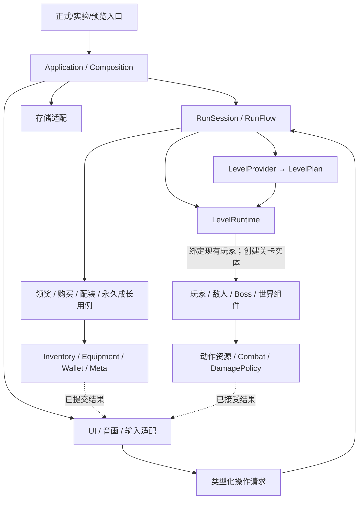

# GAME-ARCHITECTURE-01：从游戏功能出发的目标架构

> 2026-10-31 最新决定：用户已要求开始实施，并明确旧地图生成算法和旧关卡单元最终废弃，改用统一新模块库与新算法。当前恢复 P0 内容整合；地图先建立替换边界，再接入新来源，尚未切换正式内容。

规划阶段、PR122合入前的 main 经 `git ls-remote` 核实为 `b8ada996b77bdfc6bdf36a9961b9d460ab1f0323`，已含 PR124 和 PR125（测试夹具修复）。该规划快照随后已被更新：PR122已合入 main `a22b8f76f784da044bf2e4fa018ec274f12eab3f`，PR107本分支组合完成待普通合入；PR123关闭且排除。此前开放 PR 盘点中另有 56 条头提交已在 main 历史，不重复应用旧内容。未来重构基线须在内容整合完成后重新记录精确 SHA；现有 `66c6c41d...` 只是旧审计底座。

目标是按功能组织的模块化单体：各业务模块拥有规则和状态，应用层显式装配，地图通过统一协议接入，表现只消费业务结果。保留 Godot 现有机制和已可复用的核心，不引入 ECS、微服务、全局事件总线或第二套内容注册系统。

本文件取代先前零散 helper 抽取顺序。已有未提交候选只作参考，不能整包套到新 main。当前真正的问题是装配重复、状态归属交叉、跨模块直接修改内部数据，以及当前/实验/历史消费者混杂；目录整理必须伴随这些问题的消除。

## 1. 游戏应由哪些部分组成

游戏有三类入口：正式游戏、可操作实验、独立表现/内容预览。正式游戏包含家园、出发、战斗探索、拾取领奖、装备与商店、换图、死亡或胜利、返回家园及永久成长。它们应共用玩法能力，但不必拥有相同的运行政策：例如练习不能结算正式存档，历史画风预览可以显式固定旧内容。

因此采用**按功能组织、组件组合、显式装配**的模块架构。应用层负责把模块接起来；各玩法模块拥有自己的规则和状态；地图提供内容；表现层负责看见和听见；平台层负责设备与存储。保留 Godot Node、Scene、Resource 的直接使用，不引入 ECS 重写、插件扫描、全局事件总线或万能 Manager。

划分是否成功看三件事：一个状态只有一个所有者；一次业务操作有明确入口和完整结果；增加内容通常只触及所属模块与已有登记位置。

## 2. 目标目录与文件归属

目标采用 `game/` 下按功能归档。同一功能的脚本、专属场景和局部资源类型靠近存放，避免修改一个怪物时在多棵平行目录来回寻找。共享原始图声仍独立放在 `assets/`；现有 JSON 调参/authoring 继续由 `config/` 管理，现有 Definition `.tres` 仍可作为对应参数的唯一权威。每个字段只有一个可编辑来源，不为统一格式再复制一份 JSON。文件类型不决定业务归属。

```text
project.godot
game/
  application/                     # 装配与用户流程，不实现战斗/经济算法
    game_application.gd            # 顶层 Home / Run / Preview 切换
    game_application.tscn
    run_session.gd                 # 一局的状态所有权及释放
    run_flow.gd                    # 开始、暂停、换图、终局的顺序和拒绝条件
    composition/
      run_composition.gd           # 创建正式实例并注入窄依赖
      practice_composition.gd      # 复用同模块，使用明确的练习政策
    commands/                      # 跨模块用例；仅有真实消费者才建文件

  player/
    player_controller.gd           # 动作协调，不认识关卡/道具 ID
    player_motor.gd                # 唯一移动、碰撞与安全定位实现
    player.tscn                    # 玩法节点组合
    presentation/                  # 专属外观/动作适配，观察玩法结果
    actions/                       # 跳跃、射击、后坐力、钩索等已存在能力
    resources/                     # 玩家专属行动资源；共享生命状态不放这里

  combat/
    health/                        # 玩家/敌人/Boss 共用生命状态与契约
    damage/                        # 请求、排序去重、结算、阵营和可伤对象
    weapons/                       # 武器定义、目录、攻击执行
    projectiles/                   # 弹体与命中生命周期
    respawn/                       # 段回退；不重置整张地图

  loadout/                         # 本局道具、背包、装备及生效结果
    catalog/                       # 唯一定义读取/验证；不拥有本局实例
    inventory/                     # 实例、等级、破损、持久效果进度
    equipment/                     # 装备选择、容量、配装操作的原子提交
    stats/                         # 从唯一基础快照计算属性，不保存另一份 HP
    effects/                       # 有实际复用者的机制及效果生命周期
      combat/
      defense/
      active/
      time/
      companions/
      economy/
      item_runtime.gd              # 有限编排，不成为第二个游戏主程序

  enemies/
    enemy_actor.gd                 # 组合实体状态、行为和死亡处理
    enemy_factory.gd               # 使用现有行为注册表与 Definition
    enemy_behavior_registry.gd     # 原注册表迁移，不增加平行表
    behaviors/                     # 巡逻、瞄准、攻击等可复用行为
    species/                       # 各敌人的组合、场景、Definition 和专属皮肤
    state/                         # 实体快照/恢复；保留原字段和随机状态

  bosses/
    encounter/                     # 遭遇开关、阶段、终态和公共协议
    bellstrider/                   # PR122 的专属机制、定义和场景
    windkeeper/
    thorn_forest/

  economy/
    run_wallet.gd                  # 唯一本局金币余额及金币收据
    shops/                         # 报价、商品、购买/修复/扩容/刷新用例
  rewards/
    offers/                        # 候选、选择、领取资格与来源账本
    drops/                         # 既有掉落规则及随机流
    grants/                        # 委托钱包、治疗、成长模块提交；无第二账本
  progression/
    meta_progression.gd            # 永久音符、升级、发现/解锁及事务
    home/                          # 家园服务、出发携带政策

  world/
    levels/
      level_request.gd             # 纯值请求：地图、seed、版本、能力快照
      level_plan.gd                # 已验证内容声明；不是全游戏服务容器
      level_build_result.gd        # 成功内容或具体拒绝原因
      level_runtime.gd             # 当前地图实例装配、绑定和释放
      providers/                  # 平原、森林、固定开发关等真实内容来源
    generation/                   # 生成算法、模块/端口、验证与既有版本回放
    components/                   # 平台、门、危险物、宝箱、商人等组合组件
    state/                        # 探索/机关/实体状态及现有格式适配

  presentation/
    actors/                       # 跨角色共用的采样/反馈基础，不收揽各物种业务
    world/                        # 地形、背景、光照、前景与生态表现
    effects/                      # 纯视觉效果，不裁决命中或伤害
    audio/                        # 场景音频会话、音乐及已接受事件的声音
    camera/
    ui/                           # HUD、菜单、装备、商店、领奖等视图

  platform/
    input/                        # 键鼠/触屏/手柄 → 统一意图
    persistence/                  # 存储适配与现有格式读写，不决定购买政策
    web/                          # Web 启动/显示/宿主适配

config/                           # 当前唯一调参、目录 authoring、内容选择
assets/                           # 原图/声音/字体/shader 及来源许可
experiments/                      # 每个实验自己的入口、场景和实验专属代码
  motion/
  audio/
  terrain/
  generation/
tests/                            # 按功能分类，另有真实入口/集成/导出验证
tools/                            # 构建、内容校验、维护、证据与发布工具
docs/                             # 当前规则、架构、任务和必要证据导航
```

这是最终归属，不是一次性搬迁清单。不会为凑目录提前建空类或空文件夹。小模块可以只有一个脚本；存在两个真实消费者并需要稳定边界时才抽象。`game/` 是目标根，迁移期间旧 `scripts/`、`scenes/`、`resources/` 路径逐批收缩，不能同时维护两套实现。

场景依赖和代码依赖要分开检查：`player.tscn` 可由应用装配附加表现子场景；玩家玩法脚本不反向调用 HUD 或皮肤裁定结果。一个有伤害的爆炸属于 combat，一个只画光圈的爆炸表现属于 presentation。Godot 节点父子关系不自动等于业务状态所有权。

`player/actions` 负责玩家意图、能力准入和动作编排；`combat/weapons` 负责一次已准入攻击的执行。资源扣减沿唯一资源组件提交，弹体由既有攻击执行链创建，后坐力沿玩家能力交给 Motor；三个动作各有唯一执行者。重构保留原提交时序，不能让两层各执行一遍。玩家、怪物、Boss 共用的 HealthState/伤害契约归 combat，敌人不反向依赖 player。

## 3. 状态所有者和生命周期

| 状态/能力 | 唯一所有者 | 创建和结束边界 |
| --- | --- | --- |
| 当前档案、永久音符、升级、发现与家园携带选择 | MetaProgression；存储适配只负责读写 | 档案会话；保存失败必须返回原业务失败 |
| 本局 seed、流程、Manifest、run epoch | RunSession 持有现有运行状态/流程实现 | 出发创建，终局撤销；不是新造第二个 RunDirector |
| 本局金币 | RunWallet | 每局一份，跨图保留 |
| 库存实例、等级、破损、需要跨图保存的效果进度 | RunInventory | 每局一份，不由地图复制 |
| 装备选择和容量 | EquipmentService；配装用例协调提交 | 每局一份；跨模块事务保持同步 |
| 玩家生命、能量、动作与位置 | 现有玩家资源组件、Controller、Motor | 正式局按原寿命使用；进入新图不暗中换一份余额 |
| 当前图几何、敌人、Boss、机关 | LevelRuntime 持有实例；实体拥有自身状态 | 换图按 stage epoch 撤销和重建 |
| 伤害收集/排序队列、段回退服务 | 当前 LevelRuntime 的 CombatWorld/既有策略实例 | 每图重建；不能统一成跨图常驻队列 |
| 地图探索、开箱、商店和实体恢复数据 | 现有地图进度/收据对象，各按原域归属 | 换图前后保留原记录；回退不重置领奖 |
| 暂态弹体、目标引用、攻击阶段 | 所属 actor/效果运行实例 | 保持 run/stage/actor 多层失效语义 |
| UI 展示和音画播放状态 | 对应视图/场景音频会话 | 随宿主释放；不保存第二份玩法权威数据 |

RunSession 可以拥有服务，但不作为所有代码任意读取的“全局上下文”。装配层把消费者真正需要的对象传入。例如伤害接触组件只拿伤害提交接口和 token，不拿钱包、商店和整个 App。通过 `get_tree().get_first_node_in_group()` 隐式寻找有状态玩法服务不作为新接法。

不要为了整齐改变原处理顺序：物理移动仍唯一；伤害批次之后先处理玩家死亡，再处理未提交奖励/转场；暂停和切换仍取消旧输入；旧弹体/回调仍被 epoch 拒绝。所有权调整与改变规则是两件不同工作。

## 4. 依赖方向与通信



图中虚线是结果通知，不是玩法代码导入 UI。UI 将操作请求交给明确的处理者，玩法结果通过局部类型化信号/返回值供表现观察。同步的交易完成/失败不能被拆成跨帧事件接力。

禁止出现的依赖包括：玩家/怪物引用 DemoApp；生成器操作钱包；UI 直接改库存字典；表现回调决定实际伤害；生产脚本加载 tests；正式模块加载 experiments。实验可以依赖正式模块，正式模块不能反向依赖实验。

不把所有算法放进 `utils.gd` 或 `common/`。公共函数归最懂其语义的模块：金币提交归钱包，物品属性计算归配装，敌人快照归实体，地图装配归 world。仅语法相似但规则不同的函数不强行合并。

## 5. 统一地图接口

统一的是接入协议和服务所有权，不是把所有地图强制改用一种生成算法。

```text
RunFlow
  → LevelRequest（值快照）
  → 已有内容来源的 Provider
  → LevelBuildResult（LevelPlan 或拒绝）
  → LevelRuntime 校验并装配
  → 绑定当前局的玩家/经济服务与当前图的伤害/回退服务
  → 激活并通知流程；退出时保存现有状态、撤销旧 epoch、释放
```

`LevelPlan` 最少表达身份/版本/seed/hash、边界、出生点/安全锚点、几何与危险物、敌人/Boss 出生声明、交互/奖励来源、出口、表现引用。保留类型明确的区级扩展，不把森林织网等独有机制压进任意 `Dictionary` 万能对象。地图中的奖励声明是“放哪个来源”，不负责抽奖、扣款或保存。

首轮接入平原、森林两个正式消费者，并保留固定开发关和现有实验适配。未来 map-edit 读取编辑地图并产出同一协议；本轮不建立空的 map-edit 实现，也不采用 PR123。

适配已有生成结果时，现有 Manifest 内容、hash 输入、seed 派生、调用次数和顺序必须原样保留。不要因为 DTO 更漂亮就重新排序、归一化浮点或新增随机调用。支持的历史版本按记录的身份/hash 精确恢复；无匹配继续明确拒绝，不能清空旧地图状态后启动新图。Manifest 内容回放不等于完整中途存档，本轮不扩展保存能力。

### 5.1 最终替换目标（用户最新澄清）

旧算法和旧关卡单元只作为过渡适配来源，不是必须长期维护的另一套主游戏内容。最终正式地图统一使用新的模块库与新的生成算法。实验入口保留；其模块/布局应在各自迁移批次显式转换，确需历史复现的入口单独固定历史依赖，不能让旧库继续参与正式随机选择。新内容切换与等价代码重构分开验收，因为算法和模块替换本来就会改变地图布局及体验。

```text
模块定义（端口、局部几何、放置声明、内容引用）
   ↓ 新生成算法选择、布局、校验；编辑地图也可走此输入边界
统一 LevelPlan（地图身份 + 布局 + 放置实例 + 内容版本）
   ↓ LevelRuntime
地形/机关实例 + EnemyFactory/BossFactory + 现有宝箱/奖励服务
   ↓ 显式绑定
当前局 Player / Wallet / Inventory + 当前图 Damage / Lifecycle
```

过渡期旧 Provider 适配旧生成结果；不能把旧模块结构写死进共享 LevelRuntime。统一模块库用于地图内容组合，不复制敌人、道具、奖励或图声注册表。模块内只引用各领域已有定义，PR107 的离线设计 sidecar 也不自动成为运行模块库或正式生成器。

### 5.2 模板、放置与实例的区别

怪物/宝箱是可复用定义的多个运行实例，不是每张地图一套脚本。以下是字段职责示意，不是另加一份运行配置或改写现有 Manifest 格式：

| 数据 | 用途及唯一来源 |
| --- | --- |
| module_definition_id + version | 模块模板身份；同一模板可出现多次 |
| module_placement_id | 本张地图内一次模块放置的稳定身份；不能只用数组索引或 Godot instance_id |
| placement_id | 一次敌人/宝箱/机关放置身份；模块复用展开后仍唯一，生成重建时稳定 |
| definition_id | 引用已有怪物/Boss/交互物定义；同类实例共享不可变定义 |
| transform、支撑/场地引用 | 世界位置及实际宿主，运行层解析；Boss还需场地/激活条件，不只是坐标 |
| reward_source_id / encounter_id | 接入已有奖励和遭遇账本；不在工厂另存 claimed 或随机抽奖 |
| runtime state | 各实例独立持有生命、阶段、开箱状态等；不写回共享 Resource |

例如某模块模板放置两次，两处宝箱可以引用同一宝箱定义，但必须拥有不同领取来源。恢复其中一个“已领取”的实例，不能同时打开另一个，也不能通过重新实例化再次领奖。既有来源/实例 ID 在适配期原样保留；新命名空间仅用于新内容。工厂创建实例不得额外消费原生成/掉落随机流。

### 5.3 现有代码落点与迁移障碍

- `RandomStageGenerator.definition_for/scene_for` 及其四个 CATALOG 当前兼任模块库解析；应把这份权威迁出算法，由旧/新生成器共同调用，不在旁边增加平行注册表。
- `RandomStageAssembler.build`、`PlainsRegionAssembler.build` 直接调用旧生成器验证/解析；旧算法特定验证留在 Provider，运行装配只校验公共计划的结构/引用。
- `ThornForestRegionAssembler.build` 使用平台、挂点、果实宿主、门/支撑关系；公共协议必须表达这些关系，不能转换成只剩矩形的地图。
- `EnemyFactory.create_for_behavior`、`EnemyBehaviorRegistry` 和 `BossFactory` 继续复用。Boss 由计划引用明确的定义与场地，不再由地图序号隐式决定类型。
- 宝箱尚没有统一玩法工厂。当前 Stage 保存箱子声明，`DemoApp._region_interact/_claim_region_chest` 编排领取；`ChestArtLayer`/`UnderworldObjects.place_chest` 只是表现，不能当奖励实现。迁移应复用 `RewardService.create_cache_offer/claim`，统一声明到运行对象的装配。
- `EnemyDropService.settle` 已按敌人ID使用独立随机流；`PlainsRegionState` 按 Manifest hash 绑定地图，保存 claimed/actors/clocks/drops/mechanisms/boss_state。适配期保留原身份规则。
- `PlainsRegionStage._remains_support_identity` 还依赖模块/支撑节点名；路径迁移前须迁到明确放置/支撑身份或保留原映射，不能改名后丢失残骸恢复。

### 5.4 切换承诺和验收

切换位置是现有入口/运行配置中的地图来源选择，不是各功能模块散落的 `if new_map`。运行层只认识公共结果和明确的局部扩展；生成器不拥有玩家、余额、装备、伤害队列或保存服务。不得以暴露整个 App 的 Context 解决装配。

正式切换默认为新开一局时选定来源，并在该局固定生成器/模块库版本。已生成地图继续按原身份处理，不能将旧位置、箱子收据或敌人状态套给新布局。不顺手升级保存格式；若新内容超出现有记录能力，另立协议迁移工作，不能在保持格式的批次中暗改。

新来源上线前须同时证明：

1. 平原和森林都已消费公共协议；地图运行层没有旧生成器类型检查和旧模块硬编码依赖。
2. 相同模块重复放置时，实例 ID、敌人状态、箱子领取与机关状态互不干扰；重建/恢复不会重复结算。
3. 出生点、出口、可达性、碰撞、钩索/支撑宿主、Boss 场地、资源引用、缺失定义拒绝和失败清理符合当前玩法接口。
4. 新来源的正式两区流程与实际导出验证通过；旧来源退出正式选择只需入口配置变化，不要求修改 combat/loadout/economy。
5. 回退时新开的局可恢复旧来源；旧记录不被新算法强行重算。新局地图体验由新算法专项验收，不承诺与旧布局等价。

尚未具备的新模块库/算法不以空 Provider 冒充已接入。当前只为其建立有真实旧消费者验证的边界，待新来源达到同一接入合同后切换并清理旧正式依赖。

## 6. 装备、道具、奖励与商店

“本局配装”作为一个完整功能，对外提供获得、装备/卸装、升级、修复等业务操作。内部仍区分库存、装备选择、属性计算和效果执行，避免分别变成四个无协作规则的全局 Manager。

一次升级应同步完成验证、实例变更、属性重算、效果同步及收据提交，失败恢复原状态。外部不调用“改等级→刷属性→改 revision”这一串私有方法，也不开放任意 `Callable` 让商店写内部字典。

商店拥有购买流程，继续按原顺序校验报价/会话、扣款、调用配装操作、失败退款或成功记录收据。奖励模块拥有来源与领取资格，在物品/资源提交成功后才完成领取。金币、治疗、音符各委托现有权威接口，不再创建“统一资源余额”。

效果复用按实际机制，例如命中附加伤害、屏障、召唤物、主动冷却；同机制的数值差异来自定义。确有独特机制的道具保留专属实现。先迁移实际道具证明复用，再推广；不能让旧 72 件仍走旧分支，同时再搭一套无人使用的“通用系统”。

已有消费者的差异必须记录：房间奖励满血可能仍完成领取，拾取满血可能拒绝；重放收据是否触发声音也并不一致。等价重构保留这些差异，统一规则属于另立的产品/缺陷修改。

## 7. 怪物和 Boss

怪物共同使用实体、伤害协议、行为组合和表现绑定；Definition 负责数据，行为负责意图/攻击阶段，Actor 负责自身状态及死亡，皮肤只负责画面。地图通过现有工厂创建声明的怪物，不根据怪物 ID 重写 AI。

Boss 与普通怪物共享战斗基础能力，但保留遭遇阶段、场地、弱点和独有招式。不为统一继承强行让所有 Boss 变成同一个庞大状态机。PR122 的鸣铃巡游机机制作为已指定底座保留，架构迁移不重调其参数或碰撞。

实体自己提供快照及恢复入口。跨实体/地图装配的恢复顺序由关卡恢复流程控制，例如先恢复身份与必要头部状态、建立 arena/引用，再恢复战斗阶段。既有字段、随机状态、终态和失败拒绝不能被“统一序列化”抹去。

## 8. 内容版本与资源

“保留最新美术音效”定义为保留用户最新采用、正式消费者当前选择的资源组合；不按文件名中的最高 v 数字自动替换。主角动作、武器反馈、地形、怪物、音效可能采用不同演进序列，不能压成一个虚假的全局版本号。

继续使用现有权威：玩家参数/InputProfile、Definition Resource、ItemCatalogV5＋authoring、WeaponCatalog、EnemyBehaviorRegistry、既有地图生成版本分派、既有美术/音频选择记录。它们是不同业务域的登记位置，不再加一张复制全部信息的“总资源注册表”。工具可以生成只读清单，不能成为另一份需手工维护的选择数据。

实验明确选择当前或历史配置；缺少装配导致意外旧版回退列为缺陷。本轮不偷偷通过改变默认值修复它。生产资源不足时如何报错/降级也是显式政策；等价批次保留原行为，后续修复单列验证。

旧资源清理分三类：无人引用且不承担回放/导出/许可用途的可删除；历史实验仍需的移入明确历史范围且保留入口；当前生成器/存档仍依赖的保留兼容实现。检查静态引用、动态字符串加载、注册表、导出包和历史回放后才能删除。隔离旧版避免误选，不等于删除所有带旧版本号的文件。

## 9. 以后怎样新增功能

| 需求 | 应修改的位置 | 不应连带修改 |
| --- | --- | --- |
| 同机制的新道具/调数值 | 唯一 authoring 定义、已有图标引用、内容验证 | App、玩家 Motor、地图装配 |
| 新道具机制 | 对应效果实现、参数验证、真实道具消费者及撤销/失败验证 | 再建一套库存或效果总线 |
| 同行为的新怪物 | Definition、场景/表现引用、既有工厂/注册表条目 | 地图服务、钱包、玩家控制器 |
| 新怪物行为 | 所属行为组件、定义与集成验证 | 复制整套 Actor/伤害策略 |
| 新 Boss 招式 | Boss 专属模块及其定义、阶段/终态验证 | 全部普通怪物或通用地图接口 |
| 新地图来源 | Provider、内容验证、既有入口登记，真实 LevelRuntime 接入 | 玩家、经济、伤害、存档格式 |
| 新实验 | 实验入口及明确配置，复用正式装配能力 | 复制正式 Player、Wallet、奖励算法 |
| 更换已批准素材 | 既有选择/注册及真实消费者验证 | 玩法规则、碰撞与随机流 |

当前静态道具新增入口已经是 `config/item_v5_authoring.json` 的 additions 和 `tools/edit_item_catalog.py`，不能绕过它再加 JSON。当前 authoring 对动态效果的支持有限；不能承诺所有新道具都只改数据。架构目标是减少修改面和明确验证，不是保证任何扩展永远不会出错。

## 10. 按目标审视现状

下表映射固定底座及尚未验收的候选；不以文件夹相似证明边界已经成立。

| 现有位置 | 判断 | 目标迁移 |
| --- | --- | --- |
| `scripts/demo/demo_app.gd` | 混合入口、局状态、流程、地图分派、奖励/恢复、UI 与表现接线 | 分到 application 的组合/流程，以及既有业务模块；最终只留薄兼容入口 |
| `scripts/run/demo_run_director.gd`、`demo_lifetime.gd`、`run_manifest.gd` | 已有权威，不能被新的 Session/Flow 各复制一份 | 演进原实现并注入；Session 管所有权，Flow 管操作顺序 |
| `scripts/demo/*region_stage.gd`、`generated_demo_stage.gd`、`scripts/generation/` | 内容生成、实例装配、运行服务和恢复边界交叉 | Provider/Plan/Runtime 分离；既有生成器算法保留 |
| `scripts/player/`、`scripts/damage/`、`scripts/resources/state/` | 已有可复用核心；不是全仓都要推倒 | 保留算法与状态所有者，逐批修正依赖/归属 |
| `scripts/builds/`、`scripts/items/v5/` | 背包/装备已分工，但事务私有访问、宽 host 和 ID 分支仍多 | cohesive loadout；明确业务操作、属性计算和机制复用 |
| `scripts/rewards/`、`scripts/shops/`、`scripts/meta/`、`scripts/save/` | 已有账本和服务；App/场景仍有重复提交编排 | 迁移真实领奖/购买消费者；保留收据和原格式 |
| `scripts/enemies/`、`scripts/bosses/` | 已有行为注册和 PR122 专属机制；外部仍写实体内部恢复状态 | 实体拥有快照，恢复流程拥有顺序，表现独立 |
| `scripts/art/`、`scripts/audio/`、`scripts/ui/` | 运行表现与实验研究混放；音频宿主存在隐式查找问题 | 运行表现归 presentation；实验专属代码归 experiments |
| `scripts/demo/*lab.gd`、`scripts/dev/`、style/灰盒入口 | 重复玩家/控制/服务装配，部分历史政策是有意保留 | 复用装配，保留明确的入口政策；不删实验 |
| `tests/`、`tools/`、`docs/` | 验证能力多但导航/冻结来源/失败基线需要理清 | 当前说明与历史证据区分；原检查保留，生产不引用测试 |

前置 main 文件清单审计有 31,938 个 tracked 文件，主树大部分是文档证据；这不是 PR122 或未提交候选的最新文件数。不能以仓库文件总数当运行代码复杂度。该审计没有发现 scripts/scenes/resources/tools/tests 的完整源文件字节重复；冗余主要是职责交叉、重复函数与装配流程。删证据或机械搬目录不能替代运行架构重构。

### 已有未提交候选如何处理

- `StageFactory`/`StageLoadRequest`：只是六类旧来源的集中分派，带有来源专属开关和可变区域状态；作为过渡材料，不能直接认定为目标地图协议。
- `RunConfigurationRecorder`：可成为现有 Manifest 写入边界，仍需明确由应用流程调用。
- 实体 snapshot/restore：方向正确，需证明原恢复顺序/PR122 终态/RNG 和真实消费者等价。
- 奖励提交 helper：可保留窄适配，但不能再拥有来源账本；各入口满血/重放差异要测试。
- 库存 `commit_change(Callable)`：只能作为内部迁移工具，对外改为明确配装业务操作；不能开放任意内部 mutation。
- `ItemEffectModule`：只约束生命周期，尚未解决宽 host、按 ID 分支和实际机制复用。
- Lab 装配 helper：可复用，但不是另一个游戏框架；要保留各入口原输入/资源/重生政策。
- 音频宿主候选：独立审查发现本地宿主 shutdown 后可能继续向祖先/其他场景 fallback 的回归，当前 REJECT；修复必须与原音频缺陷单独验收。

所有候选均尚未提交、未合并、未发布，也没有本轮完整回归通过证明。不能据此宣称重构完成。

## 11. 实施批次、验证和回退

### 开工规则

先定模块和所有权，再完成一条真实业务链，最后搬迁该批已稳定的文件。逻辑迁移与路径迁移分开提交；不等到所有模块重构完再进行一次全仓移动。没有真实消费者的接口不提前实现；适配层只转发到唯一实现，不复制算法或定义。

每批开始前列出：精确父提交、源文件→目标文件、所有调用者、保留差异、所选验证和已知失败。结束必须提供：真实消费者已切换、被替代实现已删除或明确限时兼容、实际检查结果、该批提交和可回退父 SHA。下表的 R0…R9 是未来已验证检查点的代号，不是已有 Git 标签；实际 SHA 只能在执行后填写。当前 main 的 b8ada996 不能冒充未来合并基线或全绿检查点。

### 分批路线

| 批次 | 具体文件和要消除的问题 | 必须迁移的消费者、保留行为与验证 | 回退 |
| --- | --- | --- | --- |
| P0 内容底座（规划后恢复） | 整合 PR122 与 PR107 到当前 main，核两 Boss 工厂/App/HUD、Bible 技术绑定和 profiles 并集；不夹带架构候选 | 122/124 机制并存；107 离线关卡工具不接管正式地图；原失败独立记录。重建全文件/入口/资源清单，核提交祖先及公开构建来源，排除 PR123 | 每次普通合并独立记录父 SHA；形成 R0。已授权合并不以伪造全绿为前提 |
| P1 CI 可信基线 | `tools/harness/profiles.json`、`config/production_impact.json`、`tools/production_plan.py`、`.github/workflows/{environment,docs,production}.yml`；先修当前失败，再独立提交调度去重 | 森林超时单独根因/修复；保路线、断言与预算。当前/共享/实验/历史断言分类；共享代码变化仍触发所需历史消费者。检查选集等价、漏选负例、精确源真实运行、汇总拒绝缺失证据 | R0；故障修复和调度变更各可单独 revert；通过后 R1 |
| P2 一局所有权 | `scripts/demo/demo_app.gd`、`scripts/run/{demo_run_director,demo_lifetime,run_manifest}.gd`；演进为 application 的装配/流程/Session，消除入口重复创建局状态 | 正式 Home→出发→换图→终局；钱包/库存/装备同实例，图级伤害服务按原寿命重建；原死亡优先、暂停/失焦、旧回调拒绝不变。不在同批改地图生成与奖励算法 | R1；通过后 R2 |
| P3 地图接入 | `scripts/demo/{demo_stage,plains_region_stage,thorn_forest_region_stage,generated_demo_stage}.gd`、`scripts/generation/{plains_region_assembler,thorn_forest_region_assembler}.gd` 及实际其他来源；落地 Request/Provider/Plan/Runtime | 先让平原和森林消费同一协议，再迁移既有来源；地图仅声明内容，绑定现有服务。相同 seed/Manifest 的输出、随机调用顺序、出生/出口/碰撞、恢复及失败清理不变；未来 map-edit 只需新 Provider | R2；通过后 R3。所有来源迁完才移除旧分派 |
| P4 装备与交易 | `scripts/builds/{build_state,run_inventory,equipment_service}.gd`、`scripts/shops/{shop_service,run_wallet}.gd`、`scripts/rewards/{reward_service,simple_room_reward,supply_heal_effect}.gd` 和菜单/App调用点；消除外部私改库存及重复结算编排 | 先完整迁移装备/升级，再商店购买/修复/扩容，再奖励领取；每个子批独立提交。验证成功、余额不足、陈旧报价、失败回滚、重复领取、信号顺序及满血差异；钱包与来源账本不复制 | R3；每子批父 SHA 独立记录；全部通过后 R4 |
| P5 道具机制复用 | `scripts/items/v5/item_runtime.gd`、现有效果脚本、`item_catalog_v5.gd` 的现有调用边界；消除宽 host、重复机制及相同效果多处执行 | 按实际效果家族逐个迁移所有对应道具；定义仍来自原 authoring/Resource。装备→生效→升级→卸装→切图→死亡，验证数值、冷却、撤权和随机序列。独有机制留专属实现；不把 72 个 ID 换成 72 个无内容包装类 | R4；每效果家族独立回退；通过后 R5 |
| P6 怪物与 Boss | `scripts/enemies/{enemy_actor,enemy_behavior_registry}.gd`、行为实现、`scripts/bosses/boss_factory.gd`、两 Boss 专属 encounter 与 Stage 恢复调用点；收回外部对实体内部状态的写入 | 普通怪先完成，再逐个 Boss。共享伤害/生命周期/快照协议；保 Bellstrider 与 Pressure 各自弱点、阶段、接触、招式时序、终态和掉落；地图恢复只调用实体接口。不能用通用大状态机吞并专属招式 | R5；普通怪与各 Boss 分开回退；通过后 R6 |
| P7 全入口与表现 | `scripts/demo/*lab.gd`、`scripts/dev/`、CloudPreview、style/灰盒入口及 `scripts/{audio,art,ui}/` 实际装配点；消除重复服务接线与生产反向依赖 tests | 入口逐个对账，明确当前/历史选择及原输入/重生政策；保可启动、暂停、失焦、退出/重进、声音释放。音频遮蔽等原缺陷单独补丁；修正候选 shutdown 回归后才可采用 | R6；入口组分开回退；通过后 R7 |
| P8 剩余目录与资源清理 | 原 `scripts/scenes/resources` 剩余归属、`assets` 引用及导出过滤、`docs` 当前导航/历史证据；消除孤儿资源和多处维护的说明 | 每文件分类为生产/实验/工具/测试/历史/生成物；记录用途、消费者、权威来源、目标路径、保留/迁移/删除理由。无消费者证明包括动态加载、导出、实验、回放与许可；有用旧版显式隔离。冷导入及真实导出验证 | R7；纯移动与删除分别提交；通过后 R8 |
| P9 集成收口 | 当前功能回归、全入口矩阵、CI 影响分析、正式导出及现行架构/文件导航 | 完整检查集合从实际合并 profiles 推导，不硬编码旧169；真实两区/两Boss/装备商店/死亡换图/保存，Web与原生分别报告；重新扫描违规依赖、重复装配和旧实现残留 | R8；通过后 R9，未验设备与听感明确列出 |

P2–P7 各批的目录迁移紧跟该批职责稳定之后；P8 只收尾，避免长期出现“新目录是空壳、旧 App 仍包办一切”。共享底座尚未稳定时不同时重写地图、配装和 Boss。

### CI 的目标结构

现有 profiles 是唯一检查定义，production_impact/production_plan 负责影响分析，GitHub workflow 只准备环境、执行和汇总。不能新建一份同义测试注册表。测试按实际责任组织为：模块行为、跨模块业务流程、入口/内容接入、导出/平台；当前正式、实验与历史范围使用现有 profile 机制表达。

在旧 main 审计中，完整路径计划有 247 次检查调用、169 项唯一检查，跨 job/workflow 存在重复；这不是当前执行耗时，也不是合并所有内容后的最终检查数。去重须同时匹配源码、工具链、输入配置、运行环境和产物要求；原生通过不替代 Web。混合 runner 先拆清当前断言再调整调度，不能看到旧版本名就删除整个测试。每次 full 汇总必须核精确输入和所需检查全集，缺项失败；PR 使用既有 affected，最终集成完整 fresh 验证。

### 可维护性如何验收

- 同机制新道具只需原定义/已有资源引用及内容校验；新机制只增加所属效果及验证，不修改地图或 App 的 ID 分支。
- 同行为新怪物只需 Definition、场景/表现与既有注册；新行为局限在所属模块，不复制 Actor。
- 新地图来源只实现 Provider 与内容校验、登记既有入口，不创建另一套玩家、钱包或装备系统。
- 不新增跨功能循环、生产到 tests/experiments 的依赖、跨模块私有状态写入；每批登记迁移前后的违规清单，已有问题逐批消除。必要的依赖检查并入已有工具，不建独立架构平台。
- 代码减少行数、类数量、目录数量、通过检查数量均不单独作为成功指标；看真实修改面是否缩小、失败是否能定位、旧实现是否消失。

### 目录迁移的具体兼容约束

只读复核已确认以下路径有运行语义，不能仅批量替换 preload：`world_freeze_scope.gd` 按脚本路径识别可冻结弹体；`RunManifest` 按 `res://resources/items/<id>.tres` 重建历史道具；`BossFactory.create_recorded()` 匹配场景/Definition 路径；`prototype_health.tres` 的文件 SHA 被记入 Manifest，修改脚本引用同样会改变 SHA。

每批先产生旧→新路径表和消费者闭包，连同 `config/production_impact.json`、`tools/harness/profiles.json`、源码收集、方向绑定和导出过滤器一起迁移。保留 `.uid`，不顺手改节点名、NodePath、资源共享/克隆方式。对冻结的路径/hash 协议，先保留原资源和必要的窄兼容入口，或在已有版本解析位置显式映射；不能为目录整齐改写历史 Manifest、重签旧证据或增加第二份可编辑定义。若该批无法证明旧回放兼容，延后搬迁该文件。

第一条完整验证流程应为正式 Home 出发→平原第一图→战斗/拾取/装备/商店→Boss 结果→第二图，并用森林验证第二个内容来源。检查服务实例身份、同 seed 内容/随机结果、旧 token 拒绝、失败/重放交易、保存恢复、旧地图释放、冷导入及实际导出依赖，而不只验证工厂返回对象。

已确认的原缺陷单列：CloudPreview 音频宿主遮蔽；LightStudy 生产代码依赖导出不包含的测试清理脚本；归档文档链接来源处理；森林 CI 600 秒超时。它们不得混入保持行为不变的批次，修复各自有 before/after、测试和回退提交。候选新引入的 shutdown fallback 回归先修正再验收，不能列为原缺陷。

固定 PR122 工作树的 core 已实际通过 5,686 断言/0 失败；这不是候选改动的通过证据。main 原 CI 和公开站来源的差异见前置审计，公开网页不能用作本轮候选的验收环境。

## 12. 完成标准

真实入口和消费者已经迁移；每类状态只有原权威所有者；地图不重建经济/玩家规则；新增同机制内容不需要修改 App；没有新增的跨域私有字典写入、生产到测试/实验的反向依赖或隐式资源回退；保存/Manifest/随机/物理/资源规则保持；正式资源字节未被替换。

每批具有实际源码、验证结果、失败记录及回退 SHA。完整回归与真实导出/GUI 通过后才能声称该范围功能正常。架构清晰能缩小修改影响和让错误更早暴露，不能保证未来修改永远不出错。
