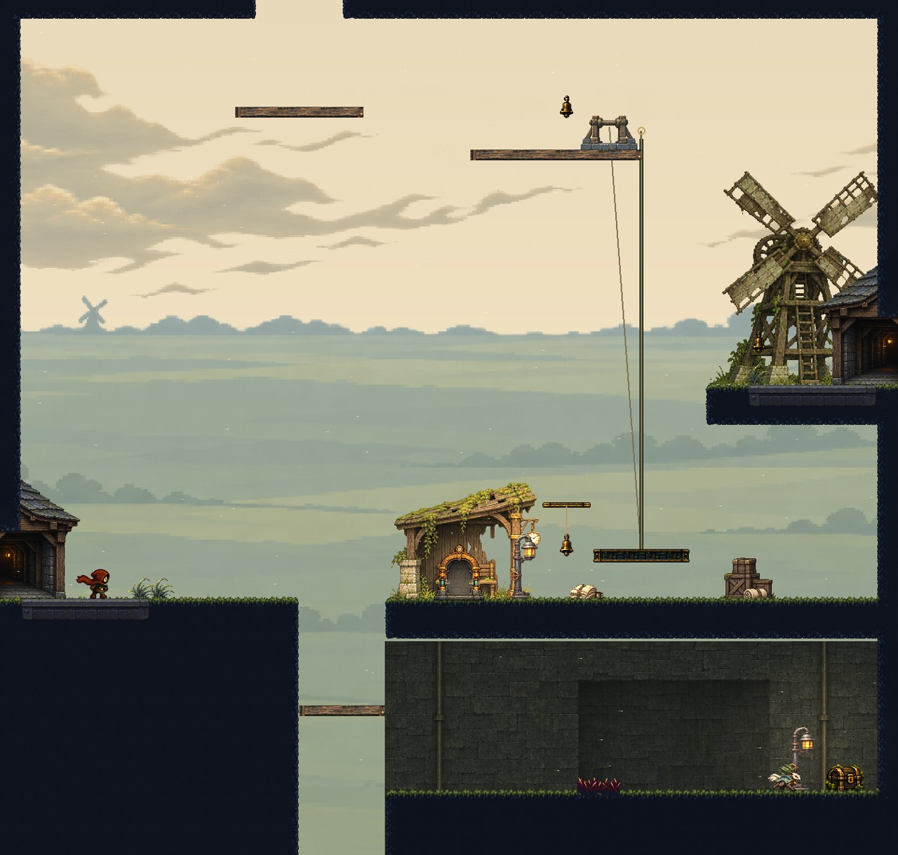
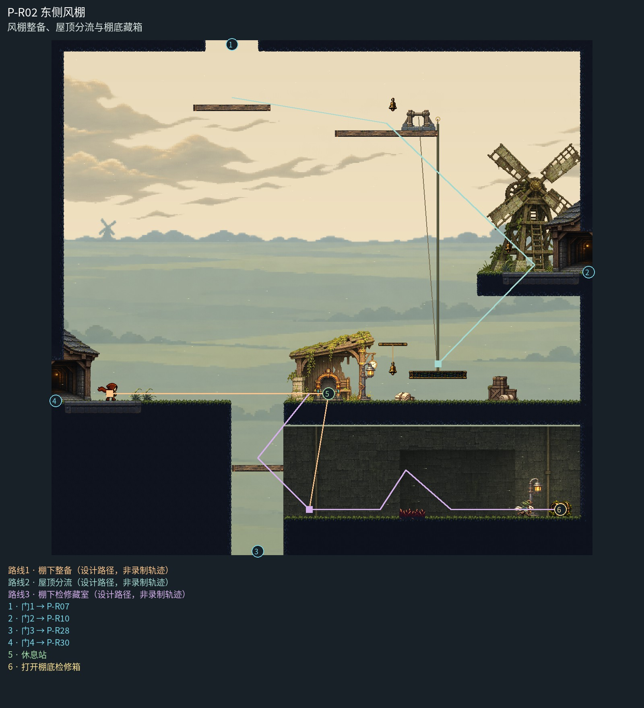

# P-R02 东侧风棚

风棚整备、屋顶分流与棚底藏箱。

主岸候车棚与充电站、上层风车和绞盘、下层检修背墙形成清楚层级；低原野与独立云层保留风场，绞盘落在现有宽台并随动牵引载台；检修支路由实体灯与背墙辨识。

[原尺寸整房图](https://raw.githubusercontent.com/zhipijun1996/gunman-rush/playtest-clockroute-57afe5fe/review/plains-final-art/P-R02/after.jpg) · [前后对比](https://raw.githubusercontent.com/zhipijun1996/gunman-rush/playtest-clockroute-57afe5fe/review/plains-final-art/P-R02/comparison.jpg) · [空间职责与出口图](https://raw.githubusercontent.com/zhipijun1996/gunman-rush/playtest-clockroute-57afe5fe/review/plains-final-art/P-R02/space-map.jpg) · [短片1](https://raw.githubusercontent.com/zhipijun1996/gunman-rush/playtest-clockroute-57afe5fe/review/plains-final-art/P-R02/P-R02-1.mp4) · [短片2](https://raw.githubusercontent.com/zhipijun1996/gunman-rush/playtest-clockroute-57afe5fe/review/plains-final-art/P-R02/P-R02-2.mp4)

整图为检查视口（1世界单位/源像素；预览已缩小），不是正式游戏缩放。对比使用相同世界范围；P33检查范围为(32,32,1984,992)。

正式控制器局部动作夹具；多数隔离敌人，镜头与游戏时间正常；起点夹具间已拆段，不代表连续通关或完整战斗 所有短片正常游戏时间、30fps；无快放。整房图保留敌人。未覆盖新档连续全收集、完整战斗难度、实体手机性能和用户终审。

## 路线与职责

- **棚下整备**：左门去回水洞，下口回旧田；棚里休息后乘屋顶绞盘。
- **屋顶分流**：中层向右进高风车，上层向左接眺望台。
- **棚下检修藏室**：从下口接收岸向右探索棚底，越64宽短刺后与巡逻体交战，右端检修箱一次散落10金币；原路回返程台上棚。上方休息与载台观察不受自愿支路影响。

