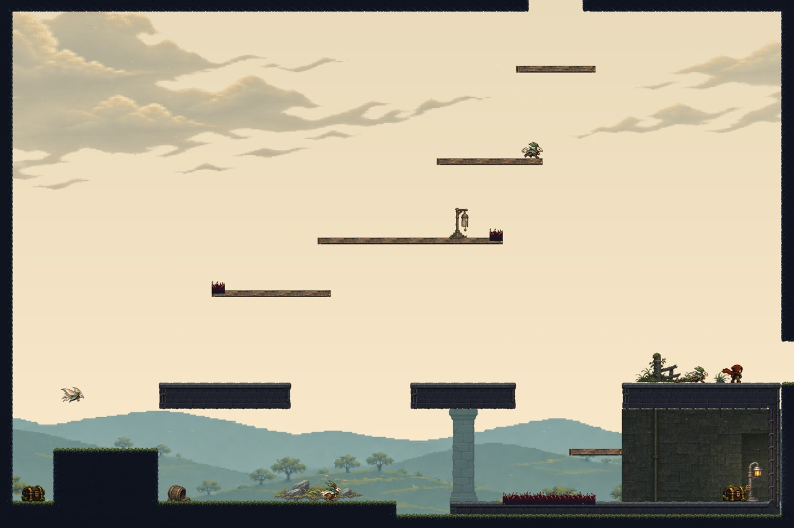
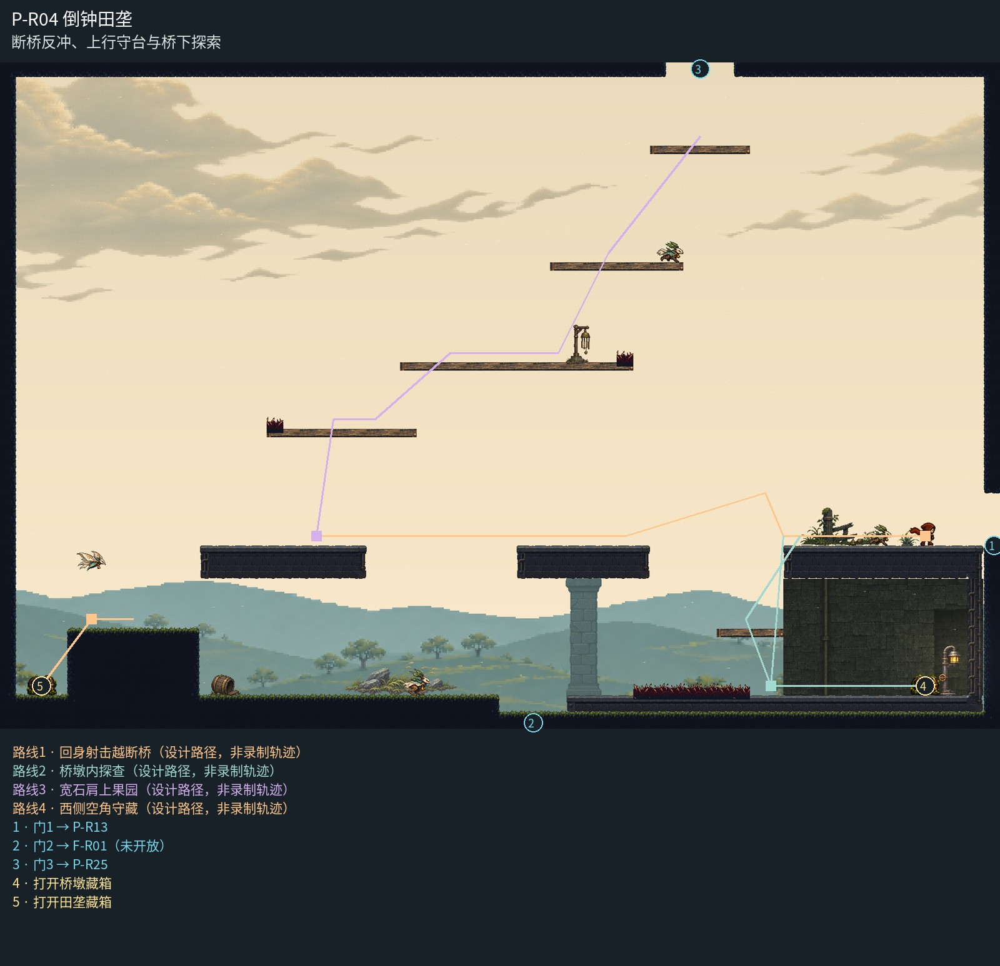

# P-R04 倒钟田垄

断桥反冲、上行守台与桥下探索。

林缘低果林与独立云层衬托三段断桥；只保留中央桥跨的一根退后桥墩，天然田垄和上行木台不逐台加柱。右岸桥下凹室用同族石体、连续后墙和实际灯位收口，危险与空中动作轮廓保持清楚。

[原尺寸整房图](https://raw.githubusercontent.com/zhipijun1996/gunman-rush/playtest-clockroute-57afe5fe/review/plains-final-art/P-R04/after.jpg) · [前后对比](https://raw.githubusercontent.com/zhipijun1996/gunman-rush/playtest-clockroute-57afe5fe/review/plains-final-art/P-R04/comparison.jpg) · [空间职责与出口图](https://raw.githubusercontent.com/zhipijun1996/gunman-rush/playtest-clockroute-57afe5fe/review/plains-final-art/P-R04/space-map.jpg) · [短片1](https://raw.githubusercontent.com/zhipijun1996/gunman-rush/playtest-clockroute-57afe5fe/review/plains-final-art/P-R04/P-R04-1.mp4) · [短片2](https://raw.githubusercontent.com/zhipijun1996/gunman-rush/playtest-clockroute-57afe5fe/review/plains-final-art/P-R04/P-R04-2.mp4)

整图为检查视口（1世界单位/源像素；预览已缩小），不是正式游戏缩放。对比使用相同世界范围；P33检查范围为(32,32,1984,992)。

正式控制器局部动作夹具；多数隔离敌人，镜头与游戏时间正常；起点夹具间已拆段，不代表连续通关或完整战斗 所有短片正常游戏时间、30fps；无快放。整房图保留敌人。未覆盖新档连续全收集、完整战斗难度、实体手机性能和用户终审。

## 路线与职责

- **回身射击越断桥**：向留在右岸的守桥怪射击，反冲同次跨到左接收岸；接收岸加宽32提供余量，保留提前清怪后的空射通行。
- **桥墩内探查**：东桥下凹室由左侧进入，桥墩藏箱一次散落10金币。经检修台回桥，不沿台阶撒币。
- **宽石肩上果园**：5加宽、6下移32并向左加宽；5→6高差128，7加宽至256且下移64，6→7高差192。5的刺移到左边短段、6的刺移到右端，给起跳与反冲落点留出空间。守台怪移至7右段，6完整承担起跳准备；7左侧保留落脚再判断的空间。
- **西侧空角守藏**：西侧低地由俯冲怪守20金币藏箱；从平台左端下探，原路跳回石肩。

