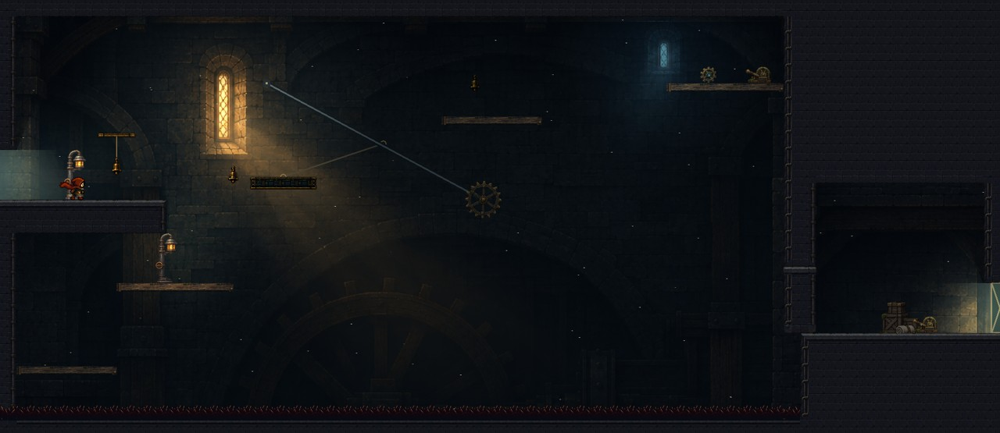
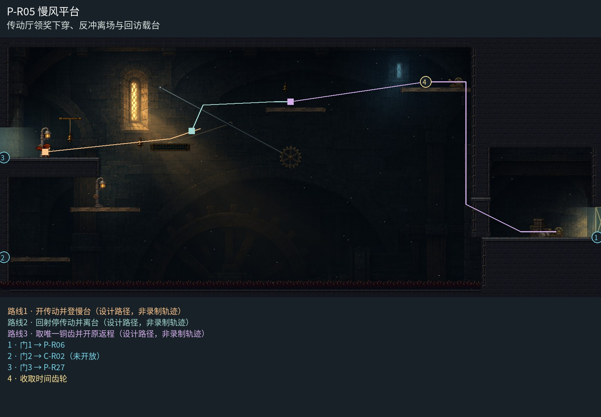

# P-R05 慢风平台

传动厅领奖下穿、反冲离场与回访载台。

本轮只裁清埋入墙体的重复平台，保留已认可的整房美术与玩法。

[原尺寸整房图](https://raw.githubusercontent.com/zhipijun1996/gunman-rush/playtest-clockroute-57afe5fe/review/plains-final-art/P-R05/after.jpg) · [前后对比](https://raw.githubusercontent.com/zhipijun1996/gunman-rush/playtest-clockroute-57afe5fe/review/plains-final-art/P-R05/comparison.jpg) · [空间职责与出口图](https://raw.githubusercontent.com/zhipijun1996/gunman-rush/playtest-clockroute-57afe5fe/review/plains-final-art/P-R05/space-map.jpg) · [短片1](https://raw.githubusercontent.com/zhipijun1996/gunman-rush/playtest-clockroute-57afe5fe/review/plains-final-art/P-R05/P-R05-1.mp4) · [短片2](https://raw.githubusercontent.com/zhipijun1996/gunman-rush/playtest-clockroute-57afe5fe/review/plains-final-art/P-R05/P-R05-2.mp4)

整图为检查视口（1世界单位/源像素；预览已缩小），不是正式游戏缩放。对比使用相同世界范围；P33检查范围为(32,32,1984,992)。

正式控制器局部动作夹具；多数隔离敌人，镜头与游戏时间正常；起点夹具间已拆段，不代表连续通关或完整战斗 所有短片正常游戏时间、30fps；无快放。整房图保留敌人。未覆盖新档连续全收集、完整战斗难度、实体手机性能和用户终审。

## 路线与职责

- **开传动并登慢台**：保留原射铃载台和同驱齿轮；观察齿轮相位后登台，不在这段精密移动里加追击怪。
- **回射停传动并离台**：在载台起跳后向左下的检修铃[448,336]开枪。真实命中停住同一传动的载台与齿轮；反冲同时把人送上检修岸。保留其他合法时机解法。
- **取唯一铜齿并开原返程**：TG02保留唯一正式奖励；领取后开返程闸，下＋跳穿过领奖台，下落至回廊开口时向左射击，借反冲向右穿入通廊，开启回06吊桥。原底部0–1536整行地刺，失足按现行地形失败回准备岸；左侧2/3检修台保留可站恢复。

