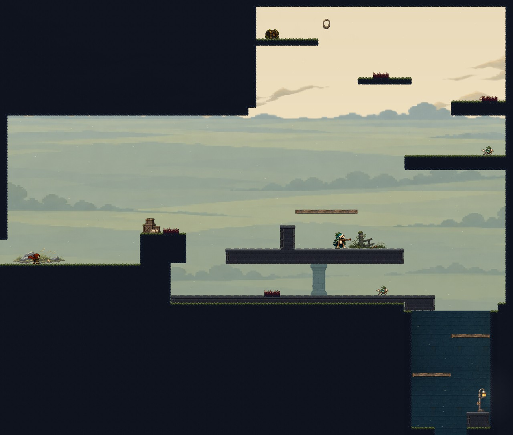
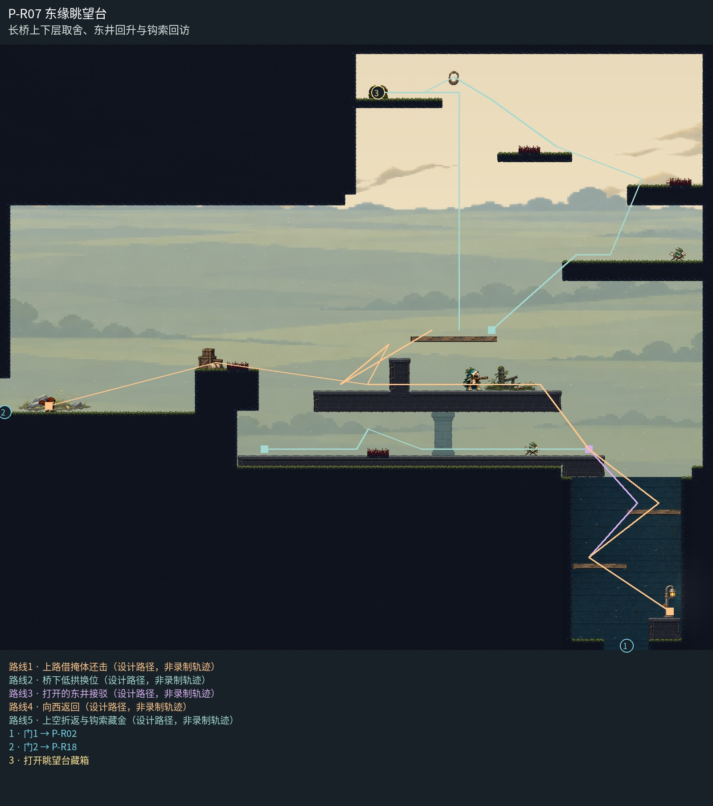

# P-R07 东缘眺望台

长桥上下层取舍、东井回升与钩索回访。

眺望台实心桥跨、低处桥下回路和右侧东井作为一个剖面组织；唯一桥柱从下岸接梁底，原生草岸保留，井内连续砌体与岸灯区别于露天眺望台，独立流云掠过高处钩索支路。

[原尺寸整房图](https://raw.githubusercontent.com/zhipijun1996/gunman-rush/playtest-clockroute-57afe5fe/review/plains-final-art/P-R07/after.jpg) · [前后对比](https://raw.githubusercontent.com/zhipijun1996/gunman-rush/playtest-clockroute-57afe5fe/review/plains-final-art/P-R07/comparison.jpg) · [空间职责与出口图](https://raw.githubusercontent.com/zhipijun1996/gunman-rush/playtest-clockroute-57afe5fe/review/plains-final-art/P-R07/space-map.jpg) · [短片1](https://raw.githubusercontent.com/zhipijun1996/gunman-rush/playtest-clockroute-57afe5fe/review/plains-final-art/P-R07/P-R07-1.mp4) · [短片2](https://raw.githubusercontent.com/zhipijun1996/gunman-rush/playtest-clockroute-57afe5fe/review/plains-final-art/P-R07/P-R07-2.mp4)

整图为检查视口（1世界单位/源像素；预览已缩小），不是正式游戏缩放。对比使用相同世界范围；P33检查范围为(32,32,1984,992)。

正式控制器局部动作夹具；多数隔离敌人，镜头与游戏时间正常；起点夹具间已拆段，不代表连续通关或完整战斗 所有短片正常游戏时间、30fps；无快放。整房图保留敌人。未覆盖新档连续全收集、完整战斗难度、实体手机性能和用户终审。

## 路线与职责

- **上路借掩体还击**：6右段加64宽刺，左侧保留96宽起跳/落脚面；越刺跳向上路。原掩体跳射与反冲回避保留。
- **桥下低拱换位**：原主台1厚256削为64，下方得到连续低拱通路；局部64宽刺留起跳和接收地，巡逻守东段宽地。低路接东岸，不封井口。
- **打开的东井接驳**：原平台2缩成128宽左接驳岸，真正开放1792–2048落槽。保留井内交错单向台和底部门；原448宽实体曾横封整个井口。
- **向西返回**：从原井内两级岸回东接驳岸，再上主路或走桥下返回；原门和入口落脚不变。
- **上空折返与钩索藏金**：沿右肩上升、越过局部刺台，再借左上钩点进入40金币藏箱岸。回访支路不堵初访主路；取得后折返下到原上路。

