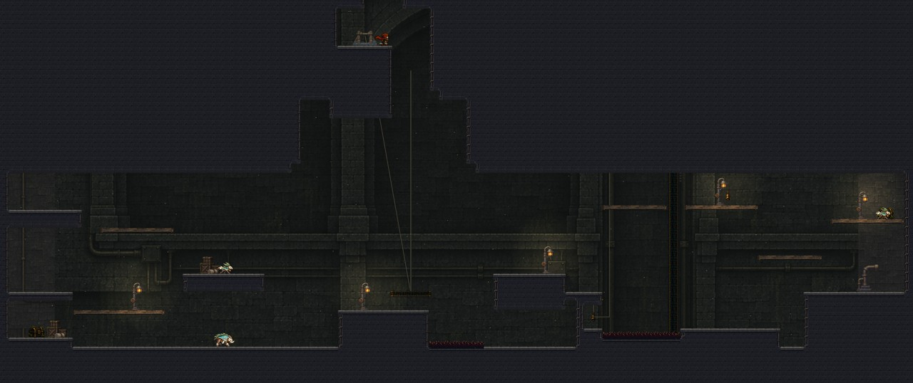
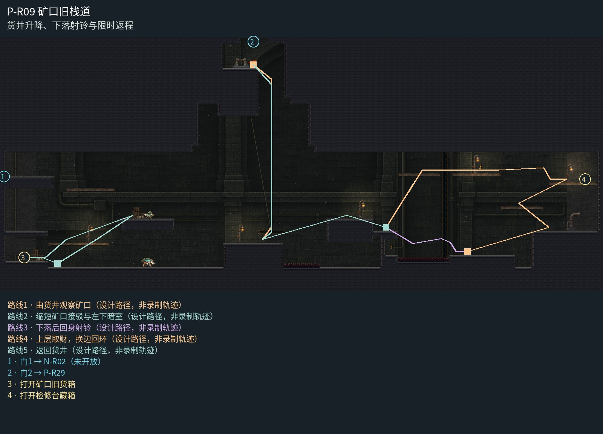

# P-R09 矿口旧栈道

货井升降、下落射铃与限时返程。

矿口货运廊整体置于地下转运结构中：中央狭井通向连续长背拱，低货台与东侧检修高台保持同族砌体；井绞盘和真实随动钢索解释货梯，灯只在真实准备岸、取箱岸及返程台。取消地下满屏天空与重复远山。

[原尺寸整房图](https://raw.githubusercontent.com/zhipijun1996/gunman-rush/playtest-clockroute-57afe5fe/review/plains-final-art/P-R09/after.jpg) · [前后对比](https://raw.githubusercontent.com/zhipijun1996/gunman-rush/playtest-clockroute-57afe5fe/review/plains-final-art/P-R09/comparison.jpg) · [空间职责与出口图](https://raw.githubusercontent.com/zhipijun1996/gunman-rush/playtest-clockroute-57afe5fe/review/plains-final-art/P-R09/space-map.jpg) · [短片1](https://raw.githubusercontent.com/zhipijun1996/gunman-rush/playtest-clockroute-57afe5fe/review/plains-final-art/P-R09/P-R09-1.mp4) · [短片2](https://raw.githubusercontent.com/zhipijun1996/gunman-rush/playtest-clockroute-57afe5fe/review/plains-final-art/P-R09/P-R09-2.mp4)

整图为检查视口（1世界单位/源像素；预览已缩小），不是正式游戏缩放。对比使用相同世界范围；P33检查范围为(32,32,1984,992)。

正式控制器局部动作夹具；多数隔离敌人，镜头与游戏时间正常；起点夹具间已拆段，不代表连续通关或完整战斗 所有短片正常游戏时间、30fps；无快放。整房图保留敌人。未覆盖新档连续全收集、完整战斗难度、实体手机性能和用户终审。

## 路线与职责

- **由货井观察矿口**：上门落到安全实体岸；沿货井乘货梯到中央货台。向西可预览未施工矿口，向东到岸底开口观察铃与闸。
- **缩短矿口接驳与左下暗室**：矿口接驳只保留连接所需长度。左下管口后的暗室向右敞开，净高128、门槛32；短跳进入领取10金币旧货箱，再由右沿跳回货台，无需破墙。
- **下落后回身射铃**：从准备岸踏入缺口，回身向左下射入80高的宽铃口。子弹打开闸，同枪反冲向右上跨过缺口并落到闸后宽岸。射偏落刺则回到准备岸；射口不靠针眼限制玩家。
- **上层取财，换边回环**：东端上层由守卫争夺20金币检修藏箱。回程从东台左缘跳起向右下射击，反冲左上接检修台；射访问铃后短跳回主路，途中不另堆浮台。
- **返回货井**：沿中央货台到货梯；中间无横梁穿过轨道。乘至上端后向左跳回安全入口岸。

