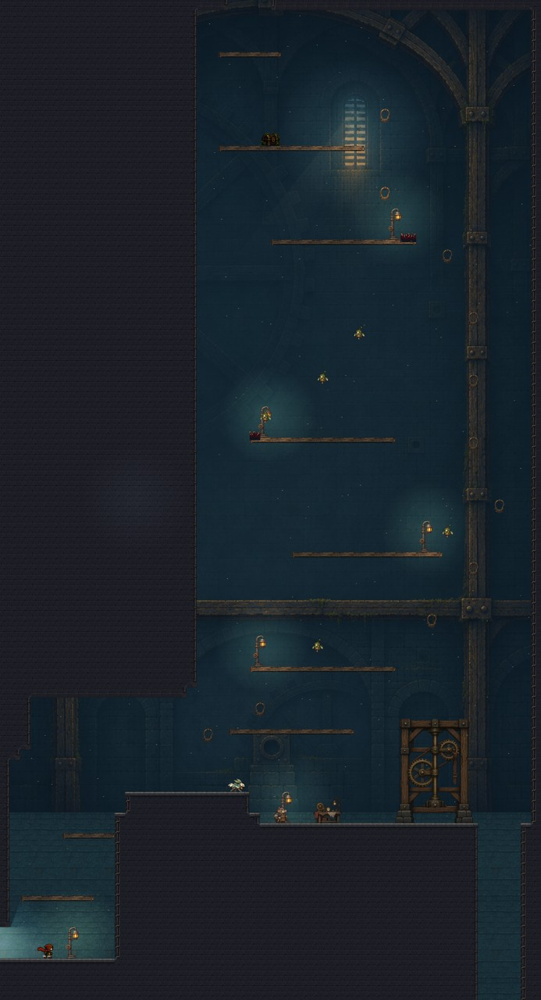
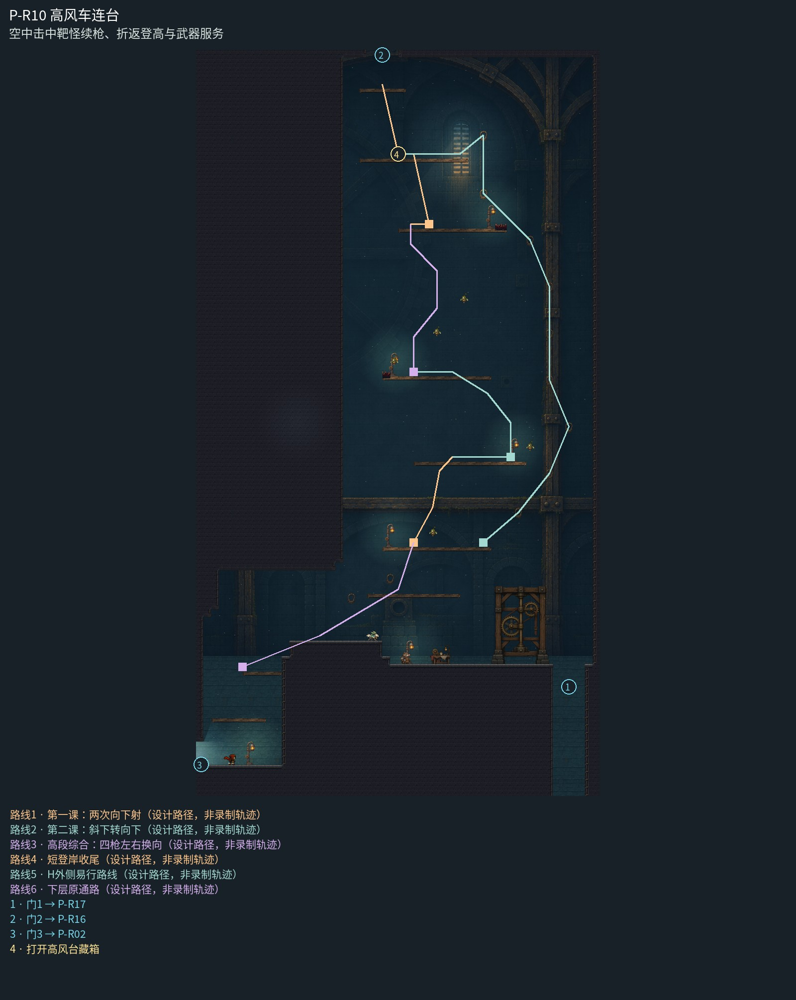

# P-R10 高风车连台

空中击中靶怪续枪、折返登高与武器服务。

整座挑高练枪中庭以连续后梁、退后的旧传动槽和高低两扇窄窗统一，不逐层重复小房间。木检修台与浮铃芽形成清楚上升节奏，宽岸实体暖灯提供停顿；下层武器匠工位与高处冷天光有明确层次。普通镜头、靶子和三段命中续枪保持。

[原尺寸整房图](https://raw.githubusercontent.com/zhipijun1996/gunman-rush/playtest-clockroute-57afe5fe/review/plains-final-art/P-R10/after.jpg) · [前后对比](https://raw.githubusercontent.com/zhipijun1996/gunman-rush/playtest-clockroute-57afe5fe/review/plains-final-art/P-R10/comparison.jpg) · [空间职责与出口图](https://raw.githubusercontent.com/zhipijun1996/gunman-rush/playtest-clockroute-57afe5fe/review/plains-final-art/P-R10/space-map.jpg) · [短片1](https://raw.githubusercontent.com/zhipijun1996/gunman-rush/playtest-clockroute-57afe5fe/review/plains-final-art/P-R10/P-R10-1.mp4) · [短片2](https://raw.githubusercontent.com/zhipijun1996/gunman-rush/playtest-clockroute-57afe5fe/review/plains-final-art/P-R10/P-R10-2.mp4)

整图为检查视口（1世界单位/源像素；预览已缩小），不是正式游戏缩放。对比使用相同世界范围；P33检查范围为(32,32,1984,992)。

正式控制器局部动作夹具；多数隔离敌人，镜头与游戏时间正常；起点夹具间已拆段，不代表连续通关或完整战斗 所有短片正常游戏时间、30fps；无快放。整房图保留敌人。未覆盖新档连续全收集、完整战斗难度、实体手机性能和用户终审。

## 路线与职责

- **第一课：两次向下射**：从宽岸轻跳到空怪上方，向下命中恢复一发，再向下射登上352高的宽接落岸；不要求瞄准换向。
- **第二课：斜下转向下**：准备后起跳朝右下击中空怪并补弹，再改为向下射，身体回收至左侧352高宽岸；只多学一次瞄准换向，464宽准备岸右端退到1360为H脱钩保留净空。
- **高段综合：四枪左右换向**：左下击A→下击B→右下击C→下射；前三次真实伤害各补回一发，同次腾空越过608高的大空域，落回下方宽岸可重新组织动作。
- **短登岸收尾**：综合段之后只需普通跳跃加一次向下反冲，分两次短登岸到共用20币位置与既有出口门台，不再安排续枪资源题。
- **H外侧易行路线**：右侧铜环保持单独易行线，跳起接环即可绕过两课和四枪精密连射，448宽顶岸接住最后一次脱钩小踢，终点与无H路线共用。
- **下层原通路**：下层宽岸连接入口、武器匠和上行挑战。

