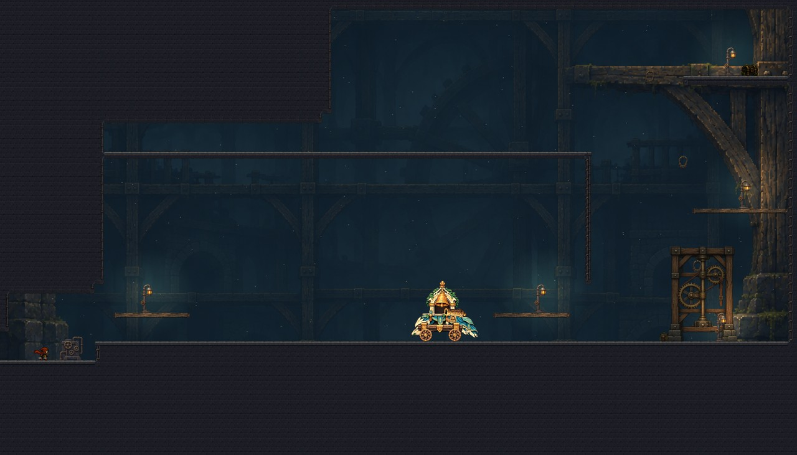
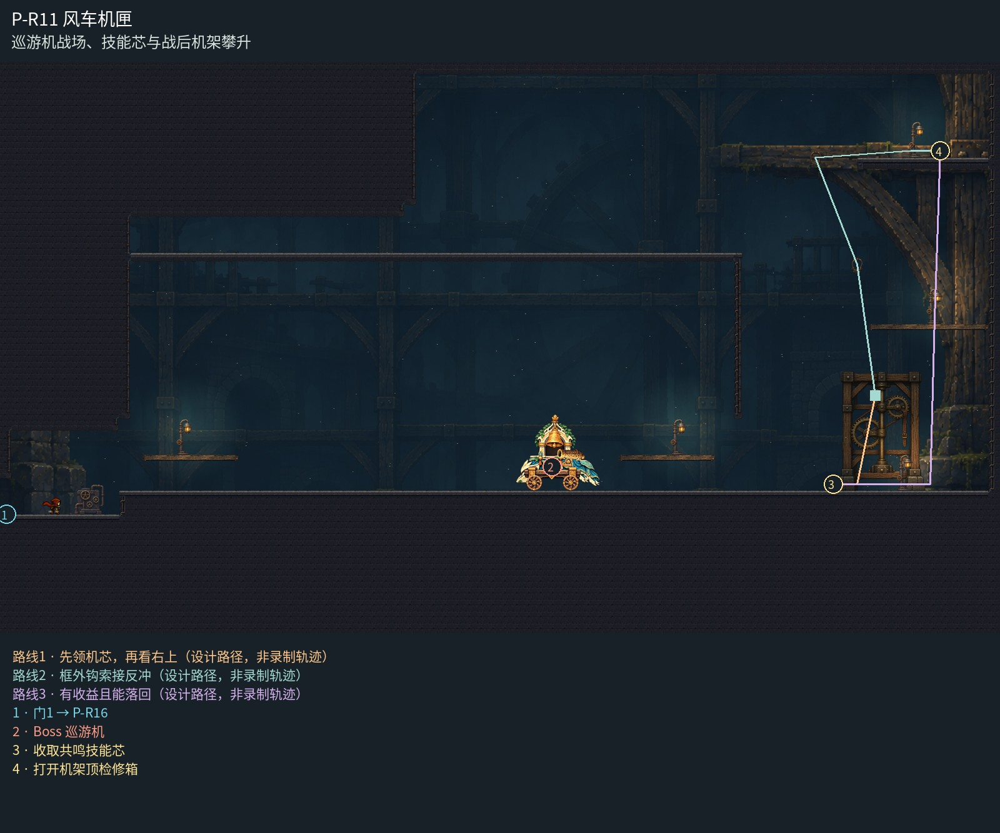

# P-R11 风车机匣

巡游机战场、技能芯与战后机架攀升。

机匣战场与右侧框外攀升共享一座宽阔传动大厅：远木拱和冷色机械轮廓连续延伸，中央战斗面不叠装饰；近处原生石台、机架与暖检修灯负责行动层。战后木检修台和高处灯位延续同一空间，不重复多间小机房。

[原尺寸整房图](https://raw.githubusercontent.com/zhipijun1996/gunman-rush/playtest-clockroute-57afe5fe/review/plains-final-art/P-R11/after.jpg) · [前后对比](https://raw.githubusercontent.com/zhipijun1996/gunman-rush/playtest-clockroute-57afe5fe/review/plains-final-art/P-R11/comparison.jpg) · [空间职责与出口图](https://raw.githubusercontent.com/zhipijun1996/gunman-rush/playtest-clockroute-57afe5fe/review/plains-final-art/P-R11/space-map.jpg) · [短片1](https://raw.githubusercontent.com/zhipijun1996/gunman-rush/playtest-clockroute-57afe5fe/review/plains-final-art/P-R11/P-R11-1.mp4)

整图为检查视口（1世界单位/源像素；预览已缩小），不是正式游戏缩放。对比使用相同世界范围；P33检查范围为(32,32,1984,992)。

正式控制器局部动作夹具；多数隔离敌人，镜头与游戏时间正常；起点夹具间已拆段，不代表连续通关或完整战斗；此片仅战后机架路线，不是完整Boss战。 所有短片正常游戏时间、30fps；无快放。整房图保留敌人。未覆盖新档连续全收集、完整战斗难度、实体手机性能和用户终审。

## 路线与职责

- **先领机芯，再看右上**：唯一机芯保留原位置和Boss资格；奖励右上只露第一枚铜环，没有沿路金币或箭头泄露顶端藏点。
- **框外钩索接反冲**：第一钩恢复后跳离、向下射击再挂第二钩；沿原框外侧接第三钩，右侧检修岸可落地整理与重试。
- **有收益且能落回**：上端整块岸的检修箱集中散落30金币；取后沿右侧落到检修岸再回领奖地，不要求重复高处精密链。

