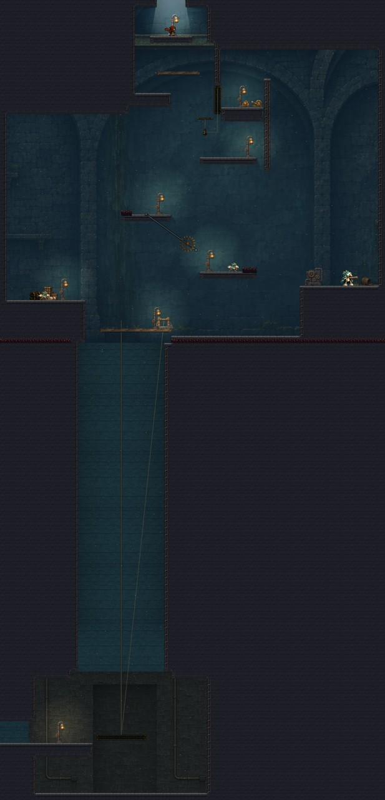
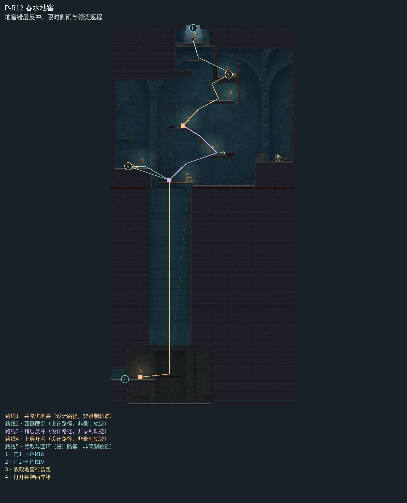

# P-R12 春水地窖

地窖错层反冲、限时侧闸与领奖返程。

春水地窖以一座大储水厅组织上层错阶、左储物拱和右泵阀领奖室；后墙管线连续、动作空域安静。窄井为连续曲面受光砌体和真实吊笼绳，上下端检修灯解释进入方向；井底接独立低矮候笼室，不竖向复制整座拱厅。

[原尺寸整房图](https://raw.githubusercontent.com/zhipijun1996/gunman-rush/playtest-clockroute-57afe5fe/review/plains-final-art/P-R12/after.jpg) · [前后对比](https://raw.githubusercontent.com/zhipijun1996/gunman-rush/playtest-clockroute-57afe5fe/review/plains-final-art/P-R12/comparison.jpg) · [空间职责与出口图](https://raw.githubusercontent.com/zhipijun1996/gunman-rush/playtest-clockroute-57afe5fe/review/plains-final-art/P-R12/space-map.jpg) · [短片1](https://raw.githubusercontent.com/zhipijun1996/gunman-rush/playtest-clockroute-57afe5fe/review/plains-final-art/P-R12/P-R12-1.mp4) · [短片2](https://raw.githubusercontent.com/zhipijun1996/gunman-rush/playtest-clockroute-57afe5fe/review/plains-final-art/P-R12/P-R12-2.mp4)

整图为检查视口（1世界单位/源像素；预览已缩小），不是正式游戏缩放。对比使用相同世界范围；P33检查范围为(32,32,1984,992)。

正式控制器局部动作夹具；多数隔离敌人，镜头与游戏时间正常；起点夹具间已拆段，不代表连续通关或完整战斗 所有短片正常游戏时间、30fps；无快放。整房图保留敌人。未覆盖新档连续全收集、完整战斗难度、实体手机性能和用户终审。

## 路线与职责

- **井笼进地窖**：下层入口乘短停井笼直达宽穿透接收岸。这里先观察西侧宝箱和右上层路线；失败可从宽岸重新组织。
- **西侧藏金**：向左跳入储物拱室，击退守箱怪取20币，再回接收岸。
- **错层反冲**：起跳后向左下射击登右岸，清除平台守卫；避开右侧短刺，回身向右下射击登左岸。转角齿轮扫过换岸通道，观察后出发。
- **上层开闸**：由左岸反冲到右上准备岸，向左下射铃，身体右上穿过临时侧闸，落到行装岸。
- **领取与回环**：收取原行装，放折梯。沿领奖岸右侧折梯下降回准备岸；若回上口，从左侧高肩上行；下行可沿宽台回井笼，不重新做上升挑战。

