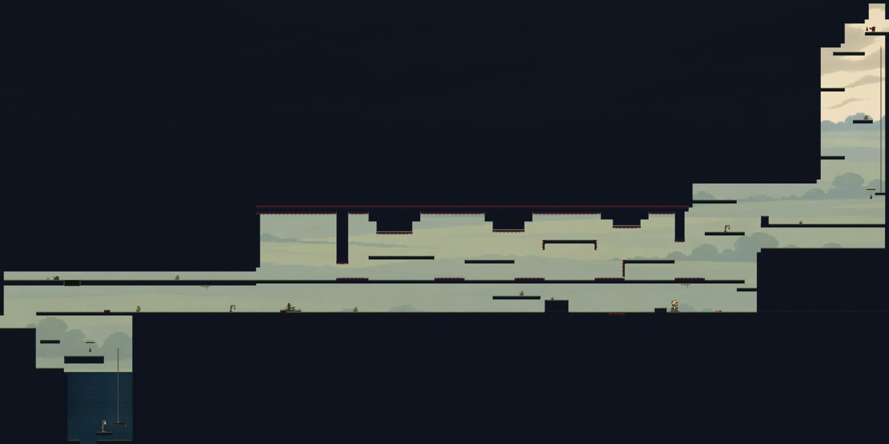
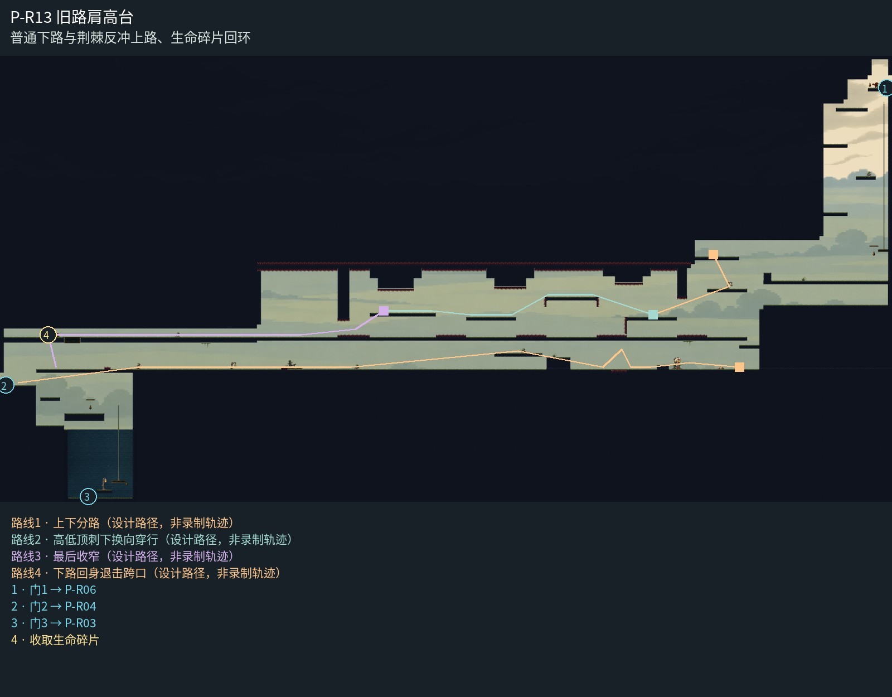

# P-R13 旧路肩高台

普通下路与荆棘反冲上路、生命碎片回环。

开敞低原野作为整条旧路肩的同一远地参照；入口竖向落到上下岔路，上层荆棘腔保持完整危险剪影，下层普通路以稀疏栅栏和行囊形成停顿。删除自带浮空地面的重复远景卡，长岸下仅两处有真实宿主的垂苔。西侧回落井用独立井壁和安全台灯收口，HP01和返程资格不变。

[原尺寸整房图](https://raw.githubusercontent.com/zhipijun1996/gunman-rush/playtest-clockroute-57afe5fe/review/plains-final-art/P-R13/after.jpg) · [前后对比](https://raw.githubusercontent.com/zhipijun1996/gunman-rush/playtest-clockroute-57afe5fe/review/plains-final-art/P-R13/comparison.jpg) · [空间职责与出口图](https://raw.githubusercontent.com/zhipijun1996/gunman-rush/playtest-clockroute-57afe5fe/review/plains-final-art/P-R13/space-map.jpg) · [短片1](https://raw.githubusercontent.com/zhipijun1996/gunman-rush/playtest-clockroute-57afe5fe/review/plains-final-art/P-R13/P-R13-1.mp4) · [短片2](https://raw.githubusercontent.com/zhipijun1996/gunman-rush/playtest-clockroute-57afe5fe/review/plains-final-art/P-R13/P-R13-2.mp4)

整图为检查视口（1世界单位/源像素；预览已缩小），不是正式游戏缩放。对比使用相同世界范围；P33检查范围为(32,32,1984,992)。

正式控制器局部动作夹具；多数隔离敌人，镜头与游戏时间正常；起点夹具间已拆段，不代表连续通关或完整战斗 所有短片正常游戏时间、30fps；无快放。整房图保留敌人。未覆盖新档连续全收集、完整战斗难度、实体手机性能和用户终审。

## 路线与职责

- **上下分路**：上路是自愿反冲荆棘挑战；下路是普通平台战斗，靠近04时再看见奖励。
- **高低顶刺下换向穿行**：东、中、西三段吊顶与顶刺改变净空；在高腔调整射向，高台边短跳后向右上射击压低轨迹，向左落入低腔，离开低顶后再抬升。
- **最后收窄**：最后一处夹刺观察后反冲；取得碎片再开返程折板落回主路。
- **下路回身退击跨口**：低廊掩体提供观察与换边；跃起后朝右击中身后根铃，同枪向左反冲跨越短刺口。清怪后也可普通跳跃跨过，西侧局部刺继续限制落脚；上层HP01保持独立挑战与单向返程。

