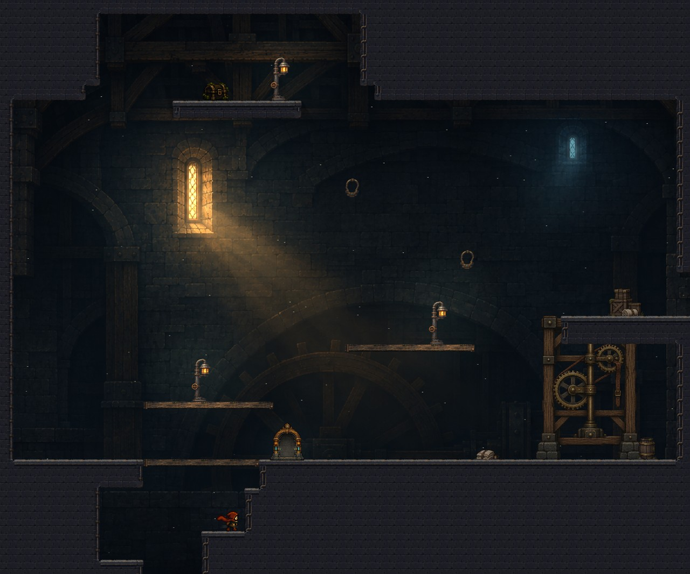
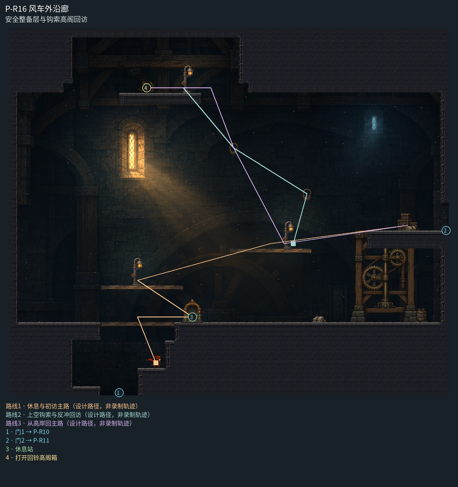

# P-R16 风车外沿廊

安全整备层与钩索高阁回访。

风车侧廊按上部闲置检修阁与下部充电休整岸整体构图：一座连续传动后厅、真实高窗和低位暖灯形成安静中层；木检修台、宽休息岸和东侧机架有清楚层次。取消密集重复梁格，中央钩索往返空间保持净空。

[原尺寸整房图](https://raw.githubusercontent.com/zhipijun1996/gunman-rush/playtest-clockroute-57afe5fe/review/plains-final-art/P-R16/after.jpg) · [前后对比](https://raw.githubusercontent.com/zhipijun1996/gunman-rush/playtest-clockroute-57afe5fe/review/plains-final-art/P-R16/comparison.jpg) · [空间职责与出口图](https://raw.githubusercontent.com/zhipijun1996/gunman-rush/playtest-clockroute-57afe5fe/review/plains-final-art/P-R16/space-map.jpg) · [短片1](https://raw.githubusercontent.com/zhipijun1996/gunman-rush/playtest-clockroute-57afe5fe/review/plains-final-art/P-R16/P-R16-1.mp4) · [短片2](https://raw.githubusercontent.com/zhipijun1996/gunman-rush/playtest-clockroute-57afe5fe/review/plains-final-art/P-R16/P-R16-2.mp4)

整图为检查视口（1世界单位/源像素；预览已缩小），不是正式游戏缩放。对比使用相同世界范围；P33检查范围为(32,32,1984,992)。

正式控制器局部动作夹具；多数隔离敌人，镜头与游戏时间正常；起点夹具间已拆段，不代表连续通关或完整战斗 所有短片正常游戏时间、30fps；无快放。整房图保留敌人。未覆盖新档连续全收集、完整战斗难度、实体手机性能和用户终审。

## 路线与职责

- **休息与初访主路**：保留底部休息岸与通向东门的原台阶；无H也可按原路到达出口。
- **上空钩索与反冲回访**：从上层主路牵引第一环，跳离后钩住左上环，再向右下射击反冲到左侧高岸；高阁箱一次散落20金币，不沿路零散撒币。
- **从高岸回主路**：从高岸右端落下可再钩上环稳住，松钩后回原6号宽台；漏钩也落入无刺休息层。

