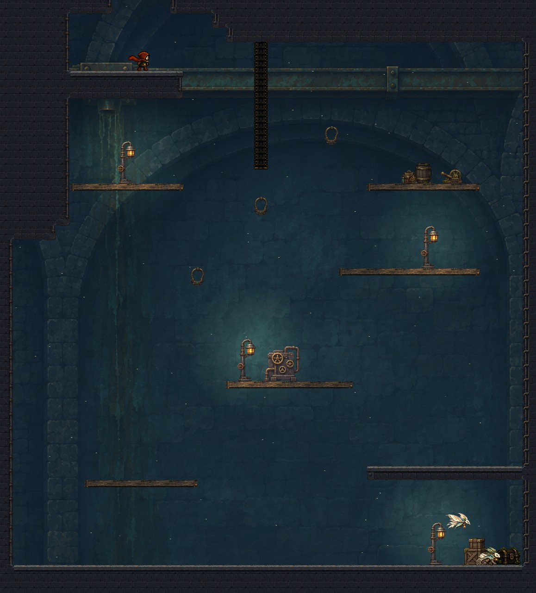
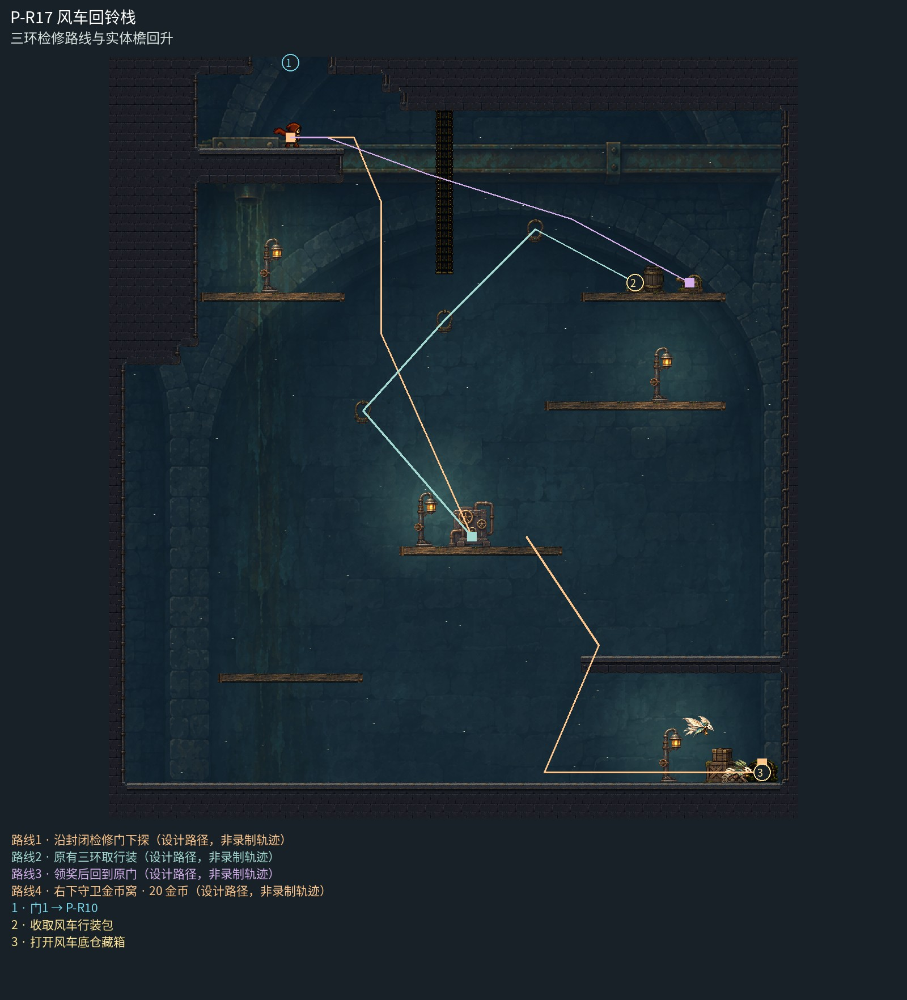

# P-R17 风车回铃栈

三环检修路线与实体檐回升。

封闭回铃检修室采用同族大后拱和管阀背墙，一幅连续凹室覆盖三环与下层守箱空间；真实暖灯按安全岸定位，轻木踏板区分可下穿面，右下实心檐仍承担遮挡与反冲回升。整室不再重复小拱门纹样。

[原尺寸整房图](https://raw.githubusercontent.com/zhipijun1996/gunman-rush/playtest-clockroute-57afe5fe/review/plains-final-art/P-R17/after.jpg) · [前后对比](https://raw.githubusercontent.com/zhipijun1996/gunman-rush/playtest-clockroute-57afe5fe/review/plains-final-art/P-R17/comparison.jpg) · [空间职责与出口图](https://raw.githubusercontent.com/zhipijun1996/gunman-rush/playtest-clockroute-57afe5fe/review/plains-final-art/P-R17/space-map.jpg) · [短片1](https://raw.githubusercontent.com/zhipijun1996/gunman-rush/playtest-clockroute-57afe5fe/review/plains-final-art/P-R17/P-R17-1.mp4) · [短片2](https://raw.githubusercontent.com/zhipijun1996/gunman-rush/playtest-clockroute-57afe5fe/review/plains-final-art/P-R17/P-R17-2.mp4)

整图为检查视口（1世界单位/源像素；预览已缩小），不是正式游戏缩放。对比使用相同世界范围；P33检查范围为(32,32,1984,992)。

正式控制器局部动作夹具；多数隔离敌人，镜头与游戏时间正常；起点夹具间已拆段，不代表连续通关或完整战斗 所有短片正常游戏时间、30fps；无快放。整房图保留敌人。未覆盖新档连续全收集、完整战斗难度、实体手机性能和用户终审。

## 路线与职责

- **沿封闭检修门下探**：入口厚块减薄；下方原平台恢复落脚用途。检修门未开时从门下绕入原H路线。
- **原有三环取行装**：原有H三环仍通往行装包；下层金币支路由右侧宽口进入，一空一陆守住下层奖励，屋檐遮断朝原H起点的初始视线。
- **领奖后回到原门**：操作原返程闩，西侧两阶展开，检修门打开；三段普通跳回入口。
- **右下守卫金币窝 · 20 金币**：右下宽口内一陆一空守20金币藏箱，屋檐隔开上层钩索路线；返程先在屋檐左侧下射反冲上升，身体越过檐面后再向右落上屋檐顶，再回原路线。

