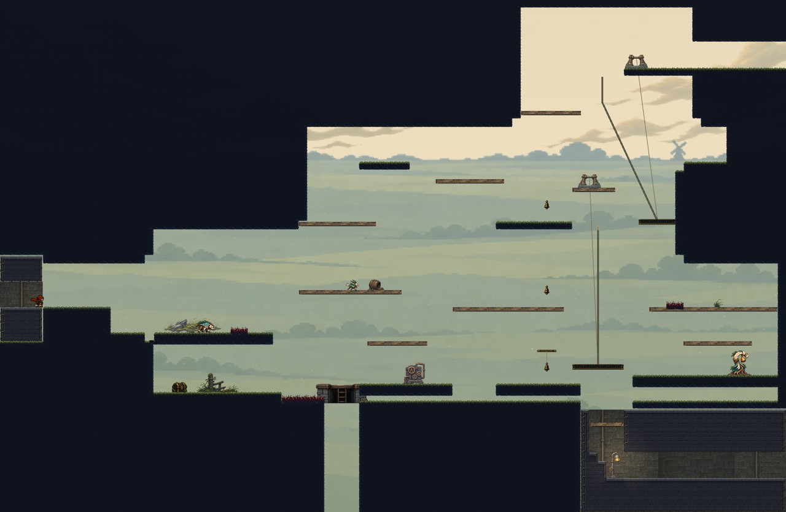
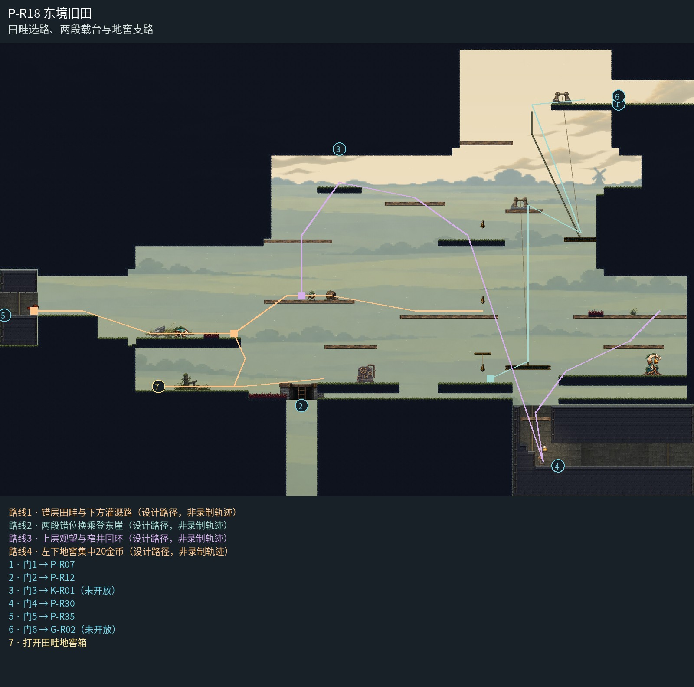

# P-R18 东境旧田

田畦选路、两段载台与地窖支路。

低田、灌溉岸与高崖换乘按同一田野纵深构图；独立云层和低田地平线区别高度，去掉多余长柱与误示下井的井台。两绞盘落在真实高岸，缆线对应各载台；自然台保持草沿，可下穿木台形成轻重区别，最下检修口用同族井壁与安全灯收束。 侧向室内连接由实际上檐、短后墙和连续门岸形成围合，撤去独立门脸贴片；门位、净空与落脚保持。

[原尺寸整房图](https://raw.githubusercontent.com/zhipijun1996/gunman-rush/playtest-clockroute-57afe5fe/review/plains-final-art/P-R18/after.jpg) · [前后对比](https://raw.githubusercontent.com/zhipijun1996/gunman-rush/playtest-clockroute-57afe5fe/review/plains-final-art/P-R18/comparison.jpg) · [空间职责与出口图](https://raw.githubusercontent.com/zhipijun1996/gunman-rush/playtest-clockroute-57afe5fe/review/plains-final-art/P-R18/space-map.jpg) · [短片1](https://raw.githubusercontent.com/zhipijun1996/gunman-rush/playtest-clockroute-57afe5fe/review/plains-final-art/P-R18/P-R18-1.mp4) · [短片2](https://raw.githubusercontent.com/zhipijun1996/gunman-rush/playtest-clockroute-57afe5fe/review/plains-final-art/P-R18/P-R18-2.mp4)

整图为检查视口（1世界单位/源像素；预览已缩小），不是正式游戏缩放。对比使用相同世界范围；P33检查范围为(32,32,1984,992)。

正式控制器局部动作夹具；多数隔离敌人，镜头与游戏时间正常；起点夹具间已拆段，不代表连续通关或完整战斗 所有短片正常游戏时间、30fps；无快放。整房图保留敌人。未覆盖新档连续全收集、完整战斗难度、实体手机性能和用户终审。

## 路线与职责

- **错层田畦与下方灌溉路**：西入口降到低田应对冲锋，再反冲上高田；第二沟下方通地窖和灌溉路，可经穿透平台返回当前田畦。
- **两段错位换乘登东崖**：下层或中层射铃召回第一台，抵达中段后跳上准备岸，再向右换到自动斜行的崖台；东崖上岸后通P07。两条轨道与乘员头顶保持独立净空。
- **上层观望与窄井回环**：高田向下射击守卫可借反冲上观望层；C05保持未施工封闭边界。下井通P30，清怪后仍可经井中接收台与东岸台返回。
- **左下地窖集中20金币**：从田畦右缘下探原地窖，到左下集中金币位置；取后走到原岸右缘，向左下射击反冲跨过渠底短刺，接回原回升路。箱内20金币沿一次性收据散落。

