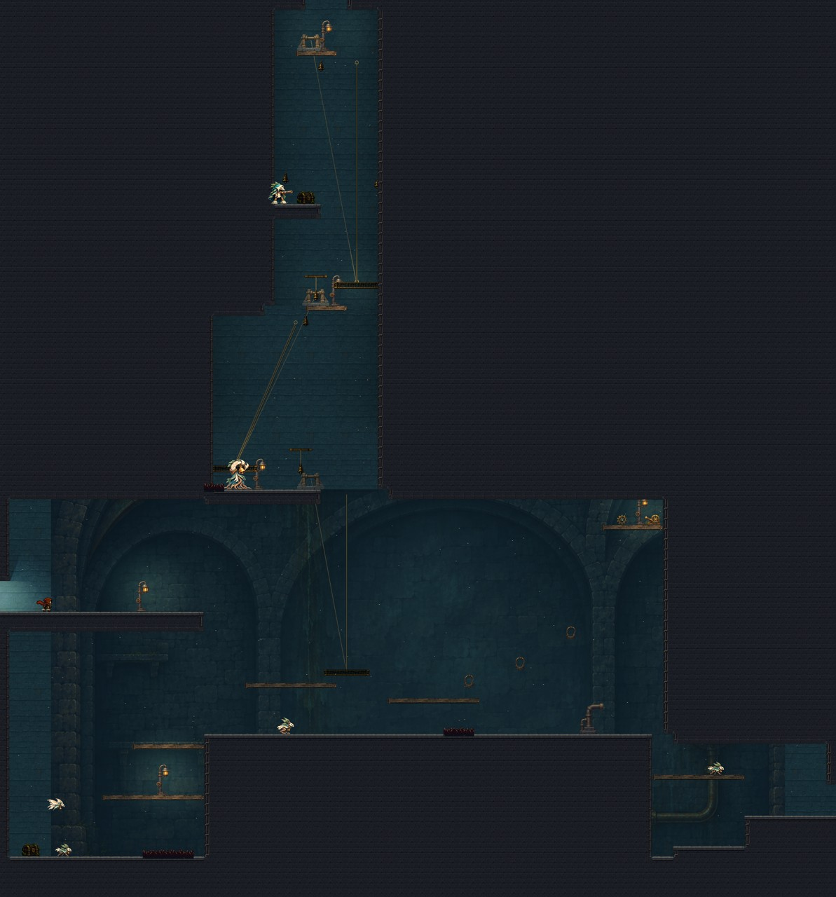
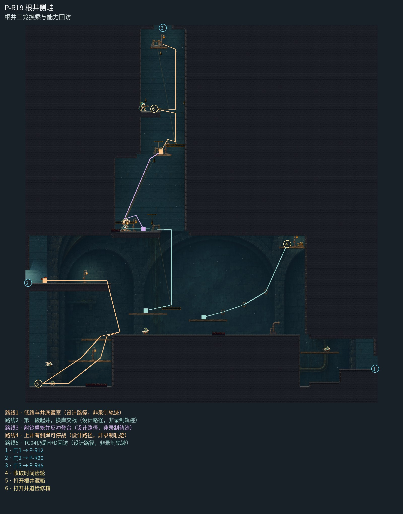

# P-R19 根井侧畦

根井三笼换乘与能力回访。

上部窄根井、中段换笼侧岸和下部泵管厅为连续地下设施；井壁曲面光只解释井筒，三个绞盘与真实运动钢索逐段连接，岸灯区分停战与换乘。底厅用大后拱、管线和宽石体统一，不复制竖井插画，不把室外井台或装饰遗物当作可交互奖励。

[原尺寸整房图](https://raw.githubusercontent.com/zhipijun1996/gunman-rush/playtest-clockroute-57afe5fe/review/plains-final-art/P-R19/after.jpg) · [前后对比](https://raw.githubusercontent.com/zhipijun1996/gunman-rush/playtest-clockroute-57afe5fe/review/plains-final-art/P-R19/comparison.jpg) · [空间职责与出口图](https://raw.githubusercontent.com/zhipijun1996/gunman-rush/playtest-clockroute-57afe5fe/review/plains-final-art/P-R19/space-map.jpg) · [短片1](https://raw.githubusercontent.com/zhipijun1996/gunman-rush/playtest-clockroute-57afe5fe/review/plains-final-art/P-R19/P-R19-1.mp4) · [短片2](https://raw.githubusercontent.com/zhipijun1996/gunman-rush/playtest-clockroute-57afe5fe/review/plains-final-art/P-R19/P-R19-2.mp4)

整图为检查视口（1世界单位/源像素；预览已缩小），不是正式游戏缩放。对比使用相同世界范围；P33检查范围为(32,32,1984,992)。

正式控制器局部动作夹具；多数隔离敌人，镜头与游戏时间正常；起点夹具间已拆段，不代表连续通关或完整战斗 所有短片正常游戏时间、30fps；无快放。整房图保留敌人。未覆盖新档连续全收集、完整战斗难度、实体手机性能和用户终审。

## 路线与职责

- **低路与井底藏室**：从低路回望桥下藏室：巡逻与俯冲怪守20金币藏箱，底部右段刺床保留左侧宽战斗面；由两层宽台回原低路。
- **第一段起井，换岸交战**：第一笼只升到中层宽岸。根铃在实心平台9预警，玩家可跳离或射击打断；局部刺迫使换落点。清理后准备向右射铃，身体向左登第二笼。
- **射铃启笼并反冲登台**：右侧风铃启动第二笼；朝右射击同时把身体送向左侧载台。第二笼斜向右上收束到平台8，失败可回中层宽岸，顶端访问铃能召回或停台。允许先启动后登台。
- **上井有侧岸可停战**：第三笼接上门，途中左侧哨兵守10金币检修箱；射右侧访问铃停笼并反冲上左岸，处理遭遇后射左铃再搭笼。上门保留安静落台。
- **TG04仍是H+D回访**：原三个钩点、TG04高岸、奖励与返程机关保留。新上升岸均在井道西侧，未把台阶接入右侧奖励；新怪不放到TG04附近充当回枪台阶。

