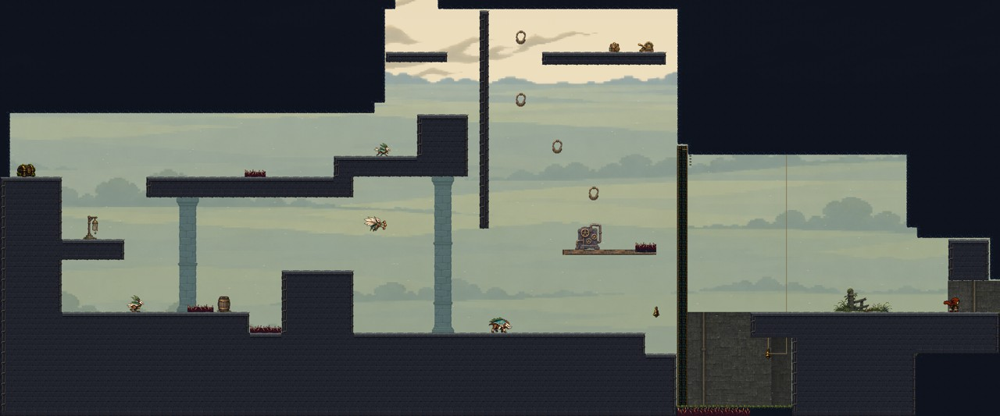
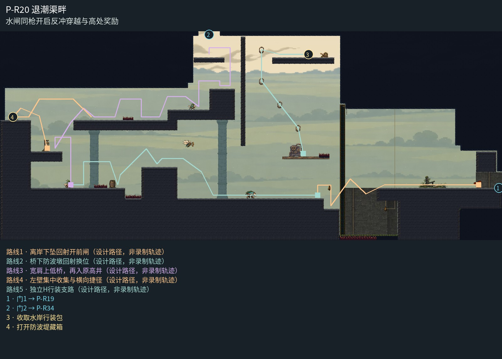

# P-R20 退潮渠畔

水闸同枪开启反冲穿越与高处奖励。

退潮闸桥整体保留两根有真实承托关系的退后桥墩，连续石桥与低岸同族收口；阀台位于可停的干岸，深闸槽背墙解释低处而不露天空。低原野与独立云层提供通风感，东口重复踏板删除，原岸体直接承接门槛，危险闸口和反冲路线保持清楚。

[原尺寸整房图](https://raw.githubusercontent.com/zhipijun1996/gunman-rush/playtest-clockroute-57afe5fe/review/plains-final-art/P-R20/after.jpg) · [前后对比](https://raw.githubusercontent.com/zhipijun1996/gunman-rush/playtest-clockroute-57afe5fe/review/plains-final-art/P-R20/comparison.jpg) · [空间职责与出口图](https://raw.githubusercontent.com/zhipijun1996/gunman-rush/playtest-clockroute-57afe5fe/review/plains-final-art/P-R20/space-map.jpg) · [短片1](https://raw.githubusercontent.com/zhipijun1996/gunman-rush/playtest-clockroute-57afe5fe/review/plains-final-art/P-R20/P-R20-1.mp4) · [短片2](https://raw.githubusercontent.com/zhipijun1996/gunman-rush/playtest-clockroute-57afe5fe/review/plains-final-art/P-R20/P-R20-2.mp4)

整图为检查视口（1世界单位/源像素；预览已缩小），不是正式游戏缩放。对比使用相同世界范围；P33检查范围为(32,32,1984,992)。

正式控制器局部动作夹具；多数隔离敌人，镜头与游戏时间正常；起点夹具间已拆段，不代表连续通关或完整战斗 所有短片正常游戏时间、30fps；无快放。整房图保留敌人。未覆盖新档连续全收集、完整战斗难度、实体手机性能和用户终审。

## 路线与职责

- **离岸下坠回射开前闸**：东堤外伸檐挡住地面射线；离岸略下落后向右下打檐下铃，同枪左上反冲穿1.5秒闸到一体接落岸，再回宽西堤。返向在西岸预开侧铃再起跳，失败落底刺按原地形恢复。
- **桥下防波墩回射换位**：借192高落地防波墩隔开冲锋线；回射右下地怪可同时上墩，随后射右上空哨并向左离墩跨96刺槽。左岸另有80短刺与跃击守转角。普通清怪后仍可走，怪物不是一次性必需踏脚。
- **宽肩上低桥，再入原高井**：反冲上左宽肩后换边上桥；桥左段544与现行边界352之间留192净空，普通短跨过64地刺，经64抬阶和巡逻守卫进入原高井。上口高肩和从门台右侧接入的位置保留。
- **左壁集中收集与横向捷径**：左墙连体侧台集中15金币箱。取后可从右侧安全回落宽肩，也可用近水平反冲跨256缺口上桥；这条回桥捷径为可选，不取代安全返回。箱内15金币沿一次性收据散落。
- **独立H行装支路**：干岸同时承担战斗换位和H起点。铜环沿墙侧空隙上行，原行装和折梯身份保持；新稿不另铺金币。

