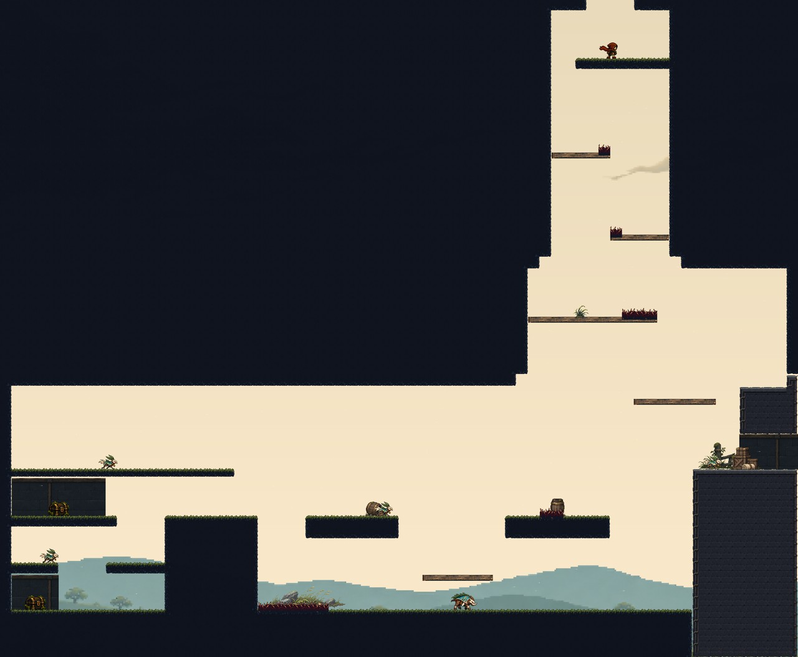
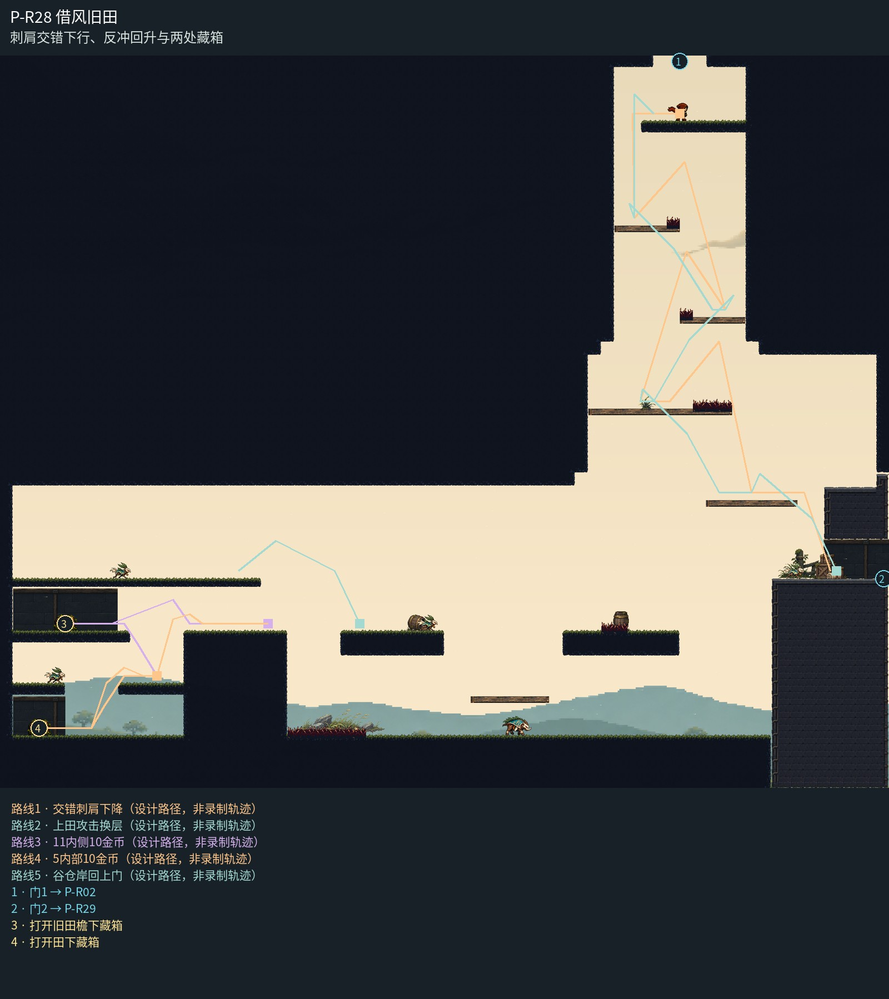

# P-R28 借风旧田

刺肩交错下行、反冲回升与两处藏箱。

田岸裂隙向下展开为开阔旧晒场，草沿厚岸、轻薄检修踏肩与田边货箱分清用途；低果林和独立流云按同一高度参照，西侧两处藏箱凹袋使用匹配净空的安静封闭背板，不填整座建筑图。移除浮空挂铃，装饰脚底落在实际宽岸。 侧向室内连接由实际上檐、短后墙和连续门岸形成围合，撤去独立门脸贴片；门位、净空与落脚保持。

[原尺寸整房图](https://raw.githubusercontent.com/zhipijun1996/gunman-rush/playtest-clockroute-57afe5fe/review/plains-final-art/P-R28/after.jpg) · [前后对比](https://raw.githubusercontent.com/zhipijun1996/gunman-rush/playtest-clockroute-57afe5fe/review/plains-final-art/P-R28/comparison.jpg) · [空间职责与出口图](https://raw.githubusercontent.com/zhipijun1996/gunman-rush/playtest-clockroute-57afe5fe/review/plains-final-art/P-R28/space-map.jpg) · [短片1](https://raw.githubusercontent.com/zhipijun1996/gunman-rush/playtest-clockroute-57afe5fe/review/plains-final-art/P-R28/P-R28-1.mp4) · [短片2](https://raw.githubusercontent.com/zhipijun1996/gunman-rush/playtest-clockroute-57afe5fe/review/plains-final-art/P-R28/P-R28-2.mp4)

整图为检查视口（1世界单位/源像素；预览已缩小），不是正式游戏缩放。对比使用相同世界范围；P33检查范围为(32,32,1984,992)。

正式控制器局部动作夹具；多数隔离敌人，镜头与游戏时间正常；起点夹具间已拆段，不代表连续通关或完整战斗 所有短片正常游戏时间、30fps；无快放。整房图保留敌人。未覆盖新档连续全收集、完整战斗难度、实体手机性能和用户终审。

## 路线与职责

- **交错刺肩下降**：顶门实体台减薄。1右端、2左端、3右端局部刺；各阶肩有安全观察岸，可用已有下看确认下一侧，沿9接到谷仓宽岸。
- **上田攻击换层**：保留朝右下守卫开枪、身体反冲左上的高效路线；西田上层仍可分步进入。
- **11内侧10金币**：上檐凹室净高104、开口128，短跳配横向反冲进入10金币藏箱岸；由错开的上口分两次各落128到下袋。
- **5内部10金币**：在160宽中台下看确认凹袋底面，128宽口进入96净高凹袋领取10金币藏箱；两次普通跳回原肩，不依赖怪物存活。
- **谷仓岸回上门**：从8经移高的9回到3，沿2、1回到薄0。井肩形成224、224、224、192的高差节奏；旧9承担回升，不额外堆浮台。

