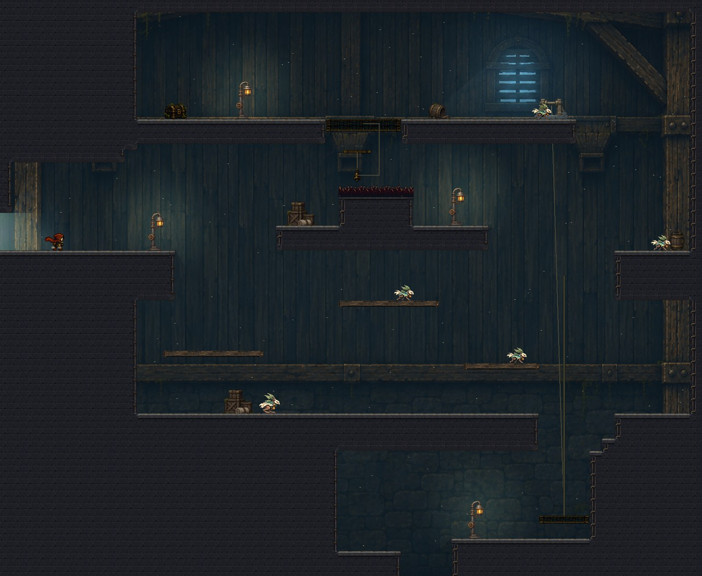
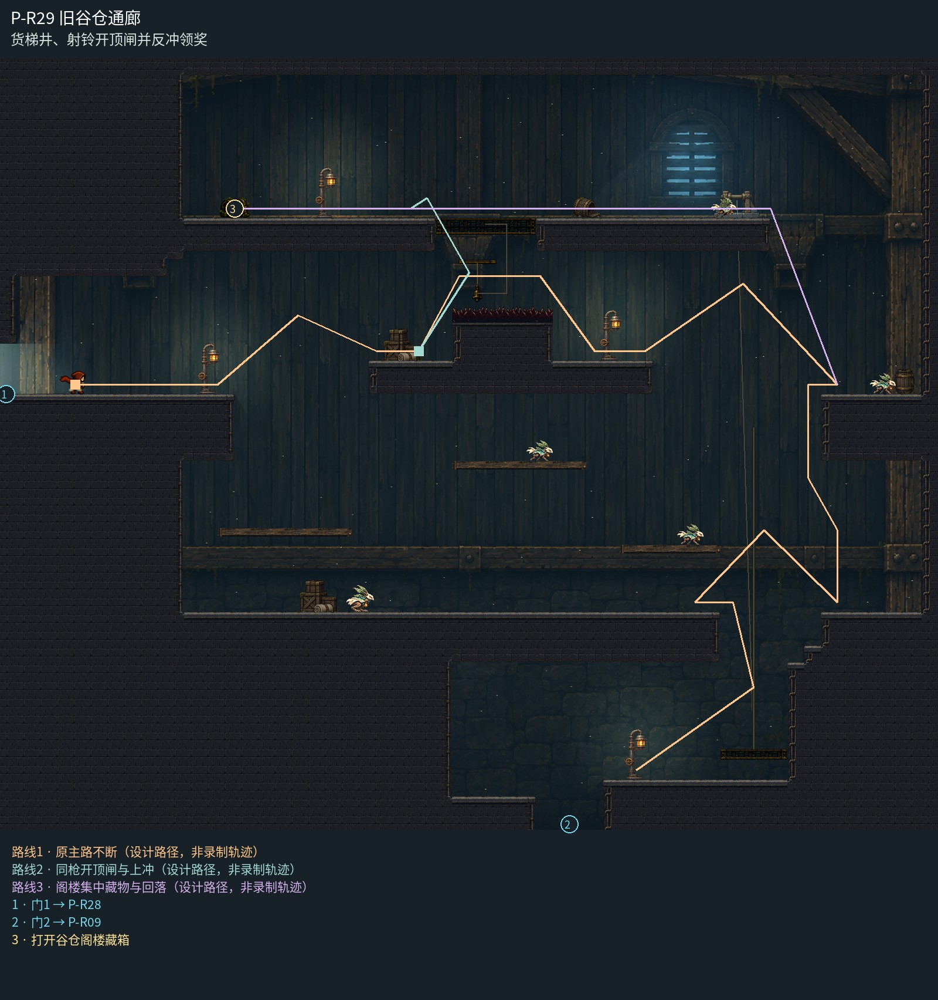

# P-R29 旧谷仓通廊

货梯井、射铃开顶闸并反冲领奖。

整座谷仓的高窗、阁楼后梁、中层宽木墙与下层石砌货井共同构图；低对比后墙不充当实平台，实际木踏板和石岸保持清楚。射铃顶闸与阁楼落点留净空，右侧绞盘对应真实货梯，箱堆和灯只放在实际宽岸。

[原尺寸整房图](https://raw.githubusercontent.com/zhipijun1996/gunman-rush/playtest-clockroute-57afe5fe/review/plains-final-art/P-R29/after.jpg) · [前后对比](https://raw.githubusercontent.com/zhipijun1996/gunman-rush/playtest-clockroute-57afe5fe/review/plains-final-art/P-R29/comparison.jpg) · [空间职责与出口图](https://raw.githubusercontent.com/zhipijun1996/gunman-rush/playtest-clockroute-57afe5fe/review/plains-final-art/P-R29/space-map.jpg) · [短片1](https://raw.githubusercontent.com/zhipijun1996/gunman-rush/playtest-clockroute-57afe5fe/review/plains-final-art/P-R29/P-R29-1.mp4) · [短片2](https://raw.githubusercontent.com/zhipijun1996/gunman-rush/playtest-clockroute-57afe5fe/review/plains-final-art/P-R29/P-R29-2.mp4)

整图为检查视口（1世界单位/源像素；预览已缩小），不是正式游戏缩放。对比使用相同世界范围；P33检查范围为(32,32,1984,992)。

正式控制器局部动作夹具；多数隔离敌人，镜头与游戏时间正常；起点夹具间已拆段，不代表连续通关或完整战斗 所有短片正常游戏时间、30fps；无快放。整房图保留敌人。未覆盖新档连续全收集、完整战斗难度、实体手机性能和用户终审。

## 路线与职责

- **原主路不断**：西岸到中梁，再接东岸货井。阁楼挑战位于中梁上方，不占货梯轨道。
- **同枪开顶闸与上冲**：在宽刺台上空向右下射近处悬铃。弹丸打开头顶限时闸，同一枪的向上反冲将身体送过闸口，随后落向左侧阁楼。
- **阁楼集中藏物与回落**：阁楼西端为一次性20金币藏箱；沿已闭合顶闸向东，处理宽地守卫后从东端落回主路。失败落回近端重试。

