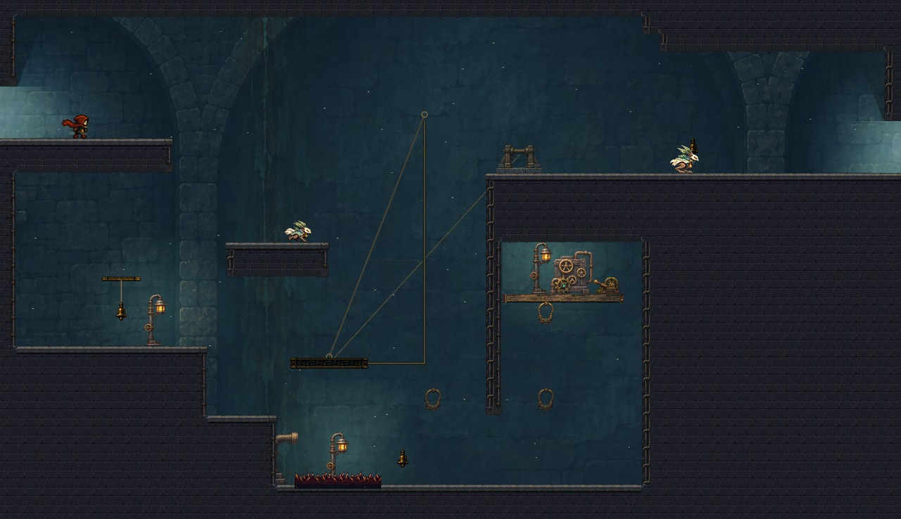
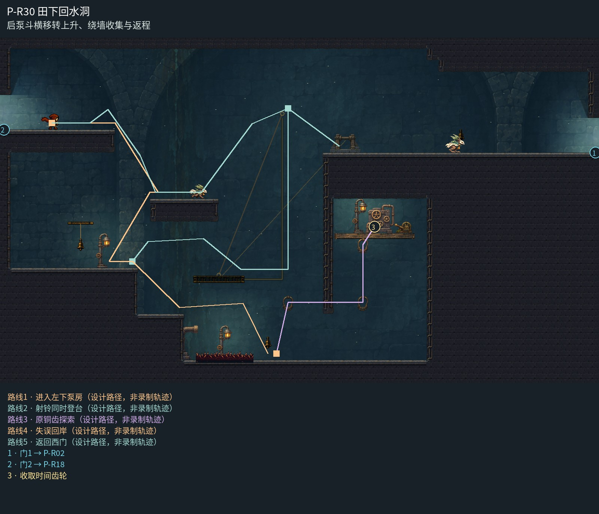

# P-R30 田下回水洞

启泵斗横移转上升、绕墙收集与返程。

整座田下泵房以连续管线后壁、左操作岸、中间吊斗井与东侧高岸组织；后层大拱不逐屏重复，近阀台和暖灯与实际站立面贴合，随动钢索解释横移转升降。右墙与上岸重叠部分从源数据裁清，保留原碰撞并集与全部机关行程。

[原尺寸整房图](https://raw.githubusercontent.com/zhipijun1996/gunman-rush/playtest-clockroute-57afe5fe/review/plains-final-art/P-R30/after.jpg) · [前后对比](https://raw.githubusercontent.com/zhipijun1996/gunman-rush/playtest-clockroute-57afe5fe/review/plains-final-art/P-R30/comparison.jpg) · [空间职责与出口图](https://raw.githubusercontent.com/zhipijun1996/gunman-rush/playtest-clockroute-57afe5fe/review/plains-final-art/P-R30/space-map.jpg) · [短片1](https://raw.githubusercontent.com/zhipijun1996/gunman-rush/playtest-clockroute-57afe5fe/review/plains-final-art/P-R30/P-R30-1.mp4) · [短片2](https://raw.githubusercontent.com/zhipijun1996/gunman-rush/playtest-clockroute-57afe5fe/review/plains-final-art/P-R30/P-R30-2.mp4)

整图为检查视口（1世界单位/源像素；预览已缩小），不是正式游戏缩放。对比使用相同世界范围；P33检查范围为(32,32,1984,992)。

正式控制器局部动作夹具；多数隔离敌人，镜头与游戏时间正常；起点夹具间已拆段，不代表连续通关或完整战斗 所有短片正常游戏时间、30fps；无快放。整房图保留敌人。未覆盖新档连续全收集、完整战斗难度、实体手机性能和用户终审。

## 路线与职责

- **进入左下泵房**：左入口的实心安全岸缩为320宽；下到中层泵台后向左折返，进入宽阔操作岸。中层泵台同时承担当期返左入口的落脚和巡逻遭遇。
- **射铃同时登台**：短跳时向身后开枪：子弹命中风铃，启动吊斗；同一枪反冲把玩家送上已在移动的吊斗。沿横轨转入中井上升，从上端向右走下东岸。允许先开铃再登台。
- **原铜齿探索**：下层东侧保留原来的H绕墙、三个钩点、TG03和返程折梯。只保留这一个真实收集目标，不新增散落金币或虚构奖励。
- **失误回岸**：底层越过短刺沟，登实体恢复台，再跳回操作岸；短跳漏枪则直接落在恢复台。下层和东岸的同组铃可以远程起停载台，错过班次可等其8秒周期回程。
- **返回西门**：从吊斗上端回落中层泵台，再从台的左端跳起，射向右下、反冲左上回到西侧入口。不是从井顶直接横跨到西门。

