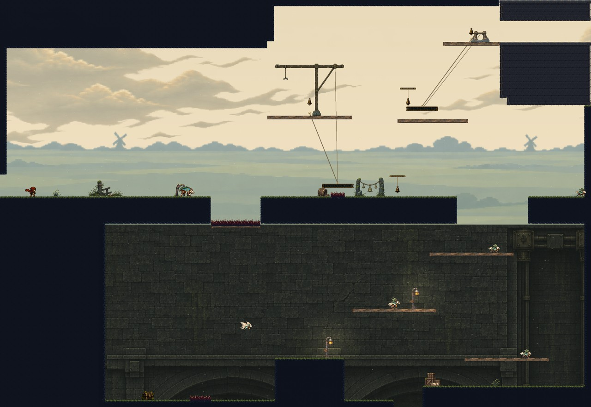
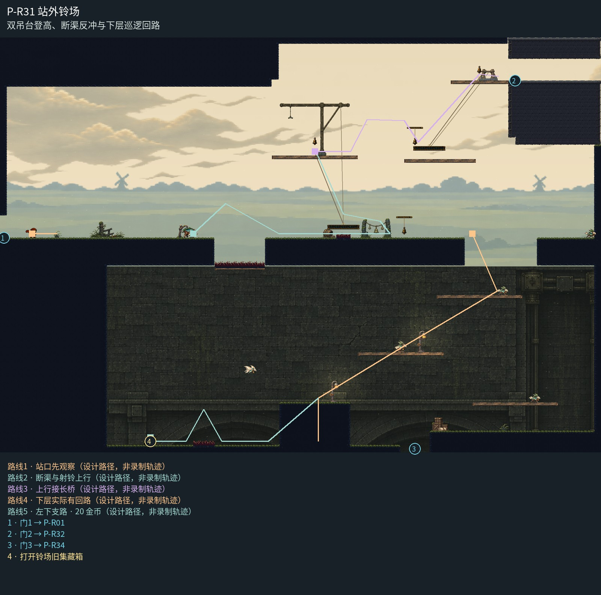

# P-R31 站外铃场

双吊台登高、断渠反冲与下层巡逻回路。

开敞铃场、双绞盘与下层渠壁统一编排；第一吊机落在检修台，第二绞盘接上层岸，绳随载台伸缩。下层以低对比连续渠壁衬托回访岸，完整显示实心回升墩，灯具落在真实岸面。东上门接长桥实体，不附加门脸。

[原尺寸整房图](https://raw.githubusercontent.com/zhipijun1996/gunman-rush/playtest-clockroute-57afe5fe/review/plains-final-art/P-R31/after.jpg) · [前后对比](https://raw.githubusercontent.com/zhipijun1996/gunman-rush/playtest-clockroute-57afe5fe/review/plains-final-art/P-R31/comparison.jpg) · [空间职责与出口图](https://raw.githubusercontent.com/zhipijun1996/gunman-rush/playtest-clockroute-57afe5fe/review/plains-final-art/P-R31/space-map.jpg) · [短片1](https://raw.githubusercontent.com/zhipijun1996/gunman-rush/playtest-clockroute-57afe5fe/review/plains-final-art/P-R31/P-R31-1.mp4) · [短片2](https://raw.githubusercontent.com/zhipijun1996/gunman-rush/playtest-clockroute-57afe5fe/review/plains-final-art/P-R31/P-R31-2.mp4)

整图为检查视口（1世界单位/源像素；预览已缩小），不是正式游戏缩放。对比使用相同世界范围；P33检查范围为(32,32,1984,992)。

正式控制器局部动作夹具；多数隔离敌人，镜头与游戏时间正常；起点夹具间已拆段，不代表连续通关或完整战斗 所有短片正常游戏时间、30fps；无快放。整房图保留敌人。未覆盖新档连续全收集、完整战斗难度、实体手机性能和用户终审。

## 路线与职责

- **站口先观察**：入口站位与失败恢复保持安全距离，向前进入遭遇后再选择上行或下路。
- **断渠与射铃上行**：先越局部断渠；回身向右下射铃，身体向左上反冲，接上已启动的第一吊台。允许先启动后登台。
- **上行接长桥**：上层净空容纳完整身体轨迹；反冲跨到第二吊台，启动后去长桥。精密换乘区移走远程守卫和俯冲怪。
- **下层实际有回路**：8和10平台各有巡逻体；先在宽落点处理守卫，再沿原9/12回升。左下地刺后集中20金币，原下层俯冲怪守接近空域，取币后可沿同路返回。
- **左下支路 · 20 金币**：跨底部96宽地刺到左侧20金币藏箱；宽岸供战斗和回跳，领取后沿原路返回上层。

