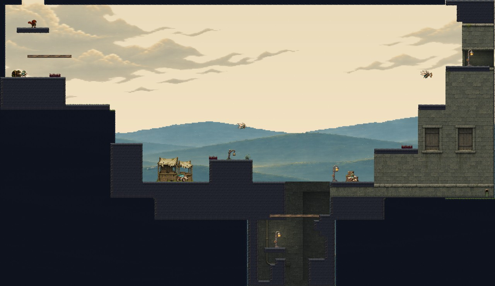
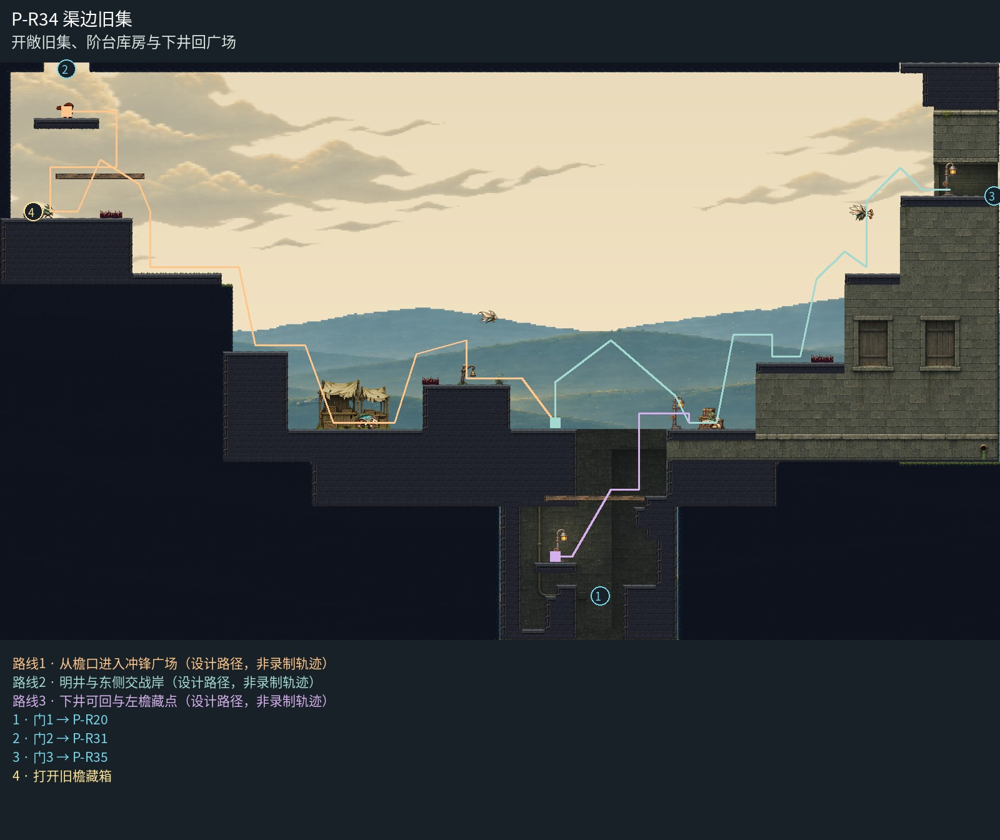

# P-R34 渠边旧集

开敞旧集、阶台库房与下井回广场。

开敞天空与低原野包住疏落旧集，低摊棚落在广场，保留稀疏遗弃集市气氛；西檐、纪念台、东侧连续旧建筑分担遭遇与登高。右上厚墙／门槛／檐口共同形成侧向转运通道，下井使用封闭背墙与井岸暖灯。

[原尺寸整房图](https://raw.githubusercontent.com/zhipijun1996/gunman-rush/playtest-clockroute-57afe5fe/review/plains-final-art/P-R34/after.jpg) · [前后对比](https://raw.githubusercontent.com/zhipijun1996/gunman-rush/playtest-clockroute-57afe5fe/review/plains-final-art/P-R34/comparison.jpg) · [空间职责与出口图](https://raw.githubusercontent.com/zhipijun1996/gunman-rush/playtest-clockroute-57afe5fe/review/plains-final-art/P-R34/space-map.jpg) · [短片1](https://raw.githubusercontent.com/zhipijun1996/gunman-rush/playtest-clockroute-57afe5fe/review/plains-final-art/P-R34/P-R34-1.mp4) · [短片2](https://raw.githubusercontent.com/zhipijun1996/gunman-rush/playtest-clockroute-57afe5fe/review/plains-final-art/P-R34/P-R34-2.mp4)

整图为检查视口（1世界单位/源像素；预览已缩小），不是正式游戏缩放。对比使用相同世界范围；P33检查范围为(32,32,1984,992)。

正式控制器局部动作夹具；多数隔离敌人，镜头与游戏时间正常；起点夹具间已拆段，不代表连续通关或完整战斗 所有短片正常游戏时间、30fps；无快放。整房图保留敌人。未覆盖新档连续全收集、完整战斗难度、实体手机性能和用户终审。

## 路线与职责

- **从檐口进入冲锋广场**：入口由门台右侧下落，越过左檐短刺后进入广场；冲锋线与低纪念台提供越敌换边，空中俯冲怪争夺高点。从上层落入宽岸交战，失手在低层重新组织路线。
- **明井与东侧交战岸**：井口与宽阶地接第二组局部遭遇。跃击怪争夺底岸，空哨在上层转角封线；沿一体建筑的三层高差反冲登高。
- **下井可回与左檐藏点**：下井门岸从右缘起跳，避开左广场实体投影，经宽穿透井肩回到广场；西檐集中15金币箱由独立巡逻守护。下井接P20回水洞，门对沿正式施工状态开放。

