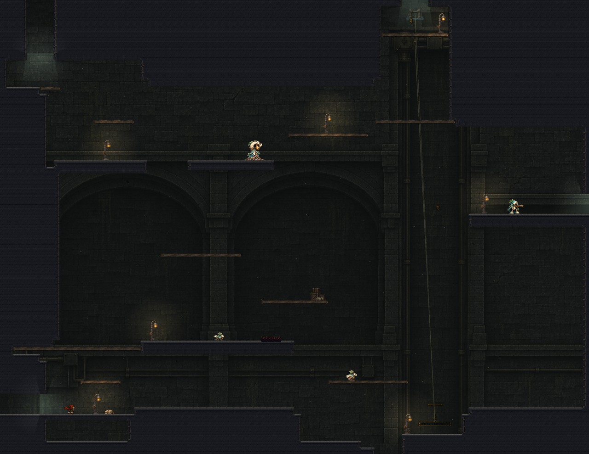
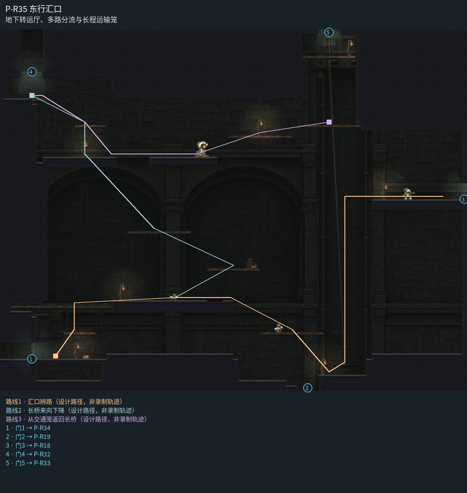

# P-R35 东行汇口

地下转运厅、多路分流与长程运输笼。

塔下地下转运厅：上层检修廊接长桥，中央大拱背墙解释挑空与分层转运，右侧交通笼由实体绞盘和随动绳承托，宽石岸与轻木检修台区分可站立面。灯具沿分路和接收岸定位；背景不出现室外天空。

[原尺寸整房图](https://raw.githubusercontent.com/zhipijun1996/gunman-rush/playtest-clockroute-57afe5fe/review/plains-final-art/P-R35/after.jpg) · [前后对比](https://raw.githubusercontent.com/zhipijun1996/gunman-rush/playtest-clockroute-57afe5fe/review/plains-final-art/P-R35/comparison.jpg) · [空间职责与出口图](https://raw.githubusercontent.com/zhipijun1996/gunman-rush/playtest-clockroute-57afe5fe/review/plains-final-art/P-R35/space-map.jpg) · [短片1](https://raw.githubusercontent.com/zhipijun1996/gunman-rush/playtest-clockroute-57afe5fe/review/plains-final-art/P-R35/P-R35.mp4)

整图为检查视口（1世界单位/源像素；预览已缩小），不是正式游戏缩放。对比使用相同世界范围；P33检查范围为(32,32,1984,992)。

连续入场、射铃、下穿登笼、运输、跳离；敌人保留。 所有短片正常游戏时间、30fps；无快放。整房图保留敌人。未覆盖新档连续全收集、完整战斗难度、实体手机性能和用户终审。

## 路线与职责

- **汇口辨路**：保留五向枢纽与交通笼，主岸轻战斗；平台2右侧局部刺约束下行选择，进入载台前仍有安静观察位。
- **长桥来向下降**：长桥来向仍可沿左侧落入中层；新增16肩台也承担返回上口的抬升。
- **从交通笼返回长桥**：交通笼在上层岸12出笼后，经15、14、8、16、7返回长桥；补上原来缺失的西向接续，避免从同一路径硬顶448高差。根铃在实心宽岸14预警，右射打断同时反冲向左侧桥岸；可先清理再跳。

